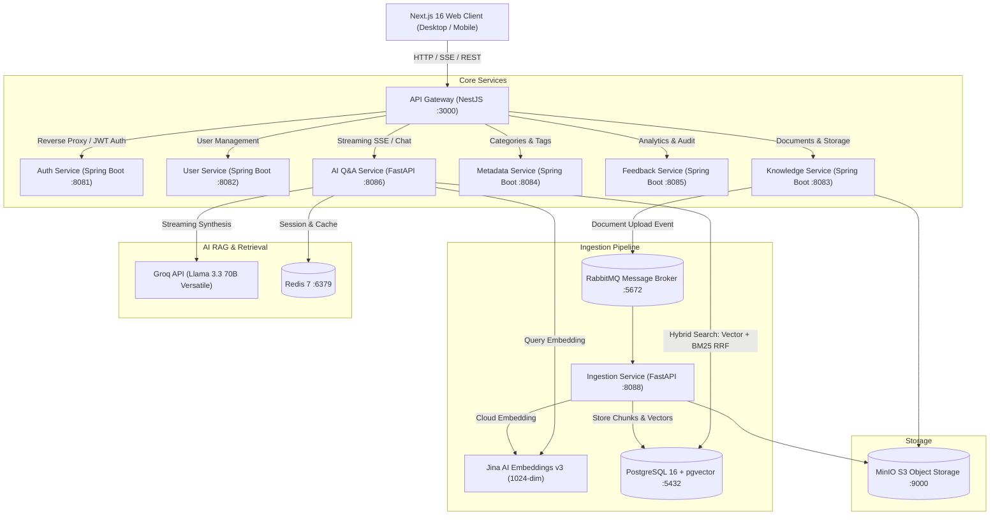

# SOPilot 🧭

> **Your Autonomous SOP & Enterprise Policy AI Copilot**  
> *Transform complex internal policies into verified, instant answers with department-level RBAC & semantic search.*

[](https://nextjs.org/)
[](https://spring.io/projects/spring-boot)
[](https://fastapi.tiangolo.com/)
[](https://nestjs.com/)
[](https://github.com/pgvector/pgvector)
[](https://www.docker.com/)

---

## 📖 Overview

**SOPilot** is a production-ready, cloud-native Enterprise Knowledge & Policy Assistant. It resolves the classic organization problem: *policies, guidelines, and SOPs buried inside 50-page PDFs across Google Drive, Notion, and email threads where nobody reads them and HR/Operations teams spend hours answering repetitive questions*.

With **SOPilot**, employees ask in natural language (Vietnamese or English) and receive concise, evidence-backed answers in 1–2 seconds, complete with document citations, page references, and in-app previews—all protected by strict **Department-level Role-Based Access Control (RBAC)**.

---

## 🏗️ System Architecture

SOPilot is designed as an **Event-Driven Microservices Architecture** optimized for high performance and low resource footprint:



---

## ✨ Key Features

- **⚡ Blazing Fast Streaming RAG:** Hybrid retrieval (Dense vector search via pgvector + Sparse BM25 via Reciprocal Rank Fusion) synthesized through Groq Llama 3.3 70B in under 2 seconds.
- **🛡️ Multi-Tenant Departmental RBAC:** Documents are classified by department (Engineering, HR, Finance, Operations). Sales employees cannot retrieve sensitive Finance or Executive salary policies.
- **📄 Native Document Preview:** Built-in PDF and DOCX reader (`mammoth`) with highlighted source citations—no heavy external document server required.
- **🔄 Closed-Loop Feedback & Unanswered Queue:** Questions that the AI cannot answer are automatically dispatched to the `/admin/unanswered` dashboard for HR managers to review, resolve, and update policies.
- **🌱 Low-Resource Profile:** Engineered to run on standard low-spec VPS (2GB–4GB RAM) using JVM Serial Garbage Collection (`-XX:+UseSerialGC`) and Cloud Embedding API (saving 12GB+ RAM).

---

## 🚀 Quick Start

### Prerequisites
- [Docker](https://docs.docker.com/get-docker/) & Docker Compose (v2.20+)
- [Git](https://git-scm.com/)

### 1. Clone Repository
```bash
git clone https://github.com/<your-username>/sopilot.git
cd sopilot
```

### 2. Configure Environment
Copy `.env.example` to `.env`:
```bash
cp .env.example .env
```
Ensure you provide your **Groq API Key** and **Jina AI Embedding Key** in `.env`:
```env
EMBEDDING_URL=https://api.jina.ai
EMBEDDING_API_KEY=your_jina_api_key_here
EMBEDDING_MODEL=jina-embeddings-v3
GROQ_API_KEY=your_groq_api_key_here
```

### 3. Launch Services
```bash
docker compose up -d --build
```

### 4. Access Application
- **Web Portal:** [http://localhost:3000](http://localhost:3000)
- **API Gateway:** [http://localhost:3001](http://localhost:3001)
- **Default Admin Account:** `admin` / `Admin@123456`
- **MinIO Storage Console:** [http://localhost:9001](http://localhost:9001)
- **RabbitMQ Management:** [http://localhost:15672](http://localhost:15672)

---

## 🛠️ Technology Stack

| Layer | Technologies |
| :--- | :--- |
| **Frontend** | Next.js 16 (App Router, Turbopack), React 19, TypeScript, Tailwind CSS, Lucide |
| **API Gateway** | NestJS 11, RxJS, Opossum Circuit Breaker, Winston Logger |
| **Microservices** | Spring Boot 3.2 (Java 17), Spring Data JPA, Spring Security, Feign Client |
| **AI / NLP Engine** | FastAPI, Python 3.12, LangChain, Tiktoken, Groq SDK |
| **Database & Vector** | PostgreSQL 16, `pgvector` (1024-dim cosine distance), HNSW indexing |
| **Embeddings** | Jina AI Embeddings v3 (Cloud API) |
| **LLM Provider** | Groq Llama 3.3 70B Versatile, Llama 3.1 8B Instant |
| **Message Broker** | RabbitMQ 3.13 (Topic Exchange, Dead Letter Exchange) |
| **Cache & Session** | Redis 7.2 Alpine |
| **Object Storage** | MinIO (S3 Compatible) |

---

## 📄 License
This project is licensed under the MIT License.
