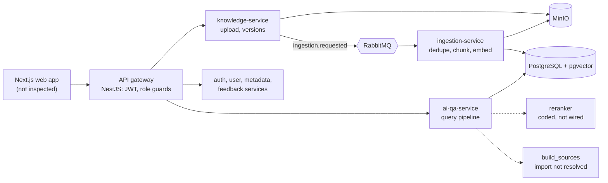

# SOPilot

SOPilot answers questions about internal procedures and policies (SOPs). Employees ask in Vietnamese or English and are meant to get a cited answer drawn only from documents their role and department may read. Administrators upload and version documents and review questions the system could not answer.

It is a personal project, built to learn and demonstrate backend engineering: service boundaries, asynchronous ingestion, retrieval, and access control. A reviewer can use it to look at how those problems were handled and where they were not.

**Start here:** [Engineering case study](docs/portfolio/engineering-case-study.md) · [Implementation evidence and status](docs/portfolio/implementation-evidence.md) · [Documentation hub](docs/README.md)

## Current status

- **V2 (active):** a rebuild into two services (`core-api`, `ai-service`) that trims and reworks almost all of V1. Done so far: specifications ([PRD](docs/01-requirements/PRD-V2-sopilot-mvp.md), [ADR-004](docs/02-architecture/adr/ADR-004-two-service-architecture.md) and others, 33 tickets), a retrieval-evaluation harness, and local database/storage infrastructure. Not yet built: the two services and any end-to-end V2 flow. Ticket counts are not a completion measure.
- **V1 (frozen):** eight services, from a course project built with a classmate. I audited it and found problems on its question-answering path (below); those findings drive V2.
- **Source is private.** There is no public repository, live demo or screenshot set. Links resolve only with repository access.
- No evidence of real users, deployment or measured performance exists.

## My contribution

I own V2 and am building it alone. In V1 I wrote the AI module (full RAG path), document ingestion and preprocessing, the database design, the unanswered-question feature and the related frontend. A classmate worked on the rest of V1. I use AI tools while building this project.

## What V2 is meant to show

| Backend | Applied AI |
|---|---|
| Transactional outbox, honest consistency boundaries | Evaluation before implementation |
| Tenant isolation with row-level security | Hybrid retrieval with BM25 matched to the harness |
| Versioned migrations, ADRs with rejected options | Refusal-threshold calibration, Vietnamese and cross-lingual handling |

These are design goals; [implementation evidence](docs/portfolio/implementation-evidence.md) shows what exists.

## Current architecture (V1, frozen; V2 is in the case study)

The edges show only the paths covered in the case study; the other services own their schemas but were not traced in detail. Redis is part of the stack and is not drawn.

## Engineering highlights

1. **Upload-to-index consistency.** Object storage, database, broker and index cannot share a transaction. The case study traces where V1 is atomic (the chunk swap in one database transaction) and where it is not (storage write before commit, swallowed publish failures): [section 1](docs/portfolio/engineering-case-study.md#1-upload-to-searchable-chunks-consistency-at-the-boundaries).
2. **Permission-aware retrieval and honest naming.** Access rules are applied inside the retrieval SQL, before ranking. The "BM25" side is actually PostgreSQL `ts_rank`, and the reranker is not on the active path: [section 2](docs/portfolio/engineering-case-study.md#2-retrieval-and-permission-aware-access).
3. **Evaluation scope.** A retrieval-only harness with real BM25, guard rails against silent fallbacks, and results explicitly limited to document/page proxies: [section 3](docs/portfolio/engineering-case-study.md#3-evaluation-what-the-metrics-measure).

Each highlight pairs the V1 finding with the proposed V2 design. For the V2 consolidation and its reasons, see the case study's V2 section and [ADR-004](docs/02-architecture/adr/ADR-004-two-service-architecture.md). The V2 services are not implemented.

## Where to read next

| Document | Purpose |
|---|---|
| [Engineering case study](docs/portfolio/engineering-case-study.md) | Decisions, trade-offs and failure modes |
| [Implementation evidence](docs/portfolio/implementation-evidence.md) | Per-capability status, source paths, tests, evaluation scope |
| [Documentation hub](docs/README.md) | PRDs, ADRs, technical designs, plans, audits (mostly Vietnamese) |
| [AGENTS.md](AGENTS.md) | Repository layout, rules and commands |
| [`eval/README.md`](eval/README.md) | Evaluation harness usage |

## Getting started

Not verified: these commands were not run while writing this documentation.

- **V1 stack:** copy `.env.example` to `.env`, fill in provider keys, then `docker compose up -d --build` from the repository root. The web app is on port 3000 and the gateway on 3001. The LLM and embedding providers need external API keys, and CLAUDE.md records that some configured LLM model IDs have been retired.
- **V2 database and storage:** follow [infrastructure/db/README.md](infrastructure/db/README.md) (`docker-compose.v2.yml`; run one stack at a time).
- **Evaluation harness:** `cd eval && uv sync --extra dev && uv run pytest -q`, per [eval/README.md](eval/README.md).
- Build, lint and test commands per service are in [AGENTS.md](AGENTS.md).

## Known limitations and next steps

- V1 answer generation path: `pipeline_orchestrator.py` imports a `build_sources` function I could not find; the reranker is not connected; document/category filters appear unreachable from the chat request. Runtime behavior is unconfirmed.
- Document access rules are copied onto chunks at ingestion; no update path was found when visibility changes.
- Configuration drift (bucket names, exchange names, a retired-model list) is recorded in [CLAUDE.md](CLAUDE.md#known-doccode-drift-verify-before-relying-on-docs).
- No official retrieval results exist; the evaluation datasets are drafts.
- Next: first official retrieval results (BM25 vs dense vs hybrid on a reviewed dataset), then the two V2 services ([PLAN-V2](docs/03-plans/PLAN-V2-sopilot-mvp.md)).

A license has not been chosen; the repository contains no `LICENSE` file.
