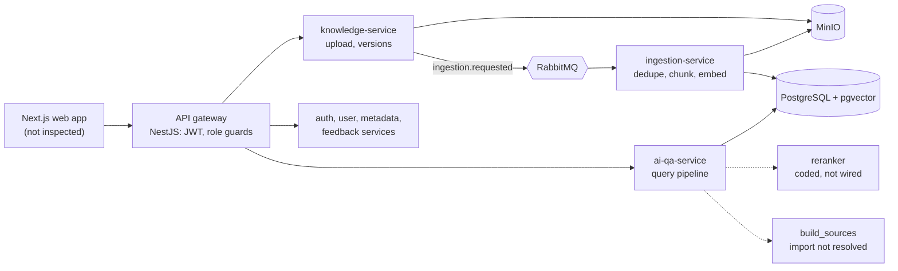

# SOPilot

SOPilot answers questions about internal procedures and policies (SOPs). Employees ask in Vietnamese or English and are meant to get a cited answer drawn only from documents their role and department may read. Administrators upload and version documents and review questions the system could not answer.

It is a personal project, built to learn and demonstrate backend engineering: service boundaries, asynchronous ingestion, retrieval, and access control. A reviewer can use it to look at how those problems were handled and where they were not.

**Start here:** [Engineering case study](docs/portfolio/engineering-case-study.md) · [Implementation evidence and status](docs/portfolio/implementation-evidence.md) · [Documentation hub](docs/README.md)

## Current status

- **V2 (active):** a rebuild into two services (`core-api`, `ai-service`) that trims and reworks almost all of V1. Done so far: specifications ([PRD](docs/product/prd-v2-sopilot-mvp.md), [ADR-004](docs/architecture/decisions/adr-004-two-service-architecture.md) and others, 33 tickets), a retrieval-evaluation harness, local database/storage infrastructure, and parts of both services (core-api identity, workspaces, documents and outbox; ai-service ingestion, extraction, chunking and retrieval). Not yet built: the question-answering pipeline, the V2 frontend and any end-to-end V2 flow. Ticket counts are not a completion measure; status per capability is in [implementation evidence](docs/portfolio/implementation-evidence.md).
- **V1 (frozen):** eight services, from a course project built with a classmate. I audited it and found problems on its question-answering path (below); those findings drive V2.
- **Source is public** at [N-Tien-L/SOPilot](https://github.com/N-Tien-L/SOPilot). There is no live demo or screenshot set.
- No evidence of real users, deployment or measured performance exists.

## My contribution

I own V2 and am building it alone. In V1 I wrote the AI module (full RAG path), document ingestion and preprocessing, the database design, the unanswered-question feature and the related frontend. A classmate worked on the rest of V1. I use AI tools while building this project.

## What V2 is meant to show

| Backend | Applied AI |
|---|---|
| Transactional outbox, honest consistency boundaries | Evaluation before implementation |
| Tenant isolation with row-level security | Hybrid retrieval with BM25 matched to the harness |
| Versioned migrations, ADRs with rejected options | Refusal-threshold calibration, Vietnamese and cross-lingual handling |

These are design goals; [implementation evidence](docs/portfolio/implementation-evidence.md) shows what exists.

## Current architecture (V1, frozen; V2 is in the case study)



The edges show only the paths covered in the case study; the other services own their schemas but were not traced in detail. Redis is part of the stack and is not drawn.

## Engineering highlights

1. **Upload-to-index consistency.** Object storage, database, broker and index cannot share a transaction. The case study traces where V1 is atomic (the chunk swap in one database transaction) and where it is not (storage write before commit, swallowed publish failures): [section 1](docs/portfolio/engineering-case-study.md#1-upload-to-searchable-chunks-consistency-at-the-boundaries).
2. **Permission-aware retrieval and honest naming.** Access rules are applied inside the retrieval SQL, before ranking. The "BM25" side is actually PostgreSQL `ts_rank`, and the reranker is not on the active path: [section 2](docs/portfolio/engineering-case-study.md#2-retrieval-and-permission-aware-access).
3. **Evaluation scope.** A retrieval-only harness with real BM25, guard rails against silent fallbacks, and results explicitly limited to document/page proxies: [section 3](docs/portfolio/engineering-case-study.md#3-evaluation-what-the-metrics-measure).

Each highlight pairs the V1 finding with the proposed V2 design. For the V2 consolidation and its reasons, see the case study's V2 section and [ADR-004](docs/architecture/decisions/adr-004-two-service-architecture.md). The V2 services are only partly implemented (see the status above).

## Where to read next

| Document | Purpose |
|---|---|
| [Engineering case study](docs/portfolio/engineering-case-study.md) | Decisions, trade-offs and failure modes |
| [Implementation evidence](docs/portfolio/implementation-evidence.md) | Per-capability status, source paths, tests, evaluation scope |
| [Documentation hub](docs/README.md) | PRDs, ADRs, technical designs, plans, audits (mostly Vietnamese) |
| [CLAUDE.md](CLAUDE.md) | Repository layout, rules and commands (Claude Code; details in `.claude/`) |
| [`eval/README.md`](eval/README.md) | Evaluation harness usage |

## Getting started

### SOPilot V2 (One-Command Stack)

> [!NOTE]
> System Requirements: Minimum 4 CPU cores, 8GB RAM, Docker Engine 24+ and Docker Compose v2.

1. **Configure Environment:**
   Copy the root `.env.example` to `.env` (Git-ignored) and replace every `<placeholder>`. Compose refuses to start unless these are set:
   - `V2_POSTGRES_SUPERUSER_PASSWORD`, `V2_DB_MIGRATOR_PASSWORD`, `V2_DB_CORE_APP_PASSWORD`, `V2_DB_AI_APP_PASSWORD`
   - `V2_MINIO_ROOT_USER`, `V2_MINIO_ROOT_PASSWORD`, `SOPILOT_S3_ACCESS_KEY`, `SOPILOT_S3_SECRET_KEY`, `SOPILOT_S3_AI_ACCESS_KEY`, `SOPILOT_S3_AI_SECRET_KEY`
   - `SOPILOT_INTERNAL_TOKEN` (shared secret between core-api and ai-service)
   - `SOPILOT_LLM_BASE_URL` (Modal endpoint, ending in `/v1`) and `SOPILOT_LLM_API_KEY` (the Modal `VLLM_API_KEY`)

   Generate secrets with `openssl rand -hex 32`. Optional: `SOPILOT_GROQ_API_KEY` for metadata suggestions (see step 5).
   ```bash
   cp .env.example .env
   ```
2. **Start the Entire V2 Stack:**
   One command builds and runs Postgres (with pgvector), Flyway migrations, MinIO object storage, `core-api` (Spring Boot), `ai-service` (FastAPI), `ai-worker`, and the `web` image:
   ```bash
   docker compose -f docker-compose.v2.yml up -d --build
   ```
   > [!WARNING]
   > The `web` image is still wired to the V1 gateway (`api-gateway:3001`, Bearer token in `localStorage`) until ticket V2-15. Use the API on `http://localhost:8080` and `http://localhost:8000` for the V2 demo, not the web UI.
   >
   > The embedding model `BAAI/bge-m3` is downloaded from Hugging Face on the first ingest and cached in the container; the first upload is slow and needs network access.
3. **Seed Demo Data:**
   Run the idempotent seeding script once core-api is healthy. It creates the demo workspace `SOPilot Demo Workspace`, departments "Kỹ thuật" and "Nhân sự", and two members who are invited and then accept through dev login: `engineer@sopilot.local` ("Kỹ thuật", made the department's publisher, ADR-009) and `hr@sopilot.local` ("Nhân sự"). The owner uploads two workspace-wide SOPs; the engineer uploads one SOP limited to "Kỹ thuật" (UC-10: the engineer sees 3 documents, the HR member sees 2). All files are tracked in `eval/datasets/`. A second run changes nothing. The final output prints the actual counts and the exit code is 1 if any step failed.
   ```powershell
   ./scripts/seed-demo.ps1
   ```
   Three documents are far below the default document limits (50 documents / 200 MB, FR-09), so no limit variable needs to be set.
4. **Dev Login (No Google OAuth Required):**
   In `local` profile, use the built-in dev login endpoint:
   ```http
   POST http://localhost:8080/api/v1/auth/dev-login
   Content-Type: application/json

   { "email": "demo-owner@sopilot.local", "displayName": "Demo Owner" }
   ```
   The `local` profile generates the JWT signing key in memory at each core-api start. A restart invalidates all issued tokens; sign in again (dev login) after a restart. Data in Postgres and MinIO is kept.
5. **LLM Provider Configuration & Missing Key Behavior:**
   - Answers: `ai-service` calls one OpenAI-compatible endpoint (self-hosted vLLM on Modal, ADR-006 §4.4) configured by `SOPILOT_LLM_BASE_URL`, `SOPILOT_LLM_API_KEY` and `SOPILOT_LLM_MODEL` (default `Qwen/Qwen3.5-9B` in compose). `SOPILOT_LLM_BASE_URL` and `SOPILOT_LLM_API_KEY` are required: compose stops with a message naming the missing variable instead of starting with a dummy endpoint.
   - Metadata suggestions (V2-25): `ai-worker` reads `SOPILOT_GROQ_API_KEY`. It is optional. Without it the worker logs `suggest_key_missing` and suggestions fall back to rules only (no LLM call); the rest of the stack works.
   - If the Modal endpoint is unreachable or times out, a question fails with the stable code `LLM_UNAVAILABLE` and is not retried against another provider after the first token. The Modal container cold start can take minutes; warm it before a demo (`infrastructure/modal/README.md`).
   - Time to first answer has not been measured on a clean clone; no latency figure is claimed here.
6. **Measure time to first token (optional, real provider):** with the stack up, the demo seeded and the Modal endpoint warm, `./scripts/measure-ttft.ps1` asks 15 questions in new conversations and 15 follow-ups (with the rewrite call) through `POST /ai/v1/conversations/{id}/messages` and writes P50/P95, spread, hardware and outcomes to `eval/results/ttft/` (PRD-V2 NFR target: P95 < 3 s). `./scripts/measure-ingest-latency.ps1` does the same for upload, READY and suggestion times.

### Evaluation Harness & Development

- **Evaluation harness:** `cd eval && uv sync --extra dev && uv run pytest -q`, per [eval/README.md](eval/README.md).
- **V1 legacy stack (frozen):** `docker compose up -d --build` (runs legacy 8 services, ports 3000/3001).
- Build, lint and test commands per service are in [CLAUDE.md](CLAUDE.md).

## Known limitations and next steps

- V1 answer generation path: `pipeline_orchestrator.py` imports a `build_sources` function I could not find; the reranker is not connected; document/category filters appear unreachable from the chat request. Runtime behavior is unconfirmed.
- Document access rules are copied onto chunks at ingestion; no update path was found when visibility changes.
- Configuration drift (bucket names, exchange names, a retired-model list) is recorded in [CLAUDE.md](CLAUDE.md#known-v2-doccode-drift-verify-before-relying-on-docs). V1 is frozen, so these items are documented and not fixed.
- No official retrieval results exist; the evaluation datasets are drafts.
- Next: first official retrieval results (BM25 vs dense vs hybrid on a reviewed dataset), then the two V2 services ([PLAN-V2](docs/03-plans/PLAN-V2-sopilot-mvp.md)).

Licensed under the [MIT License](LICENSE). Third-party material in the repository (GitLab Handbook excerpts under CC BY-SA 4.0) is listed in [THIRD_PARTY_NOTICES.md](THIRD_PARTY_NOTICES.md).
