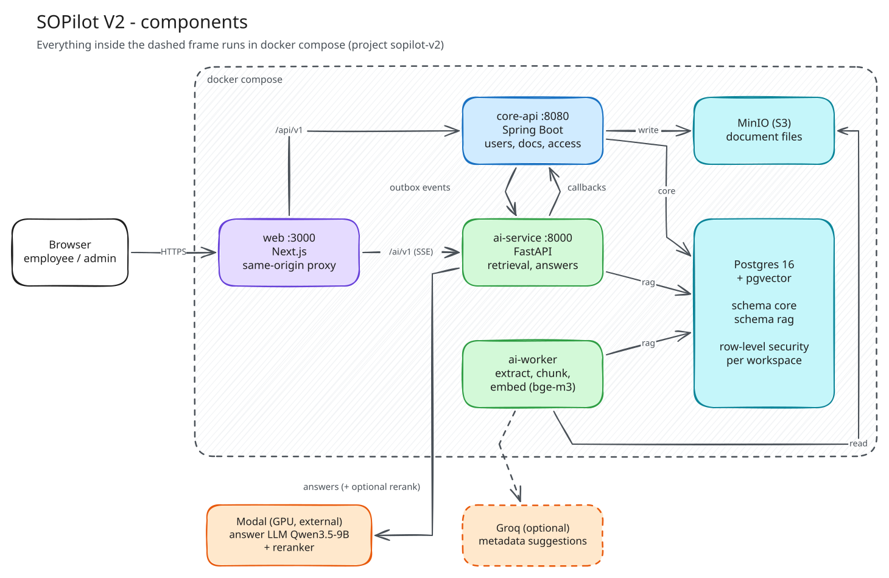
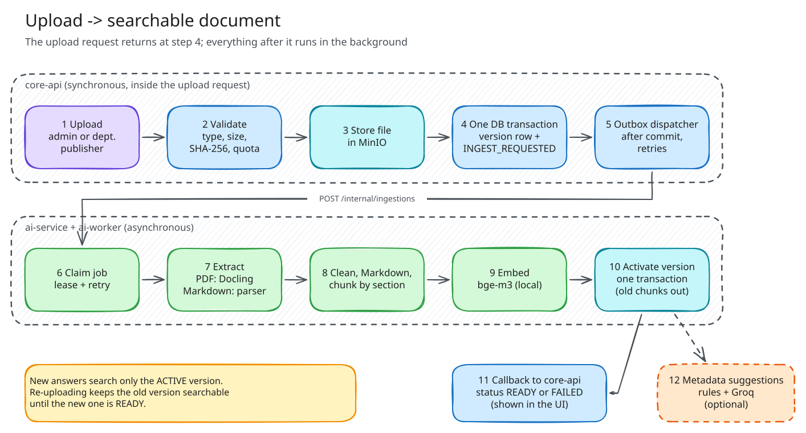
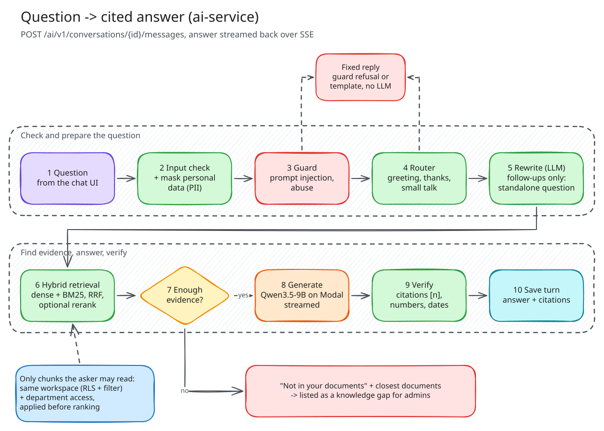

# SOPilot

**Ask questions about your company's procedures (SOPs) and get answers that cite the exact source.**

Employees ask in Vietnamese or English. SOPilot answers only from documents that their workspace, role and department are allowed to read. Every claim links to the passage in its source document. When the documents do not hold the answer, SOPilot says so, and the question is listed as a knowledge gap for admins.

University research project (NCKH) and portfolio piece, built and run **locally only** (no hosted demo). License: [MIT](LICENSE).



| Component | Stack | Job |
|---|---|---|
| `web` | Next.js 16, React 19 | Chat with citations, documents, members, knowledge gaps |
| `core-api` | Spring Boot 3.5, Java 21 | Sign-in, workspaces, departments, document upload and access |
| `ai-service` + `ai-worker` | FastAPI, Python 3.11+ | Extraction, chunking, embeddings, hybrid retrieval, answers |
| Postgres 16 + pgvector | Flyway migrations | Two schemas (`core`, `rag`) with row-level security per workspace |
| MinIO | S3 API | Uploaded files |
| Modal (external) | vLLM on a GPU | Answer model and reranker ([setup](infrastructure/modal/README.md)) |

## Quick start

**You need:** Docker Engine 24+ with Compose v2, 4 CPU cores and 8 GB RAM (an estimate), PowerShell for the seed script, and a running Modal endpoint for answers.

**1. Configure.** Copy the sample file, then replace every `<placeholder>` in `.env`:

```bash
cp .env.example .env
```

| Variables | Value |
|---|---|
| `V2_POSTGRES_SUPERUSER_PASSWORD`, `V2_DB_*_PASSWORD`, `V2_MINIO_ROOT_PASSWORD`, `SOPILOT_S3_*_SECRET_KEY`, `SOPILOT_INTERNAL_TOKEN` | Random secrets: `openssl rand -hex 32` |
| `SOPILOT_LLM_BASE_URL`, `SOPILOT_LLM_API_KEY` | Your Modal endpoint (ends in `/v1`) and its `VLLM_API_KEY` |
| `GOOGLE_CLIENT_ID` | Required by the build. Any value works if you only use Dev sign-in |
| `SOPILOT_GROQ_API_KEY` | Optional. Without it, metadata suggestions use rules only |

Compose refuses to start and names the missing variable if one is unset.

**2. Start everything** (Postgres, migrations, MinIO, core-api, ai-service, ai-worker, web):

```bash
docker compose up -d --build
```

**3. Load demo data** once core-api is healthy (safe to run again):

```powershell
./scripts/seed-demo.ps1
```

**4. Open http://localhost:3000**, click **Dev sign-in**, and use one of the demo accounts:

| Account | Role | Sees |
|---|---|---|
| `demo-owner@sopilot.local` | Workspace owner | All 3 documents, admin pages |
| `engineer@sopilot.local` | Member of "Kỹ thuật", department publisher | 3 documents (2 shared + 1 for "Kỹ thuật") |
| `hr@sopilot.local` | Member of "Nhân sự" | 2 shared documents only |

The seed creates the workspace "SOPilot Demo Workspace", the two departments, both members, and three SOPs from `eval/datasets/`. It prints the final counts and exits with code 1 if any step failed.

### Ports

| URL | Service |
|---|---|
| http://localhost:3000 | Web app |
| http://localhost:8080 | core-api (`/actuator/health`) |
| http://localhost:8000 | ai-service (`/health`) |
| `127.0.0.1:55432` | Postgres |
| http://127.0.0.1:59001 | MinIO console (API on `59000`) |

Each port can be changed with the `V2_*_PORT` variables in `.env`.

### Good to know

- **The first upload is slow.** It downloads the embedding model `BAAI/bge-m3` from Hugging Face (needs network access). After that, the model is cached in a volume.
- **Warm up Modal before a demo.** A cold start takes minutes. If the endpoint is down, a question fails with `LLM_UNAVAILABLE`.
- **A core-api restart signs everyone out.** The local profile creates its signing key in memory. Your data is kept.
- **Use Chrome, Edge or Firefox.** Safari drops the auth cookie on plain `http://localhost`.
- **Stop with `docker compose down`. Never add `-v`:** it deletes the database and the uploaded files.

Running services from source, health checks and fixes: [local development](docs/operations/local-development.md) · [troubleshooting](docs/operations/troubleshooting.md).

## How it works

### 1. Upload: from a file to searchable chunks



core-api never calls ai-service inside the upload transaction. It records an outbox event, and a dispatcher delivers it after commit, with retries. Supported files: PDF with a text layer, and Markdown.

### 2. Question: from a question to a cited answer



The permission filter runs inside the retrieval SQL, before ranking, so the model never sees a chunk the asker may not read. Every step is described in [TECH-V2-ai-service §7.1](docs/architecture/components/ai-service.md#71-steps). The detailed as-built view is [qa-lifecycle-current.svg](docs/architecture/diagrams/assets/qa-lifecycle-current.svg).

### Tenant isolation

Every tenant table is protected twice: by Postgres row-level security and by an explicit `workspace_id` filter in every query. Another workspace's resource returns `404`. CI runs a database suite, a negative control with RLS turned off, and API-level isolation tests ([system overview §4](docs/architecture/system-overview.md#4-tenant-isolation-fr-19)).

## Development

| Purpose | Command (repo root, PowerShell) |
|---|---|
| Build + lint one part | `./scripts/validate-build.ps1 -Scope core\|ai\|web` |
| core-api tests | `./scripts/run-tests.ps1 -Scope core-api -Type unit` (`-Type all` needs Docker) |
| ai-service tests | `./scripts/run-tests.ps1 -Scope ai-service -Type unit\|integration\|all` |
| Tenant isolation suite | `cd tests/tenant-isolation; uv run pytest -v` (Docker) |
| Retrieval evaluation | `cd eval; uv sync --extra dev; uv run pytest -q` ([eval/README.md](eval/README.md)) |
| Check `.env` files (prints no values) | `./scripts/check-env.ps1` |
| Before a commit | `./scripts/pre-commit-check.ps1` |

```text
services/core-api      Spring Boot service, schema core
services/ai-service    FastAPI service and ingest worker, schema rag
frontend/web           Next.js app
infrastructure/        Postgres migrations, MinIO setup, Modal deployment
eval/                  Retrieval and answer evaluation harness
docs/                  Product, architecture, ADRs, plans, test reports
```

## Status

V2 is a rebuild of an earlier eight-service V1 (kept at tag [`v1-final`](https://github.com/N-Tien-L/SOPilot/tree/v1-final)) into two services. Every V2 use case and P0 requirement is checked against tests in the [V2-17 parity report](docs/quality/test-reports/parity-v2-17-2026-11-16.md) (verdict: passed with warnings). Per-capability status: [implementation evidence](docs/portfolio/implementation-evidence.md); remaining tickets: [PLAN-V2](docs/execution/initiatives/v2-sopilot-mvp/PLAN.md).

**Not claimed:** real users, a deployment, or official retrieval numbers (the evaluation datasets are still drafts). No outside reviewer has verified it end to end. Time to first token can be measured with `./scripts/measure-ttft.ps1` (results in `eval/results/ttft/`).

## Read more

| Document | For |
|---|---|
| [Documentation hub](docs/README.md) | PRD, ADRs, technical designs, plans, test reports |
| [System overview](docs/architecture/system-overview.md) | Components, communication, flows, tenancy |
| [Testing strategy](docs/quality/testing-strategy.md) | Test layers and what CI runs |
| [CLAUDE.md](CLAUDE.md) | Repository rules for AI coding agents |

I built V2 alone, with AI coding tools. V1 was a course project with a classmate; my part was the RAG path, ingestion, database design and the unanswered-question feature. Third-party material (GitLab Handbook excerpts, CC BY-SA 4.0) is listed in [THIRD_PARTY_NOTICES.md](THIRD_PARTY_NOTICES.md).
