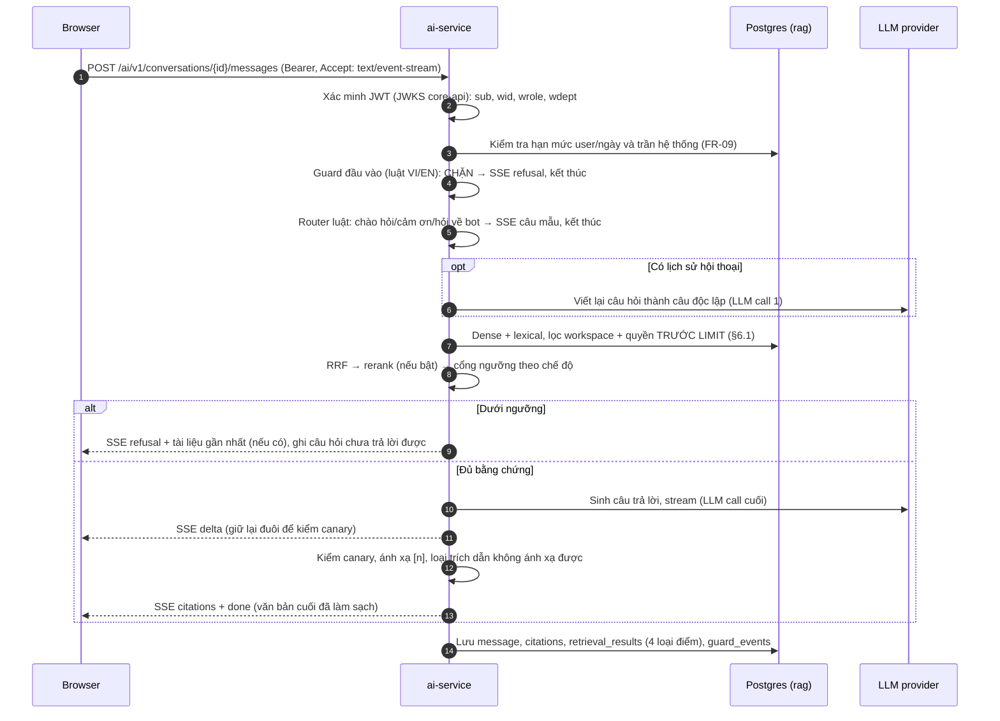

# THIẾT KẾ KỸ THUẬT: ai-service (V2)

> **Mã tài liệu:** `TECH-V2-AI-SERVICE` | **Tham chiếu PRD:** `PRD-V2-SOPILOT-MVP` | **Trạng thái:** `draft`, chờ owner duyệt (V2-03)
>
> Contract với core-api (endpoint `/internal/**`, payload, idempotency, thứ tự) định nghĩa ở [TECH-V2-core-api](TECH-V2-core-api.md) §8. Tài liệu này chỉ mô tả phía ai-service xử lý chúng.

---

## 0. Phạm vi và quy ước

- ai-service là service FastAPI, Python ≥ 3.11, viết mới ở `services/ai-service`. Thay `ai-qa-service` và `ingestion-service` (gỡ ở V2-17). Mã cũ chỉ để tham khảo.
- ai-service là chủ duy nhất của schema `rag`, không đọc schema `core` (ADR-004 §4.3). Mọi thông tin về tài liệu và quyền đi qua job và `rag.document_access`.
- Mỗi câu hỏi gọi LLM sinh **tối đa một lần**; viết lại câu hỏi (chỉ khi có lịch sử) là lần gọi thứ hai và duy nhất còn lại. Guard và định tuyến chạy bằng luật (PRD FR-13, ADR-006 §4.4).
- Mọi model đi qua interface provider và khai báo trong **một** file `config/models.yaml`; không gán cứng model ID trong code (ADR-006 §4.1).

### Truy vết tới yêu cầu và phát hiện cũ

| Yêu cầu / phát hiện | Mục |
|---|---|
| FR-08, AUDIT-ingestion §5 mục 2–9 | §5 |
| FR-10, R1–R5 | §6 |
| FR-11, FR-12, FR-13, FR-14 | §7.1–§7.3 |
| FR-09 (hạn mức câu hỏi, giới hạn provider) | §7.4 |
| FR-15, UC-11 (ẩn lịch sử khi mất quyền) | §7.5 |
| FR-16, FR-17 (nếu owner chốt Q1 của TECH-V2-core-api) | §7.6 |
| FR-25, ADR-007 §4.5 | §3.2, §6.1 |
| FR-28 | §5.7 |
| FR-18 (đồng bộ với `eval/`) | §6.5 |
| FR-19, FR-29 | §9 |
| §4.2 AUDIT-v2: `EMBEDDING_MODEL_NAME = "BGE_M3"`, cắt 512 token bằng `tiktoken` | §4.2, §5.5 |

---

## 1. Tổng quan kiến trúc và thành phần

| Thành phần | Công nghệ | Ranh giới | Bản chất thay đổi |
|---|---|---|---|
| `services/ai-service` | FastAPI, SQLAlchemy 2 (async, psycopg 3), Pydantic v2, uv | Schema `rag` | Service mới |
| `infrastructure/db/migrations/rag/` | Flyway | Schema `rag` | Chuỗi migration mới (V2-08) |
| Worker ingest và gợi ý metadata | Tiến trình con trong cùng container (`python -m sopilot_ai.worker`) | `rag.ingestion_jobs`, `rag.suggestion_jobs` | Hàng đợi Postgres `FOR UPDATE SKIP LOCKED` |
| Model local | sentence-transformers / transformers trên CPU | — | `bge-m3`, `bge-reranker-v2-m3` (ADR-006 §4.2) |
| LLM API | Gemini, Groq qua API kiểu OpenAI | — | ADR-006 §4.4 |

API và worker là hai tiến trình dùng chung image và cấu hình. Tách tiến trình để bước embed nặng CPU không chặn event loop của API (lỗi cũ: OCR đồng bộ trong hàm `async`, AUDIT-ingestion §2.1). Truy vấn hỏi đáp vẫn embed câu hỏi trong tiến trình API, qua `run_in_threadpool` với một model đã nạp sẵn.

### 1.1 Cấu trúc package

```
services/ai-service/
├── config/models.yaml
├── src/sopilot_ai/
│   ├── api/            # routers công khai /ai/v1 và nội bộ /internal, SSE
│   ├── auth/           # xác minh JWT qua JWKS core-api, InternalTokenDependency
│   ├── db/             # engine, session có set_config tenant, repositories
│   ├── docproc/        # PACKAGE THUẦN, không phụ thuộc DB/web (V2-20, V2-21, V2-22)
│   │   ├── model.py    #   DocElement, StructuredDocument
│   │   ├── extract/    #   docx.py, pdf.py, markdown.py, text.py (V2-20)
│   │   ├── clean/      #   boilerplate.py, metadata.py (V2-21)
│   │   └── chunk/      #   family.py, procedure_table.py, chunker.py (V2-22)
│   ├── providers/      # embedding.py, rerank.py, llm.py, registry.py (đọc models.yaml)
│   ├── retrieval/      # access_filter.py, dense.py, lexical.py, fusion.py, gate.py
│   ├── qa/             # guard.py, router.py, prompt.py, citations.py, pipeline.py
│   ├── conversations/
│   ├── quota/          # bộ đếm câu hỏi, giới hạn RPM/TPM theo provider
│   ├── ingest/         # job handler gọi docproc → embed → ghi chunk
│   ├── suggest/        # gợi ý metadata (V2-25)
│   ├── outbox/         # gửi trạng thái và gợi ý về core-api
│   └── worker.py
└── tests/
```

`docproc` là package Python thuần: nhận bytes và loại file, trả cấu trúc dữ liệu. `eval/` và test chất lượng trích xuất (V2-19) import trực tiếp package này, nên số đo trên corpus là số đo của đúng code chạy trong service.

---

## 2. Sơ đồ tuần tự

### 2.1 Ingest một phiên bản tài liệu

```mermaid
sequenceDiagram
    autonumber
    participant C as core-api
    participant A as ai-service API
    participant W as ai-service worker
    participant DB as Postgres (rag)
    participant S3 as Object storage

    C->>A: POST /internal/ingestions (Idempotency-Key)
    A->>DB: BEGIN; set_config(app.workspace_id); UPSERT document_access (nếu accessRevision mới hơn); INSERT ingestion_jobs ON CONFLICT (version_id) DO NOTHING; COMMIT
    A-->>C: 202
    A->>W: NOTIFY rag_jobs (đánh thức; worker cũng quét mỗi 5 s)
    W->>DB: rag.claim_ingestion_job() (SECURITY DEFINER, FOR UPDATE SKIP LOCKED, lease 10 phút)
    W->>DB: outbox VERSION_STATUS(PROCESSING)
    W->>S3: GET objectKey
    W->>W: docproc.extract → clean → chunk (tokenizer của model embedding)
    W->>W: embed (cache theo model, revision, sha256)
    W->>DB: BEGIN; INSERT chunks, chunk_terms, extracted_documents (version mới); UPDATE document_access.active_version_id; DELETE chunks của version cũ; job DONE; outbox VERSION_STATUS(READY); COMMIT
    W->>C: (outbox) PATCH /internal/documents/{id}/versions/{verId}/status
    W->>DB: INSERT suggestion_jobs (nếu suggest.enabled)
```

### 2.2 Hỏi đáp



---

## 3. Thiết kế dữ liệu (schema `rag`)

- Migration: `infrastructure/db/migrations/rag/V0xx__*.sql`, bảng lịch sử `rag.flyway_schema_history`.
- Extension `vector` (pgvector ≥ 0.8, để có iterative index scan khi lọc) tạo ở migration bootstrap của V2-08.
- Mọi bảng có `workspace_id` bật `ENABLE` + `FORCE ROW LEVEL SECURITY` với policy `workspace_id = rag.current_workspace()` (định nghĩa giống `core.current_workspace()`, TECH-V2-core-api §4.2). Ngoại lệ có lý do ghi ngay tại bảng.
- Không có FK sang `core`. `document_id`, `version_id`, `user_id`, `department_id` là UUID do core-api cấp.

### 3.1 Quyền đọc tài liệu (ADR-007 §4.5)

```sql
CREATE TABLE rag.document_access (
    workspace_id      uuid NOT NULL,
    document_id       uuid PRIMARY KEY,
    visibility        text NOT NULL CHECK (visibility IN ('WORKSPACE','DEPARTMENTS')),
    department_ids    uuid[] NOT NULL DEFAULT '{}',
    access_revision   bigint NOT NULL,
    active_version_id uuid,                 -- phiên bản đang được truy xuất; NULL = chưa READY lần nào
    title             text NOT NULL,        -- để hiển thị trích dẫn và "tài liệu gần nhất"
    deleted_at        timestamptz,          -- đặt ngay khi nhận DELETE, trước khi dọn chunk
    updated_at        timestamptz NOT NULL DEFAULT now(),
    CHECK (visibility = 'WORKSPACE' OR cardinality(department_ids) >= 1)
);
CREATE INDEX ix_document_access_ws ON rag.document_access(workspace_id);
CREATE INDEX ix_document_access_depts ON rag.document_access USING gin (department_ids);
```

Không có dòng quyền → chunk không bao giờ được truy xuất vì mọi truy vấn `JOIN` bảng này (fail closed). `title` được core-api gửi kèm job và cập nhật khi đổi tiêu đề sẽ cần thêm một sự kiện; để tránh thêm sự kiện, V2 hiển thị tên tài liệu trong trích dẫn bằng tiêu đề **tại thời điểm ingest**, frontend lấy tiêu đề mới nhất qua core-api khi mở trình xem.

### 3.2 Job ingest và kết quả trích xuất

```sql
CREATE TABLE rag.ingestion_jobs (
    id            uuid PRIMARY KEY,
    workspace_id  uuid NOT NULL,
    document_id   uuid NOT NULL,
    version_id    uuid NOT NULL UNIQUE,     -- idempotent theo phiên bản
    payload       jsonb NOT NULL,           -- nguyên payload POST /internal/ingestions
    status        text NOT NULL DEFAULT 'QUEUED' CHECK (status IN ('QUEUED','RUNNING','DONE','FAILED','CANCELLED')),
    attempts      int NOT NULL DEFAULT 0,
    lease_until   timestamptz,              -- worker chết giữa chừng: job tự trả lại sau khi hết lease
    failure_code  text,
    stage_timings jsonb,                    -- {download_ms, extract_ms, clean_ms, chunk_ms, embed_ms, write_ms}
    created_at    timestamptz NOT NULL DEFAULT now(),
    updated_at    timestamptz NOT NULL DEFAULT now()
);
CREATE INDEX ix_ingestion_jobs_due ON rag.ingestion_jobs(created_at) WHERE status IN ('QUEUED','RUNNING');

CREATE TABLE rag.extracted_documents (
    workspace_id   uuid NOT NULL,
    version_id     uuid PRIMARY KEY,
    document_id    uuid NOT NULL,
    structure      jsonb NOT NULL,          -- StructuredDocument đã làm sạch (§5.2), cho trình xem và gợi ý metadata
    markdown       text NOT NULL,           -- bản Markdown, offset ký tự của chunk tham chiếu vào đây
    page_count     int,
    language       text,
    doc_family     text NOT NULL CHECK (doc_family IN ('ISO_PROCEDURE','LEGAL_ARTICLES','MARKDOWN','PROSE')),
    boilerplate    jsonb NOT NULL,          -- phần khung đã tách: header/footer, quốc hiệu, chữ ký, bảng phê duyệt...
    extracted_meta jsonb NOT NULL,          -- {docCode, revisionLabel, effectiveDate, approvedBy}
    extractor      text NOT NULL,           -- tên + phiên bản thư viện (ADR-008, V2-20)
    created_at     timestamptz NOT NULL DEFAULT now()
);
```

`rag.claim_ingestion_job()` là hàm `SECURITY DEFINER` (owner `sopilot_migrator`, `GRANT EXECUTE` cho `sopilot_ai_app`) trả một job `QUEUED` hoặc `RUNNING` hết lease, đặt `RUNNING`, `lease_until = now() + 10 phút`, `attempts + 1`. Worker cần hàm này vì phải thấy job của mọi workspace; sau khi nhận job, worker đặt `app.workspace_id` theo job và mọi truy vấn tiếp theo chịu RLS bình thường. Khi khởi động, worker quét job còn tồn trước khi chờ `NOTIFY` (FR-08, ADR-006 B1 ràng buộc 3). Quá `SOPILOT_INGEST_MAX_ATTEMPTS=3` → `FAILED` với `failure_code = RETRY_EXHAUSTED`.

### 3.3 Chunk và chỉ mục

```sql
CREATE TABLE rag.chunks (
    id                 uuid PRIMARY KEY,
    workspace_id       uuid NOT NULL,
    document_id        uuid NOT NULL,
    version_id         uuid NOT NULL,
    ordinal            int  NOT NULL,                 -- thứ tự trong tài liệu
    chunk_type         text NOT NULL CHECK (chunk_type IN ('SECTION','PROCEDURE_STEP','TABLE','PROSE')),
    section_path       text[] NOT NULL,               -- tổ tiên, ví dụ {'5. Nội dung','5.1 Lập đề nghị mua hàng'}
    page_start         int,
    page_end           int,
    char_start         int  NOT NULL,                 -- offset trong extracted_documents.markdown
    char_end           int  NOT NULL,
    content            text NOT NULL,                 -- đoạn hiển thị cho người dùng và gửi LLM
    index_text         text NOT NULL,                 -- "Tên tài liệu › mục › bước\n" + content: được embed và index lexical
    token_count        int  NOT NULL,                 -- đếm bằng tokenizer của embedding_model
    content_sha256     bytea NOT NULL,                -- sha256(index_text), khóa cache embedding
    embedding          vector(1024) NOT NULL,
    embedding_provider text NOT NULL,
    embedding_model    text NOT NULL,
    embedding_dim      int  NOT NULL CHECK (embedding_dim = 1024),
    embedding_revision text NOT NULL,
    lexical_len        int  NOT NULL,                 -- số term của index_text (BM25 cần độ dài tài liệu)
    created_at         timestamptz NOT NULL DEFAULT now(),
    UNIQUE (version_id, ordinal),
    CHECK (char_end > char_start)
);
CREATE INDEX ix_chunks_doc ON rag.chunks(document_id, version_id);
CREATE INDEX ix_chunks_embedding ON rag.chunks USING hnsw (embedding vector_cosine_ops);

CREATE TABLE rag.chunk_terms (                        -- chỉ mục lexical cho BM25 (§6.3)
    workspace_id uuid NOT NULL,
    chunk_id     uuid NOT NULL REFERENCES rag.chunks(id) ON DELETE CASCADE,
    term         text NOT NULL,
    tf           int  NOT NULL CHECK (tf > 0),
    PRIMARY KEY (chunk_id, term)
);
CREATE INDEX ix_chunk_terms_lookup ON rag.chunk_terms(workspace_id, term);

CREATE TABLE rag.embedding_cache (                    -- KHÔNG có workspace_id, KHÔNG RLS: chỉ chứa vector, khóa theo nội dung
    model        text  NOT NULL,
    revision     text  NOT NULL,
    content_sha256 bytea NOT NULL,
    embedding    vector(1024) NOT NULL,
    created_at   timestamptz NOT NULL DEFAULT now(),
    PRIMARY KEY (model, revision, content_sha256)
);
```

Ghi chú thiết kế:
- **Kích thước vector cố định 1024.** Cả ba model của RQ5 (`bge-m3`, `Qwen3-Embedding-0.6B`, `multilingual-e5-large-instruct`) đều ra 1024 chiều. Ứng dụng chỉ dùng **một** model đang hoạt động; truy vấn luôn lọc `embedding_model = :active AND embedding_revision = :active_rev`, nên vector của hai model không bao giờ bị so với nhau (ADR-006 §4.1.3). Đổi model là chạy lại ingest cho mọi phiên bản; thí nghiệm RQ5 chạy trong `eval/`, không trong DB ứng dụng.
- **`embedding_cache` không có `workspace_id`** là ngoại lệ có chủ đích (ADR-007 §4.5: cache embedding chỉ chứa vector theo nội dung). Không trả văn bản từ bảng này; không có đường nào từ hash suy ra workspace.
- **Bốn loại điểm** (`dense_score`, `bm25_score`, `fusion_score`, `rerank_score`) phụ thuộc câu hỏi nên không nằm trên `chunks`; chúng được lưu theo từng lần truy xuất ở `rag.retrieval_results` (§3.4). Điều này thay cho cách cũ ghi đè `similarity_score` (R2, R4, R5).
- `section_path` là chuỗi **tổ tiên**, không phải anh em (lỗi standardizer cũ, AUDIT-ingestion §2.3).

### 3.4 Hội thoại, truy xuất và guard

```sql
CREATE TABLE rag.conversations (
    id           uuid PRIMARY KEY,
    workspace_id uuid NOT NULL,
    user_id      uuid NOT NULL,
    title        text NOT NULL,                         -- sinh bằng luật từ câu hỏi đầu (cắt 80 ký tự)
    created_at   timestamptz NOT NULL DEFAULT now(),
    updated_at   timestamptz NOT NULL DEFAULT now(),
    deleted_at   timestamptz
);
CREATE INDEX ix_conversations_owner ON rag.conversations(workspace_id, user_id, updated_at DESC);

CREATE TABLE rag.messages (
    id              uuid PRIMARY KEY,
    workspace_id    uuid NOT NULL,
    conversation_id uuid NOT NULL REFERENCES rag.conversations(id) ON DELETE CASCADE,
    user_id         uuid NOT NULL,
    role            text NOT NULL CHECK (role IN ('USER','ASSISTANT')),
    content         text NOT NULL,
    standalone_query text,                              -- câu hỏi sau khi viết lại (nếu có)
    outcome         text CHECK (outcome IN ('ANSWERED','REFUSED_NO_EVIDENCE','REFUSED_GUARD','TEMPLATE','QUOTA_EXCEEDED','ERROR')),
    lang            text,
    retrieval_mode  text,                               -- dense | bm25 | hybrid | hybrid_rerank
    gate_score      real,
    threshold       real,
    model           text,                               -- LLM thực sự sinh (sau fallback)
    prompt_version  text,
    tokens_in       int,
    tokens_out      int,
    latency_ms      jsonb,                              -- {retrieve, rerank, first_token, total}
    created_at      timestamptz NOT NULL DEFAULT now()
);
CREATE INDEX ix_messages_conv ON rag.messages(conversation_id, created_at);

CREATE TABLE rag.message_citations (
    workspace_id uuid NOT NULL,
    message_id   uuid NOT NULL REFERENCES rag.messages(id) ON DELETE CASCADE,
    n            int  NOT NULL,                         -- số [n] trong câu trả lời
    chunk_id     uuid,                                  -- có thể NULL nếu chunk đã bị xóa khi thay bản mới
    document_id  uuid NOT NULL,
    version_id   uuid NOT NULL,
    page_start   int,
    char_start   int  NOT NULL,
    char_end     int  NOT NULL,
    snippet      text NOT NULL,                         -- bản sao đoạn trích tại thời điểm trả lời
    PRIMARY KEY (message_id, n)
);
CREATE INDEX ix_citations_document ON rag.message_citations(document_id);

CREATE TABLE rag.retrieval_results (                    -- phục vụ RQ2/RQ3 trên dữ liệu thật và gỡ lỗi
    workspace_id uuid NOT NULL,
    message_id   uuid NOT NULL REFERENCES rag.messages(id) ON DELETE CASCADE,
    chunk_id     uuid NOT NULL,
    rank         int  NOT NULL,                          -- thứ hạng cuối (sau rerank nếu có)
    dense_score  real,                                   -- cosine
    bm25_score   real,
    fusion_score real,                                   -- RRF
    rerank_score real,
    in_context   boolean NOT NULL,                       -- có được đưa vào prompt không
    PRIMARY KEY (message_id, chunk_id)
);

CREATE TABLE rag.guard_events (                          -- lớp 4 của FR-13
    id           uuid PRIMARY KEY,
    workspace_id uuid NOT NULL,
    message_id   uuid REFERENCES rag.messages(id) ON DELETE CASCADE,
    user_id      uuid NOT NULL,
    layer        text NOT NULL CHECK (layer IN ('INPUT_BLOCK','INPUT_FLAG','OUTPUT_CANARY','OUTPUT_PROMPT_ECHO')),
    rule_id      text NOT NULL,
    created_at   timestamptz NOT NULL DEFAULT now()
);

CREATE TABLE rag.usage_counters (                        -- FR-09
    workspace_id uuid NOT NULL,
    user_id      uuid NOT NULL,
    day          date NOT NULL,                          -- theo UTC
    questions    int  NOT NULL DEFAULT 0,
    PRIMARY KEY (workspace_id, user_id, day)
);
```

Trần câu hỏi toàn hệ thống cần đếm qua mọi workspace nên nằm trong bảng **không RLS** `rag.system_usage(day date PRIMARY KEY, questions int)`, chỉ chứa số đếm. Cập nhật bằng `INSERT ... ON CONFLICT DO UPDATE SET questions = questions + 1 RETURNING questions`.

### 3.5 Gợi ý metadata và outbox

```sql
CREATE TABLE rag.suggestion_jobs (
    id            uuid PRIMARY KEY,
    workspace_id  uuid NOT NULL,
    document_id   uuid NOT NULL,
    version_id    uuid NOT NULL UNIQUE,
    input         jsonb NOT NULL,      -- categories/tags hiện có từ payload ingest
    status        text NOT NULL DEFAULT 'QUEUED' CHECK (status IN ('QUEUED','RUNNING','DONE','FAILED')),
    result        jsonb,
    method        text CHECK (method IN ('RULES','LLM','RULES_FALLBACK')),
    timings       jsonb,               -- {t_ready, t_suggest, llm_ms, tokens_in, tokens_out}
    attempts      int NOT NULL DEFAULT 0,
    lease_until   timestamptz,
    created_at    timestamptz NOT NULL DEFAULT now(),
    updated_at    timestamptz NOT NULL DEFAULT now()
);

CREATE TABLE rag.suggestion_cache (
    workspace_id   uuid NOT NULL,
    cache_key      bytea NOT NULL,     -- sha256(workspace_id, content_sha256, prompt_version, model, hash danh sách category)
    result         jsonb NOT NULL,
    created_at     timestamptz NOT NULL DEFAULT now(),
    PRIMARY KEY (workspace_id, cache_key)
);

CREATE TABLE rag.outbox_events (    -- cùng cấu trúc và quy tắc với core.outbox_events (TECH-V2-core-api §3.5, §7)
    id              uuid PRIMARY KEY,
    workspace_id    uuid NOT NULL,
    aggregate_id    uuid NOT NULL,
    event_type      text NOT NULL CHECK (event_type IN ('VERSION_STATUS','SUGGESTIONS_READY')),
    payload         jsonb NOT NULL,
    status          text NOT NULL DEFAULT 'PENDING' CHECK (status IN ('PENDING','DELIVERED','DEAD')),
    attempts        int NOT NULL DEFAULT 0,
    next_attempt_at timestamptz NOT NULL DEFAULT now(),
    last_error      text,
    created_at      timestamptz NOT NULL DEFAULT now(),
    delivered_at    timestamptz
);

CREATE TABLE rag.processed_requests (  -- idempotency cho /internal/** (Idempotency-Key từ core-api)
    idempotency_key uuid PRIMARY KEY,
    processed_at    timestamptz NOT NULL DEFAULT now()
);
```

`processed_requests` không có `workspace_id` và không RLS (chỉ chứa UUID); dọn dòng cũ hơn 7 ngày.

---

## 4. Xác thực, cấu hình và provider

### 4.1 Xác thực

- **Request công khai `/ai/v1/**`:** `Authorization: Bearer <access token>` do core-api phát. Xác minh RS256 bằng JWKS `http://core-api:8080/.well-known/jwks.json` (cache 10 phút, tải lại khi gặp `kid` lạ, tối đa 1 lần/phút), kiểm `iss = sopilot-core`, `aud` chứa `sopilot-ai`, `exp` (lệch 60 s). Lấy `sub`, `wid`, `wrole`, `wdept`. Các giá trị này là nguồn duy nhất cho bộ lọc tenant và quyền; **không** đọc `workspaceId` từ body hay query (ADR-005 §4.5).
- **Request nội bộ `/internal/**`:** header `X-Internal-Token`, so sánh thời gian hằng (`hmac.compare_digest`). Router nội bộ không được mount dưới tiền tố `/ai`, nên rewrites của frontend không chạm tới.
- Mọi session DB mở transaction và gọi `SELECT set_config('app.workspace_id', :wid, true), set_config('app.user_id', :sub, true)` ngay đầu (dependency `tenant_session`). Repository không nhận session chưa qua dependency này.

### 4.2 `config/models.yaml`

Đây là nơi **duy nhất** khai báo model (ADR-006 §4.1.2). Giá trị là cấu hình mặc định; ID chính xác của Gemini được giữ cấu hình được vì `gemini-3.1-flash-lite` (GA) còn trả 503 lúc thử, chỉ bản `-preview` trả 200 (V2-02, AUDIT-v2 §4.1, 2026-10-20).

```yaml
embedding:
  active: bge-m3
  models:
    bge-m3:
      provider: local                 # local | cloudflare | openai_compatible
      model: BAAI/bge-m3
      revision: ${EMBEDDING_REVISION}  # ghim HF commit hash; khởi động lỗi nếu trống ở profile eval
      dim: 1024
      max_tokens: 8192
      query_prefix: ""
rerank:
  enabled: ${RERANK_ENABLED:false}
  provider: local                     # local | none
  model: BAAI/bge-reranker-v2-m3
  revision: ${RERANK_REVISION}
  max_pairs: 25
llm:
  generate:
    chain:
      - {provider: gemini, model: "${GEMINI_GENERATE_MODEL:gemini-3.1-flash-lite-preview}", rpm: 15, tpm: 250000, rpd: 500}
      - {provider: groq,   model: openai/gpt-oss-120b, rpm: 30, tpm: 8000, rpd: 1000}
    temperature: 0.2
    max_output_tokens: 800
  rewrite:          # chỉ dùng khi có lịch sử hội thoại
    chain:
      - {provider: groq,   model: openai/gpt-oss-20b, rpm: 30, tpm: 8000, rpd: 1000}
      - {provider: gemini, model: "${GEMINI_GENERATE_MODEL:gemini-3.1-flash-lite-preview}"}
    temperature: 0
  small_task:       # gợi ý metadata (FR-28)
    chain:
      - {provider: groq, model: openai/gpt-oss-20b, rpm: 30, tpm: 8000, rpd: 1000}
    temperature: 0
  judge:            # chỉ eval (V2-10), không dùng trong request người dùng
    chain:
      - {provider: groq, model: openai/gpt-oss-120b}
    temperature: 0
providers:
  gemini: {base_url: "https://generativelanguage.googleapis.com/v1beta/openai", api_key_env: GEMINI_API_KEY}
  groq:   {base_url: "https://api.groq.com/openai/v1", api_key_env: GROQ_API_KEY}
  local_llm: {base_url: "${LOCAL_LLM_BASE_URL:http://ollama:11434/v1}", api_key_env: null}
retrieval:
  candidate_pool: 50      # mỗi nhánh dense / lexical
  rerank_pool: 25
  context_k: 5
  rrf_k: 60
  rrf_weights: [1.0, 1.0]
  thresholds:             # cổng từ chối; hiệu chỉnh trên tập dev của V2-06 (RQ3)
    dense: 0.45
    bm25: null            # BM25 không có thang chung giữa các câu hỏi; chế độ bm25 không tự từ chối
    hybrid: 0.45          # so trên dense cosine của ứng viên đầu, giống harness eval
    hybrid_rerank: 0.30   # so trên rerank score (sigmoid) của ứng viên đầu
  mode: hybrid            # dense | bm25 | hybrid; rerank thêm hậu tố _rerank khi rerank.enabled
chunking:
  target_tokens: 384
  max_tokens: 512         # vừa giới hạn 512 của multilingual-e5 để kết quả RQ5 áp dụng được
  min_tokens: 64          # section nhỏ hơn được gộp với anh em cùng cha
```

Ngưỡng ở trên là giá trị giữ chỗ, phải thay bằng giá trị hiệu chỉnh trên tập dev (V2-07). Khi khởi động, ai-service gọi `/models` của từng provider có key và log `WARNING` cho model không còn trong danh sách (ADR-006 §4.1.2); không chặn khởi động để eval truy xuất vẫn chạy khi không có key LLM.

### 4.3 Interface provider

```python
class EmbeddingProvider(Protocol):
    name: str; model: str; revision: str; dim: int
    def tokenizer(self) -> "Tokenizer": ...                       # tokenizer của chính model này
    def embed(self, texts: Sequence[str], *, is_query: bool) -> np.ndarray: ...   # đã chuẩn hóa L2

class RerankProvider(Protocol):
    def score(self, query: str, passages: Sequence[str]) -> np.ndarray: ...       # sigmoid, [0, 1]

class LLMProvider(Protocol):
    async def complete(self, messages: list[Message], *, task: Literal["generate","rewrite","small_task","judge"],
                       response_schema: type[BaseModel] | None = None) -> Completion: ...
    def stream(self, messages: list[Message], *, task: str) -> AsyncIterator[Delta]: ...
```

- `EmbeddingProvider`: `local` (sentence-transformers, chạy trên threadpool), `cloudflare` (Workers AI `@cf/baai/bge-m3`, chỉ cho deploy, ngoài phạm vi V2), `openai_compatible` (TEI hoặc server nhúng khác).
- `RerankProvider`: `local` (cross-encoder `bge-reranker-v2-m3`), `none`. Một reranker qua API miễn phí có thể thêm sau như một provider mới mà không đổi pipeline (xem câu hỏi mở Q3).
- `LLMProvider`: một lớp duy nhất gọi API kiểu OpenAI `chat/completions` với `base_url` khác nhau. `ChainedLLM` thử lần lượt các model trong `chain`; chuyển sang model kế tiếp khi gặp `429`, `503`, timeout, hoặc khi bộ giới hạn cục bộ báo hết quota (§7.4). Ghi model thực sự trả lời vào `messages.model`.

---

## 5. Ingest có cấu trúc (FR-08, V2-19..22)

### 5.1 Các bước của job

| Bước | Module | Đầu ra | Lỗi → `failure_code` |
|---|---|---|---|
| 1. Tải file | `ingest` | bytes | `OBJECT_NOT_FOUND` |
| 2. Trích xuất | `docproc.extract` | `StructuredDocument` | `UNSUPPORTED_TYPE`, `NO_TEXT_LAYER`, `ENCRYPTED_PDF`, `CORRUPT_FILE` |
| 3. Tách khung, trích metadata | `docproc.clean` | `StructuredDocument` đã làm sạch + `boilerplate` + `extracted_meta` | — |
| 4. Nhận diện họ tài liệu | `docproc.chunk.family` | `ISO_PROCEDURE` \| `LEGAL_ARTICLES` \| `MARKDOWN` \| `PROSE` | — |
| 5. Chunk | `docproc.chunk` | `list[Chunk]` | `EMPTY_CONTENT` khi 0 chunk (sửa lỗi cũ: rỗng vẫn `READY`) |
| 6. Phát hiện ngôn ngữ | `ingest` | `vi` / `en` / khác | — |
| 7. Embed | `providers.embedding` + cache | vector 1024 chiều | `EMBEDDING_ERROR` (có thử lại) |
| 8. Ghi và kích hoạt | `ingest` | transaction §5.6 | — |

`failure_message` gửi về core-api là câu cố định theo `failure_code` (VI/EN), không bao giờ là message của exception.

### 5.2 Cấu trúc tài liệu trung gian (đầu ra V2-20)

```python
class DocElement(BaseModel):
    kind: Literal["heading", "paragraph", "list_item", "table", "page_break"]
    text: str                       # đã chuẩn hóa NFC; với list_item gồm cả số thứ tự tự động của Word ("5.1", "a)")
    level: int | None = None        # heading 1..6; list nesting
    number: str | None = None       # số thứ tự đã render, nếu có
    rows: list[list[str]] | None = None   # table: hàng đầu là tiêu đề cột nếu nhận ra; ô gộp không lặp
    page: int | None = None         # PDF: số trang thật; DOCX: None (không có trang ổn định)
    char_start: int                 # offset trong markdown xuất ra
    char_end: int
    style: str | None = None        # style Word gốc, dùng cho heuristic và gỡ lỗi
    role: Literal["content", "header", "footer", "boilerplate"] = "content"

class StructuredDocument(BaseModel):
    file_type: Literal["PDF", "DOCX", "MD", "TXT"]
    elements: list[DocElement]      # theo thứ tự đọc; bảng nằm đúng vị trí trong thân
    page_count: int | None
    frontmatter: dict | None        # MD
    def to_markdown(self) -> str: ...
```

Quy tắc theo định dạng (V2-20, chọn thư viện ở ADR-008 sau khi đo trên corpus V2-19):
- **DOCX:** đọc thân theo thứ tự body (đoạn và bảng xen kẽ), render số thứ tự tự động từ `numbering.xml`, heading theo style, header/footer của section gắn `role = header/footer`. Ô gộp xuất một lần. Không có trang nên trích dẫn DOCX trỏ tới đoạn (`char_start`), không tới trang (FR-14 cho phép).
- **PDF có lớp chữ:** giữ số trang; thứ tự đọc đúng với trang nhiều cột; bảng giữ hàng/cột. Trang có ít chữ **không** được OCR. Toàn tài liệu gần như không có chữ (tỷ lệ trang có chữ < 10% hoặc tổng < 200 ký tự) → `NO_TEXT_LAYER`.
- **MD:** heading `#`, bỏ frontmatter khỏi nội dung và lưu vào `frontmatter`; xóa shortcode Hugo `` (corpus GitLab của V2-06).
- **TXT:** UTF-8, đoạn tách theo dòng trống; nhận heading bằng mẫu đánh số ở bước 4.

### 5.3 Tách khung và metadata (V2-21)

- Header/footer lặp: dòng xuất hiện ở ≥ 60% số trang tại cùng vùng đầu/cuối trang (sau khi thay số trang bằng `#`) → `role = header|footer`, bỏ khỏi nội dung.
- Khối khung VI/EN nhận diện bằng luật: quốc hiệu/tiêu ngữ, số/ký hiệu, nơi nhận, khối chữ ký, bảng Soạn thảo/Soát xét/Phê duyệt (Prepared/Reviewed/Approved), bảng theo dõi sửa đổi (Revision history). Đánh `role = boilerplate`, lưu vào `extracted_documents.boilerplate`.
- Metadata trích từ khung trước khi bỏ: `docCode` (mã số/mã hiệu), `revisionLabel` (lần ban hành), `effectiveDate`, `approvedBy`. Gửi về core-api trong callback `READY`.
- Không xóa nội dung thật: V2-21 báo cáo tỷ lệ khung lọt vào nội dung và tỷ lệ nội dung bị xóa nhầm trên corpus V2-19.

### 5.4 Họ tài liệu và chunk (V2-22)

Nhận diện heading theo thứ tự ưu tiên: heading thật (style Word, `#`) → mẫu đánh số (`1.`, `5.1`, `I.`, `Điều n`, `Chương n`, `Article n`) đứng đầu dòng ngắn → heuristic (dòng in hoa, chữ đậm). Câu kết thúc bằng dấu chấm và dài hơn 120 ký tự không bao giờ là heading (chặn lỗi "căn cứ ⏎ Điều 5 Luật Doanh nghiệp.").

| Họ | Nhận diện | Đơn vị chunk |
|---|---|---|
| `ISO_PROCEDURE` | Có các mục Mục đích/Phạm vi/Nội dung (Purpose/Scope/Procedure) hoặc bảng có cột Trách nhiệm + Bước/Mô tả | Section theo heading; **mỗi hàng của bảng quy trình là một chunk `PROCEDURE_STEP`**, nội dung dạng `Bước: … \| Trách nhiệm: … \| Mô tả: … \| Biểu mẫu: …` |
| `LEGAL_ARTICLES` | ≥ 3 heading dạng `Điều n` / `Article n` | Mỗi Điều một chunk; Điều dài cắt theo Khoản |
| `MARKDOWN` | File MD hoặc heading `#` | Section theo heading |
| `PROSE` | Không thuộc các họ trên | Đoạn văn; gộp đoạn tới `target_tokens`, cắt theo câu, không cắt cứng giữa câu |

Quy tắc chung:
- Đếm token bằng tokenizer của model embedding đang hoạt động (`EmbeddingProvider.tokenizer()`), **không** dùng `tiktoken` (AUDIT-v2 §4.2). Chunk ≤ `max_tokens` tính cả tiền tố đường dẫn tiêu đề.
- Section < `min_tokens` gộp với anh em kế tiếp cùng cha; section > `max_tokens` cắt theo đoạn rồi theo câu. Cắt trên ranh giới ký tự Unicode, không trên byte.
- `index_text` = `"{title} › {section_path joined by ' › '}\n{content}"`. Tiền tố có trong cả vector lẫn chỉ mục lexical (V2-22).
- Bảng thường (không phải bảng quy trình) dài hơn `max_tokens` cắt theo hàng, lặp lại hàng tiêu đề cột ở mỗi phần.
- Chunk mang `page_start/page_end` (PDF) và `char_start/char_end` trong `markdown` (mọi định dạng) để trình xem tô sáng (FR-14).

### 5.5 Embedding và cache

- Embed theo lô 16, trên threadpool. Trước khi embed, tra `rag.embedding_cache` theo `(model, revision, sha256(index_text))`; chỉ embed phần thiếu rồi ghi lại cache.
- Ghi `embedding_provider/model/dim/revision` đúng giá trị của provider đang hoạt động; không có hằng số như `EMBEDDING_MODEL_NAME = "BGE_M3"` cũ.
- `revision` rỗng ở profile `eval` là lỗi khởi động; ở profile `local` cho phép nhưng log cảnh báo và ghi `revision = "unpinned"`.

### 5.6 Kích hoạt phiên bản (thay bản mới, FR-07)

Một transaction, sau khi đã có đủ vector:
1. `INSERT` chunks, chunk_terms, extracted_documents của phiên bản mới.
2. `UPDATE rag.document_access SET active_version_id = :new WHERE document_id = :doc AND deleted_at IS NULL`. Không có dòng (tài liệu đã bị xóa giữa chừng) → rollback, job `CANCELLED`.
3. `DELETE FROM rag.chunks WHERE document_id = :doc AND version_id <> :new` (chunk_terms xóa theo cascade).
4. Job `DONE`; outbox `VERSION_STATUS(READY)`.

Trong lúc bản mới xử lý, truy xuất vẫn dùng bản cũ vì lọc `version_id = active_version_id`. Bản mới `FAILED` không đụng tới bản cũ.

### 5.7 Gợi ý metadata chạy nền (FR-28, V2-25)

- Sau bước 8, nếu `suggest.enabled`, tạo `suggestion_jobs`. Worker xử lý job gợi ý **sau** job ingest, nên gợi ý không nằm trên đường tới `READY`.
- Đầu vào chỉ từ `extracted_documents`: tiêu đề (heading đầu hoặc tên file), dàn ý heading, tối đa 3 đoạn đại diện, trần `SOPILOT_SUGGEST_MAX_INPUT_TOKENS=1500`. Không tải hay parse lại file.
- Luật trước: tiêu đề, ngôn ngữ, `docCode`/`revisionLabel`/`effectiveDate` từ §5.3.
- Một lần gọi `small_task` với structured output `{description, category_id | null, proposed_category_name | null, tags[]}`; `category_id` phải thuộc danh sách category trong payload, sai thì bỏ. Timeout `SOPILOT_SUGGEST_TIMEOUT=20s`, thử lại tối đa 1 lần; lỗi → chỉ gửi kết quả luật với `method = RULES_FALLBACK`.
- Cache theo khóa §3.5; không dùng chung giữa workspace.
- Gửi về core-api qua outbox `SUGGESTIONS_READY` → `PUT /internal/documents/{id}/suggestions`. Gợi ý không chứa phạm vi hiển thị hay phòng ban.
- Ghi số đo theo job (`t_ready`, `t_suggest`, `llm_ms`, token vào/ra, fallback) cho báo cáo p50/p95 của V2-25.

---

## 6. Truy xuất (FR-10, FR-25)

### 6.1 Bộ lọc quyền dùng chung

Mọi nhánh truy xuất dùng cùng một điều kiện, tham số hóa hoàn toàn (sửa A3: không f-string):

```sql
-- :wrole, :wdept lấy từ token; :model, :rev là embedding đang hoạt động. RLS đã giới hạn workspace_id.
WITH allowed AS (
    SELECT da.document_id, da.active_version_id, da.title
    FROM rag.document_access da
    WHERE da.deleted_at IS NULL
      AND da.active_version_id IS NOT NULL
      AND ( :wrole IN ('OWNER','ADMIN')
            OR da.visibility = 'WORKSPACE'
            OR (:wdept IS NOT NULL AND :wdept = ANY(da.department_ids)) )
)
```

Điều kiện `workspace_id = :wid` được viết thêm tường minh ở tầng ứng dụng trong mọi truy vấn, cạnh RLS (hai lớp, ADR-005). Hàm `access_filter.allowed_cte()` là nơi duy nhất sinh đoạn SQL này; test FR-29 gọi trực tiếp nó.

### 6.2 Dense

```sql
SET LOCAL hnsw.iterative_scan = relaxed_order;   -- pgvector ≥ 0.8: tiếp tục quét khi bộ lọc loại nhiều ứng viên
SET LOCAL hnsw.ef_search = 100;
<allowed CTE>
SELECT c.id, 1 - (c.embedding <=> :qvec) AS dense_score
FROM rag.chunks c
JOIN allowed a ON a.document_id = c.document_id AND a.active_version_id = c.version_id
WHERE c.workspace_id = :wid
  AND c.embedding_model = :model AND c.embedding_revision = :rev
ORDER BY c.embedding <=> :qvec
LIMIT :candidate_pool;
```

Lọc nằm trong `WHERE`/`JOIN` nên áp dụng **trước** `LIMIT` (FR-25). Với quy mô MVP (≤ 50 tài liệu mỗi workspace) Postgres thường chọn quét tuần tự có lọc, kết quả chính xác tuyệt đối; HNSW chỉ có tác dụng khi dữ liệu lớn hơn.

### 6.3 Lexical (BM25 trong SQL)

Tokenizer giống hệt harness `eval/sopilot_eval/retrievers.py::tokenize`: chữ thường, NFC, `\w+`, unigram + bigram (`a_b`), giữ dấu tiếng Việt. Một module `sopilot_ai.retrieval.lexical.tokenize` được dùng chung cho ingest (sinh `chunk_terms`, `lexical_len`), truy vấn và harness eval (harness import module này thay cho bản sao, V2-09). Tham số BM25 giống harness: `k1 = 1.5`, `b = 0.75`, `idf = ln(1 + (N - df + 0.5) / (df + 0.5))`.

```sql
<allowed CTE>,
scope AS (                -- tập chunk người hỏi được đọc: thống kê BM25 chỉ tính trên tập này
    SELECT c.id, c.lexical_len FROM rag.chunks c
    JOIN allowed a ON a.document_id = c.document_id AND a.active_version_id = c.version_id
    WHERE c.workspace_id = :wid
),
stats AS (SELECT count(*)::float AS n, avg(lexical_len)::float AS avgdl FROM scope),
q AS (SELECT unnest(CAST(:terms AS text[])) AS term),
df AS (
    SELECT t.term, count(*)::float AS df
    FROM rag.chunk_terms t JOIN scope s ON s.id = t.chunk_id JOIN q ON q.term = t.term
    WHERE t.workspace_id = :wid
    GROUP BY t.term
)
SELECT t.chunk_id AS id,
       sum( ln(1 + (st.n - df.df + 0.5) / (df.df + 0.5))
            * t.tf * (1.5 + 1)
            / (t.tf + 1.5 * (1 - 0.75 + 0.75 * s.lexical_len / st.avgdl)) ) AS bm25_score
FROM rag.chunk_terms t
JOIN scope s ON s.id = t.chunk_id
JOIN df ON df.term = t.term
CROSS JOIN stats st
WHERE t.workspace_id = :wid
GROUP BY t.chunk_id
ORDER BY bm25_score DESC
LIMIT :candidate_pool;
```

Lý do chọn BM25 tự viết thay cho `ts_rank` hay extension: (1) điểm khớp harness eval, nên kết quả RQ1 đo bằng `eval/` áp dụng được cho service (V2-09 yêu cầu khớp trong sai số); (2) Postgres không có từ điển tiếng Việt, `ts_rank` không phải BM25 (R2); (3) extension như `pg_search` cần image Postgres riêng. Thống kê `N`, `df`, `avgdl` tính trên **tập được phép đọc**, nên điểm của người hỏi không chịu ảnh hưởng từ tài liệu ngoài quyền. Chi phí chấp nhận được ở quy mô MVP; nếu RQ4 hoặc số đo độ trễ cho thấy chậm, bước tối ưu đầu tiên là bảng thống kê theo workspace, không đổi công thức.

### 6.4 Gộp, rerank và cổng ngưỡng

1. **RRF** trên hai danh sách đã lọc: `fusion(c) = Σ wᵢ / (rrf_k + rankᵢ(c))`, `rrf_k = 60`, trọng số `[1.0, 1.0]` (cấu hình được; trọng số cũ 0.7/0.3 là một cấu hình trong RQ1, không phải mặc định).
2. Lấy `rerank_pool = 25` ứng viên đầu theo `fusion_score`.
3. **Rerank (nếu bật)** chạy trên 25 ứng viên đó **trước** cổng ngưỡng (sửa R3), xếp lại theo `rerank_score`.
4. **Cổng ngưỡng** so điểm của ứng viên đầu với ngưỡng của chế độ đang chạy (`retrieval.thresholds`, sửa R2/R4):

| Chế độ | Điểm dùng cho cổng | Lý do |
|---|---|---|
| `dense` | `dense_score` (cosine) | Thang chung giữa các câu hỏi |
| `bm25` | Không có cổng | BM25 không có thang chung; chế độ này chỉ dùng cho eval |
| `hybrid` | `dense_score` của ứng viên đầu theo `fusion_score` | RRF là điểm theo thứ hạng, không hiệu chỉnh được; giống harness |
| `hybrid_rerank` | `rerank_score` (sigmoid) của ứng viên đầu | Cross-encoder có thang chung |

5. Đủ ngưỡng → đưa `context_k = 5` chunk đầu vào prompt. Ghi cả 25 ứng viên kèm bốn điểm vào `rag.retrieval_results` (`in_context` đánh dấu 5 chunk được dùng). Điểm trả cho frontend là `rank` và (tùy chọn hiển thị) điểm của cổng, không phải một `similarity_score` đổi thang theo cấu hình (R5).

### 6.5 Đồng bộ với harness eval

- `eval/` import `sopilot_ai.docproc` (chunk), `sopilot_ai.retrieval.lexical` (tokenizer, BM25) và `sopilot_ai.retrieval.fusion` (RRF, cổng) thay cho bản sao hiện có. Harness vẫn chạy in-memory, không cần DB hay stack.
- Kiểm tra V2-09: cùng corpus V2-06, cùng cấu hình → top-10 của service (qua DB, một workspace, OWNER) và của harness trùng ≥ 95% theo Jaccard trung bình; khác biệt chỉ do HNSW xấp xỉ.

---

## 7. Hỏi đáp (FR-11..FR-15)

### 7.1 Các bước

1. **Hạn mức** (§7.4). Hết → SSE `error {code: QUOTA_EXCEEDED}`; không gọi gì thêm.
2. **Guard đầu vào** (lớp 1 FR-13): chuẩn hóa (NFC, bỏ dấu, leetspeak `0→o, 1→i, 3→e, 4→a, 5→s, 7→t`), giới hạn `SOPILOT_MAX_QUESTION_CHARS=1000`. Luật VI/EN hai mức, viết trong `qa/guard_rules.yaml` (không trong code):
   - **Chặn:** đòi lộ system prompt/quy tắc ẩn/khóa API; ghi đè chỉ dẫn nhắm vào chỉ dẫn/prompt; giả mạo vai trò hệ thống (`system:`, `[INST]`, `<|im_start|>`). Trả câu từ chối cố định, `outcome = REFUSED_GUARD`, ghi `guard_events(INPUT_BLOCK)`.
   - **Gắn cờ:** đóng vai, "bỏ qua bước", nhắc workspace khác. Vẫn trả lời, ghi `guard_events(INPUT_FLAG)`.
   - Luật khởi đầu port từ `eval/provider_check/check_providers.py::RULE_PATTERNS`, sau đó điều chỉnh bằng **bộ câu kiểm tra riêng** của V2-10 (không trùng bộ dùng để viết luật).
3. **Router luật:** chào hỏi/cảm ơn/hỏi về bot (VI/EN) → câu mẫu, `outcome = TEMPLATE`, không gọi LLM, không tính hạn mức.
4. **Viết lại câu hỏi** chỉ khi hội thoại có ≥ 1 lượt trước: gửi tối đa 3 lượt gần nhất (chỉ câu hỏi và câu trả lời đã làm sạch, không gửi chunk) cho `llm.rewrite`, nhận câu hỏi độc lập. Lỗi → dùng câu hỏi gốc.
5. **Truy xuất** (§6). Dưới ngưỡng → bước 8.
6. **Ghép prompt** (lớp 2): system prompt cố định theo `prompt_version`, chứa canary token ngẫu nhiên sinh mỗi request và quy tắc: chỉ dùng dữ liệu trong thẻ, trả lời theo ngôn ngữ câu hỏi, mỗi khẳng định gắn `[n]`, thiếu thông tin thì nói không tìm thấy. Mỗi chunk bọc trong `<source n="1" title="…" page="3">…</source>`, escape `<`, `>`, `&` trong nội dung. Câu hỏi nằm ở message `user` riêng, không ghép vào system.
7. **Sinh và stream** (lớp 3): SSE `delta` phát văn bản nhưng **giữ lại** `len(canary) + 32` ký tự cuối chưa phát. Mỗi delta mới, kiểm tra buffer có chứa canary hoặc đoạn ≥ 40 ký tự liên tiếp của system prompt không. Có → dừng stream, phát `replace` với câu từ chối cố định, `outcome = REFUSED_GUARD`, `guard_events(OUTPUT_CANARY | OUTPUT_PROMPT_ECHO)`.
8. **Từ chối thiếu bằng chứng** (FR-12): câu trả lời cố định theo ngôn ngữ câu hỏi + tối đa 3 "tài liệu gần nhất" (tiêu đề của tài liệu chứa ứng viên đầu, đã qua bộ lọc quyền nên không lộ tài liệu ngoài quyền), `outcome = REFUSED_NO_EVIDENCE`. Không gọi LLM sinh.
9. **Hậu xử lý trích dẫn** (FR-11): tìm `[n]` trong văn bản cuối; `n` không ứng với source nào trong prompt → xóa khỏi văn bản. Mỗi `n` hợp lệ lưu `message_citations` với đoạn trích chính là `content` của chunk.

Ngôn ngữ câu hỏi phát hiện bằng luật nhẹ (tỷ lệ ký tự có dấu tiếng Việt) và có thể ghi đè bằng `lang` trong request.

### 7.2 SSE

`POST /ai/v1/conversations/{conversationId}/messages` với `Accept: text/event-stream`. Body `{ "content": "…", "lang": "vi" | "en" | null }`. `conversationId = "new"` tạo hội thoại mới.

| Sự kiện | Dữ liệu | Khi nào |
|---|---|---|
| `meta` | `{conversationId, messageId, mode, lang}` | Đầu tiên |
| `delta` | `{text}` | Mỗi đoạn văn bản |
| `replace` | `{text, reason: "GUARD"}` | Phát hiện canary/echo giữa chừng |
| `refusal` | `{text, reason: "NO_EVIDENCE" \| "GUARD", nearestDocuments: [{documentId, title}]}` | Từ chối, thay cho `delta` |
| `citations` | `[{n, documentId, versionId, title, page, charStart, charEnd, snippet}]` | Sau khi sinh xong |
| `done` | `{finalText, outcome, usage: {questionsLeftToday}}` | Cuối cùng; frontend thay văn bản đã stream bằng `finalText` (đã xóa `[n]` không hợp lệ) |
| `error` | `{code, message}` | `QUOTA_EXCEEDED`, `LLM_UNAVAILABLE`, `INTERNAL_ERROR` |

Header `Cache-Control: no-cache`, `X-Accel-Buffering: no`. Ping comment `: ping` mỗi 15 s để proxy không cắt kết nối.

### 7.3 Trình xem trích dẫn (FR-14)

`GET /ai/v1/documents/{documentId}/versions/{versionId}/content` trả `{markdown, pages: [{page, charStart, charEnd}]}` từ `extracted_documents`, chỉ khi tài liệu qua bộ lọc §6.1 và `versionId` là phiên bản đang hoạt động; ngược lại `404`. PDF gốc được frontend mở bằng URL ký sẵn của core-api (`/api/v1/documents/{id}/download-url`) và nhảy tới `page`; DOCX/MD/TXT hiển thị `markdown` và tô sáng `[charStart, charEnd)`.

### 7.4 Hạn mức và giới hạn provider (FR-09)

- **Theo user:** `SOPILOT_QUOTA_QUESTIONS_PER_USER_DAY=20` (PRD FR-09; ticket V2-12 ghi 50, xem câu hỏi mở Q2 của TECH-V2-core-api). Tăng `usage_counters` trong transaction đầu request, **trước** khi gọi LLM; câu `TEMPLATE` và `REFUSED_GUARD` không tính.
- **Toàn hệ thống:** `SOPILOT_QUOTA_QUESTIONS_SYSTEM_DAY=400` qua `rag.system_usage`.
- **Theo provider:** token bucket trong bộ nhớ cho RPM và TPM của từng `(provider, model)` lấy từ `models.yaml` (một tiến trình API nên không cần Redis). Ước lượng token prompt trước khi gọi; hết bucket → coi như `429` và chuyển model kế tiếp trong `chain`. Hết cả chuỗi → `error LLM_UNAVAILABLE`, hoàn lại lượt hạn mức của user.

### 7.5 Hội thoại (FR-15) và lịch sử khi mất quyền

| Method & path | Ghi chú |
|---|---|
| `GET /ai/v1/conversations` | Hội thoại của `sub` trong `wid`, mới nhất trước |
| `GET /ai/v1/conversations/{id}` | Tin nhắn + trích dẫn; `404` nếu không phải của mình |
| `PATCH /ai/v1/conversations/{id}` | Đổi tên |
| `DELETE /ai/v1/conversations/{id}` | Xóa mềm |
| `POST /ai/v1/conversations/{id}/messages` | §7.2 |

Mọi truy vấn có `workspace_id = :wid AND user_id = :sub` (ngoài RLS). Khi đọc lại hội thoại, mỗi câu trả lời có trích dẫn được kiểm `document_id` với bộ lọc §6.1 hiện tại: nếu **bất kỳ** trích dẫn nào trỏ tới tài liệu không còn đọc được (đổi phạm vi, đổi phòng ban, bị xóa), toàn bộ câu trả lời và đoạn trích của nó bị thay bằng `{hidden: true, reason: "ACCESS_REVOKED" | "DOCUMENT_DELETED"}`; câu hỏi vẫn hiện (PRD §8.8). Viết lại câu hỏi (§7.1 bước 4) chỉ dùng các lượt chưa bị ẩn.

### 7.6 Phản hồi và khoảng trống tri thức (đề xuất, chờ Q1)

Nếu owner chọn đặt FR-16/FR-17 ở ai-service (đề xuất ở TECH-V2-core-api §11 Q1):

```sql
CREATE TABLE rag.message_feedback (
    workspace_id uuid NOT NULL,
    message_id   uuid NOT NULL REFERENCES rag.messages(id) ON DELETE CASCADE,
    user_id      uuid NOT NULL,
    vote         smallint NOT NULL CHECK (vote IN (-1, 1)),
    comment      text CHECK (length(comment) <= 1000),
    created_at   timestamptz NOT NULL DEFAULT now(),
    updated_at   timestamptz NOT NULL DEFAULT now(),
    PRIMARY KEY (message_id, user_id)
);
CREATE TABLE rag.knowledge_gap_status (
    workspace_id uuid NOT NULL,
    message_id   uuid PRIMARY KEY REFERENCES rag.messages(id) ON DELETE CASCADE,
    resolved_by  uuid NOT NULL,
    resolved_at  timestamptz NOT NULL DEFAULT now(),
    note         text
);
```

- `PUT /ai/v1/messages/{id}/feedback` `{vote, comment}`: chỉ người tạo hội thoại, chỉ tin nhắn `ASSISTANT`.
- `GET /ai/v1/knowledge-gaps?status=open|resolved`: OWNER, ADMIN; gồm câu `REFUSED_NO_EVIDENCE` và câu trả lời bị downvote, kèm câu hỏi, thời gian, phản hồi. Không kèm tên người hỏi (giữ riêng tư hội thoại FR-15).
- `POST /ai/v1/knowledge-gaps/{messageId}/resolve`: OWNER, ADMIN.

---

## 8. API nội bộ phía ai-service

Định nghĩa contract ở TECH-V2-core-api §8. Phía ai-service:
- Mọi endpoint `/internal/**` kiểm `Idempotency-Key`: đã có trong `processed_requests` → trả lại response thành công, không làm lại. Ghi khóa trong cùng transaction với thay đổi.
- `POST /internal/ingestions`: `UPSERT rag.document_access` chỉ khi `accessRevision` lớn hơn bản đang có (hoặc chưa có); `INSERT ingestion_jobs ON CONFLICT (version_id) DO NOTHING`; `NOTIFY rag_jobs`.
- `PUT /internal/document-access/{documentId}`: cập nhật nếu `accessRevision` mới hơn; trả `{applied}`. Không động tới chunk (FR-26: đổi phạm vi không embed lại).
- `DELETE /internal/documents/{documentId}`: đặt `document_access.deleted_at` (truy xuất bỏ tài liệu ngay), hủy job đang chờ, xóa chunk, `extracted_documents`, `suggestion_jobs`, rồi xóa dòng `document_access`. `message_citations` giữ lại để lịch sử hiện lý do `DOCUMENT_DELETED`.
- Gửi về core-api: outbox `rag.outbox_events`, dispatcher giống core-api (đẩy ngay sau commit + quét mỗi 5 s, backoff, `DEAD` sau 20 lần, `4xx` không thử lại).

---

## 9. Chiến lược kiểm thử

| Lớp | Nội dung | Công cụ |
|---|---|---|
| Unit `docproc` | Fixture DOCX có numbering tự động, bảng giữa thân, ô gộp; PDF hai cột, header/footer lặp; SOP ISO có bảng quy trình; văn bản Điều/Khoản có câu dẫn chiếu "Điều 5" giữa câu; kiểm `section_path` là tổ tiên; không cắt giữa ký tự; chunk ≤ `max_tokens` theo tokenizer của model | pytest |
| Chất lượng trích xuất | Chỉ số trên corpus V2-19 (heading recall, khung lọt, nội dung bị xóa nhầm) | Script trong `eval/`, không chạy trong CI |
| Unit truy xuất | BM25 SQL và BM25 harness cho cùng điểm (sai số 1e-4) trên corpus nhỏ; RRF; cổng ngưỡng từng chế độ; trích dẫn `[n]` không hợp lệ bị loại; canary bị phát hiện kể cả khi bị cắt qua hai delta | pytest |
| Integration | Testcontainers Postgres + pgvector với role `sopilot_ai_app` thật: RLS, job lease hết hạn được nhận lại, thay bản mới không làm gián đoạn truy xuất, `accessRevision` cũ bị bỏ qua, idempotency | pytest + testcontainers |
| FR-19 (phần ai-service) | Hai workspace, tài liệu chứa chuỗi bí mật riêng: hỏi đáp, hội thoại, trình xem nội dung, retrieval_results không bao giờ chứa chuỗi của workspace kia; connection tái dùng không mang `app.workspace_id` cũ | CI |
| FR-29 (phần ai-service) | Cùng workspace: tài liệu `DEPARTMENTS` có chuỗi bí mật không xuất hiện trong dense, BM25, rerank, prompt gửi LLM (provider giả ghi lại prompt), trích dẫn, lịch sử, "tài liệu gần nhất"; các ca đổi phòng ban (token mới), thu hẹp phạm vi, xóa tài liệu | CI, LLM giả |
| Guard | Bộ câu kiểm tra riêng V2-10: chặn nhầm ≤ 2%, 0 lần lộ canary | CI |
| Contract | Cùng JSON Schema `services/contracts/` với core-api | CI |

---

## 10. Cấu hình (biến môi trường)

| Biến | Mặc định | Ghi chú |
|---|---|---|
| `SOPILOT_DB_URL` | — | Role `sopilot_ai_app` |
| `SOPILOT_CORE_JWKS_URL`, `SOPILOT_CORE_BASE_URL` | `http://core-api:8080/.well-known/jwks.json`, `http://core-api:8080` | |
| `SOPILOT_INTERNAL_TOKEN` | — | Dùng chung với core-api |
| `SOPILOT_S3_ENDPOINT`, `SOPILOT_S3_BUCKET`, `SOPILOT_S3_AI_ACCESS_KEY`, `SOPILOT_S3_AI_SECRET_KEY` | — | Credential chỉ đọc |
| `GEMINI_API_KEY`, `GROQ_API_KEY` | — | Chỉ trong `.env` |
| `SOPILOT_MODELS_CONFIG` | `config/models.yaml` | |
| `EMBEDDING_REVISION`, `RERANK_REVISION`, `RERANK_ENABLED` | —, —, `false` | |
| `GEMINI_GENERATE_MODEL` | `gemini-3.1-flash-lite-preview` | Đổi sang GA khi hết 503 |
| `SOPILOT_QUOTA_QUESTIONS_PER_USER_DAY`, `SOPILOT_QUOTA_QUESTIONS_SYSTEM_DAY` | `20`, `400` | FR-09 |
| `SOPILOT_INGEST_MAX_ATTEMPTS`, `SOPILOT_SUGGEST_TIMEOUT`, `SOPILOT_SUGGEST_MAX_INPUT_TOKENS` | `3`, `20s`, `1500` | |
| `HF_HOME` | `/models` (volume) | Model tải một lần, không tải lại mỗi lần khởi động |

---

## 11. Câu hỏi mở cần owner chốt

| # | Câu hỏi | Đề xuất |
|---|---|---|
| Q1 | Phản hồi và khoảng trống tri thức ở service nào? | Xem TECH-V2-core-api §11 Q1; đề xuất ai-service (§7.6). |
| Q2 | BM25 tự viết trong SQL hay dùng extension? | Tự viết (§6.3) để khớp harness và không cần image Postgres riêng. |
| Q3 | Rerank: chỉ local, hay thêm provider API miễn phí (ví dụ Pinecone bge-reranker-v2-m3) cho máy yếu? | Local cho eval (ADR-006); interface đã cho phép thêm provider, chỉ làm khi đo thấy rerank local quá chậm cho demo. |
| Q4 | Kích thước chunk mặc định | `target 384 / max 512` token theo tokenizer bge-m3; V2-07 có thể đổi sau khi đo, cấu hình harness và service phải giống nhau. |
| Q5 | Worker cùng container với API hay container riêng? | Cùng image, hai tiến trình (hai service trong compose dùng chung image) để embed không chặn API và giới hạn RAM riêng được. |
| Q6 | Ngưỡng từ chối mặc định trước khi có V2-07 | Giữ chỗ (§4.2); không công bố chỉ số từ chối nào trước khi hiệu chỉnh trên tập dev. |

---

## 12. Không port từ hệ thống cũ

- `EMBEDDING_MODEL_NAME = "BGE_M3"` gán cứng, cắt 512 token bằng `tiktoken`, `cl100k_base` cho tiếng Việt (AUDIT-v2 §4.2, AUDIT-ingestion §2.4).
- Ba bộ trích xuất song song, OCR tesseract đồng bộ, dedup ngữ nghĩa theo 3 cửa sổ (AUDIT-ingestion §2.1, §2.5).
- Intent classification nhiều tầng, lọc độc hại bằng LLM, Llama Prompt Guard 2 (FR-13, V2-02).
- Sao chép `allowed_roles/allowed_departments/allowed_users` vào từng chunk; `department_id` ghép bằng f-string (A2, A3, ADR-007).
- Ngưỡng 0.15 trên thang điểm trộn; ghi đè `similarity_score` bằng điểm rerank (R2, R4).
