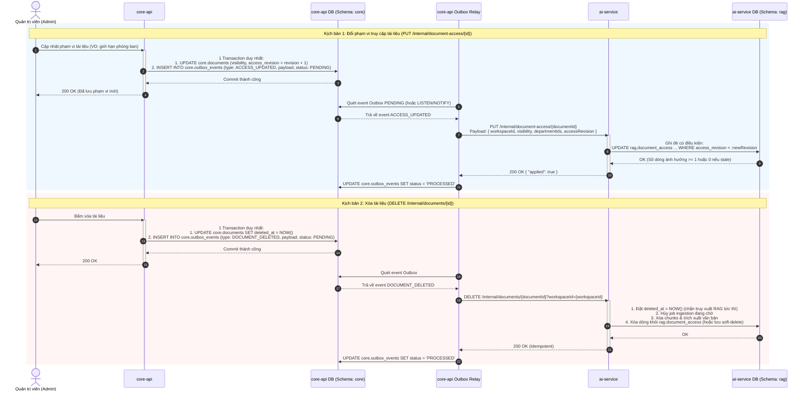

# TÀI LIỆU THIẾT KẾ KỸ THUẬT: ĐỒNG BỘ QUYỀN TRUY CẬP TÀI LIỆU (DOCUMENT ACCESS SYNC)

> **Mã tài liệu:** `TECH-V2-DOCUMENT-ACCESS-SYNC` | **Trạng thái:** `draft`  
> **Tham chiếu:** [ADR-004](../../02-architecture/adr/ADR-004-two-service-architecture.md), [ADR-007](../../02-architecture/adr/ADR-007-departments-member-profiles-document-access.md), [TECH-V2-core-api](TECH-V2-core-api.md), [TECH-V2-ai-service](TECH-V2-ai-service.md)

---

## 1. Tổng quan & Ranh giới Hệ thống (System Boundaries)

Hệ thống SOPilot V2 vận hành theo kiến trúc 2-service độc lập:
1. **`core-api`**: Là **nguồn sự thật duy nhất (Single Source of Truth)** về tài liệu, người dùng, phòng ban, phân quyền và phiên bản. Sở hữu schema `core`.
2. **`ai-service`**: Chịu trách nhiệm trích xuất văn bản, embedding, lưu trữ chunks và tìm kiếm ngữ nghĩa (RAG). Sở hữu schema `rag` và **hoàn toàn không truy cập schema `core`** (ADR-004 §4.3).

Để đảm bảo RAG truy xuất chính xác theo phân quyền (RBAC / Department filtering) mà không cần gọi ngược lại `core-api` trong thời gian thực khi inference, `ai-service` duy trì bảng bản sao trạng thái quyền: **`rag.document_access`** (mỗi tài liệu một dòng).

### Ranh giới đồng bộ:
- Mọi thay đổi về phạm vi truy cập hoặc trạng thái tồn tại của tài liệu từ `core-api` được đồng bộ sang `ai-service` thông qua **Transactional Outbox Pattern** với giao thức HTTP nội bộ.
- Cơ chế **ghi đè có kiểm tra thứ tự (`access_revision`)** để đảm bảo tính nhất quán (Eventual Consistency) và chống sự cố tin nhắn đến sai thứ tự (out-of-order delivery).

| Thành phần | Schema sở hữu | Vai trò trong luồng |
|---|---|---|
| `core-api` | `core` | Lưu trữ tài liệu, ghi sự kiện quyền vào `core.outbox_events` trong cùng transaction với thay đổi dữ liệu. |
| `outbox-worker` | - | Polling/relay các sự kiện `PENDING` từ `core.outbox_events`, gọi HTTP sang `ai-service`. |
| `ai-service` | `rag` | Nhận HTTP request nội bộ (`PUT /internal/document-access/{id}`, `DELETE /internal/documents/{id}`), ghi đè trạng thái tại `rag.document_access`. |

---

## 2. Sơ đồ tuần tự tương tác (Sequence Diagram)



---

## 3. Thiết kế Dữ liệu & Database Schema (Data Modeling)

### 3.1 Bảng `rag.document_access` (tại `ai-service`)
Bảng nắm giữ quyền hiện hành của từng tài liệu, mỗi tài liệu tương ứng một dòng duy nhất. Mọi truy vấn search vector chunk phải JOIN bảng này.

```sql
CREATE TABLE rag.document_access (
    workspace_id      uuid NOT NULL,
    document_id       uuid PRIMARY KEY,
    visibility        text NOT NULL CHECK (visibility IN ('WORKSPACE', 'DEPARTMENTS')),
    department_ids    uuid[] NOT NULL DEFAULT '{}',
    access_revision   bigint NOT NULL,
    active_version_id uuid,                 -- Phiên bản đang được truy xuất (NULL = chưa có bản READY)
    title             text NOT NULL,        -- Tiêu đề tài liệu lưu thời điểm ingest
    deleted_at        timestamptz,          -- Đánh dấu xóa mềm, lập tức ẩn khỏi truy vấn RAG
    updated_at        timestamptz NOT NULL DEFAULT now(),
    CHECK (visibility = 'WORKSPACE' OR cardinality(department_ids) >= 1)
);

CREATE INDEX ix_document_access_ws ON rag.document_access(workspace_id);
CREATE INDEX ix_document_access_depts ON rag.document_access USING gin (department_ids);
```

### 3.2 Bảng `core.outbox_events` (tại `core-api`)
Nơi ghi lại các biến động dữ liệu cần đẩy sang `ai-service`.

```sql
CREATE TABLE core.outbox_events (
    id            uuid PRIMARY KEY DEFAULT gen_random_uuid(),
    aggregate_type text NOT NULL,        -- 'DOCUMENT', 'DOCUMENT_ACCESS'
    aggregate_id  uuid NOT NULL,
    event_type    text NOT NULL,        -- 'ACCESS_UPDATED', 'DOCUMENT_DELETED'
    payload       jsonb NOT NULL,
    status        text NOT NULL DEFAULT 'PENDING' CHECK (status IN ('PENDING', 'PROCESSING', 'PROCESSED', 'DEAD')),
    retry_count   int NOT NULL DEFAULT 0,
    next_retry_at timestamptz DEFAULT now(),
    created_at    timestamptz NOT NULL DEFAULT now(),
    updated_at    timestamptz NOT NULL DEFAULT now()
);

CREATE INDEX ix_outbox_pending ON core.outbox_events(status, next_retry_at) 
WHERE status IN ('PENDING', 'PROCESSING');
```

---

## 4. Đặc tả Hợp đồng API Nội bộ (Internal API Contracts)

### 4.1 Cập nhật phạm vi truy cập: `PUT /internal/document-access/{documentId}`
Được gọi bởi Outbox Worker khi admin cập nhật quyền tài liệu trên `core-api`.

- **Mục đích:** Ghi đè trạng thái quyền mới nhất của tài liệu.
- **Tính chất:** Idempotent, không tác động tới chunk vector (theo FR-26: đổi phạm vi không chạy lại pipeline embedding).
- **Headers:**
  ```http
  Content-Type: application/json
  X-Internal-Token: <service-secret-token>
  ```
- **Request Body:**
  ```json
  {
    "workspaceId": "9b1deb4d-3b7d-4bad-9bdd-2b0d7b3dcb6d",
    "visibility": "DEPARTMENTS",
    "departmentIds": [
      "a0eebc99-9c0b-4ef8-bb6d-6bb9bd380a11",
      "b1eebc99-9c0b-4ef8-bb6d-6bb9bd380a22"
    ],
    "accessRevision": 4
  }
  ```
- **Xử lý tại `ai-service`:**
  Chỉ ghi đè nếu `accessRevision` gửi sang lớn hơn `access_revision` đang có trong database (tránh out-of-order delivery ghi đè dữ liệu cũ lên dữ liệu mới):
  ```sql
  UPDATE rag.document_access
  SET visibility = :visibility,
      department_ids = :departmentIds,
      access_revision = :accessRevision,
      updated_at = NOW()
  WHERE document_id = :documentId
    AND workspace_id = :workspaceId
    AND access_revision < :accessRevision;
  ```
- **Response:**
  - `200 OK`:
    ```json
    { "applied": true }
    ```
    *(Nếu `accessRevision` không mới hơn, trả về `{"applied": false}` nhưng vẫn là HTTP 200 để Outbox hoàn tất).*

---

### 4.2 Xóa tài liệu: `DELETE /internal/documents/{documentId}?workspaceId=...`
Được gọi khi admin xóa tài liệu trên `core-api`.

- **Mục đích:** Vô hiệu hóa và xóa toàn bộ dữ liệu vector của tài liệu khỏi không gian tìm kiếm.
- **Tính chất:** Idempotent.
- **Query Parameters:** `workspaceId=<uuid>`
- **Xử lý tại `ai-service`:**
  1. Cập nhật `deleted_at = NOW()` trong `rag.document_access` (truy xuất RAG lập tức bỏ qua tài liệu này).
  2. Hủy các job ingestion đang `QUEUED` / `PROCESSING` của tài liệu này.
  3. Xóa toàn bộ các chunk trong `rag.chunks` của các phiên bản tài liệu.
  4. Xóa kết quả trích xuất văn bản (`rag.extracted_documents`).
  5. Xóa dòng tương ứng trong `rag.document_access` (hoặc giữ lại trạng thái `deleted_at`).
- **Response:**
  - `200 OK`:
    ```json
    { "success": true, "message": "Document access and vectors removed" }
    ```

---

## 5. Ví dụ Minh họa Toàn diện (Walkthrough Examples)

Giả sử tài liệu **"Quy trình thanh toán công tác phí"** có `documentId = "doc-8888"`.

### Ví dụ 1: Admin tạo tài liệu & Ingest bản đầu tiên
1. `core-api` gọi `POST /internal/ingestions` gửi kèm thông tin tài liệu và quyền ban đầu (`visibility = "WORKSPACE"`, `accessRevision = 1`).
2. `ai-service` thực hiện ghi bản ghi đầu tiên vào `rag.document_access`:
   ```json
   {
     "workspace_id": "ws-1111",
     "document_id": "doc-8888",
     "visibility": "WORKSPACE",
     "department_ids": [],
     "access_revision": 1,
     "active_version_id": null,
     "title": "Quy trình thanh toán công tác phí",
     "deleted_at": null,
     "updated_at": "2026-11-09T08:00:00Z"
   }
   ```
3. Sau khi Ingestion Job hoàn thành trích xuất và embedding, worker của `ai-service` cập nhật:
   `active_version_id = "ver-0001"`. Tài liệu bắt đầu sẵn sàng phục vụ RAG.

---

### Ví dụ 2: Admin đổi phạm vi truy cập sang Phòng Kế toán & Nhân sự
1. **Admin** chọn giới hạn phòng ban `dept-acc` (Kế toán) và `dept-hr` (Nhân sự) trên giao diện `core-api`.
2. **`core-api`** tăng revision: `access_revision = 2`. Transaction ghi dữ liệu và ghi Outbox:
   ```json
   {
     "aggregateType": "DOCUMENT_ACCESS",
     "aggregateId": "doc-8888",
     "eventType": "ACCESS_UPDATED",
     "payload": {
       "workspaceId": "ws-1111",
       "visibility": "DEPARTMENTS",
       "departmentIds": ["dept-acc", "dept-hr"],
       "accessRevision": 2
     }
   }
   ```
3. **Outbox Worker** gửi `PUT /internal/document-access/doc-8888`.
4. **`ai-service`** nhận request và **ghi đè** dữ liệu:
   ```json
   {
     "workspace_id": "ws-1111",
     "document_id": "doc-8888",
     "visibility": "DEPARTMENTS",
     "department_ids": ["dept-acc", "dept-hr"],
     "access_revision": 2,
     "active_version_id": "ver-0001",
     "title": "Quy trình thanh toán công tác phí",
     "deleted_at": null,
     "updated_at": "2026-11-09T09:15:00Z"
   }
   ```

---

### Ví dụ 3: Xử lý sự cố Out-of-order Delivery (Mạng chập chờn)
1. Admin đổi quyền từ `DEPARTMENTS` sang `WORKSPACE` (`accessRevision = 3`).
2. Ngay sau đó (trong vài giây), Admin phát hiện nhầm và đổi lại sang chỉ phòng `dept-board` (`accessRevision = 4`).
3. Giả sử vì nghẽn mạng, gói tin `accessRevision = 4` đến `ai-service` trước.
   - `ai-service` cập nhật dòng thành `access_revision = 4`.
4. Vài giây sau, gói tin `accessRevision = 3` mới tới `ai-service`:
   - Câu lệnh SQL kiểm tra: `WHERE access_revision < 3`.
   - Kết quả: Không khớp điều kiện (vì hiện tại đã là 4). Dòng **không bị ghi đè dữ liệu cũ**.
   - `ai-service` phản hồi: `200 {"applied": false}`. Hệ thống giữ vững tính toàn vẹn dữ liệu.

---

### Ví dụ 4: Xóa tài liệu
1. Admin bấm xóa tài liệu `doc-8888`.
2. `core-api` sinh event `DOCUMENT_DELETED`.
3. Outbox gọi `DELETE /internal/documents/doc-8888?workspaceId=ws-1111`.
4. `ai-service` thực hiện:
   ```sql
   UPDATE rag.document_access 
   SET deleted_at = NOW() 
   WHERE document_id = 'doc-8888' AND workspace_id = 'ws-1111';
   ```
   Sau đó ngầm thu hồi và dọn dẹp các chunk trong `rag.chunks`.

---

## 6. Cơ chế Truy vấn Tìm kiếm RAG (RAG Retrieval Isolation)

Khi người dùng thực hiện hỏi đáp (Chat QA), API Gateway / Core truyền danh tính người dùng gồm `workspace_id` và `user_department_ids`. `ai-service` thực thi tìm kiếm vector với mệnh đề bắt buộc:

```sql
SELECT 
    c.id AS chunk_id,
    c.content,
    c.heading,
    da.title AS document_title
FROM rag.chunks c
JOIN rag.document_access da 
  ON c.document_id = da.document_id 
 AND c.workspace_id = da.workspace_id
WHERE da.workspace_id = :workspaceId
  AND da.deleted_at IS NULL
  AND da.active_version_id IS NOT NULL
  AND c.version_id = da.active_version_id
  AND (
      da.visibility = 'WORKSPACE'
      OR da.department_ids && :userDepartmentIds::uuid[]
  )
ORDER BY c.embedding <=> :queryEmbedding
LIMIT 5;
```

> **Nguyên tắc "Fail-closed":** 
> Nếu tài liệu chưa có dòng tương ứng trong `rag.document_access`, mệnh đề `INNER JOIN` sẽ loại bỏ toàn bộ chunk của tài liệu đó, đảm bảo tuyệt đối không rò rỉ dữ liệu khi chưa đồng bộ xong quyền.

---

## 7. Chiến lược Kiểm thử (Testing Strategy)

1. **Unit Test**:
   - Kiểm tra `core-api`: Khi lưu quyền tài liệu, bản ghi Outbox phải được tạo trong cùng transaction DB (nếu DB lỗi, cả hai cùng rollback).
   - Kiểm tra `ai-service`: Xử lý endpoint `PUT /internal/document-access/{id}` trả về `applied = false` khi `accessRevision` nhỏ hơn hoặc bằng revision hiện tại.
2. **Integration Test**:
   - Chạy Outbox Worker để chuyển event từ `core.outbox_events` sang `ai-service`.
   - Kiểm tra kịch bản idempotency: Bắn lại 1 payload 3 lần, trạng thái trong `rag.document_access` không đổi và worker đều nhận về `200 OK`.
3. **Security Test (Tenant & Department Isolation)**:
   - Tạo 1 tài liệu cho `dept-finance`.
   - Dùng tài khoản thuộc `dept-marketing` hỏi bot câu hỏi liên quan.
   - Xác nhận câu trả lời không trích dẫn hoặc chứa thông tin từ tài liệu của `dept-finance`.
