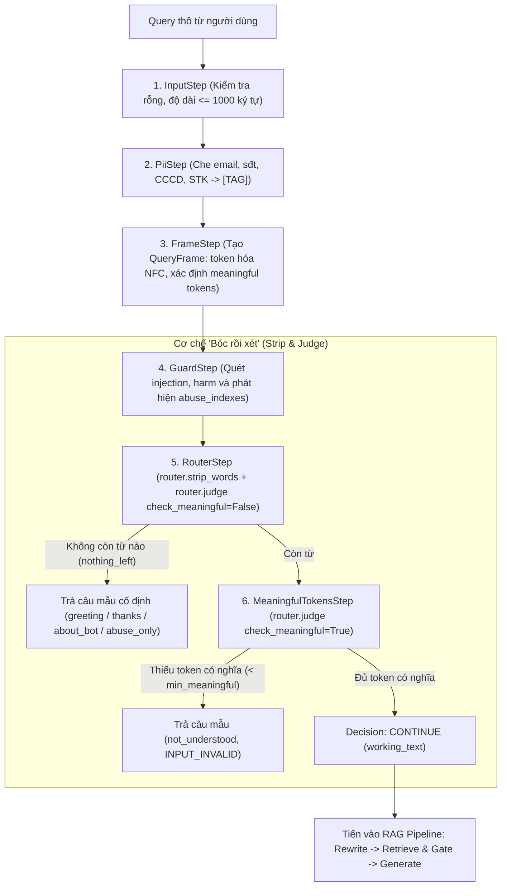

# TÀI LIỆU THIẾT KẾ KỸ THUẬT: CƠ CHẾ "BÓC RỒI XÉT" (STRIP & JUDGE)

> **Mã tài liệu:** `TECH-V2-qa-strip-and-judge` | **Tham chiếu:** `TECH-V2-ai-service §7.1`, `PRD-V2 FR-13`, `V2-10` | **Trạng thái:** `draft`

---

## 1. Bối cảnh & Mục tiêu Kỹ thuật

Trong các hệ thống RAG nội bộ tra cứu quy trình chuẩn (SOP), câu hỏi của người dùng thường chứa:
- Từ ngữ chào hỏi giao tiếp (*"xin chào"*, *"hello"*).
- Lời cảm ơn (*"cảm ơn"*, *"thanks"*).
- Câu hỏi về danh tính trợ lý (*"bạn là ai?"*, *"bạn làm được gì?"*).
- Từ ngữ cảm thán hoặc xúc phạm/thô tục (*"ngu quá"*, *"đm"*).

### Vấn đề với cách tiếp cận truyền thống
Nếu đưa trực tiếp câu hỏi thô vào mô hình sinh hoặc dùng LLM Classifier để phân loại ý định:
1. **Lãng phí chi phí & Độ trễ cao:** Một lượt phân loại intent bằng LLM tốn 300–800ms và tiêu tốn quota không cần thiết cho những câu chào hỏi hiển nhiên.
2. **Dễ tổn thương trước Prompt Injection:** Câu hỏi chứa mã độc có thể đánh lừa bước phân loại intent.
3. **Hiện tượng False Positive với từ viết tắt:** Trong tài liệu SOP, nhiều thuật ngữ viết tắt dễ bị bộ lọc thô tục gán nhãn nhầm (ví dụ: *"định mức"* viết tắt là *"đm"*, *"vật liệu"* viết tắt là *"vl"*, *"chứng chỉ"* viết tắt là *"cc"*, hoặc các mã tài liệu như `QT-VL-02`).

### Giải pháp SOPilot: Quy tắc "Bóc rồi xét" (Strip & Judge)
- Thay thế toàn bộ LLM Intent Classifier bằng quy tắc so khớp tất định (deterministic rule-based).
- **Bóc (Strip):** Tách bỏ các từ chào hỏi, cảm ơn, hỏi về bot và từ ngữ thô tục ra khỏi chuỗi ký tự nguyên gốc mà không làm mất vị trí các token còn lại.
- **Xét (Judge):** Đánh giá phần còn lại của câu hỏi:
  - Nếu không còn gì hoặc dưới ngưỡng token có nghĩa (`min_meaningful_tokens`): Trả ngay câu mẫu cố định (`TEMPLATE`), kết thúc chuỗi xử lý.
  - Nếu còn nội dung có nghĩa: Cho phép đi tiếp vào pipeline RAG trên phần văn bản đã bóc (`working_text`).

---

## 2. Kiến trúc & Vị trí trong QA Pipeline

Cơ chế "Bóc rồi xét" nằm ở các bước đầu tiên của QA Pipeline trong `services/ai-service`, thực thi tuần tự theo chuỗi `Step` của `qa/pipeline.py`:



---

## 3. Cấu trúc Dữ liệu (Data Contracts)

Hệ thống sử dụng các cấu trúc dữ liệu bất biến (immutable dataclasses) tại `sopilot_ai.qa`:

### 3.1 `Token` ([`qa/textnorm.py`](file:///C:/Users/Tien/Workspace/Personal/SOPilot/services/ai-service/src/sopilot_ai/qa/textnorm.py))
```python
@dataclass(frozen=True)
class Token:
    index: int          # Thứ tự token trong câu (0, 1, 2...)
    raw: str            # Ký tự chữ thường chuẩn NFC, giữ nguyên dấu
    folded: str         # Bỏ dấu tiếng Việt, giải mã leetspeak (0->o, 1->i, 3->e, 4->a, 5->s, 7->t)
    start: int          # Vị trí ký tự bắt đầu trong chuỗi văn bản NFC gốc
    end: int            # Vị trí ký tự kết thúc trong chuỗi văn bản NFC gốc
```

### 3.2 `Stripped` ([`qa/router.py`](file:///C:/Users/Tien/Workspace/Personal/SOPilot/services/ai-service/src/sopilot_ai/qa/router.py))
```python
@dataclass(frozen=True)
class Stripped:
    working_text: str          # Văn bản sau khi cắt bỏ token, chuẩn hóa khoảng trắng và dấu câu
    kinds: tuple[str, ...]     # Danh sách loại bị bóc: ("about_bot", "thanks", "greeting", "abuse")
    removed: frozenset[int]    # Tập hợp các token index đã bị cắt bỏ
    nothing_left: bool         # True nếu toàn bộ token trong câu đều bị bóc
```

### 3.3 `RouteResult` ([`qa/router.py`](file:///C:/Users/Tien/Workspace/Personal/SOPilot/services/ai-service/src/sopilot_ai/qa/router.py))
```python
@dataclass(frozen=True)
class RouteResult:
    working_text: str          # Chuỗi văn bản đưa vào RAG
    stripped: tuple[str, ...]  # Các loại đã bóc
    removed: frozenset[int]    # Chỉ số token đã loại bỏ
    template_key: str | None   # Key trong templates.yaml nếu trả câu mẫu, None nếu đi tiếp
    refusal_reason: str | None # "INPUT_INVALID" đối với not_understood, ngược lại None
```

---

## 4. Chi tiết Thuật toán: Bóc và Xét

### 4.1 Quy trình Bóc (`router.strip_words`)

Hàm [`strip_words(frame, abuse_indexes)`](file:///C:/Users/Tien/Workspace/Personal/SOPilot/services/ai-service/src/sopilot_ai/qa/router.py) thực thi việc bóc tách:
1. **Tiếp nhận chỉ mục thô tục:** `removed` khởi tạo với toàn bộ `abuse_indexes` được tìm thấy từ bước Guard.
2. **Khớp cụm từ theo độ ưu tiên:** Quét tuần tự qua danh sách loại có thể bóc `_STRIPPABLE = ("about_bot", "thanks", "greeting")`:
   - Lấy danh sách trigger từ `qa/templates.yaml`.
   - Sử dụng `match_phrases(frame.tokens, triggers, use_folded=True)`: So khớp nguyên từ trên biểu diễn `folded`. Cụm từ dài hơn được ưu tiên khớp trước (`-len(phrase)`).
   - Loại trừ các token đã thuộc nhóm `abuse` (từ thô tục không bị chuyển nhầm thành câu chào).
   - Bổ sung chỉ số token vào `removed`.
3. **Cắt token và tái tạo chuỗi văn bản:**
   - Gọi `remove_tokens(frame.text, frame.tokens, removed)`: Cắt bỏ các lát cắt `[start:end]` tương ứng với các token bị loại bỏ trực tiếp trên chuỗi văn bản gốc.
   - Chuẩn hóa khoảng trắng kép thành khoảng trắng đơn, loại bỏ khoảng trắng trước dấu câu (`re.sub(r"\s+([,.;:!?])", r"\1", cleaned)`), loại bỏ dấu câu thừa ở hai đầu.
4. **Xác định trạng thái rỗng:** `nothing_left = all(t.index in removed for t in frame.tokens)`.

### 4.2 Quy trình Xét (`router.judge`)

Hàm [`judge(frame, stripped, min_meaningful=None, check_meaningful=True)`](file:///C:/Users/Tien/Workspace/Personal/SOPilot/services/ai-service/src/sopilot_ai/qa/router.py) đưa ra phán quyết:
- **Trường hợp 1: `stripped.nothing_left == True`** (Được kiểm tra tại `RouterStep`):
  - Toàn bộ câu hỏi chỉ gồm từ chào hỏi, cảm ơn hoặc chửi tục.
  - Chọn câu mẫu thông qua hàm `_template_for(stripped.kinds)`:
    - Nếu có chứa `"abuse"`: Trả về template `abuse_only` (câu trung tính kèm gợi ý cách đặt câu hỏi).
    - Ngược lại, chọn loại có `priority` cao nhất: `about_bot` (ưu tiên 3) > `thanks` (ưu tiên 2) > `greeting` (ưu tiên 1).
    - Nếu không bóc được loại nào mà vẫn rỗng (toàn ký tự lạ): Trả về `not_understood` (`refusal_reason = "INPUT_INVALID"`).
- **Trường hợp 2: `check_meaningful == True`** (Được kiểm tra tại `MeaningfulTokensStep`):
  - Tính số lượng token có nghĩa còn lại: `count = frame.meaningful_count(stripped.removed)`.
  - Một token được coi là có nghĩa nếu:
    - Nằm trong tập từ vựng tài liệu người dùng (`known_terms` đọc từ `rag.chunk_terms` qua access filter).
    - Nằm trong từ điển phổ thông song ngữ [`qa/lexicon.yaml`](file:///C:/Users/Tien/Workspace/Personal/SOPilot/services/ai-service/src/sopilot_ai/qa/lexicon.yaml).
  - Nếu `count < min_meaningful` (mặc định ngưỡng là 1 trong `qa/guard_rules.yaml`):
    - Câu hỏi có chữ nhưng vô nghĩa hoặc mơ hồ (ví dụ: *"chào bạn nhé"*, *"asdf qwer"*, *"cái này sao"*).
    - Trả về câu mẫu tương ứng hoặc `not_understood`.

---

## 5. Xử lý các Trường hợp Đặc biệt (Edge Cases)

| Trường hợp | Nguy cơ | Giải pháp thiết kế |
|---|---|---|
| **Từ va chạm dấu tiếng Việt**<br/>(*"nguồn"* vs *"ngu"*, *"các"* vs *"cac"*, *"buổi"* vs *"buoi"*) | Bị bộ lọc thô tục xóa nhầm từ khóa nghiệp vụ hợp lệ | - So khớp thô tục bằng ranh giới nguyên từ (`match_phrases`), không tìm chuỗi con.<br/>- Các từ có nghĩa lành mạnh khi có dấu chỉ xuất hiện trong danh sách `abuse.accented` (chỉ khớp khi câu gốc có dấu). |
| **Mã tài liệu & Từ viết tắt**<br/>(*"QT-VL-02"*, *"cc"*, *"đm"*, *"vl"*) | *"cc"*, *"đm"*, *"vl"* bị nhận nhầm thành chửi thề thay vì *"chứng chỉ"*, *"định mức"*, *"vật liệu"* | - Phân loại vào danh sách `standalone_only`.<br/>- Chỉ tính là thô tục khi câu siêu ngắn (`len(tokens) <= 3`).<br/>- Kiểm tra hàm `_inside_code`: nếu token tiếp giáp với `-` hoặc `/` (như `QT-VL-02` hoặc `cc/dm`) thì tuyệt đối không tính là thô tục. |
| **Câu chửi thề kèm câu hỏi thực**<br/>(*"ngu quá, quy trình nghỉ phép thế nào?"*) | Hệ thống từ chối trả lời, gây ức chế cho người dùng | - Bóc từ *"ngu"*, ghi sự kiện cờ cảnh báo `guard_events(INPUT_FLAG, "abuse.profanity")`.<br/>- Giữ lại phần câu hỏi hợp lệ: *"quá, quy trình nghỉ phép thế nào?"* làm `working_text` để tiếp tục đưa vào RAG. |
| **Bảo vệ System Prompt Injection** | Dùng câu chào giả mạo để né Guard | `GuardStep` luôn chạy trước `RouterStep`. Mọi câu lệnh chứa mẫu tấn công xâm nhập prompt hoặc giả mạo system role đều bị chặn ngay ở lớp Guard (`Decision.REFUSE`, `REFUSED_GUARD`). Chi tiết cơ chế bảo vệ xem tại [TECH-V2-qa-guard-and-defense](TECH-V2-qa-guard-and-defense.md). |

---

## 6. Mối quan hệ với Hệ thống Guarding Toàn diện

Cơ chế "Bóc rồi xét" chỉ đảm nhiệm việc tiền xử lý câu hỏi sạch, phân luồng câu chào/cảm ơn/thô tục và lọc câu vô nghĩa. Các cơ chế bảo vệ đa tầng nâng cao (chặn prompt injection tinh vi, chống rò rỉ prompt qua Canary Token, cổng kiểm soát truy xuất tài liệu và Semantic Router cho vùng xám) được đặc tả riêng biệt tại:

👉 [**`TECH-V2-qa-guard-and-defense` (Hệ thống Guarding và Cơ chế Phòng vệ Đa tầng trong QA Pipeline)**](TECH-V2-qa-guard-and-defense.md).

---

## 7. Kế hoạch Kiểm thử & Xác minh

Toàn bộ cơ chế đã được kiểm chứng bằng bộ test tự động tại [`services/ai-service/tests/unit/test_qa_input_rules.py`](file:///C:/Users/Tien/Workspace/Personal/SOPilot/services/ai-service/tests/unit/test_qa_input_rules.py):

1. **`test_words_that_collide_when_accents_are_stripped_are_not_profanity`**: Kiểm tra các câu chứa *"nguồn"*, *"các bước"*, *"buổi họp"*, *"cc là gì"*, *"đm trong quy trình"* đều vượt qua thành công (`Decision.CONTINUE`).
2. **`test_a_question_that_is_only_profanity_gets_the_neutral_sentence`**: Các câu chỉ chứa từ ngữ xúc phạm nhận diện đúng template `abuse_only`.
3. **`test_profanity_with_a_question_is_answered_on_the_stripped_text`**: Câu chửi kèm câu hỏi được bóc sạch từ chửi và đưa phần nội dung vào RAG.
4. **`test_greetings_thanks_and_about_bot_get_a_template`**: Các câu giao tiếp đơn thuần trả về đúng mẫu template mà không kích hoạt gọi mô hình LLM.
5. **`test_a_greeting_before_a_question_is_stripped_and_the_question_goes_to_rag`**: Lời chào đứng trước câu hỏi được bóc tách chính xác, câu hỏi giữ nguyên vẹn.
