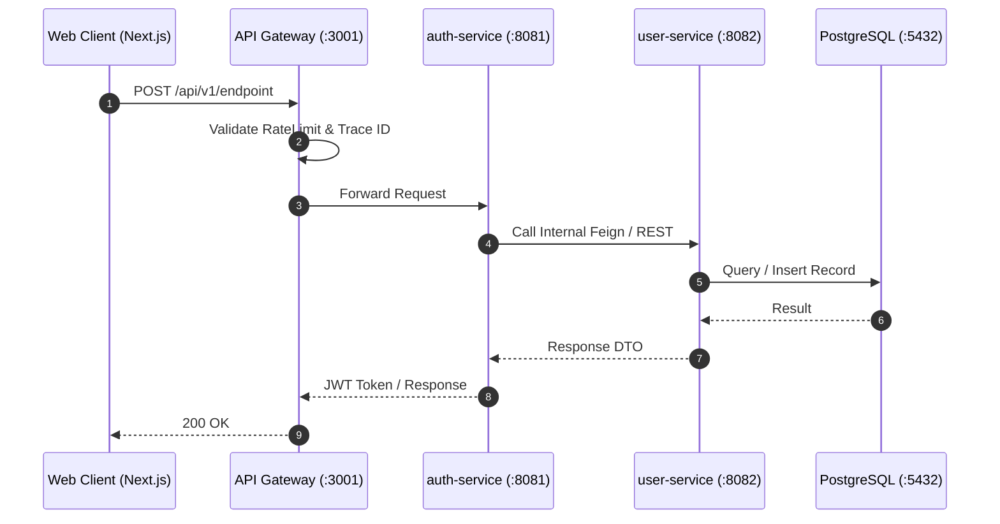

# TÀI LIỆU THIẾT KẾ KỸ THUẬT (TECHNICAL DESIGN DOCUMENT)

> **Mã tài liệu:** `TECH-XXX` | **Tham chiếu PRD:** `PRD-XXX` | **Trạng thái:** `[status]`

---

## 1. Tổng quan Kiến trúc & Thành phần bị ảnh hưởng (System Topology Impact)

| Thành phần | Công nghệ | Ranh giới Schema / Vai trò | Bản chất thay đổi |
|---|---|---|---|
| `infrastructure` | PostgreSQL 16 | Schema: `core` | Migration DDL mới |
| `user-service` | Spring Boot 3.4 | Schema: `core` | Thêm Entity, Service, Controller |
| `auth-service` | Spring Boot 3.4 | Schema: `core` | Xác thực token, cấp JWT |
| `api-gateway` | NestJS 11 | In-memory Proxy | Thêm routing, RBAC Guard |
| `frontend/web` | Next.js 16 | React 19 / Zustand | Dựng UI, gọi API Client |

---

## 2. Sơ đồ tuần tự tương tác (Sequence Diagram)



---

## 3. Thiết kế Dữ liệu & Database Schema (Data Modeling)

- **Target Schema:** `core` / `metadata` / `knowledge` / `conversation` / `analytics`
- **File Migration:** `infrastructure/init-db/0XX_xxx.sql`

```sql
-- DDL Script Spec
CREATE TABLE IF NOT EXISTS schema_name.table_name (
    id UUID PRIMARY KEY DEFAULT uuid_generate_v4(),
    created_at TIMESTAMPTZ DEFAULT CURRENT_TIMESTAMP,
    updated_at TIMESTAMPTZ DEFAULT CURRENT_TIMESTAMP
);
```

### Ràng buộc & Chỉ mục (Indexes & Constraints):
- `UNIQUE INDEX`: ...
- `FOREIGN KEY`: Phải đảm bảo cùng schema, không cross-schema FK.

---

## 4. Đặc tả Hợp đồng API (API Contracts)

### Endpoint: `POST /api/v1/resource/action`
- **Mục đích:** ...
- **Quyền hạn (RBAC):** `ADMIN` | `MANAGER` | `USER` | `@Public`
- **Headers bắt buộc:**
  ```http
  Authorization: Bearer <jwt-token>
  Content-Type: application/json
  X-Trace-Id: <uuid-v4>
  ```
- **Request Body Payload:**
  ```json
  {
    "field": "value"
  }
  ```
- **Response Success (200 OK):**
  ```json
  {
    "success": true,
    "data": {},
    "timestamp": "2026-09-25T10:00:00Z"
  }
  ```
- **Error Cases (400, 403, 404, 409):**
  ```json
  {
    "success": false,
    "error": {
      "code": "INVALID_ARGUMENT",
      "message": "Chi tiết lỗi"
    }
  }
  ```

---

## 5. Sự kiện & Tích hợp Bất đồng bộ (RabbitMQ Events)
- **Exchange:** `sopilot.events` (Topic)
- **Routing Key:** `domain.action` (ví dụ: `user.roster.claimed`)
- **Event Payload Schema:**
  ```json
  {
    "eventId": "uuid",
    "eventType": "user.roster.claimed",
    "timestamp": "2026-09-25T10:00:00Z",
    "payload": {}
  }
  ```

---

## 6. Chiến lược Kiểm thử Kỹ thuật (Testing Strategy)
- **Unit Test:** Mock dependencies, kiểm tra logic validation, mapper, status transitions.
- **Integration Test:** Kiểm tra giao dịch DB (Transactions), rollback, constraints.
- **Security Check:** Kiểm tra chặn truy cập khi sai token, sai role.
