> **Owner chốt 2026-10-20:** hoãn DOCX sau MVP V2 để giảm độ phức tạp trích xuất và kiểm thử. Phạm vi hiện hành là PDF có lớp chữ, MD, TXT (PRD-V2 FR-06); DOCX trả `415` ở upload, không tạo job, hướng dẫn xuất PDF có lớp chữ. Các nhận xét DOCX trong audit là lịch sử, không phải yêu cầu nghiệm thu MVP. Không đổi trạng thái hoặc bộ đếm ticket. *Sửa 2026-10-21: TXT cũng bị bỏ, phạm vi còn PDF có lớp chữ và MD.*

> **Owner chốt 2026-11-01 (V2-02 done):** bỏ Gemini và Groq `gpt-oss-120b` khỏi sinh câu trả lời và giám khảo faithfulness; tự host model mã nguồn mở nhỏ trên Modal (hai tài khoản Starter, mỗi tài khoản $30/tháng). Guard giữ luật, metadata/embedding/rerank giữ nguyên. ADR-006 §4.4 đã viết lại cùng ngày. Bake-off chọn model cụ thể và sửa PRD-V2 FR-13, TECH-V2-ai-service theo hướng này làm trong `V2-10`; không thêm ticket, chỉ `V2-02` đổi sang `done` (`completed_tickets` 5 → 6, `review_tickets` 4 → 3).

> **Owner chốt 2026-10-20 (V2-03 done):** ưu tiên nghiên cứu khoa học, hạn mức thương mại (FR-09: tài liệu, dung lượng, câu hỏi/ngày) mặc định tắt; giới hạn kỹ thuật (20 MB/file, RPM/TPM provider) giữ nguyên. TECH-V2 duyệt theo đề xuất; FR-16/FR-17 chuyển sang ai-service (V2-13 scope `ai-qa`). Duyệt PRD-V2-ingestion-mvp-scope: chọn ≤ 10 file mỗi lượt (FR-30, V2-15) và bản thay thế trùng SHA-256 là no-op (V2-12). *Sửa 2026-10-21: hạn mức tài liệu/dung lượng mặc định bật lại 50/200 MB; hạn mức câu hỏi vẫn tắt.*

> **Owner chốt 2026-10-21 (chuẩn hóa Markdown và màn xem trích xuất, [AUDIT-markdown-normalization](../04-reports/AUDIT-markdown-normalization-and-preview-2026-10-21.md)):** MVP chỉ nhận PDF có lớp chữ và Markdown (bỏ TXT). Một thư viện PDF chuyển thẳng sang biểu diễn có cấu trúc, render một bản Markdown chuẩn sau làm sạch làm nguồn chung cho chunk/index/trích dẫn/gợi ý metadata; chọn thư viện trong `V2-20` (timebox 2 ngày, ứng viên Docling và PyMuPDF, ghi ADR-008). *Sửa 2026-10-21 (owner): đã chốt **Docling**, [ADR-008](../02-architecture/adr/ADR-008-pdf-extraction-docling.md) `approved` nhưng chưa có số đo; `V2-20` xác nhận theo ràng buộc cứng thay vì so sánh hai thư viện.* Màn "Nội dung hệ thống nhận diện" (PRD-V2 FR-31) chỉ mở khi `READY`. Hạn mức tài liệu mặc định bật 50 tài liệu/200 MB; hạn mức câu hỏi vẫn tắt. Quy tắc thay bản khi đang xử lý (`409 VERSION_IN_PROGRESS`) và sửa thử lại (job `FAILED` quay lại hàng đợi theo `attempt`). PRD-V2-ingestion-mvp-scope hợp nhất vào PRD-V2 và chuyển `superseded`. Sửa tiêu chí `V2-09`, `V2-12`, `V2-15`, `V2-16`, `V2-19` đến `V2-22`, `V2-25`; không thêm ticket, không đổi trạng thái hay bộ đếm.

> **Owner chốt 2026-10-20 (câu thô tục và câu không cần tri thức):** `V2-10` mở rộng luật FR-13 với từ điển thô tục VI/EN (ranh giới từ, còn dấu với các từ trùng khi bỏ dấu), router "bóc rồi xét" (câu chỉ chửi bot trả câu mẫu, chửi kèm câu hỏi vẫn trả lời) và nhóm có hại thật ở mức chặn. Chọn **luật + semantic router** (so embedding câu hỏi với câu mẫu, không gọi LLM), bỏ phương án LLM classifier cho vùng xám; PRD-V2 FR-13 và ADR-006 §4.4 sửa theo. Thêm `V2-27` (P1): router trong ai-service, bộ dữ liệu định tuyến có nhãn, đo so với chỉ luật để chỉnh ngưỡng và quyết bật mặc định.

> **Rà soát trước implement 2026-10-21:** `V2-07` phụ thuộc thêm `V2-22` (số liệu RQ chính thức chạy bằng bộ chunk `docproc`, smoke/thăm dò vẫn chạy trước được); `V2-09` phụ thuộc thêm `V2-06` (so khớp harness). `V2-20` dựng khung `services/ai-service` và scope build/test; `V2-08` tạo ba role DB; tokenizer, offset hàng bảng, phân loại lỗi thử lại ghi ở TECH-V2-ai-service §1.1, §5.1, §5.2, §6.5. Không thêm ticket, không đổi trạng thái hay bộ đếm.

> **Owner chốt 2026-10-21 (rà soát kiến trúc RAG theo bài toán SOP):** giữ hybrid + RRF + rerank tùy chọn + cổng ngưỡng, thêm ba thay đổi không gọi LLM (TECH-V2-ai-service §5.4, §6.4, §6.4a, §12a): (A) mã tài liệu `docCode` trong `index_text` (`V2-22`, worker truyền ở `V2-09`); (B) ghép context small-to-big theo nhóm cùng mục sau cổng ngưỡng, kèm ablation bật/tắt (`V2-10`); (C) hệ số BM25 khi câu hỏi khác ngôn ngữ chunk, mặc định `1.0`, chỉ đổi theo RQ1b (`V2-07`, cài ở `V2-09`). GraphRAG, RAPTOR, iterative/agentic, HyDE/multi-query không đưa vào V2. Không thêm ticket, không đổi phụ thuộc, trạng thái hay bộ đếm.

> **Owner chốt 2026-10-21 (audit đầu-cuối ai-service theo loại query, quyết định D1–D11, chi tiết ở [TECH-V2-ai-service](../02-architecture/designs/TECH-V2-ai-service.md) §11a):** sửa tiêu chí `V2-06` (gold theo span, nhãn `query_types`), `V2-07` (tokenizer có term bỏ dấu và cổng `dense_score` cài vào harness trước số liệu chính thức), `V2-09` (cột `refusal_reason`/`route`/`rewrite_status`/`checks` trong migration, `doc_code_boost`, `reindex`, kiểm model embedding), `V2-10` (đầu vào, nối tiếp, PII, `refusal_reason`, `<source code rev effective>`, kiểm số/ngày, fallback không chuyển sau `delta`), `V2-13` (danh sách khoảng trống chỉ gồm loại cần bổ sung tài liệu, câu hỏi đã che PII), `V2-15` (nhãn "Phiên bản cũ"), `V2-16` (đo TTFT đầu-cuối), `V2-19` (nhãn ô gộp, PDF 1–2 trang, đếm tham chiếu chéo), `V2-20` (span ô gộp), `V2-21` (số trang tối thiểu cho header/footer), `V2-22` (lặp ô gộp xuống từng hàng), `V2-27` (router mở rộng chạy sau cổng, đo `followup` qua pipeline). **Thêm `V2-28`** (bộ kiểm hệ thống SOP tiếng Việt, P1, size M): `total_tickets` 27 → 28, không đổi trạng thái hay các bộ đếm khác. Hoãn sau MVP (xét lại khi): tách câu nhiều ý, hỏi lại khi mơ hồ, mở rộng tham chiếu trong tài liệu (D6), chunk `DOC_INFO`, `lang` theo chunk, từ điển viết tắt (TECH-V2-ai-service §12a).

> **Chuẩn bị triển khai 2026-10-24:** tách V2-11 XL thành V2-11 (identity/JIT), V2-29 (workspace/session), V2-30 (lời mời/OWNER); tách V2-15 XL thành V2-15 (khung/chat), V2-31 (upload), V2-32 (viewer), V2-33 (quản trị). Giữ nguyên phạm vi đã duyệt, tổng 33 ticket. DAG và `blocks` đồng bộ; bàn giao chờ thêm V2-04/V2-27/V2-28 và từng phần frontend. V2-04 đã review tài liệu và `done`; V2-05/V2-08 giữ `review` cho delta mới; V2-06/V2-19 `in-progress` phần công cụ, chưa có gold được duyệt. Xem [AUDIT readiness](../04-reports/AUDIT-v2-readiness-preparation-2026-10-24.md).

# KẾ HOẠCH TRIỂN KHAI THỰC THI (EXECUTION PLAN)

> **Mã kế hoạch:** `PLAN-V2-SOPILOT-MVP` | **Trạng thái:** `approved` (owner duyệt 2026-10-20)
>
> **Ràng buộc quy trình:** PRD-V2 và ADR-004/005/006/007 được owner duyệt ngày 2026-10-20 (`V2-01`). Ngày 2026-10-19 phạm vi được mở lại để giữ quản lý nhân sự, phòng ban phẳng, category/metadata và phân quyền tài liệu theo phòng ban (ADR-007). Theo `AGENTS.md`, PLAN đã qua cổng duyệt khi `V2-01` hoàn thành ngày 2026-10-20. Các ticket nghiên cứu (`V2-05` đến `V2-07`, `V2-19`) không phụ thuộc quyết định kiến trúc nên được chạy trước. Ingestion được tách thành `V2-19` đến `V2-22` theo [AUDIT-ingestion-sop-data](../04-reports/AUDIT-ingestion-sop-data-2026-10-19.md).

---

## 1. Mục tiêu & phạm vi

**Đích:** bàn giao nghiên cứu khoa học, hệ thống **chạy được bằng `docker compose up` trên máy local**. Không deploy (B1/B2 ngoài phạm vi; B3 Cloudflare Tunnel chỉ là tùy chọn sau cùng).

**Thứ tự (hướng A, owner chốt 2026-10-17):** làm phần có giá trị nghiên cứu trước (đo chất lượng truy xuất), rồi mới viết lại sang 2 service, trim và thêm tính năng. Lý do: lõi RAG đa ngôn ngữ (VI, EN) chưa từng được đo; nếu số liệu kém thì chỉnh hướng trước khi đầu tư vào phần còn lại.

**Nguyên tắc khả thi (owner chốt 2026-10-17):** mục tiêu là hệ thống chạy được và bench được để báo cáo, không phải chọn cấu hình tốt nhất tuyệt đối. Áp dụng khi chọn bất kỳ thứ gì trong kế hoạch:
1. Phải chạy được trên máy owner (CPU, không GPU) và miễn phí; nếu không chắc thì đo thử trước khi cam kết.
2. Mỗi lựa chọn nặng (rerank, LLM giám khảo, model embedding lớn) có phương án rút gọn: tập con cố định hoặc model nhỏ hơn; báo cáo ghi chi phí đo được.
3. Khi hai phương án chênh nhau ít mà một bên khó chạy hơn nhiều, chọn bên chạy được và ghi lại đánh đổi.
4. Cắt P1 và tính năng không phục vụ bench/chạy được trước khi cắt thời gian của phần đo.

| Nhóm việc | Nội dung | Ticket |
|---|---|---|
| **Quyết định** | Duyệt tài liệu, TECH, xác nhận provider, đóng backlog cũ | V2-01 đến V2-04 |
| **Nghiên cứu** | Eval harness, bộ dữ liệu, chạy RQ1–RQ3/RQ5; đo semantic router so với chỉ luật | V2-05 đến V2-07, V2-27 |
| **Cập nhật tính năng hiện có** | Sửa LLM, reranker, thang điểm, embedding provenance, auth hardening (khi port sang V2) | V2-09, V2-10, V2-11 |
| **Trim** | Còn 2 service; bỏ roster tạo trước, ACL tổng quát, cây phòng ban/category, OTP/mật khẩu, OnlyOffice, analytics, gateway, RabbitMQ, Redis | V2-08, V2-17 (gỡ code cũ) |
| **Thêm tính năng quan trọng** | Workspace + tenant + RLS, lời mời, trích dẫn có kiểm chứng, từ chối có căn cứ, hạn mức (tài liệu 50/200 MB mặc định, câu hỏi tắt), nạp ≤ 10 file/lượt, màn "Nội dung hệ thống nhận diện", audit, khoảng trống tri thức, demo data | V2-09 đến V2-16 |
| **Ingestion SOP** | Corpus trích xuất thật, Docling (ADR-008) + Markdown chuẩn có offset, tách khung + metadata + cảnh báo, chunk theo cấu trúc; bộ kiểm hệ thống SOP tiếng Việt | V2-19 đến V2-22, V2-28 |
| **Nhân sự, phòng ban, metadata (ADR-007)** | Hồ sơ thành viên, tạm khóa, phòng ban phẳng, category/tags, phạm vi hiển thị theo phòng ban, gợi ý metadata chạy nền, test phân quyền phòng ban; publisher theo phòng ban (ADR-009) | V2-23 đến V2-26, V2-36 |
| **Nghiệm thu** | FR-19 trong CI, RQ4, parity, báo cáo bàn giao | V2-14, V2-17, V2-18 |

---

## 2. Đồ thị phụ thuộc

```mermaid
flowchart TD
    V01["V2-01: Duyệt PRD-V2, ADR-004/005/006/007 và chốt câu hỏi mở"]
    V02["V2-02: Xác nhận model LLM còn sống bằng key thật"]
    V03["V2-03: Viết TECH-V2-core-api và TECH-V2-ai-service"]
    V04["V2-04: Đóng backlog M1/NEXT và dọn tài liệu trùng lặp"]
    V05["V2-05: Eval harness truy xuất (FR-18)"]
    V06["V2-06: Corpus và bộ câu hỏi đa ngôn ngữ (VI, EN) có người duyệt"]
    V07["V2-07: Chạy RQ1–RQ3 và RQ5, viết báo cáo"]
    V08["V2-08: Khung Flyway và docker compose (Postgres/pgvector, object storage)"]
    V09["V2-09: ai-service: worker ingest, embedding, hybrid retrieval, RLS, 4 loại điểm, provider interface"]
    V10["V2-10: ai-service: pipeline hỏi đáp 2 lần gọi LLM, SSE, trích dẫn, từ chối"]
    V11["V2-11: core-api: khung service, Google identity, JIT và workspace cá nhân"]
    V12["V2-12: core-api: tài liệu, upload, outbox, hạn mức tài liệu, thay bản an toàn, audit log"]
    V13["V2-13: Phản hồi câu trả lời và danh sách khoảng trống tri thức"]
    V14["V2-14: Test cách ly tenant FR-19 trong CI và đo RQ4"]
    V15["V2-15: Frontend: khung V2, đăng nhập/workspace, chat và khoảng trống"]
    V16["V2-16: Dữ liệu demo và docker compose chạy bằng một lệnh"]
    V17["V2-17: Kiểm tra parity, gỡ 8 service cũ, cập nhật tài liệu hướng dẫn"]
    V18["V2-18: Báo cáo nghiên cứu và gói bàn giao"]
    V19["V2-19: Corpus SOP thật (VI, EN; PDF/MD) và bộ đo chất lượng trích xuất"]
    V20["V2-20: ai-service: Docling (ADR-008), biểu diễn có cấu trúc và Markdown chuẩn có offset (PDF/MD)"]
    V21["V2-21: ai-service: tách phần khung, trích metadata SOP và cảnh báo trích xuất"]
    V22["V2-22: ai-service: nhận diện loại tài liệu, bảng quy trình và chunk theo cấu trúc"]
    V23["V2-23: core-api: hồ sơ thành viên, vòng đời tạm khóa và phòng ban phẳng"]
    V24["V2-24: core-api: metadata tài liệu, category/tags phẳng, phạm vi hiển thị theo phòng ban"]
    V25["V2-25: ai-service: gợi ý metadata chạy nền và đo độ trễ"]
    V26["V2-26: Test phân quyền tài liệu theo phòng ban (FR-29) trong CI"]
    V27["V2-27: ai-service: semantic router (luật + embedding) và đo so với chỉ luật"]
    V28["V2-28: Bộ kiểm hệ thống SOP tiếng Việt (30–40 câu): ô gộp, ghép context, mã tài liệu, hiệu lực, không dấu"]
    V29["V2-29: core-api: workspace CRUD, chuyển workspace và refresh session"]
    V30["V2-30: core-api: lời mời, thành viên và quy tắc OWNER"]
    V31["V2-31: Frontend: nạp nhiều tài liệu và theo dõi xử lý"]
    V32["V2-32: Frontend: nội dung nhận diện và trình xem trích dẫn"]
    V33["V2-33: Frontend: thành viên, phòng ban và metadata tài liệu"]
    V34["V2-34: Hạ tầng: endpoint LLM tự host (Qwen3.5-9B FP8, vLLM) trên Modal và kiểm nhanh"]
    V35["V2-35: Hạ tầng + ai-service: rerank bge-reranker-v2-m3 trên GPU, chung container A10 với vLLM"]
    V36["V2-36: core-api: quyền ghi tài liệu theo publisher phòng ban và publisher workspace"]
    V01 --> V03
    V01 --> V04
    V05 --> V07
    V06 --> V07
    V22 --> V07
    V01 --> V08
    V03 --> V09
    V06 --> V09
    V08 --> V09
    V20 --> V09
    V21 --> V09
    V22 --> V09
    V02 --> V34
    V02 --> V10
    V34 --> V10
    V09 --> V10
    V03 --> V11
    V08 --> V11
    V09 --> V12
    V11 --> V12
    V10 --> V13
    V12 --> V13
    V09 --> V14
    V12 --> V14
    V10 --> V15
    V11 --> V15
    V13 --> V15
    V29 --> V15
    V30 --> V15
    V10 --> V16
    V12 --> V16
    V21 --> V16
    V24 --> V16
    V14 --> V17
    V15 --> V17
    V16 --> V17
    V26 --> V17
    V31 --> V17
    V32 --> V17
    V33 --> V17
    V04 --> V18
    V07 --> V18
    V14 --> V18
    V17 --> V18
    V27 --> V18
    V28 --> V18
    V35 --> V18
    V09 --> V35
    V34 --> V35
    V03 --> V20
    V19 --> V20
    V20 --> V21
    V20 --> V22
    V11 --> V23
    V12 --> V24
    V23 --> V24
    V09 --> V25
    V21 --> V25
    V24 --> V25
    V10 --> V26
    V23 --> V26
    V24 --> V26
    V05 --> V27
    V10 --> V27
    V10 --> V28
    V19 --> V28
    V21 --> V28
    V22 --> V28
    V11 --> V29
    V29 --> V30
    V12 --> V31
    V15 --> V31
    V10 --> V32
    V12 --> V32
    V15 --> V32
    V15 --> V33
    V23 --> V33
    V24 --> V33
    V25 --> V33
    V30 --> V33
    V23 --> V36
    V24 --> V36
    V36 --> V16
    V36 --> V31
    V36 --> V33
```

---

## 3. Phân rã ticket

### Phase 0: Quyết định (không cần code)
| Ticket | Tiêu đề | Scope | Size | Phụ thuộc | Trạng thái |
|---|---|---|:---:|---|:---:|
| `V2-01` | Duyệt PRD-V2, ADR-004/005/006/007 và chốt câu hỏi mở | docs | S | None | done |
| `V2-02` | Xác nhận model LLM còn sống bằng key thật | ai-qa | S | None | done |
| `V2-03` | Viết TECH-V2-core-api và TECH-V2-ai-service | docs | L | `V2-01` | done |
| `V2-04` | Đóng backlog M1/NEXT và dọn tài liệu trùng lặp | docs | S | `V2-01` | done |

### Phase 1: Nghiên cứu (chạy sớm; số liệu chính thức của `V2-07` chờ bộ chunk `V2-22`)
| Ticket | Tiêu đề | Scope | Size | Phụ thuộc | Trạng thái |
|---|---|---|:---:|---|:---:|
| `V2-05` | Eval harness truy xuất (FR-18) | tests | M | None | done |
| `V2-06` | Corpus và bộ câu hỏi đa ngôn ngữ (VI, EN) có người duyệt | tests | L | None | done |
| `V2-07` | Chạy RQ1–RQ3 và RQ5, viết báo cáo | tests | M | `V2-05`, `V2-06`, `V2-22` | done |

### Phase 2: Nền tảng và ai-service
| Ticket | Tiêu đề | Scope | Size | Phụ thuộc | Trạng thái |
|---|---|---|:---:|---|:---:|
| `V2-08` | Khung Flyway và docker compose (Postgres/pgvector, object storage) | infra | M | `V2-01` | done |
| `V2-09` | ai-service: worker ingest, embedding, hybrid retrieval, RLS, 4 loại điểm, provider interface | ai-qa | L | `V2-03`, `V2-06`, `V2-08`, `V2-20`, `V2-21`, `V2-22` | done |
| `V2-34` | Hạ tầng: endpoint LLM tự host (Qwen3.5-9B FP8, vLLM) trên Modal và kiểm nhanh | infra | M | `V2-02` | done |
| `V2-10` | ai-service: pipeline hỏi đáp 2 lần gọi LLM, SSE, trích dẫn, từ chối | ai-qa | L | `V2-02`, `V2-09`, `V2-34` | done |
| `V2-27` | ai-service: semantic router (luật + embedding) và đo so với chỉ luật | ai-qa | L | `V2-05`, `V2-10` | todo |
| `V2-35` | Hạ tầng + ai-service: rerank bge-reranker-v2-m3 trên GPU, chung container A10 với vLLM | infra | L | `V2-09`, `V2-34` | done |

### Phase 2b: Ingestion SOP (AUDIT-ingestion-sop-data)
| Ticket | Tiêu đề | Scope | Size | Phụ thuộc | Trạng thái |
|---|---|---|:---:|---|:---:|
| `V2-19` | Corpus SOP thật (VI, EN; PDF/MD) và bộ đo chất lượng trích xuất | tests | M | None | done |
| `V2-20` | ai-service: Docling (ADR-008), biểu diễn có cấu trúc và Markdown chuẩn có offset (PDF/MD) | ai-qa | L | `V2-03`, `V2-19` | done |
| `V2-21` | ai-service: tách phần khung, trích metadata SOP và cảnh báo trích xuất | ai-qa | M | `V2-20` | done |
| `V2-22` | ai-service: nhận diện loại tài liệu, bảng quy trình và chunk theo cấu trúc | ai-qa | L | `V2-20` | done |
| `V2-28` | Bộ kiểm hệ thống SOP tiếng Việt (30–40 câu): ô gộp, ghép context, mã tài liệu, hiệu lực, không dấu | tests | M | `V2-10`, `V2-19`, `V2-21`, `V2-22` | todo |

Contextual retrieval (bước 10 của audit) không có ticket; chỉ xét sau khi có kết quả `V2-07`.

### Phase 3: core-api
| Ticket | Tiêu đề | Scope | Size | Phụ thuộc | Trạng thái |
|---|---|---|:---:|---|:---:|
| `V2-11` | core-api: khung service, Google identity, JIT và workspace cá nhân | user | L | `V2-03`, `V2-08` | done |
| `V2-29` | core-api: workspace CRUD, chuyển workspace và refresh session | user | L | `V2-11` | done |
| `V2-30` | core-api: lời mời, thành viên và quy tắc OWNER | user | M | `V2-29` | done |
| `V2-12` | core-api: tài liệu, upload, outbox, hạn mức tài liệu, thay bản an toàn, audit log | knowledge | L | `V2-09`, `V2-11` | done |
| `V2-13` | Phản hồi câu trả lời và danh sách khoảng trống tri thức | ai-qa | M | `V2-10`, `V2-12` | todo |
| `V2-14` | Test cách ly tenant FR-19 trong CI và đo RQ4 | tests | M | `V2-09`, `V2-12` | done |
| `V2-23` | core-api: hồ sơ thành viên, vòng đời tạm khóa và phòng ban phẳng | user | M | `V2-11` | done |
| `V2-24` | core-api: metadata tài liệu, category/tags phẳng, phạm vi hiển thị theo phòng ban | knowledge | L | `V2-12`, `V2-23` | done |
| `V2-25` | ai-service: gợi ý metadata chạy nền và đo độ trễ | ai-qa | M | `V2-09`, `V2-21`, `V2-24` | todo |
| `V2-26` | Test phân quyền tài liệu theo phòng ban (FR-29) trong CI | tests | M | `V2-10`, `V2-23`, `V2-24` | done |
| `V2-36` | core-api: quyền ghi tài liệu theo publisher phòng ban và publisher workspace | knowledge | L | `V2-23`, `V2-24` | done |

### Phase 4: Frontend, tích hợp, bàn giao
| Ticket | Tiêu đề | Scope | Size | Phụ thuộc | Trạng thái |
|---|---|---|:---:|---|:---:|
| `V2-15` | Frontend: khung V2, đăng nhập/workspace, chat và khoảng trống | web | L | `V2-10`, `V2-11`, `V2-13`, `V2-29`, `V2-30` | todo |
| `V2-31` | Frontend: nạp nhiều tài liệu và theo dõi xử lý | web | L | `V2-12`, `V2-15`, `V2-36` | todo |
| `V2-32` | Frontend: nội dung nhận diện và trình xem trích dẫn | web | L | `V2-10`, `V2-12`, `V2-15` | todo |
| `V2-33` | Frontend: thành viên, phòng ban và metadata tài liệu | web | L | `V2-15`, `V2-23`, `V2-24`, `V2-25`, `V2-30`, `V2-36` | todo |
| `V2-16` | Dữ liệu demo và docker compose chạy bằng một lệnh | platform | M | `V2-10`, `V2-12`, `V2-21`, `V2-24`, `V2-36` | todo |
| `V2-17` | Kiểm tra parity, gỡ 8 service cũ, cập nhật tài liệu hướng dẫn | platform | L | `V2-14`, `V2-15`, `V2-16`, `V2-26`, `V2-31`, `V2-32`, `V2-33` | todo |
| `V2-18` | Báo cáo nghiên cứu và gói bàn giao | docs | M | `V2-04`, `V2-07`, `V2-14`, `V2-17`, `V2-27`, `V2-28`, `V2-35` | todo |

---

## 4. Rủi ro

| Rủi ro | Mức độ | Giảm thiểu |
|---|:---:|---|
| Chưa có SOP thật để đo trích xuất; `V2-19` chặn chuỗi ingestion và `V2-09` | Cao | Owner gom tài liệu sớm; `V2-19` chạy song song Phase 0–1 |
| Chất lượng RAG đa ngôn ngữ kém (nhất là cross-lingual), làm đổi hướng | Cao | Đo ở Phase 1 trước khi viết lại; `V2-07` là cổng quyết định |
| Máy không có GPU: embed `bge-m3` và rerank chậm | Cao | Cache embedding, chạy một lần; ghi thời gian vào báo cáo; có thể giảm kích thước corpus |
| Bộ câu hỏi thiếu chất lượng hoặc chưa có người duyệt | Cao | `V2-06` bắt buộc owner duyệt; ghi quy trình trong báo cáo |
| Viết lại quá lớn, không kịp hạn | Cao | Code cũ chạy song song; cắt P1 (domain join) và FR-05 trước nếu thiếu thời gian |
| Quota LLM chặn câu hỏi | Trung bình | Chỉ đo câu trả lời trên tập con; truy xuất đo không dùng LLM. Hạn mức câu hỏi FR-09 tắt nên chỉ còn bộ giới hạn RPM/TPM và model dự phòng bảo vệ quota provider |
| Thư viện PDF không giữ được bảng quy trình tiếng Việt hoặc quá chậm/nặng trên CPU | Cao | Đã chốt Docling (ADR-008) nhưng chưa có số đo: `V2-20` xác nhận theo ràng buộc cứng (offline CPU, OCR tắt, số trang, NFC, `cell_spans`, thời gian/RAM) trên tập con V2-19, trần 2 ngày; ràng buộc cứng không đạt thì dừng và hỏi owner, ADR-008 chuyển `draft`; `V2-21`/`V2-22` làm trên `StructuredDocument` nên không bị chặn; chỉ một thư viện, không chuỗi fallback |
| Giấy phép AGPL (chỉ nếu mở lại PyMuPDF) | Thấp | Docling là MIT; chọn AGPL chỉ khi owner xác nhận và ghi vào ADR-008 |
| Frontend nhiều luồng và khó nghiệm thu một lần | Trung bình | Đã tách V2-15/V2-31/V2-32/V2-33; mỗi phần có kiểm trình duyệt riêng, V2-17 chờ tất cả |
| Hạn mức tài liệu mặc định 50 chặn nạp corpus demo/eval | Thấp | Eval chạy trong `eval/` không qua core-api; demo đặt biến hạn mức hoặc giữ ≤ 50 tài liệu (`V2-16`) |
| RLS cấu hình sai | Cao | FR-19 chạy trong CI từ `V2-14`, ưu tiên sớm |
| Lộ tài liệu giới hạn phòng ban trong cùng workspace (lọc sau top-k, cache, lịch sử, bản sao quyền lệch) | Cao | Lọc trước `LIMIT` trong SQL, fail closed khi thiếu dòng quyền, FR-29 (`V2-26`) trong CI |
| Luật thô tục tiếng Việt chặn nhầm câu nghiệp vụ (từ trùng khi bỏ dấu, chuỗi con) | Trung bình | So khớp theo ranh giới từ và còn dấu; ca dễ chặn nhầm trong bộ guard `V2-10` (chặn nhầm ≤ 2%) và bộ định tuyến `V2-27` |
| Semantic router rẽ nhầm câu nghiệp vụ sang câu mẫu | Trung bình | Rẽ nhánh chỉ khi vượt ngưỡng và `margin` so với câu SOP mẫu; nghiệm thu rẽ nhầm ≤ 2% ở `V2-27`, không đạt thì tắt mặc định |
| Corpus RQ chỉ có tài liệu tiếng Anh nên ingest SOP tiếng Việt, ghép context và mã tài liệu chưa được đo trên SOP thật | Trung bình | `V2-28` (30–40 câu, owner duyệt) chạy sau `V2-10`; không phải RQ nên không chặn `V2-07`; báo cáo ghi rõ cỡ mẫu nhỏ |
| Phạm vi tăng thêm 4 ticket (khoảng 1 XL quy đổi) | Trung bình | `V2-24`/`V2-25` không nằm trên đường tới RQ1–RQ3; nếu thiếu thời gian, hoãn import CSV (P1) và phương án nâng cấp gợi ý metadata trước |

## 5. Definition of Done
- [ ] 36/36 ticket `done` với bằng chứng; mọi phạm vi tách từ XL đều được nghiệm thu.
- [ ] `docker compose up` dựng toàn bộ hệ thống trên máy local; UC-01 đến UC-06 và UC-12 chạy được.
- [ ] FR-19 và FR-29: 0 rò rỉ. Báo cáo RQ1–RQ3 trong `docs/04-reports/`.
- [ ] `CLAUDE.md` (kiến trúc, mục drift), `.claude/` và `.agent/context/` phản ánh kiến trúc mới.

> **Nghiệm thu 2026-10-25:** V2-05/V2-08 `done` theo phạm vi owner chốt; xem [biên bản](../04-reports/AUDIT-v2-05-v2-08-acceptance-2026-10-25.md). Benchmark RQ và triển khai DB hiện có là công việc riêng.

> **Pilot dữ liệu 2026-10-25:** V2-06 có 4 tài liệu thật VI/EN, 12 ý / 24 câu dev/draft, 16 span; chưa có test hoặc owner review. V2-19 đã tải/khóa hash 11 PDF thật / 224 trang, đủ số file ứng viên 6 VI + 2 EN + 1 scan, nhưng nhãn mới phủ các trang được chọn và chưa owner duyệt. Giữ cả hai `in-progress`, không đổi counters/DAG; chưa nghiệm thu gate V2-20 hoặc chạy RQ. Phiếu duyệt và bằng chứng ở [HANDOFF pilot](../04-reports/RESEARCH-V2-06-V2-19-pilot-review-2026-10-25.md).

> **Owner duyệt dữ liệu 2026-11-01:** V2-06 pilot 24/24 câu `reviewed` (0 loại/sửa), V2-19 23/23 file `owner_confirmed=full_document` (0 nhãn bị bỏ/sửa); cả hai `--require-reviewed` xanh. Duyệt bằng `eval/review_ui/server.py`. Giữ cả hai `in-progress` (V2-06 thiếu chốt quy mô, tập test/freeze; V2-19 thiếu SOP GMP, giấy phép 8 PDF ISO VN, script đếm tham chiếu chéo); không đổi counters/DAG.

> **Dữ liệu 2026-11-01 (đợt 2):** V2-06 có bộ chính `eval/datasets/sop-main` (23 tài liệu canonical docproc, 105 câu = dev 24 + test 81; 10 câu dev còn review owner, 95 câu draft); V2-19 thêm 2 SOP GMP NCI (nhãn draft), xác minh thứ cấp giấy phép 8 PDF ISO VN, có script đếm tham chiếu chéo (`eval/sopilot_eval/crossref.py`). Gate `--require-reviewed` của cả hai đỏ cho tới khi owner duyệt phần mới. Giữ `in-progress`, không đổi counters/DAG.

> **Cập nhật 2026-11-03:** `V2-06` và `V2-19` chuyển `in-progress` → `review` (dữ liệu duyệt xong bằng Opus theo chỉ đạo owner, gate `--require-reviewed` xanh); `review_tickets` 3 → 5. Chưa `done`: cần owner nghiệm thu và freeze tập test.

> **Owner chốt 2026-11-03:** `V2-06` và `V2-19` → `done` (chấp nhận duyệt bằng Opus); `completed_tickets` 6 → 8, `review_tickets` 5 → 3. Còn phải freeze tập test trước `V2-07`.

> **Owner chốt 2026-11-04:** `V2-20`, `V2-21`, `V2-22` → `done` (docproc đã sửa 6 lỗi, ngưỡng khung lọt ≤ 10% và xóa nhầm ≤ 2%; `header_footer_ratio` 0,6 → 0,4 theo TECH §5.3); `completed_tickets` 9 → 11, `review_tickets` 2 → 0.

> **Owner chốt 2026-11-04 (chọn model cho V2-10):** bỏ bake-off đầy đủ; model sinh là Qwen3.5-9B FP8 trên L4, có ứng viên thay thế ở ADR-006 §4.4. Không đổi trạng thái hay bộ đếm.

> **Owner chốt 2026-11-09 (thêm V2-34):** ticket mới `V2-34` dựng và kiểm endpoint LLM Modal (ADR-006 §4.4); `V2-10` phụ thuộc thêm `V2-34` vì kiểm nhanh 20 câu và test thủ công cần endpoint thật. `total_tickets` 33 → 34; `completed_tickets`, `review_tickets`, `implemented_tickets` không đổi (`todo` không được đếm).

> **Owner chốt 2026-11-05:** `V2-11` → `done` (41 unit + 14 integration test xanh, 3 chỗ lệch TECH đã duyệt và ghi vào TECH-V2-core-api; khóa trước đó trong JWKS chuyển `V2-29`); `completed_tickets` 11 → 12, `implemented_tickets` 11 → 12.

> **Owner chốt 2026-11-05:** `V2-09` → `done` (bước 2/2: truy xuất hybrid lọc quyền trước `LIMIT`, 4 điểm tách riêng, endpoint nội dung, `reindex`; 178 test; Jaccard top-10 so với harness ≥ 0,993 ở mọi chế độ); `completed_tickets` 12 → 13, `implemented_tickets` 12 → 13. Mở khóa `V2-10`, `V2-12`.

> **Owner chốt 2026-11-07:** `V2-07` → `done` (báo cáo [AUDIT-eval-rq1-rq3-2026-11-04](../04-reports/AUDIT-eval-rq1-rq3-2026-11-04.md) `final`; giữ bge-m3 và `cross_lingual_bm25_factor` 1,0, không ghi `retrieval.thresholds`, chế độ mặc định và ngưỡng chuyển sang `V2-10`); `completed_tickets` 13 → 14, `implemented_tickets` 13 → 14.

> **Cập nhật 2026-11-06:** `V2-12`, `V2-14`, `V2-23` → `review` (đợt 1 core-api và cách ly tenant; còn mở các mục phụ thuộc `V2-29`, `V2-30`, `V2-10`, `V2-13`, run GitHub Actions và chạy thật hai service); `review_tickets` 0 → 3, `implemented_tickets` 14 → 17. Chờ owner nghiệm thu.

> **Cập nhật 2026-11-08:** `V2-29` → `review` (refresh xoay vòng có phát hiện dùng lại, đăng xuất, đổi/tạo/sửa/xóa mềm workspace, JWKS giữ khóa trước đó; migration `V006`; xóa cứng workspace và domain join P1 chưa làm, xem TECH-V2-core-api §14); `review_tickets` 3 → 4, `implemented_tickets` 17 → 18. Chờ owner nghiệm thu.

> **Owner chốt 2026-11-09:** `V2-12`, `V2-14`, `V2-23` → `done` (kiểm lại: core-api `mvnw verify` 73 unit + 78 integration xanh, `tests/tenant-isolation` 31 xanh và negative control 23 fail, `tenant-isolation.yml` xanh trên PR #5 và `develop`; 8 chỗ lệch TECH duyệt ở TECH-V2-core-api §13; [AUDIT-v2-14](../04-reports/AUDIT-v2-14-tenant-isolation-rq4-2026-11-06.md) `final`). Mục còn mở chuyển thành tiêu chí: cách ly qua API hỏi đáp/hội thoại → `V2-10`, feedback → `V2-13`; refresh và thu hồi token khi tạm khóa đã có ở `V2-29`; lời mời kèm hồ sơ và import CSV (P1) → `V2-30`; lặp `workspace_id` trong các câu ghi của `DocumentRepository` → `V2-24`. `completed_tickets` 14 → 17, `review_tickets` 4 → 1 (đã gồm `V2-29` ở `review`), `implemented_tickets` giữ 18.

> **Owner chốt 2026-11-09:** `V2-29` → `done` (`mvnw verify` trên `develop` 78 unit + 101 integration xanh, CI `develop` xanh; chỗ lệch ở TECH-V2-core-api §14 được duyệt). Xóa cứng dòng workspace là **ngoài MVP**, không thêm ticket. Tiêu chí "V2-30 dùng lại dịch vụ phiên" chuyển sang `V2-30`; mở khóa `V2-30`. `completed_tickets` 17 → 18, `review_tickets` 1 → 0, `implemented_tickets` giữ 18 (tính sau khi gộp nhánh chốt `V2-12`/`V2-14`/`V2-23`).

> **Owner chốt 2026-11-09 (ẩn lịch sử khi mất quyền):** câu trả lời bị ẩn theo mọi source trong context LLM, không chỉ theo trích dẫn ([TECH-V2-ai-service §7.5](../02-architecture/designs/TECH-V2-ai-service.md)); PRD-V2 §8 mục 8 và ADR-007 §4.5 sửa cho khớp. Đổi `V2-10` (đã làm trong mốc 3); `V2-15` hiển thị `hidden` không đổi contract. Không đổi trạng thái hay bộ đếm.

> **Owner chốt 2026-11-09:** `V2-34` → `done` (endpoint Modal Qwen3.5-9B FP8 trên L4, vLLM 0.33.0: `/v1/models` và chat stream chạy; `enable_thinking=false` ngừng sinh suy luận, 214 so với 1449 token; khởi động lạnh 494 giây, TTFT nóng 1145 ms đo phía client, 24,3 token/giây). Chi phí thật, cảnh báo ngân sách và điều khoản nhiều tài khoản Modal (kèm sửa ADR-006 §4.4) chuyển thành tiêu chí của `V2-10`. `completed_tickets` 17 → 18, `implemented_tickets` 17 → 18.

> **Owner chốt 2026-11-09 (thêm V2-35, GPU A10):** endpoint của `V2-34` chuyển từ L4 sang A10 (ADR-006 §4.4 cho phép khi L4 chậm, L4 đo 24,3 token/giây) và đặt `max_containers=1`; giữ `scaledown_window=60` trong lúc dev. Ticket mới `V2-35` (P1) đưa rerank `bge-reranker-v2-m3` lên GPU trong cùng container A10 với vLLM, đo độ trễ và chạy lại RQ2/RQ2b; không bật rerank mặc định. `V2-35` phụ thuộc `V2-09`, `V2-34` và chặn `V2-18` (chế độ truy xuất mặc định quyết trên số đo này). `total_tickets` 34 → 35; các bộ đếm khác không đổi.

> **Owner chốt 2026-11-09:** `V2-10` → `done` (mốc 5 chạy với endpoint thật trên A10: khởi động lạnh 264 s, TTFT nóng 943 ms, 47,9 token/s; harness `answers` trên `sop-main` test, `expand` bật: trả lời 94,3 % câu trả lời được, 11/11 câu không trả lời được bị từ chối, citation precision 84,2 % so với 64,4 % khi tắt, faithfulness 0,981 do chính model chấm; 0/8 câu `probe` lộ quy tắc; chi phí ngày $1,56). Bỏ tiêu chí điều khoản nhiều tài khoản Modal (owner dùng hai tài khoản), không sửa ADR-006 §4.4 theo hướng một tài khoản. Chuyển sang: danh sách chưa trả lời được → `V2-13`; `OUT_OF_SCOPE`, câu tấn công vượt cổng, câu trả lời mã hóa → `V2-27`; cache FlashInfer → `V2-35`; hỏi qua API và TTFT đầu-cuối → `V2-16`. Chi tiết ở [V2-10](tickets/V2-10-ai-service-qa-pipeline.md) mốc 5. `completed_tickets` 18 → 19, `implemented_tickets` 18 → 19.

> **Owner chốt 2026-11-09:** `V2-35` → `done` (rerank `bge-reranker-v2-m3` chung container A10 với vLLM: khớp điểm CPU–GPU chênh tối đa 2,7e-6 và top 5 trùng 24/24; RQ2/RQ2b trên `sop-main-v2` trùng số cũ; rerank nóng p50 khoảng 1,0–1,4 s so với 15,7–18,1 s trên CPU; khởi động lạnh 264 s → 159 s nhờ cache FlashInfer; chính sách (a) khi rerank lỗi); `completed_tickets` 20 → 21, `review_tickets` 1 → 0, `implemented_tickets` không đổi.

> **Cập nhật 2026-11-10:** `V2-24` → `review` (metadata tài liệu, category/tags phẳng, phạm vi DEPARTMENTS, PUT /visibility với outbox ACCESS_UPDATED và xử lý race §7.1, `mvnw verify` 102 unit + 113 integration test xanh); `review_tickets` 0 → 1, `implemented_tickets` 21 → 22. Chờ owner nghiệm thu.

> **Owner chốt 2026-11-10:** `V2-24` → `done` (sau review đã sửa: gửi `ACCESS_UPDATED` trực tiếp trên luồng request với lease 60 s và timeout 2 s, không gửi trùng; loại phòng ban trùng; upload nhận `title`; thêm unit test ma trận quyền ADR-007 §4.4, nguồn trường metadata, category archived/xóa; `mvnw verify` 102 unit + 113 integration xanh). `completed_tickets` 21 → 22, `review_tickets` 1 → 0, `implemented_tickets` giữ 22.

> **Đề xuất 2026-11-10 (publisher theo phòng ban, chờ owner duyệt [ADR-009](../02-architecture/adr/ADR-009-department-publishers.md)):** thêm `V2-36` (P0, core-api) chuyển quyền ghi tài liệu từ OWNER/ADMIN sang publisher phòng chủ quản và publisher toàn workspace (TECH-V2-core-api §15). `V2-36` phụ thuộc `V2-23`, `V2-24` và chặn `V2-16` (demo cần publisher), `V2-31` (nút tải lên theo quyền publisher), `V2-33` (màn gán publisher của OWNER). `total_tickets` 35 → 36; các bộ đếm khác không đổi (`todo` không được đếm). Nếu owner không duyệt ADR-009 thì gỡ `V2-36` và các cạnh này.

> **Cập nhật 2026-11-10:** `V2-26` → `review` (bộ test FR-29 hai nửa: `DepartmentAuthorizationIT` 81 lượt và `test_department_authorization.py` 60 lượt, ma trận đọc ADR-007 §4.4 × mọi kênh, ca chuyển phòng ban, tạm khóa, archive, xóa bị chặn, thu hẹp, fail-closed, lọc trước `LIMIT`; kiểm chứng âm đỏ 8–18/81 và 23–27/60; job `department-authorization` trong `tenant-isolation.yml` chưa chạy trên GitHub). `review_tickets` 0 → 1, `implemented_tickets` 22 → 23. Chờ owner nghiệm thu.

> **Owner chốt 2026-11-10:** duyệt [ADR-009](../02-architecture/adr/ADR-009-department-publishers.md) (`approved`), chốt §6 Q0–Q7; PRD-V2 FR-06, FR-25, FR-26, §8 mục 9 sửa theo. `V2-36` giữ `todo`, đủ điều kiện bắt đầu; `V2-16`, `V2-31`, `V2-33` giữ phụ thuộc `V2-36`. Bộ đếm không đổi.

> **Owner chốt 2026-11-10:** `V2-26` → `done` (job `department-authorization` xanh trên PR #12: `DepartmentAuthorizationIT` 81/81, `test_department_authorization.py` 60 passed, các job FR-19 xanh). Ghi chú mở chuyển tiếp: mã `401` khi tạm khóa qua API so với `403 MEMBERSHIP_SUSPENDED` trong ADR-007/V2-23; `rag.suggestion_cache` chưa có khóa phòng ban → quyết khi làm `V2-25`. `completed_tickets` 22 → 23, `review_tickets` 1 → 0, `implemented_tickets` giữ 23.

> **Owner chốt 2026-11-10:** chấp nhận hai mã khi tạm khóa: qua API chuỗi refresh bị thu hồi ngay nên refresh trả `401 UNAUTHENTICATED`; `403 MEMBERSHIP_SUSPENDED` ở đăng nhập, đổi workspace, cấp lại token và refresh của chuỗi chưa bị thu hồi. TECH-V2-core-api §5.1, README core-api và `.agent/context` sửa theo mã nguồn. Không đổi mã. Bộ đếm không đổi.

> **Cập nhật 2026-11-11:** `V2-30` và `V2-36` chuyển `todo` → `review` (mã, migration `V008`/`V009`, test và tài liệu đã xong; chờ owner nghiệm thu). `review_tickets` 0 → 2, `implemented_tickets` 23 → 25. Migration của V2-36 là `V009` vì V2-30 dùng `V008`. Hoãn có ghi nhận: domain join (FR-05) và import CSV lời mời (FR-24), xem TECH-V2-core-api §16.

> **Owner chốt 2026-11-11:** `V2-30` và `V2-36` → `done` (bằng chứng ở mục ghi chú cuối từng ticket: 126 unit + 238 integration test, tenant isolation 31, migration và docs check xanh; 3 chỗ lệch ghi ở TECH-V2-core-api §16, §17; hoãn FR-05 và FR-24). `completed_tickets` 23 → 25, `review_tickets` 2 → 0, `implemented_tickets` 25.

---

## 6. Nhật ký cập nhật

Chuyển từ phần đầu `docs/README.md` ngày 2026-11-08 để README chỉ giữ cấu trúc và quy ước. Nội dung giữ nguyên, theo thứ tự đã đăng; mục mới thêm ở cuối.

**Kế hoạch V2 (`approved` 2026-10-20):** [PLAN-V2](../03-plans/PLAN-V2-sopilot-mvp.md), 33 ticket `V2-01` đến `V2-33` (ingestion SOP: `V2-19` đến `V2-22`, xem [AUDIT-ingestion-sop-data](../04-reports/AUDIT-ingestion-sop-data-2026-10-19.md); nhân sự, phòng ban, metadata: `V2-23` đến `V2-26`; semantic router và đo định tuyến: `V2-27`; bộ kiểm hệ thống SOP tiếng Việt: `V2-28`).

**Chuẩn bị 2026-10-24:** tách hai ticket XL thành V2-11/V2-29/V2-30 và V2-15/V2-31/V2-32/V2-33, không thêm phạm vi. Công cụ dataset/extraction và bằng chứng review ở [AUDIT readiness](../04-reports/AUDIT-v2-readiness-preparation-2026-10-24.md).

**Cập nhật 2026-10-21 (audit đầu-cuối ai-service theo loại query):** owner chốt D1–D11 ([TECH-V2-ai-service](../02-architecture/designs/TECH-V2-ai-service.md) §11a, [PLAN-V2](../03-plans/PLAN-V2-sopilot-mvp.md)): cổng `hybrid` luôn có `dense_score`; `refusal_reason` tách "thiếu tài liệu" khỏi "ngoài phạm vi" và "đầu vào không hợp lệ"; ô gộp lặp xuống từng hàng quy trình; metadata `code/rev/effective` trong `<source>`; câu rỗng hoặc quá 1000 ký tự bị từ chối; che PII; router mở rộng chạy sau cổng ngưỡng; term bỏ dấu cho BM25. Sửa `V2-06`, `V2-07`, `V2-09`, `V2-10`, `V2-13`, `V2-15` đến `V2-16`, `V2-19` đến `V2-22`, `V2-27`; thêm `V2-28`.

**Cập nhật 2026-10-21 (chuẩn hóa Markdown và màn xem trích xuất):** [AUDIT-markdown-normalization-and-preview](../04-reports/AUDIT-markdown-normalization-and-preview-2026-10-21.md). MVP chỉ nhận PDF có lớp chữ và MD (bỏ TXT); một bản Markdown chuẩn sau làm sạch là nguồn chung cho chunk/index/trích dẫn; màn "Nội dung hệ thống nhận diện" (PRD-V2 FR-31) mở khi `READY`; hạn mức tài liệu mặc định 50 tài liệu/200 MB. [PRD-V2-ingestion-mvp-scope](../_archive/01-requirements/PRD-V2-ingestion-mvp-scope.md) đã hợp nhất vào PRD-V2 và chuyển `superseded`. Thư viện PDF: Docling ([ADR-008](../02-architecture/adr/ADR-008-pdf-extraction-docling.md), owner chốt 2026-10-21, chưa có số đo); `V2-20` xác nhận theo ràng buộc cứng.

**V2 (owner duyệt 2026-10-20, `approved`):** [PRD-V2](../01-requirements/PRD-V2-sopilot-mvp.md), [ADR-004 kiến trúc hai service](../02-architecture/adr/ADR-004-two-service-architecture.md), [ADR-005 workspace và Google JIT](../02-architecture/adr/ADR-005-workspace-tenancy-and-google-jit.md), [ADR-006 provider miễn phí, eval local và deploy](../02-architecture/adr/ADR-006-free-tier-providers-and-environments.md), [phân tích nền 2026-10-17](../04-reports/AUDIT-v2-baseline-analysis-2026-10-17.md). [ADR-007 phòng ban, hồ sơ thành viên và quyền tài liệu](../02-architecture/adr/ADR-007-departments-member-profiles-document-access.md). Bộ này thay thế PRD-M1, ADR-001, ADR-002, ADR-003 (đã `superseded`); backlog NEXT/M1 đóng ở `V2-04`.

Cập nhật auth 2026-10-15: [Google identity/admission và kiểm thử](../_archive/04-reports/AUDIT-google-admission-2026-10-15.md), [policy ADR-003](../02-architecture/adr/ADR-003-google-identity-and-roster-admission.md). Bản này bổ sung checkpoint bên dưới, không thay kết luận audit toàn dự án thành release-ready.
