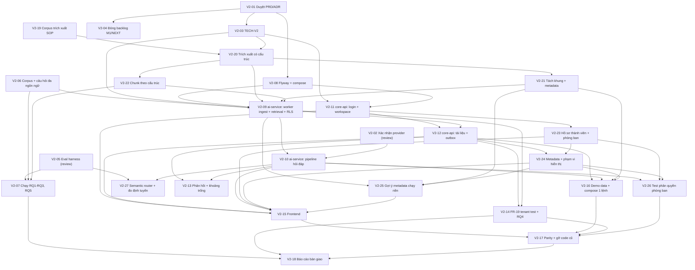

> **Owner chốt 2026-10-20:** hoãn DOCX sau MVP V2 để giảm độ phức tạp trích xuất và kiểm thử. Phạm vi hiện hành là PDF có lớp chữ, MD, TXT (PRD-V2 FR-06); DOCX trả `415` ở upload, không tạo job, hướng dẫn xuất PDF có lớp chữ. Các nhận xét DOCX trong audit là lịch sử, không phải yêu cầu nghiệm thu MVP. Không đổi trạng thái hoặc bộ đếm ticket. *Sửa 2026-10-21: TXT cũng bị bỏ, phạm vi còn PDF có lớp chữ và MD.*

> **Owner chốt 2026-10-20 (V2-03 done):** ưu tiên nghiên cứu khoa học, hạn mức thương mại (FR-09: tài liệu, dung lượng, câu hỏi/ngày) mặc định tắt; giới hạn kỹ thuật (20 MB/file, RPM/TPM provider) giữ nguyên. TECH-V2 duyệt theo đề xuất; FR-16/FR-17 chuyển sang ai-service (V2-13 scope `ai-qa`). Duyệt PRD-V2-ingestion-mvp-scope: chọn ≤ 10 file mỗi lượt (FR-30, V2-15) và bản thay thế trùng SHA-256 là no-op (V2-12). *Sửa 2026-10-21: hạn mức tài liệu/dung lượng mặc định bật lại 50/200 MB; hạn mức câu hỏi vẫn tắt.*

> **Owner chốt 2026-10-21 (chuẩn hóa Markdown và màn xem trích xuất, [AUDIT-markdown-normalization](../04-reports/AUDIT-markdown-normalization-and-preview-2026-10-21.md)):** MVP chỉ nhận PDF có lớp chữ và Markdown (bỏ TXT). Một thư viện PDF chuyển thẳng sang biểu diễn có cấu trúc, render một bản Markdown chuẩn sau làm sạch làm nguồn chung cho chunk/index/trích dẫn/gợi ý metadata; chọn thư viện trong `V2-20` (timebox 2 ngày, ứng viên Docling và PyMuPDF, ghi ADR-008). Màn "Nội dung hệ thống nhận diện" (PRD-V2 FR-31) chỉ mở khi `READY`. Hạn mức tài liệu mặc định bật 50 tài liệu/200 MB; hạn mức câu hỏi vẫn tắt. Quy tắc thay bản khi đang xử lý (`409 VERSION_IN_PROGRESS`) và sửa thử lại (job `FAILED` quay lại hàng đợi theo `attempt`). PRD-V2-ingestion-mvp-scope hợp nhất vào PRD-V2 và chuyển `superseded`. Sửa tiêu chí `V2-09`, `V2-12`, `V2-15`, `V2-16`, `V2-19` đến `V2-22`, `V2-25`; không thêm ticket, không đổi trạng thái hay bộ đếm.

> **Owner chốt 2026-10-20 (câu thô tục và câu không cần tri thức):** `V2-10` mở rộng luật FR-13 với từ điển thô tục VI/EN (ranh giới từ, còn dấu với các từ trùng khi bỏ dấu), router "bóc rồi xét" (câu chỉ chửi bot trả câu mẫu, chửi kèm câu hỏi vẫn trả lời) và nhóm có hại thật ở mức chặn. Chọn **luật + semantic router** (so embedding câu hỏi với câu mẫu, không gọi LLM), bỏ phương án LLM classifier cho vùng xám; PRD-V2 FR-13 và ADR-006 §4.4 sửa theo. Thêm `V2-27` (P1): router trong ai-service, bộ dữ liệu định tuyến có nhãn, đo so với chỉ luật để chỉnh ngưỡng và quyết bật mặc định.

> **Rà soát trước implement 2026-10-21:** `V2-07` phụ thuộc thêm `V2-22` (số liệu RQ chính thức chạy bằng bộ chunk `docproc`, smoke/thăm dò vẫn chạy trước được); `V2-09` phụ thuộc thêm `V2-06` (so khớp harness). `V2-20` dựng khung `services/ai-service` và scope build/test; `V2-08` tạo ba role DB; tokenizer, offset hàng bảng, phân loại lỗi thử lại ghi ở TECH-V2-ai-service §1.1, §5.1, §5.2, §6.5. Không thêm ticket, không đổi trạng thái hay bộ đếm.

> **Owner chốt 2026-10-21 (rà soát kiến trúc RAG theo bài toán SOP):** giữ hybrid + RRF + rerank tùy chọn + cổng ngưỡng, thêm ba thay đổi không gọi LLM (TECH-V2-ai-service §5.4, §6.4, §6.4a, §12a): (A) mã tài liệu `docCode` trong `index_text` (`V2-22`, worker truyền ở `V2-09`); (B) ghép context small-to-big theo nhóm cùng mục sau cổng ngưỡng, kèm ablation bật/tắt (`V2-10`); (C) hệ số BM25 khi câu hỏi khác ngôn ngữ chunk, mặc định `1.0`, chỉ đổi theo RQ1b (`V2-07`, cài ở `V2-09`). GraphRAG, RAPTOR, iterative/agentic, HyDE/multi-query không đưa vào V2. Không thêm ticket, không đổi phụ thuộc, trạng thái hay bộ đếm.

# KẾ HOẠCH TRIỂN KHAI THỰC THI (EXECUTION PLAN)

> **Mã kế hoạch:** `PLAN-V2-SOPILOT-MVP` | **Trạng thái:** `approved` (owner duyệt 2026-10-20)
>
> **Ràng buộc quy trình:** PRD-V2 và ADR-004/005/006/007 được owner duyệt ngày 2026-10-20 (`V2-01`). Ngày 2026-10-19 phạm vi được mở lại để giữ quản lý nhân sự, phòng ban phẳng, category/metadata và phân quyền tài liệu theo phòng ban (ADR-007). Theo `AGENTS.md`, PLAN này chưa được `approved` cho tới khi `V2-01` hoàn thành. Các ticket nghiên cứu (`V2-05` đến `V2-07`, `V2-19`) không phụ thuộc quyết định kiến trúc nên được chạy trước. Ingestion được tách thành `V2-19` đến `V2-22` theo [AUDIT-ingestion-sop-data](../04-reports/AUDIT-ingestion-sop-data-2026-10-19.md).

---

## 1. Mục tiêu & phạm vi

**Đích:** bàn giao nghiên cứu khoa học, hệ thống **chạy được bằng `docker compose up` trên máy local**. Không deploy (B1/B2 ngoài phạm vi; B3 Cloudflare Tunnel chỉ là tùy chọn sau cùng).

**Thứ tự (hướng A, owner chốt 2026-10-17):** làm phần có giá trị nghiên cứu trước (đo chất lượng truy xuất), rồi mới viết lại sang 2 service, trim và thêm tính năng. Lý do: lõi RAG đa ngôn ngữ (VI, EN) chưa từng được đo; nếu số liệu kém thì chỉnh hướng trước khi đầu tư vào phần còn lại.

**Nguyên tắc khả thi (owner chốt 2026-10-17):** mục tiêu là hệ thống chạy được và bench được để báo cáo, không phải chọn cấu hình tốt nhất tuyệt đối. Áp dụng khi chọn bất kỳ thứ gì trong kế hoạch:
1. Phải chạy được trên máy owner (CPU, không GPU) và miễn phí; nếu không chắc thì đo thử trước khi cam kết.
2. Mỗi lựa chọn nặng (rerank, LLM giám khảo, model embedding lớn) có phương án rút gọn: tập con cố định hoặc model nhỏ hơn; báo cáo ghi chi phí đo được.
3. Khi hai phương án chênh nhau ít mà một bên khó chạy hơn nhiều, chọn bên chạy được và ghi lại đánh đổi.
4. Cắt P1 và tính năng không phục vụ bench/chạy được trước khi cắt thời gian của phần đo.

| Nhóm việc | Nội dung | Ticket |
|---|---|---|
| **Quyết định** | Duyệt tài liệu, TECH, xác nhận provider, đóng backlog cũ | V2-01 đến V2-04 |
| **Nghiên cứu** | Eval harness, bộ dữ liệu, chạy RQ1–RQ3/RQ5; đo semantic router so với chỉ luật | V2-05 đến V2-07, V2-27 |
| **Cập nhật tính năng hiện có** | Sửa LLM, reranker, thang điểm, embedding provenance, auth hardening (khi port sang V2) | V2-09, V2-10, V2-11 |
| **Trim** | Còn 2 service; bỏ roster tạo trước, ACL tổng quát, cây phòng ban/category, OTP/mật khẩu, OnlyOffice, analytics, gateway, RabbitMQ, Redis | V2-08, V2-17 (gỡ code cũ) |
| **Thêm tính năng quan trọng** | Workspace + tenant + RLS, lời mời, trích dẫn có kiểm chứng, từ chối có căn cứ, hạn mức (tài liệu 50/200 MB mặc định, câu hỏi tắt), nạp ≤ 10 file/lượt, màn "Nội dung hệ thống nhận diện", audit, khoảng trống tri thức, demo data | V2-09 đến V2-16 |
| **Ingestion SOP** | Corpus trích xuất thật, chọn thư viện PDF + Markdown chuẩn có offset, tách khung + metadata + cảnh báo, chunk theo cấu trúc | V2-19 đến V2-22 |
| **Nhân sự, phòng ban, metadata (ADR-007)** | Hồ sơ thành viên, tạm khóa, phòng ban phẳng, category/tags, phạm vi hiển thị theo phòng ban, gợi ý metadata chạy nền, test phân quyền phòng ban | V2-23 đến V2-26 |
| **Nghiệm thu** | FR-19 trong CI, RQ4, parity, báo cáo bàn giao | V2-14, V2-17, V2-18 |

---

## 2. Đồ thị phụ thuộc

---

## 3. Phân rã ticket

### Phase 0: Quyết định (không cần code)
| Ticket | Tiêu đề | Scope | Size | Phụ thuộc | Trạng thái |
|---|---|---|:---:|---|:---:|
| `V2-01` | Duyệt PRD-V2/ADR-004/005/006/007, chốt câu hỏi mở | docs | S | None | done |
| `V2-02` | Xác nhận model LLM còn sống bằng key thật | ai-qa | S | None | review |
| `V2-03` | Viết TECH-V2-core-api và TECH-V2-ai-service | docs | L | `V2-01` | done |
| `V2-04` | Đóng backlog M1/NEXT, dọn `docs/plans/` | docs | S | `V2-01` | review |

### Phase 1: Nghiên cứu (chạy sớm; số liệu chính thức của `V2-07` chờ bộ chunk `V2-22`)
| Ticket | Tiêu đề | Scope | Size | Phụ thuộc | Trạng thái |
|---|---|---|:---:|---|:---:|
| `V2-05` | Eval harness truy xuất (FR-18) | tests | M | None | done |
| `V2-06` | Corpus và bộ câu hỏi đa ngôn ngữ (VI, EN) có người duyệt | tests | L | None | todo |
| `V2-07` | Chạy RQ1–RQ3 và RQ5, báo cáo | tests | M | `V2-05`, `V2-06`, `V2-22` | todo |

### Phase 2: Nền tảng và ai-service
| Ticket | Tiêu đề | Scope | Size | Phụ thuộc | Trạng thái |
|---|---|---|:---:|---|:---:|
| `V2-08` | Khung Flyway + compose (Postgres/pgvector, MinIO ghim bản) | infra | M | `V2-01` | done |
| `V2-09` | ai-service: worker ingest, embedding, hybrid retrieval, RLS, 4 loại điểm, provider interface | ai-qa | L | `V2-03`, `V2-06`, `V2-08`, `V2-20`, `V2-21`, `V2-22` | todo |
| `V2-10` | ai-service: pipeline 2 lần gọi LLM, SSE, trích dẫn, từ chối | ai-qa | L | `V2-02`, `V2-09` | todo |
| `V2-27` | ai-service: semantic router (luật + embedding) và đo so với chỉ luật | ai-qa | L | `V2-05`, `V2-10` | todo |

### Phase 2b: Ingestion SOP (AUDIT-ingestion-sop-data)
| Ticket | Tiêu đề | Scope | Size | Phụ thuộc | Trạng thái |
|---|---|---|:---:|---|:---:|
| `V2-19` | Corpus SOP thật (VI, EN; PDF/MD) và bộ đo trích xuất | tests | M | None | todo |
| `V2-20` | ai-service: chọn thư viện PDF, biểu diễn có cấu trúc, Markdown chuẩn có offset | ai-qa | L | `V2-03`, `V2-19` | todo |
| `V2-21` | ai-service: tách phần khung, trích metadata SOP, cảnh báo trích xuất | ai-qa | M | `V2-20` | todo |
| `V2-22` | ai-service: nhận diện loại tài liệu, bảng quy trình, chunk theo cấu trúc | ai-qa | L | `V2-20` | todo |

Contextual retrieval (bước 10 của audit) không có ticket; chỉ xét sau khi có kết quả `V2-07`.

### Phase 3: core-api
| Ticket | Tiêu đề | Scope | Size | Phụ thuộc | Trạng thái |
|---|---|---|:---:|---|:---:|
| `V2-11` | core-api: Google login, JIT, workspace, thành viên, lời mời, dev login | user | XL | `V2-03`, `V2-08` | todo |
| `V2-12` | core-api: tài liệu, upload, outbox, hạn mức tài liệu, thay bản an toàn, audit log | knowledge | L | `V2-09`, `V2-11` | todo |
| `V2-13` | Phản hồi và danh sách khoảng trống tri thức (ai-service) | ai-qa | M | `V2-10`, `V2-12` | todo |
| `V2-14` | Test cách ly tenant FR-19 trong CI và đo RQ4 | tests | M | `V2-09`, `V2-12` | todo |
| `V2-23` | core-api: hồ sơ thành viên, tạm khóa, phòng ban phẳng | user | M | `V2-11` | todo |
| `V2-24` | core-api: metadata, category/tags phẳng, phạm vi hiển thị theo phòng ban | knowledge | L | `V2-12`, `V2-23` | todo |
| `V2-25` | ai-service: gợi ý metadata chạy nền và đo độ trễ | ai-qa | M | `V2-09`, `V2-21`, `V2-24` | todo |
| `V2-26` | Test phân quyền tài liệu theo phòng ban (FR-29) trong CI | tests | M | `V2-10`, `V2-23`, `V2-24` | todo |

### Phase 4: Frontend, tích hợp, bàn giao
| Ticket | Tiêu đề | Scope | Size | Phụ thuộc | Trạng thái |
|---|---|---|:---:|---|:---:|
| `V2-15` | Frontend: thu gọn, chọn workspace, nạp ≤ 10 file, trình xem trích dẫn và nội dung nhận diện, thành viên/phòng ban/metadata | web | XL | `V2-10`, `V2-11`, `V2-12`, `V2-23`, `V2-24`, `V2-25` | todo |
| `V2-16` | Dữ liệu demo và `docker compose up` một lệnh | platform | M | `V2-10`, `V2-12`, `V2-21`, `V2-24` | todo |
| `V2-17` | Kiểm tra parity, gỡ 8 service cũ, cập nhật AGENTS.md và `.agent/context/` | platform | L | `V2-14`, `V2-15`, `V2-16`, `V2-26` | todo |
| `V2-18` | Báo cáo nghiên cứu và gói bàn giao | docs | M | `V2-07`, `V2-14`, `V2-17` | todo |

---

## 4. Rủi ro

| Rủi ro | Mức độ | Giảm thiểu |
|---|:---:|---|
| Chưa có SOP thật để đo trích xuất; `V2-19` chặn chuỗi ingestion và `V2-09` | Cao | Owner gom tài liệu sớm; `V2-19` chạy song song Phase 0–1 |
| Chất lượng RAG đa ngôn ngữ kém (nhất là cross-lingual), làm đổi hướng | Cao | Đo ở Phase 1 trước khi viết lại; `V2-07` là cổng quyết định |
| Máy không có GPU: embed `bge-m3` và rerank chậm | Cao | Cache embedding, chạy một lần; ghi thời gian vào báo cáo; có thể giảm kích thước corpus |
| Bộ câu hỏi thiếu chất lượng hoặc chưa có người duyệt | Cao | `V2-06` bắt buộc owner duyệt; ghi quy trình trong báo cáo |
| Viết lại quá lớn, không kịp hạn | Cao | Code cũ chạy song song; cắt P1 (domain join) và FR-05 trước nếu thiếu thời gian |
| Quota LLM chặn câu hỏi | Trung bình | Chỉ đo câu trả lời trên tập con; truy xuất đo không dùng LLM. Hạn mức câu hỏi FR-09 tắt nên chỉ còn bộ giới hạn RPM/TPM và model dự phòng bảo vệ quota provider |
| Thư viện PDF không giữ được bảng quy trình tiếng Việt hoặc quá chậm/nặng trên CPU | Cao | Spike 2 ngày đầu `V2-20` trên tập con V2-19, tiêu chí cứng/so sánh định sẵn (AUDIT-markdown-normalization §6); `V2-21`/`V2-22` làm trên `StructuredDocument` nên không bị chặn bởi lựa chọn; chỉ một thư viện, không chuỗi fallback |
| Giấy phép AGPL nếu chọn PyMuPDF | Trung bình | Ưu tiên MIT/Apache; chọn AGPL chỉ khi owner xác nhận và ghi vào ADR-008 |
| `V2-15` (XL) to thêm vì nạp nhiều file và màn xem nội dung | Trung bình | Màn xem dùng lại trình xem trích dẫn; nếu vượt, tách phần nạp/màn xem thành ticket con khi bắt đầu `V2-15` (cập nhật bộ đếm lúc đó) |
| Hạn mức tài liệu mặc định 50 chặn nạp corpus demo/eval | Thấp | Eval chạy trong `eval/` không qua core-api; demo đặt biến hạn mức hoặc giữ ≤ 50 tài liệu (`V2-16`) |
| RLS cấu hình sai | Cao | FR-19 chạy trong CI từ `V2-14`, ưu tiên sớm |
| Lộ tài liệu giới hạn phòng ban trong cùng workspace (lọc sau top-k, cache, lịch sử, bản sao quyền lệch) | Cao | Lọc trước `LIMIT` trong SQL, fail closed khi thiếu dòng quyền, FR-29 (`V2-26`) trong CI |
| Luật thô tục tiếng Việt chặn nhầm câu nghiệp vụ (từ trùng khi bỏ dấu, chuỗi con) | Trung bình | So khớp theo ranh giới từ và còn dấu; ca dễ chặn nhầm trong bộ guard `V2-10` (chặn nhầm ≤ 2%) và bộ định tuyến `V2-27` |
| Semantic router rẽ nhầm câu nghiệp vụ sang câu mẫu | Trung bình | Rẽ nhánh chỉ khi vượt ngưỡng và `margin` so với câu SOP mẫu; nghiệm thu rẽ nhầm ≤ 2% ở `V2-27`, không đạt thì tắt mặc định |
| Phạm vi tăng thêm 4 ticket (khoảng 1 XL quy đổi) | Trung bình | `V2-24`/`V2-25` không nằm trên đường tới RQ1–RQ3; nếu thiếu thời gian, hoãn import CSV (P1) và phương án nâng cấp gợi ý metadata trước |

## 5. Definition of Done
- [ ] 27/27 ticket `done` với bằng chứng.
- [ ] `docker compose up` dựng toàn bộ hệ thống trên máy local; UC-01 đến UC-06 và UC-12 chạy được.
- [ ] FR-19 và FR-29: 0 rò rỉ. Báo cáo RQ1–RQ3 trong `docs/04-reports/`.
- [ ] `AGENTS.md`, `CLAUDE.md` (mục drift) và `.agent/context/` phản ánh kiến trúc mới.

> **Nghiệm thu 2026-10-25:** V2-05/V2-08 `done` theo phạm vi owner chốt; xem [biên bản](../04-reports/AUDIT-v2-05-v2-08-acceptance-2026-10-25.md). Benchmark RQ và triển khai DB hiện có là công việc riêng.
