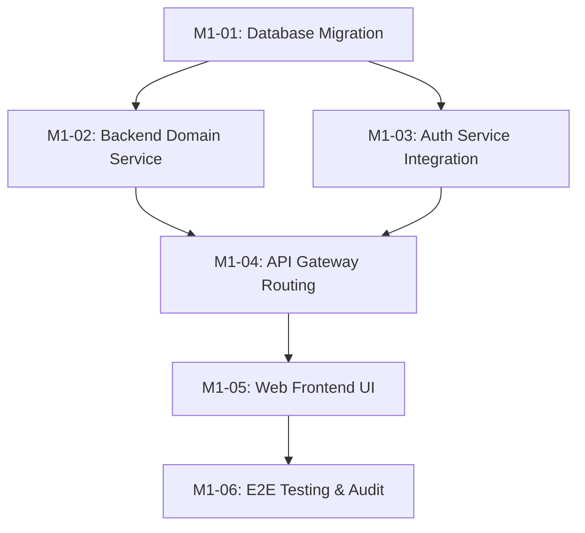

# KẾ HOẠCH TRIỂN KHAI THỰC THI (EXECUTION PLAN)

> **Mã kế hoạch:** `PLAN-XXX` | **Milestone:** `[Milestone X]` | **Trạng thái:** `[status]`
> **Tài liệu tham chiếu:** [PRD](docs/01-requirements/PRD-XXX.md) | [Technical Design](docs/02-architecture/designs/TECH-XXX.md)

---

## 1. Mục tiêu Kế hoạch & Phạm vi (Plan Objectives)
Tóm tắt ngắn gọn mục tiêu cần đạt được của đợt triển khai này, trỏ trực tiếp đến tài liệu đặc tả PRD và thiết kế kỹ thuật TECH tương ứng.

---

## 2. Lộ trình Thực thi & Đồ thị Phụ thuộc (Execution DAG & Phases)

---

## 3. Danh sách Phân rã Tickets (Ticket Breakdown)

### Phase 1: Nền tảng Dữ liệu & Database (Database Foundation)
| Ticket ID | Tiêu đề | Scope | Size | Phụ thuộc | Trạng thái |
|---|---|---|:---:|---|:---:|
| `M1-01` | Database Schema Migration | infra | S | None | todo |

### Phase 2: Dịch vụ Nghiệp vụ Backend (Backend Domain & Auth)
| Ticket ID | Tiêu đề | Scope | Size | Phụ thuộc | Trạng thái |
|---|---|---|:---:|---|:---:|
| `M1-02` | User Service Domain Logic | user | M | `M1-01` | todo |
| `M1-03` | Auth Service Integration | auth | M | `M1-01` | todo |

### Phase 3: Gateway & Frontend (Client Integration)
| Ticket ID | Tiêu đề | Scope | Size | Phụ thuộc | Trạng thái |
|---|---|---|:---:|---|:---:|
| `M1-04` | API Gateway Proxy & RBAC | gateway | S | `M1-02`, `M1-03` | todo |
| `M1-05` | Frontend Web UI & State | web | L | `M1-04` | todo |

### Phase 4: Kiểm thử Tích hợp & Nghiệm thu (Verification & Audit)
| Ticket ID | Tiêu đề | Scope | Size | Phụ thuộc | Trạng thái |
|---|---|---|:---:|---|:---:|
| `M1-06` | E2E Testing & Verification | platform | M | `M1-05` | todo |

---

## 4. Quản lý Rủi ro & Điểm nghẽn (Risk Management)
| Rủi ro tiềm ẩn | Mức độ | Biện pháp giảm thiểu |
|---|:---:|---|
| Xung đột schema DB | Cao | Viết DDL migration độc lập, test trên local postgres trước |
| Lỗi Token expired | Trung bình | Tích hợp Axios refresh token interceptor trong gateway/frontend |

---

## 5. Tiêu chuẩn Nghiệm thu Toàn diện (Definition of Done)
- [ ] 100% tickets con đạt trạng thái `done`.
- [ ] Chạy `./scripts/pre-commit-check.ps1` đạt PASS 100%.
- [ ] Cập nhật tài liệu kiến trúc sống `.agent/context/` nếu có thay đổi contract.
- [ ] Xuất báo cáo kiểm định `docs/04-reports/AUDIT-XXX.md`.
