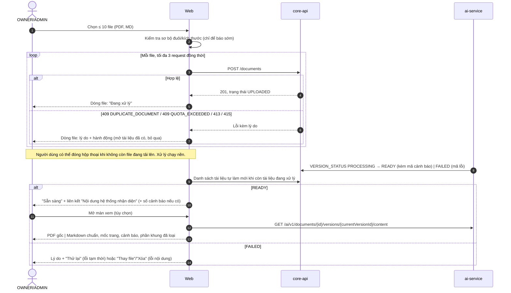

# Chuẩn hóa Markdown có cấu trúc và "Nội dung hệ thống nhận diện"

Owner yêu cầu ngày 2026-10-21 chốt giải pháp chuẩn hóa tài liệu về Markdown có cấu trúc, kèm UX xem kết quả trích xuất, và đồng bộ vào kế hoạch V2. Báo cáo này ghi phân tích và lý do. Các quyết định đã được đưa vào PRD-V2 (FR-06..FR-09, FR-30, FR-31), hai TECH-V2, PLAN-V2 và các ticket liệt kê ở §9.

**Giới hạn:** chưa có corpus V2-19, chưa cài thử Docling hoặc PyMuPDF 2.x (không cài đặt ngoài repo theo chỉ dẫn). Số đo duy nhất ở §5 là thử PyMuPDF 1.27 đã có sẵn trong venv của repo trên 5 PDF không phải SOP. Các kịch bản người dùng ở §2 là giả định, không phải thống kê hay benchmark.

---

## 1. Kết luận

1. **Một biểu diễn chung, một bản Markdown chuẩn.** Mọi file (PDF có lớp chữ, Markdown) được đọc vào `StructuredDocument` (heading, paragraph, list item, table, mỗi phần tử có trang PDF và offset). Sau làm sạch, ai-service **tự render** Markdown chuẩn (canonical Markdown) từ cây phần tử và ghi offset trong lúc render. Đây là bản duy nhất dùng cho chunk, index, trích dẫn, gợi ý metadata và màn xem. Không dùng chuỗi Markdown do thư viện xuất ra làm nguồn offset.
2. **PDF đi thẳng từ cấu trúc của thư viện sang cây phần tử.** Không trích plain text rồi dựng lại Markdown. Markdown đầu vào được parse bằng parser CommonMark/GFM và re-render qua cùng renderer.
3. **Một thư viện chuyển PDF, chọn bằng spike có timebox.** Ứng viên chính: Docling (MIT); ứng viên đối chứng: PyMuPDF (AGPL-3.0 hoặc giấy phép thương mại). Không chuỗi fallback nhiều công cụ, không OCR, không LLM viết lại nội dung. Tiêu chí và timebox ở §6.
4. **MVP nhận PDF có lớp chữ và Markdown.** TXT bị bỏ (upload trả `415`); DOCX và OCR tiếp tục hoãn.
5. **Màn xem "Nội dung hệ thống nhận diện" chỉ mở khi `READY`.** Chỉ đọc, hiển thị đúng bản Markdown đã làm sạch dùng cho chunk/index, đặt cạnh PDF gốc với mốc trang. Không chặn pipeline, không có editor, không có trạng thái "đã kiểm tra". Lý do chọn thời điểm này ở §4.3.
6. **Nạp kho theo lượt ≤ 10 file**, mỗi file một request; kết quả độc lập; thử lại từng file. Không có batch, ZIP hay connector.
7. **Dedup và thay bản theo bytes:** SHA-256 chặn trùng giữa tài liệu, bản thay thế giống bản `READY` là no-op, bản thay thế đang xử lý chặn bản thay thế khác (`409 VERSION_IN_PROGRESS`) để tránh kích hoạt sai thứ tự.
8. **Hạn mức tài liệu mặc định bật lại 50 tài liệu / 200 MB mỗi workspace** theo chỉ dẫn owner 2026-10-21, cấu hình được, `0` = tắt. Hạn mức câu hỏi vẫn mặc định tắt. Đây là đảo ngược một phần quyết định 2026-10-20 (PRD-V2 §8.10), xem §8.

---

## 2. Nhóm sử dụng và tình huống (giả định)

| Nhóm | Định dạng điển hình | Nạp ban đầu | Vận hành | Nhu cầu với màn xem |
|---|---|---|---|---|
| Cá nhân | PDF tải về, ghi chú MD | Vài chục file, 2–3 lượt | Thêm/thay lẻ | Biết file scan bị từ chối; thấy nhanh nội dung có đọc được không |
| Nhóm wiki/Markdown | MD (có frontmatter, shortcode) | Xuất thư mục wiki, chọn file | Thay nhiều file sau đợt sửa | Kiểm heading/list giữ nguyên; MD render lại có thể khác định dạng gốc |
| Doanh nghiệp Word/PDF | PDF xuất từ Word, có bảng | Hàng trăm file theo nhiều lượt; với 50 tài liệu mặc định cần nâng hạn mức | Thay bản khi ban hành lại; đôi khi thay hàng loạt template | Bảng quy trình có giữ hàng/cột; header/footer có bị lọt |
| Tổ chức có kiểm soát SOP | PDF ISO/GMP có bảng phê duyệt, lịch sử sửa đổi | Chọn bản đang hiệu lực trước khi nạp | Thay đúng bản theo mã SOP | Phần khung bị loại có đúng không; mã số/lần ban hành nhận ra không |

Nhận xét dùng để quyết định:
- Kiểm soát "bản nào được phép dùng" là việc của người quản lý trước khi upload; SOPilot không có workflow duyệt (PRD-V2 ING-04 cũ, nay trong FR-07).
- Màn xem giúp người quản lý phát hiện lỗi trích xuất trên từng file, nhưng không thay đo chất lượng extractor trên corpus (V2-19/V2-20).
- Kho hàng nghìn tài liệu (nhóm D trong AUDIT-ingestion-business-cases §8) không được hỗ trợ chỉ bằng nâng hạn mức: cần đo thời gian xử lý trên máy mục tiêu, không có trong V2.

---

## 3. Đối chiếu với thiết kế hiện tại

| Hạng mục | Đã có (TECH-V2, 2026-10-20) | Thay đổi | Lợi ích | Giới hạn |
|---|---|---|---|---|
| Biểu diễn trung gian | `StructuredDocument`, `DocElement`, `extracted_documents.structure/markdown` | Giữ; bỏ `TXT`; thêm định nghĩa Markdown chuẩn và renderer có offset | Một nguồn cho chunk, trích dẫn, preview | Markdown chuẩn có thể khác định dạng MD gốc (ví dụ `*` thành `-`) |
| Offset | "offset trong markdown xuất ra" | Offset tính trên Markdown **sau làm sạch**, đơn vị code point; API trả thêm UTF-16 cho trình duyệt | Không lệch khi tô sáng; không phụ thuộc chuỗi của thư viện | Mỗi lần đổi renderer phải ingest lại (ghi `normalizer_version`) |
| Trích xuất PDF | ADR-008 chọn thư viện sau V2-19 | Giữ; thêm tiêu chí, timebox và cấu hình tắt OCR | Quyết định có số đo | Bị chặn bởi corpus tối thiểu |
| Tọa độ (bbox) | Không có | Không đưa vào contract MVP | Ít dữ liệu, ít test | Không tô sáng trên PDF gốc; chỉ nhảy trang |
| Cảnh báo chất lượng | Không có | `warnings` theo mã cụ thể (§4.4) | Người quản lý biết nên kiểm tra file nào | Không có điểm tin cậy tổng hợp |
| Màn xem | `/content` cho trình xem trích dẫn | Mở rộng thành màn "Nội dung hệ thống nhận diện" (FR-31) | Tận dụng endpoint và viewer cũ | Chỉ khi `READY` |
| Thử lại | `POST /retry` + `INSERT ... ON CONFLICT (version_id) DO NOTHING` | Payload mang `attempt`; ai-service đưa job `FAILED` về `QUEUED` khi `attempt` mới hơn | Sửa lỗi thiết kế: retry cũ sẽ bị bỏ qua vì trùng `version_id` | — |
| Thay bản | No-op khi trùng bản hiện hành | Thêm: trùng tài liệu khác → `DUPLICATE_DOCUMENT`; đang có bản xử lý → cùng bytes trả bản đó, khác bytes `409 VERSION_IN_PROGRESS` | Tránh hai phiên bản kích hoạt sai thứ tự | Người dùng phải chờ bản đang xử lý xong |
| Hạn mức | Mặc định tắt | Tài liệu/dung lượng mặc định 50 / 200 MB | Theo chỉ dẫn owner 2026-10-21 | Demo/eval lớn hơn phải đặt biến (V2-16) |

---

## 4. Pipeline và UX đã chốt

### 4.1 Pipeline

```mermaid
flowchart LR
    U["Upload từng file\n(core-api: loại, 20 MB, SHA-256, hạn mức)"] --> Q["Outbox → job\n(ai-service)"]
    Q --> R{"Loại file"}
    R -->|PDF có lớp chữ| P["Thư viện PDF (ADR-008)\nOCR tắt"]
    R -->|Markdown| M["Parser CommonMark/GFM\n+ frontmatter"]
    P --> S["StructuredDocument\n(heading, đoạn, list, bảng, trang)"]
    M --> S
    S --> N["Chuẩn hóa\n(NFC, khoảng trắng, đánh số giữ nguyên)"]
    N --> C["Làm sạch\n(header/footer, khung, metadata)"]
    C --> MD["Render Markdown chuẩn\n+ offset + mốc trang + cảnh báo"]
    MD --> K["Chunk theo cấu trúc\n(offset trên Markdown chuẩn)"]
    K --> E["Embed\n(cache theo model, revision, sha256(index_text))"]
    E --> A["Một transaction: chunk + extracted_documents\n+ kích hoạt phiên bản → READY"]
    A --> G["Gợi ý metadata\n(đọc extracted_documents)"]
    A --> V["Màn xem 'Nội dung hệ thống nhận diện'"]
```

Quy ước:
- **Bản Markdown chuẩn** = render của các phần tử `role = content` sau làm sạch. Phần khung bị loại được lưu riêng (`boilerplate`) kèm trang, không nằm trong Markdown chuẩn và không vào index.
- Offset của phần tử và chunk là `[char_start, char_end)` trên Markdown chuẩn, đơn vị Unicode code point (chỉ số chuỗi Python). API công khai trả thêm offset UTF-16 để trình duyệt cắt chuỗi đúng.
- Chunk `PROCEDURE_STEP` có `content` dạng `Bước: … | Trách nhiệm: …` không phải chuỗi con của Markdown; offset của nó trỏ tới đoạn nguồn (hàng bảng).
- Không cam kết cùng nội dung khác định dạng (PDF và MD) cho ra Markdown giống hệt; không dùng LLM để ép giống nhau.
- Không dùng hash của Markdown để tự bỏ qua phiên bản. Bỏ qua chỉ dựa trên SHA-256 của file.
- Gợi ý metadata đọc `extracted_documents`, không tải hay parse lại file. Thử lại một phiên bản `FAILED` chạy lại toàn bộ pipeline (không lưu kết quả trung gian giữa các lần thử).

### 4.2 Luồng UX upload → xử lý → `READY` → xem

- Upload thành công chỉ nghĩa là file đã được nhận; nhãn là "Đang xử lý", không có liên kết xem nội dung.
- `READY` nghĩa là xử lý kỹ thuật thành công và hỏi đáp được; không có nghĩa nội dung đã được người dùng kiểm tra hay chắc chắn đúng. Màn xem ghi rõ câu này.
- Phát hiện sai thì dùng "Thay file" hoặc "Xóa" hiện có. Không có editor Markdown.

### 4.3 Thời điểm mở màn xem: chỉ khi `READY`

| Phương án | Cần thêm | Effort ước lượng | Lợi ích |
|---|---|---|---|
| A. Mở ngay sau convert/clean | Ghi `extracted_documents` trong transaction riêng trước embed; endpoint cho phép đọc phiên bản chưa kích hoạt (chỉ OWNER/ADMIN); dọn dữ liệu khi phiên bản `FAILED` hay bị xóa giữa chừng; thêm trạng thái UI "đã có nội dung, chưa hỏi đáp được"; test quyền cho phiên bản chưa hoạt động | +1 đến +2 ngày, thêm một nhánh quyền cần test FR-19/FR-29 | Xem sớm hơn khoảng thời gian embed |
| **B. Chỉ khi `READY` (chọn)** | Không thêm bảng hay trạng thái; dùng `extracted_documents` ghi trong transaction kích hoạt (TECH-V2-ai-service §5.6) và endpoint `/content` vốn chỉ đọc phiên bản đang hoạt động | Phần UI màn xem | Một trạng thái, một nhánh quyền |

Chọn B vì: (1) embed là bước còn lại duy nhất sau clean, NFR hiện đặt ingest PDF 20 trang < 60 s nên khoảng chờ thêm nhỏ (chưa đo trên máy owner); (2) người dùng không phải ngồi chờ, vì danh sách tài liệu báo `READY` sau; (3) phương án A thêm một đường đọc nội dung chưa kích hoạt, là đường cần test cách ly và phân quyền. Có thể chuyển sang A sau MVP nếu số đo `t_ready` cho thấy chờ quá lâu.

Trường hợp thay bản: khi phiên bản N+1 đang xử lý hoặc `FAILED`, màn xem vẫn hiện phiên bản N kèm nhãn "Phiên bản N, đang dùng để hỏi đáp; phiên bản N+1 đang xử lý / xử lý lỗi". Không bao giờ hiện nội dung N dưới nhãn của N+1. Sau khi N+1 `READY`, chỉ còn nội dung N+1 (file và chunk của N bị xóa theo TECH-V2-core-api §11 Q4).

### 4.4 Cảnh báo chất lượng

Chỉ phát khi bộ xử lý có tín hiệu cụ thể. Không có điểm tin cậy.

| Mã | Tín hiệu | Hiển thị |
|---|---|---|
| `PAGES_WITHOUT_TEXT` | Trang có ít hơn `SOPILOT_PAGE_MIN_CHARS` ký tự trong một PDF vẫn có lớp chữ ở trang khác | "Trang 3, 7 gần như không có chữ; nội dung dạng ảnh không được nhận diện (không OCR)." |
| `UNMAPPED_GLYPHS` | Văn bản chứa U+FFFD, `(cid:n)` hoặc ký tự vùng Private Use | "Một số ký tự không đọc được (font PDF thiếu bảng mã); nội dung có thể sai ở trang …" |
| `NO_HEADINGS_DETECTED` | Không nhận ra heading nào trong tài liệu có hơn một trang | "Không nhận ra tiêu đề mục; trích dẫn sẽ thiếu đường dẫn mục." |
| `BOILERPLATE_REMOVED` | Có khối khung bị loại (thông tin, không phải lỗi) | Danh sách khối đã loại, theo trang, thu gọn mặc định |
| `CONVERTER_WARNING` | Thư viện đã chọn tự trả cảnh báo cho trang/phần tử (nếu thư viện có API này) | Thông điệp đã chuyển sang câu cố định theo loại |

### 4.5 Bố cục màn xem

- PDF, màn rộng: trái là PDF gốc (trình xem hiện có, URL ký sẵn, nhảy trang bằng `#page=N`); phải là Markdown chuẩn đã render, có mốc "Trang N" ở đầu đoạn của mỗi trang. Bấm mốc trang thì PDF nhảy tới trang đó. Không đồng bộ cuộn, không tô sáng hai chiều.
- PDF, màn hẹp: hai tab "Nội dung nhận diện" và "File gốc".
- Markdown: chỉ khung Markdown chuẩn và nút tải file gốc.
- Render không thực thi HTML thô (không dùng `rehype-raw` như `DocumentViewerModal` cũ); ảnh ngoài không tự tải, hiển thị thành liên kết.
- Mọi thành viên có quyền đọc tài liệu đều mở được (FR-25 "xem trước"); ngoài quyền → `404`.

---

## 5. Thử nghiệm đã chạy (2026-10-21)

**Lệnh:** script tạm trong scratchpad, chạy bằng `services/ingestion-service/.venv` (PyMuPDF 1.27.2.3 đã có sẵn trong repo, không cài thêm). Đo: số trang có chữ, số ký tự, ký tự tiếng Việt có dấu, số `U+FFFD`/`(cid:`, trang không ở dạng NFC, số bảng `page.find_tables()`, mục TOC, thời gian (gồm cả `find_tables` và `get_text("dict")`).

| File | Loại | Trang | Trang có chữ | Ký tự VI có dấu | U+FFFD / cid | Không NFC | Bảng phát hiện | TOC | Thời gian |
|---|---|---:|---:|---:|---:|---:|---:|---:|---:|
| `temp/De_cuong_NCKH_sinh_vien_2026.pdf` | PDF xuất từ Word, tiếng Việt | 8 | 8 | 2.661 | 0 | 0 | 7 | 0 | 0,40 s |
| `temp/De_cuong_NCKH_SOPilot_17-10-2026.pdf` | PDF xuất từ Word, tiếng Việt | 7 | 7 | 2.765 | 0 | 0 | 9 | 0 | 0,72 s |
| `mock_docs/original_safety_policy.pdf` | PDF tổng hợp, tiếng Anh | 2 | 2 | 0 | 0 | 0 | 0 | 0 | 0,13 s |
| `mock_docs/large_document.pdf` | PDF tổng hợp, tiếng Anh | 21 | 21 | 0 | 0 | 0 | 0 | 0 | 1,96 s |
| `mock_docs/empty_document.pdf` | PDF không có chữ | 1 | 0 | 0 | 0 | 0 | 0 | 0 | 0,00 s |

Quan sát đã đo:
- Hai PDF tiếng Việt xuất từ Word cho văn bản NFC, không có ký tự lỗi; có bảng được phát hiện. **Chưa đối chiếu** bảng với nhãn vàng nên không biết hàng/cột có đúng.
- Không PDF nào có TOC; hai PDF tổng hợp chỉ có một cỡ chữ (10 pt), nên nhận heading theo cỡ chữ không dùng được, phải dựa vào mẫu đánh số (V2-22). Một PDF tiếng Việt có heading chỉ khác thân bài ở chữ đậm cùng cỡ 12 pt.
- `empty_document.pdf` cho 0 ký tự: tín hiệu đủ cho `NO_TEXT_LAYER`.

Không suy ra từ thử nghiệm này: chất lượng trên SOP ISO, so sánh với Docling, tốc độ của PyMuPDF 2.x có layout model, hay bất kỳ ngưỡng nào. Năm file này không phải corpus V2-19.

---

## 6. Lựa chọn công cụ: tiêu chí và timebox

### 6.1 Thông tin từ tài liệu chính thức (tra ngày 2026-10-21)

| Tiêu chí | Docling | PyMuPDF / PyMuPDF4LLM |
|---|---|---|
| Giấy phép | MIT ([GitHub](https://github.com/docling-project/docling), PyPI `docling` 2.140.0, 2026-10-16) | "Dual Licensed - GNU AFFERO GPL 3.0 or Artifex Commercial License" (PyPI `PyMuPDF` 2.0) |
| Phiên bản | 2.140.0, Python ≥ 3.10 | PyMuPDF 2.0 phát hành 2026-10-19, Python ≥ 3.11; mã 4llm và layout đã gộp vào `pymupdf` 2.x (gói `pymupdf4llm` 2.0 là gói rỗng) |
| Phụ thuộc | `docling-slim[standard]`; OCR là extra (`rapidocr`, `easyocr`, `tesserocr`…). Model tải lần đầu, có `docling-tools models download` và `artifacts_path` để chạy offline | `numpy`, `onnxruntime`, `networkx`, `pymupdf-layout==2.0`, `tabulate`… (PyPI `requires_dist` của PyMuPDF 2.0) |
| Bố cục, bảng | Layout model, thứ tự đọc, TableFormer (`FAST`/`ACCURATE`, mặc định `ACCURATE`) | Layout analysis "không cần GPU", bật mặc định khi import, tắt bằng `use_layout`; Artifex báo F1 layout tổng 0,8343 → 0,8640 trên tập của họ |
| Provenance | `DoclingDocument` có cây `body` và `furniture` (header/footer tách khỏi thân), "provenance information", bbox nếu có | `page_chunks` trả `page_boxes` có lớp `section-header`, `table`, `page-header`, `page-footer`, `list-item`… |
| OCR | Có nhiều engine; phải tắt bằng cấu hình | Tài liệu nói OCR tự chạy trên trang cần OCR nếu có engine; phải tắt |
| CPU | Có tùy chọn số luồng, giới hạn hàng đợi trang để giảm RAM | Tuyên bố layout không cần GPU |

**Chưa kiểm chứng:** tốc độ và RAM trên máy owner (CPU, 32 GB RAM); tên trường provenance cụ thể (`page_no`, `bbox`, `charspan`) của Docling; giá trị mặc định `do_ocr`; kích thước image Docker sau khi thêm mỗi thư viện; chất lượng trên tiếng Việt.

Nhận định (chưa đo): ai-service đã cần `torch` cho `bge-m3` qua sentence-transformers, nên chi phí phụ thuộc thêm của Docling nhỏ hơn so với một service không có torch. PyMuPDF 2.0 mới phát hành hai ngày trước khi viết báo cáo; ghim phiên bản là bắt buộc nếu chọn.

Không xét làm ứng viên chính: Marker và MinerU (giấy phép GPL/AGPL hoặc điều khoản model riêng, nặng hơn cho mục tiêu này), `unstructured` (nhiều phụ thuộc, không mang lại cấu trúc bảng tốt hơn theo tài liệu đọc được). Đây là loại trừ theo phạm vi, không phải kết quả đo.

### 6.2 Tiêu chí chọn (ghi vào ADR-008 trong V2-20)

Ràng buộc cứng (không đạt thì loại):
1. Chạy offline trên CPU, model tải trước vào volume; không gọi mạng lúc xử lý.
2. OCR tắt được hoàn toàn và kiểm chứng được (trang ảnh cho 0 ký tự).
3. Mỗi phần tử có số trang thật; tách được header/footer hoặc cho đủ thông tin trang để V2-21 tự tách.
4. Văn bản tiếng Việt NFC, không mất dấu trên các PDF mẫu có lớp chữ chuẩn Unicode.
5. Giấy phép: MIT/Apache/BSD được ưu tiên. AGPL chỉ chấp nhận nếu owner xác nhận (dự án chạy local, chưa phân phối dịch vụ; nếu sau này cung cấp qua mạng phải công bố mã hoặc mua giấy phép).

So sánh (không có ngưỡng tuyệt đối trước baseline):
6. Heading precision/recall theo thứ tự và cấp, bảng đúng vị trí và số hàng/cột, theo từng họ tài liệu của V2-19.
7. Thời gian và RAM đỉnh trên mỗi trang ở máy owner. Mục tiêu khởi đầu (chưa có căn cứ đo, chốt lại sau spike): trích xuất PDF 20 trang dùng không quá một nửa ngân sách 60 s của NFR, để chừa phần cho embed.
8. Công tích hợp và bảo trì: số dòng adapter, độ ổn định API, tần suất phát hành.

Quy tắc: cả hai đạt ràng buộc cứng thì chọn bên tốt hơn ở tiêu chí 6; chênh lệch nhỏ thì chọn bên nhẹ hơn và dễ bảo trì hơn (PLAN-V2 nguyên tắc khả thi 3). Chỉ dùng **một** thư viện trong runtime.

### 6.3 Timebox

- **2 ngày làm việc** trong V2-20, trên tập con tối thiểu của V2-19: ít nhất 6 PDF tiếng Việt (ưu tiên 4 PDF ISO danh sách A của RESEARCH-V2-19 có bảng quy trình), 2 PDF tiếng Anh (EPA), 1 PDF scan. Nhãn heading/bảng của tập con này do owner duyệt trước.
- Nếu corpus chưa đủ khi bắt đầu V2-20: dùng PDF tự tạo từ Word (tiếng Việt, có heading đánh số, bảng có ô gộp) gắn nhãn synthetic, chọn tạm theo ràng buộc cứng và tiêu chí 7–8, ghi ADR-008 là `draft` và chạy lại so sánh khi đủ corpus. Không chặn V2-21/V2-22 vì chúng làm việc trên `StructuredDocument`, không trên thư viện.

---

## 7. Effort, giả định và phần chưa đo

Giả định: một người, ngày làm việc tập trung khoảng 6 giờ; đã có corpus tập con; không tính thời gian chờ owner duyệt nhãn. Đơn vị: ngày.

| Phần việc | Ticket | Ước lượng | Bất định chính |
|---|---|---:|---|
| Spike chọn thư viện, ADR-008 | V2-20 | 2 (timebox) | Cài model, chạy trên Windows và Docker |
| Adapter PDF → `StructuredDocument` (trang, bảng, tắt OCR, `NO_TEXT_LAYER`, PDF mã hóa/hỏng) | V2-20 | 2–4 | Bảng nhiều trang, ô gộp, header chen trong bảng (ISO VI) |
| Reader Markdown (parser, frontmatter, shortcode) | V2-20 | 1 | Các biến thể GFM |
| Chuẩn hóa + renderer Markdown chuẩn có offset, mốc trang, UTF-16, cảnh báo | V2-20 | 1,5–2,5 | Quy tắc khoảng trắng và bảng GFM khi ô có xuống dòng |
| Source mapping qua clean/chunk (offset, trang, chunk bảng) | V2-21, V2-22 | +1 so với ước lượng cũ | Chunk cắt giữa bảng nhiều trang |
| Tích hợp worker: lưu `warnings`, `normalizer_version`, sửa retry, endpoint `/content` mở rộng | V2-09 | +1 | — |
| core-api: quy tắc thay bản đang xử lý, hạn mức mặc định bật và test đồng thời, mã cảnh báo | V2-12 | +1–1,5 | — |
| UX nạp ≤ 10 file với trạng thái và hành động từng file | V2-15 | 2–3 | Tự làm mới danh sách, xử lý mất mạng |
| UX "Nội dung hệ thống nhận diện" + kiểm tra trình duyệt | V2-15 | 2–3 | Hành vi `#page=N` khác nhau giữa trình xem PDF của trình duyệt |
| **Cộng phần tăng thêm so với kế hoạch 2026-10-20** | | **khoảng 8–14** | Phần lớn bất định nằm ở chất lượng bảng PDF tiếng Việt |

Chưa đo: tốc độ/RAM của cả hai thư viện; chất lượng heading/bảng trên SOP; thời gian `t_ready` thực của PDF 20 trang trên máy owner; tỉ lệ cache embedding khi thay bản; dung lượng image Docker.

---

## 8. Điều chỉnh so với tài liệu đã duyệt

| Trước | Sau (2026-10-21) | Nơi sửa |
|---|---|---|
| FR-06: PDF có lớp chữ, MD, TXT | PDF có lớp chữ và MD; TXT trả `415` kèm hướng dẫn đổi sang `.md` | PRD-V2, TECH-V2 ×2, V2-12, V2-15, V2-19, V2-20 |
| FR-09: hạn mức tài liệu/dung lượng mặc định tắt | Mặc định 50 tài liệu / 200 MB mỗi workspace, `0` = tắt; hạn mức câu hỏi vẫn tắt | PRD-V2 FR-09 và §8.10, TECH-V2-core-api, V2-12, V2-16 |
| §5: "import ZIP/thư mục ngoài phạm vi (chọn ≤ 10 file vẫn trong phạm vi)" | Giữ; làm rõ không có batch, không transaction toàn đợt, kết quả từng file, thử lại từng file | PRD-V2 §5, FR-30 |
| FR-07 no-op khi trùng bản hiện hành | Thêm: trùng tài liệu khác khi thay bản → báo trùng; bản đang xử lý chặn bản khác bytes | PRD-V2 FR-07, TECH-V2-core-api §3.3/§5.5 |
| Không có màn xem trích xuất | FR-31 "Nội dung hệ thống nhận diện", chỉ khi `READY` | PRD-V2, TECH-V2-ai-service §7.3, V2-09, V2-15 |
| PRD-V2-ingestion-mvp-scope là nguồn bổ sung | Nội dung đã hợp nhất vào PRD-V2; tài liệu chuyển `superseded` | PRD-V2-ingestion-mvp-scope |

Quyết định hạn mức là đảo ngược một phần quyết định owner 2026-10-20 ("hạn mức thương mại mặc định tắt"). Owner đã xác nhận ngày 2026-10-21: hạn mức tài liệu bật mặc định 50 tài liệu/200 MB.

---

## 9. Tài liệu đã cập nhật

PRD-V2 (FR-06, FR-07, FR-08, FR-09, FR-14, FR-30, FR-31 mới, UC-04, UC-12 mới, §5, §8), PRD-V2-ingestion-mvp-scope (`superseded`), TECH-V2-ai-service, TECH-V2-core-api, PLAN-V2, ticket V2-09, V2-12, V2-15, V2-16, V2-19, V2-20, V2-21, V2-22, V2-25, `.agent/context/README.md`, `docs/README.md`. Không đổi trạng thái ticket hay bộ đếm PLAN; không có acceptance scenario nào được ghi là đã đạt.
