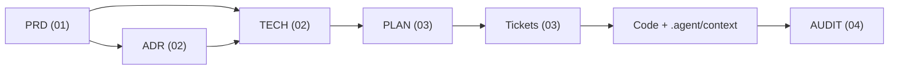

# SOPilot Documentation Hub (`docs/`)

**Kế hoạch V2 (`approved` 2026-10-20):** [PLAN-V2](03-plans/PLAN-V2-sopilot-mvp.md), 33 ticket `V2-01` đến `V2-33` (ingestion SOP: `V2-19` đến `V2-22`, xem [AUDIT-ingestion-sop-data](04-reports/AUDIT-ingestion-sop-data-2026-10-19.md); nhân sự, phòng ban, metadata: `V2-23` đến `V2-26`; semantic router và đo định tuyến: `V2-27`; bộ kiểm hệ thống SOP tiếng Việt: `V2-28`).

**Chuẩn bị 2026-10-24:** tách hai ticket XL thành V2-11/V2-29/V2-30 và V2-15/V2-31/V2-32/V2-33, không thêm phạm vi. Công cụ dataset/extraction và bằng chứng review ở [AUDIT readiness](04-reports/AUDIT-v2-readiness-preparation-2026-10-24.md).

**Cập nhật 2026-10-21 (audit đầu-cuối ai-service theo loại query):** owner chốt D1–D11 ([TECH-V2-ai-service](02-architecture/designs/TECH-V2-ai-service.md) §11a, [PLAN-V2](03-plans/PLAN-V2-sopilot-mvp.md)): cổng `hybrid` luôn có `dense_score`; `refusal_reason` tách "thiếu tài liệu" khỏi "ngoài phạm vi" và "đầu vào không hợp lệ"; ô gộp lặp xuống từng hàng quy trình; metadata `code/rev/effective` trong `<source>`; câu rỗng hoặc quá 1000 ký tự bị từ chối; che PII; router mở rộng chạy sau cổng ngưỡng; term bỏ dấu cho BM25. Sửa `V2-06`, `V2-07`, `V2-09`, `V2-10`, `V2-13`, `V2-15` đến `V2-16`, `V2-19` đến `V2-22`, `V2-27`; thêm `V2-28`.

**Cập nhật 2026-10-21 (chuẩn hóa Markdown và màn xem trích xuất):** [AUDIT-markdown-normalization-and-preview](04-reports/AUDIT-markdown-normalization-and-preview-2026-10-21.md). MVP chỉ nhận PDF có lớp chữ và MD (bỏ TXT); một bản Markdown chuẩn sau làm sạch là nguồn chung cho chunk/index/trích dẫn; màn "Nội dung hệ thống nhận diện" (PRD-V2 FR-31) mở khi `READY`; hạn mức tài liệu mặc định 50 tài liệu/200 MB. [PRD-V2-ingestion-mvp-scope](01-requirements/PRD-V2-ingestion-mvp-scope.md) đã hợp nhất vào PRD-V2 và chuyển `superseded`. Thư viện PDF: Docling ([ADR-008](02-architecture/adr/ADR-008-pdf-extraction-docling.md), owner chốt 2026-10-21, chưa có số đo); `V2-20` xác nhận theo ràng buộc cứng.

**V2 (owner duyệt 2026-10-20, `approved`):** [PRD-V2](01-requirements/PRD-V2-sopilot-mvp.md), [ADR-004 kiến trúc hai service](02-architecture/adr/ADR-004-two-service-architecture.md), [ADR-005 workspace và Google JIT](02-architecture/adr/ADR-005-workspace-tenancy-and-google-jit.md), [ADR-006 provider miễn phí, eval local và deploy](02-architecture/adr/ADR-006-free-tier-providers-and-environments.md), [phân tích nền 2026-10-17](04-reports/AUDIT-v2-baseline-analysis-2026-10-17.md). [ADR-007 phòng ban, hồ sơ thành viên và quyền tài liệu](02-architecture/adr/ADR-007-departments-member-profiles-document-access.md). Bộ này thay thế PRD-M1, ADR-001, ADR-002, ADR-003 (đã `superseded`); backlog NEXT/M1 đóng ở `V2-04`.

Cập nhật auth 2026-10-15: [Google identity/admission và kiểm thử](04-reports/AUDIT-google-admission-2026-10-15.md), [policy ADR-003](02-architecture/adr/ADR-003-google-identity-and-roster-admission.md). Bản này bổ sung checkpoint bên dưới, không thay kết luận audit toàn dự án thành release-ready.

Điểm bắt đầu hiện tại: [PLAN-V2](03-plans/PLAN-V2-sopilot-mvp.md) và [AUDIT readiness](04-reports/AUDIT-v2-readiness-preparation-2026-10-24.md). [Bàn giao 2026-10-15](04-reports/HANDOFF-implementation-2026-10-15.md), PLAN-NEXT và audit V1 chỉ còn giá trị lịch sử.

> **`docs/plans/` đã bị xóa** (2026-10-20, V2-04); bản sao cũ còn trong lịch sử git. Chỉ dùng `docs/03-plans/`. PLAN-M1 và PLAN-NEXT đã `superseded` bởi PLAN-V2.

Thư mục này là nguồn sự thật duy nhất cho đặc tả sản phẩm (PRD, ADR, TECH), kế hoạch (PLAN, ticket) và báo cáo nghiệm thu (AUDIT, HANDOFF). Ngữ cảnh kỹ thuật dài hạn của từng service (contract, schema, event, RBAC) nằm ở [`.agent/context/`](../.agent/context/README.md); quy tắc làm việc cho agent nằm ở [`AGENTS.md`](../AGENTS.md).

---

## 🧭 Cấu trúc thư mục

```text
docs/
├── 01-requirements/       # PRD: vấn đề, phạm vi, user story, acceptance criteria
│   ├── templates/prd-template.md
│   └── PRD-*.md
├── 02-architecture/
│   ├── adr/               # Quyết định kiến trúc dài hạn (ADR-*.md, templates/adr-template.md)
│   └── designs/           # Thiết kế kỹ thuật: DDL, API, sequence (TECH-*.md, templates/tech-design-template.md)
├── 03-plans/              # Kế hoạch thực thi: nguồn tiến độ hiện hành
│   ├── templates/         # plan-template.md, ticket-template.md
│   ├── PLAN-*.md          # Kế hoạch mốc, DAG phụ thuộc, bảng trạng thái ticket
│   └── tickets/           # Ticket thực thi (M1-01, NEXT-02, ...)
├── 04-reports/            # Báo cáo nghiệm thu, audit, bàn giao (templates/audit-report-template.md)
├── portfolio/             # Tài liệu giới thiệu dự án bằng tiếng Anh (không phải spec, không có frontmatter): engineering-case-study.md, implementation-evidence.md; điểm vào là README gốc
└── (docs/plans/ đã xóa ở V2-04; không tạo lại)
```

Sơ đồ (ERD, luồng hệ thống) hiện nằm trong `.agent/context/database/erd.mmd` và `.agent/context/architecture/`. Chưa có thư mục `02-architecture/diagrams/`.

---

## 🔁 Quy trình spec-driven



1. **PRD** chốt vấn đề, phạm vi và acceptance criteria. Chưa có PRD `approved` thì không lập PLAN.
2. **ADR** ghi quyết định khó đảo ngược. **TECH** đặc tả DDL, API, event, sequence và tham chiếu PRD/ADR qua `refs`.
3. **PLAN** phân rã TECH thành ticket, có DAG phụ thuộc và bảng trạng thái. `depends_on` trong ticket và DAG trong PLAN phải khớp nhau.
4. **Ticket** được triển khai theo thứ tự service → gateway → frontend → kiểm thử → cập nhật tài liệu. Khi đổi endpoint, schema, event hoặc RBAC thì cập nhật file tương ứng trong `.agent/context/` trong cùng thay đổi.
5. **AUDIT** ghi bằng chứng nghiệm thu (lệnh đã chạy, kết quả, phần chưa xác minh). Ticket chỉ chuyển `done` khi có bằng chứng.

Khi tài liệu và code mâu thuẫn, code là sự thật. Hãy sửa tài liệu hoặc mở ticket sửa code, không âm thầm "chỉnh" cho khớp.

---

## 📋 Quy ước frontmatter

Mọi file spec (trừ template và README) bắt đầu bằng YAML frontmatter.

**Trường chung (bắt buộc):** `id`, `title`, `status`, `created`, `updated` (định dạng `YYYY-MM-DD`).
**Trường chung (tùy chọn):** `refs` (danh sách đường dẫn tính từ gốc repo tới tài liệu thượng nguồn), `author`.

| Loại | Tiền tố `id` | `status` hợp lệ | Trường riêng |
|---|---|---|---|
| PRD | `PRD-` | `draft` \| `approved` \| `superseded` | `milestone`, `priority` |
| ADR | `ADR-` | `draft` \| `approved` \| `superseded` | `deciders`, `amends`, `supersedes`, `superseded_by` |
| TECH | `TECH-` | `draft` \| `approved` \| `superseded` | `affected_services`, `affected_schemas` |
| PLAN | `PLAN-` | `draft` \| `approved` \| `superseded` | `milestone`, `total_tickets`, `completed_tickets`, `implemented_tickets`, `review_tickets` |
| Ticket | `<mốc>-NN` (vd. `M1-01`, `NEXT-02`) | `todo` \| `in-progress` \| `review` \| `done` \| `superseded` | `type` (loại commit), `scope`, `priority`, `size`, `parent_plan`, `depends_on`, `blocks`, `branch`, `assignee` |
| Report | `AUDIT-`, `HANDOFF-` | `draft` \| `final` | `type` (loại báo cáo), `scope`, `verdict`, `milestone` |

**Ý nghĩa trạng thái ticket:**
- `in-progress`: đang triển khai.
- `review`: code đã commit, chờ review hoặc chưa có đủ bằng chứng nghiệm thu.
- `superseded`: đóng mà không làm vì kế hoạch khác thay thế (vd. backlog M1/NEXT bị PLAN-V2 thay, V2-04). Thân ticket phải ghi ticket/tài liệu thay thế. Không tính vào `completed_tickets`, `review_tickets` hay `implemented_tickets`.
- `done`: **đã nghiệm thu**, tức acceptance criteria có bằng chứng (test, lệnh, SQL/event) và đã được review. Không bắt buộc đã merge vào `develop`. Build xanh hoặc số commit không đủ để chuyển `done`.

**Bộ đếm trong PLAN:** `completed_tickets` = số ticket `done`; `review_tickets` = số ticket `review`; `implemented_tickets` = `done` + `review`. Bộ đếm phải khớp bảng trạng thái trong thân PLAN và frontmatter của từng ticket.

ADR dùng `amends` khi chỉ điều chỉnh một phần ADR cũ (ADR cũ vẫn `approved`), và `supersedes` khi thay thế hoàn toàn (ADR cũ chuyển `superseded`).

---

## 🤖 Kỹ năng agent tương ứng

Mỗi nhóm tài liệu có một skill trong `.agent/skills/`. Danh sách đầy đủ skill nằm trong [`AGENTS.md`](../AGENTS.md).

| Tác vụ / Nhóm tài liệu | Skill | Output |
|---|---|---|
| Phân tích yêu cầu / PRD | [`analyze-requirements`](../.agent/skills/analyze-requirements/SKILL.md) | `docs/01-requirements/PRD-*.md` |
| Thiết kế kỹ thuật / ADR | [`design-architecture`](../.agent/skills/design-architecture/SKILL.md) | `docs/02-architecture/designs/TECH-*.md`, `adr/ADR-*.md` |
| Lập kế hoạch & phân rã ticket | [`plan-and-decompose`](../.agent/skills/plan-and-decompose/SKILL.md) | `docs/03-plans/PLAN-*.md`, `tickets/*.md` |
| Triển khai code theo ticket | [`execute-ticket`](../.agent/skills/execute-ticket/SKILL.md) | Code + cập nhật `.agent/context/` |
| Viết test | [`write-test`](../.agent/skills/write-test/SKILL.md) | Test chuẩn AAA cho Java/Python/NestJS |
| Chạy test & kiểm tra | [`run-test`](../.agent/skills/run-test/SKILL.md) | `./scripts/run-tests.ps1`, `./scripts/pre-commit-check.ps1` |
| Phân tích chất lượng & audit | [`analyze-quality`](../.agent/skills/analyze-quality/SKILL.md) | `docs/04-reports/AUDIT-*.md` |
