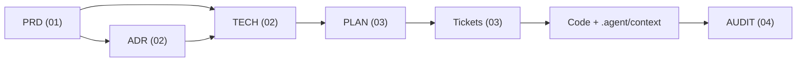

# SOPilot Documentation Hub (`docs/`)

Thư mục này là nguồn sự thật cho **đặc tả** (PRD, ADR, TECH), **kế hoạch** (PLAN, ticket) và **báo cáo** (AUDIT, RESEARCH, HANDOFF). README này chỉ giữ cấu trúc và quy ước. Tiến độ và nhật ký quyết định nằm ở [PLAN-V2](03-plans/PLAN-V2-sopilot-mvp.md) (mục 6 là nhật ký cập nhật).

**Điểm bắt đầu:** [PLAN-V2](03-plans/PLAN-V2-sopilot-mvp.md) và ticket tương ứng trong `03-plans/tickets/`. Bàn giao mới nhất là file `HANDOFF-*` có ngày lớn nhất trong `04-reports/`.

**Thứ tự ưu tiên khi các nguồn mâu thuẫn:** code → đặc tả trong `docs/` (PRD, ADR, TECH) → [`.agent/context/`](../.agent/context/README.md) (tóm tắt dẫn xuất, cập nhật cùng thay đổi) → README của service. Quy tắc làm việc cho agent nằm ở [`CLAUDE.md`](../CLAUDE.md) và `.claude/`.

---

## 🧭 Cấu trúc thư mục

```text
docs/
├── 01-requirements/       # PRD: vấn đề, phạm vi, user story, acceptance criteria
│   └── templates/prd-template.md
├── 02-architecture/
│   ├── adr/               # Quyết định kiến trúc dài hạn (ADR-*.md, templates/adr-template.md)
│   ├── designs/           # Thiết kế kỹ thuật: DDL, API, sequence (TECH-*.md, templates/tech-design-template.md)
│   └── diagrams/          # Sơ đồ tổng quan hệ thống (excalidraw + html), không phải spec
├── 03-plans/              # Kế hoạch thực thi: nguồn tiến độ hiện hành
│   ├── templates/         # plan-template.md, ticket-template.md
│   ├── PLAN-*.md          # Đồ thị phụ thuộc, bảng trạng thái ticket, nhật ký cập nhật
│   └── tickets/           # Ticket thực thi (V2-NN)
├── 04-reports/            # AUDIT / RESEARCH / HANDOFF (templates/ có một khuôn cho mỗi loại)
├── _archive/              # Tài liệu V1 đã đóng (M1, NEXT, TECH V1, audit V1). Chỉ đọc, không sửa, không dùng làm đặc tả
└── portfolio/             # Giới thiệu dự án bằng tiếng Anh (không phải spec, không có frontmatter); điểm vào là README gốc
```

`_archive/` giữ cùng cấu trúc con với `docs/` (`_archive/03-plans/tickets/M1-01-...`). Các ADR đã `superseded` (ADR-001 đến 003) **ở lại** `02-architecture/adr/` vì chuỗi ADR là nhật ký quyết định. `docs/plans/` đã bị xóa ở V2-04; không tạo lại.

Sơ đồ ERD nằm ở `.agent/context/database/erd.mmd`, sơ đồ luồng ở `.agent/context/architecture/`.

---

## 🔁 Quy trình spec-driven



1. **PRD** chốt vấn đề, phạm vi và acceptance criteria. Chưa có PRD `approved` thì không lập PLAN.
2. **ADR** ghi quyết định khó đảo ngược. **TECH** đặc tả DDL, API, event, sequence và tham chiếu PRD/ADR qua `refs`.
3. **PLAN** phân rã TECH thành ticket, có DAG phụ thuộc và bảng trạng thái. `depends_on` trong ticket và DAG trong PLAN phải khớp nhau.
4. **Ticket** được triển khai theo thứ tự migration → core-api → ai-service → frontend → kiểm thử → cập nhật tài liệu. Khi đổi endpoint, schema, event hoặc RBAC thì cập nhật file tương ứng trong `.agent/context/` trong cùng thay đổi.
5. **AUDIT** ghi bằng chứng nghiệm thu (lệnh đã chạy, kết quả, phần chưa xác minh). Ticket chỉ chuyển `done` khi có bằng chứng.

Khi tài liệu và code mâu thuẫn, code là sự thật. Hãy sửa tài liệu hoặc mở ticket sửa code, không âm thầm "chỉnh" cho khớp.

Một quyết định của owner được ghi **một lần** ở nơi nó thuộc về (ADR hoặc TECH), rồi PLAN ghi ghi chú `Owner chốt` kèm ticket bị ảnh hưởng. Ticket không chép lại nội dung quyết định; ticket sửa tiêu chí hoàn thành trực tiếp và trỏ tới mục TECH/ADR.

---

## 📋 Quy ước frontmatter

Mọi file spec (trừ template, README và `portfolio/`) bắt đầu bằng YAML frontmatter. Kiểm tra bằng `./scripts/check-docs.ps1` (cũng chạy trong `pre-commit-check.ps1`).

**Trường chung (bắt buộc):** `id`, `title`, `status`, `created`, `updated` (định dạng `YYYY-MM-DD`), `author`.
**Trường chung (tùy chọn):** `refs` (danh sách đường dẫn tính từ gốc repo tới tài liệu thượng nguồn).

**`author` luôn là `"Owner"`.** Không ghi tên agent, công cụ hay vai trò giả định. Nếu một đánh giá do công cụ thực hiện, ghi điều đó trong thân tài liệu như một dữ kiện về phương pháp, không ở `author`.

| Loại | Tiền tố `id` | `status` hợp lệ | Trường riêng |
|---|---|---|---|
| PRD | `PRD-` | `draft` \| `approved` \| `superseded` | `milestone`, `priority` |
| ADR | `ADR-` | `draft` \| `approved` \| `superseded` | `deciders`, `amends`, `supersedes`, `superseded_by` |
| TECH | `TECH-` | `draft` \| `approved` \| `superseded` | `affected_services`, `affected_schemas` |
| PLAN | `PLAN-` | `draft` \| `approved` \| `superseded` | `milestone`, `total_tickets`, `completed_tickets`, `implemented_tickets`, `review_tickets` |
| Ticket | `<mốc>-NN` (vd. `V2-10`) | `todo` \| `in-progress` \| `review` \| `done` \| `superseded` | `type` (loại commit), `scope`, `priority`, `size`, `parent_plan`, `depends_on`, `blocks`, `branch`, `assignee` |
| Report | `AUDIT-`, `RESEARCH-`, `HANDOFF-` | `draft` \| `final` | `type`, `scope`, `verdict`, `milestone` |

**Ba loại báo cáo trong `04-reports/`.** Tiền tố tên file, tiền tố `id` và `type` phải trùng nhau:

| Tiền tố / `type` | Dùng cho | Không dùng cho | Template |
|---|---|---|---|
| `AUDIT` / `audit` | Đánh giá, nghiệm thu, phân tích có kết luận và `verdict`; bằng chứng để ticket lên `done` | Prompt giao việc | `audit-report-template.md` |
| `RESEARCH` / `research` | Tra cứu, thiết kế nghiên cứu, ghi chú nguồn; phân biệt dữ kiện đã kiểm chứng với đề xuất | Kết luận nghiệm thu | `research-template.md` |
| `HANDOFF` / `handoff` | Prompt bàn giao để session sau (người hoặc agent) làm tiếp mà không cần hội thoại cũ | Bằng chứng nghiệm thu | `handoff-template.md` |

**Ý nghĩa trạng thái ticket:**
- `in-progress`: đang triển khai.
- `review`: code đã commit, chờ review hoặc chưa có đủ bằng chứng nghiệm thu.
- `superseded`: đóng mà không làm vì kế hoạch khác thay thế (vd. backlog M1/NEXT bị PLAN-V2 thay, V2-04). Thân ticket phải ghi ticket/tài liệu thay thế. Không tính vào `completed_tickets`, `review_tickets` hay `implemented_tickets`.
- `done`: **đã nghiệm thu**, tức acceptance criteria có bằng chứng (test, lệnh, SQL/event) và đã được review. Không bắt buộc đã merge vào `develop`. Build xanh hoặc số commit không đủ để chuyển `done`.

**Bộ đếm trong PLAN:** `completed_tickets` = số ticket `done`; `review_tickets` = số ticket `review`; `implemented_tickets` = `done` + `review`. Bộ đếm phải khớp bảng trạng thái trong thân PLAN và frontmatter của từng ticket. Với PLAN `superseded`, bộ đếm đứng yên ở giá trị lúc đóng (đã trừ các ticket chuyển `superseded`).

ADR dùng `amends` khi chỉ điều chỉnh một phần ADR cũ (ADR cũ vẫn `approved`), và `supersedes` khi thay thế hoàn toàn (ADR cũ chuyển `superseded`).

**Đóng một chuỗi tài liệu:** khi PLAN `superseded`, mọi ticket chưa `done` của nó chuyển `superseded`, và PRD/TECH của chuỗi đó chuyển `superseded` cùng lúc. Sau đó có thể chuyển sang `_archive/` (cập nhật mọi link trong cùng thay đổi).

---

## 🤖 Kỹ năng agent tương ứng

Skill của Claude Code nằm trong `.claude/skills/`. Danh sách đầy đủ và cách dùng nằm trong [`CLAUDE.md`](../CLAUDE.md).

| Tác vụ / Nhóm tài liệu | Skill | Output |
|---|---|---|
| PRD, ADR, TECH, PLAN, ticket, AUDIT, RESEARCH, HANDOFF | [`spec-docs`](../.claude/skills/spec-docs/SKILL.md) | `docs/0*-*/` |
| Triển khai code theo ticket | [`execute-ticket`](../.claude/skills/execute-ticket/SKILL.md) | Code + cập nhật `.agent/context/` |
| Viết, chạy và phân loại lỗi test | [`testing`](../.claude/skills/testing/SKILL.md) | `./scripts/run-tests.ps1`, `./scripts/pre-commit-check.ps1` |
| Tìm nguyên nhân lỗi khi chạy | [`debug-and-diagnose`](../.claude/skills/debug-and-diagnose/SKILL.md) | Báo cáo nguyên nhân + bản sửa |
| Thay đổi schema `core`/`rag` | [`flyway-migration`](../.claude/skills/flyway-migration/SKILL.md) | `infrastructure/db/migrations/*/V*.sql` |
