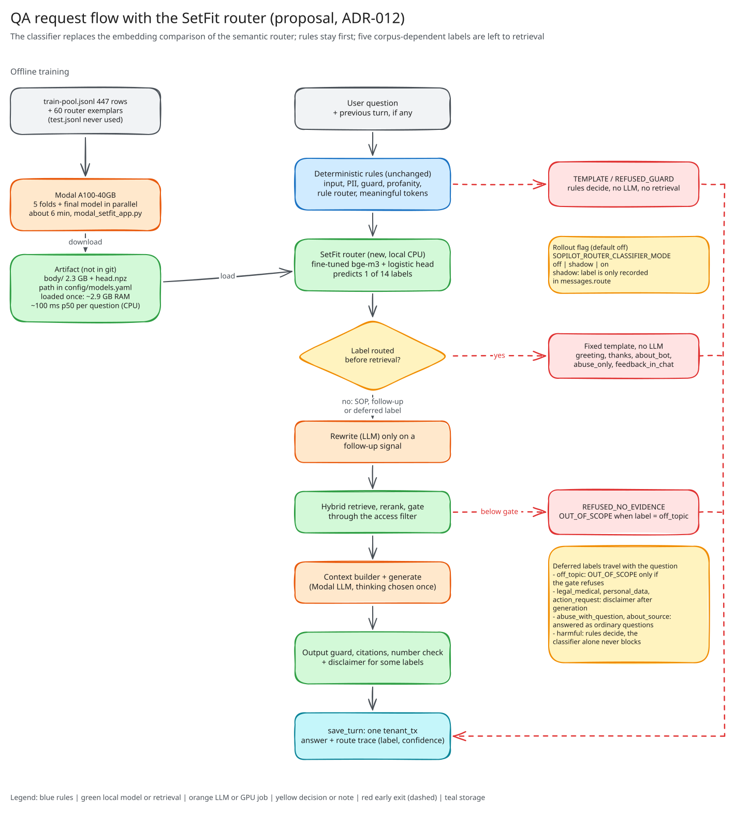

# ADR-012: Query routing with a SetFit classifier

Approved by the owner on 2026-11-17, including the extra encoder pass and about 2.9 GB of memory (§4). The points listed under "Open for the owner" in §4 stay open and are settled while implementing [V2-44](../../execution/initiatives/v2-sopilot-mvp/tickets/V2-44-ai-service-setfit-router.md). It replaces the embedding layer of the semantic router (V2-27, TECH-V2-ai-service §7.1 step 3) with a trained classifier. Nothing here is implemented in `services/ai-service` yet; the numbers come from the `eval/` experiments of 2026-11-17 (§5).

## 1. Context

The router in `qa/router.py` is a rule layer plus a cosine match against example sentences. On the frozen routing `test` split (233 rows, 169 of them not meant for retrieval) it routes few non-SOP questions correctly: 44 of 169 in the V2-27 measurement, and 28 of the 101 rows that the design in §2 routes before retrieval. The V2-27 acceptance rule stays the bar for any replacement: **no `sop_question` or `followup` routed away from retrieval** (a costly error), because a blocked business question is worse than a greeting answered with "not found".

Candidates were compared on the same split (handoff, 2026-11-17): GLiNER2.5 zero-shot, LiquidAI d1-2B, logistic regression on bge-m3 vectors, and SetFit on bge-m3. LLM classifiers were dropped by the owner as too slow. SetFit was chosen by the owner on 2026-11-17 and is trained off the machine (Kaggle, then Modal) but **served locally on CPU**, like the retrieval embedder (ADR-006).

## 2. Decision

1. **Order.** The rule layer decides first (harmful content, PII, guard, profanity). Questions the rules do not decide go to the classifier, which replaces the embedding comparison of `SemanticLayer`. The classifier never blocks harmful content on its own.
2. **Design `two_group+`.** The classifier always predicts one of 14 labels. Labels whose correct handling depends on the workspace corpus or already has its own mechanism are **deferred**: the question goes to retrieval and its gate, as TECH §7.1 step 3 already does for `off_topic`. Deferred labels: `off_topic`, `legal_medical`, `personal_data`, `abuse_with_question`, `about_source`. Routed before retrieval: `greeting`, `thanks`, `about_bot`, `abuse_only` (fixed templates, as `qa/router.py` does today). The eval also scores `harmful`, `action_request` and `feedback_in_chat` as routed, but in the service they keep today's behaviour: `harmful` is decided by rules (the classifier alone never blocks), `action_request` still runs retrieval and adds a disclaimer, and `feedback_in_chat` is not routed yet (owner decision open, `FEEDBACK_INTENT` in `qa/router.py`). `sop_question` and `followup` go to retrieval.
3. **Confidence threshold.** None for `two_group+` (0.0, picked on dev out-of-fold probabilities with zero costly errors). See §5 for why a threshold does not help here.
4. **Training.** SetFit (fine-tuned `BAAI/bge-m3` body, logistic head), 20 iterations, 1 epoch, batch 16, max sequence length 128, with the previous turn prepended when there is one **and a random previous turn added to half of the training rows that have none** (`--augment-history`, §5: without it the model reads any previous message as a follow-up). Training rows: `train-pool.jsonl` (447 rows) plus the router exemplars (60), 507 in total. `test.jsonl` is never used for training or tuning.
5. **Artifact and serving.** The model is `body/` (a sentence-transformers folder, about 2.3 GB fp32) and `head.npz` (`coef`, `intercept`, `classes`; probabilities are `softmax(embedding @ coef.T + intercept)` in numpy). It is **not stored in git**. Its path and label set are declared in `config/models.yaml`, not in Python. It is rebuilt by `eval/experiments/routing/modal_setfit_app.py`, never hand-edited.
6. **Rollout.** First in shadow mode (the prediction is recorded in `messages.route`, nothing is routed by it), then switched on by a flag, default off until the acceptance in V2-44 passes on a corpus-specific test set.

Source: [qa-routing-setfit.excalidraw](../diagrams/qa-routing-setfit.excalidraw)

Diagram source (text)

- user question (+ previous turn) → deterministic rules (input, PII, guard, profanity, rule router, meaningful tokens) → SetFit router → "label routed before retrieval?"
- rules may exit with `TEMPLATE` / `REFUSED_GUARD`; the classifier exits with a fixed template for `greeting`, `thanks`, `about_bot`, `abuse_only`
- otherwise: rewrite only on a follow-up signal → hybrid retrieve + rerank + gate → generate → output guard, citations, number check, disclaimer for `legal_medical`, `personal_data`, `action_request` → `save_turn` (answer + route trace with label and confidence)
- gate refusal: `REFUSED_NO_EVIDENCE`, or `OUT_OF_SCOPE` when the label is `off_topic`
- offline: `train-pool.jsonl` (447) + 60 exemplars → Modal A100-40GB (5 folds + final in parallel) → artifact `body/` + `head.npz` (not in git) → loaded once by the service
- flag `SOPILOT_ROUTER_CLASSIFIER_MODE`: `off` (default), `shadow` (label only recorded in `messages.route`), `on`

## 3. Alternatives considered

| Option | Why not |
|---|---|
| Keep rules + cosine router (V2-27) | 28 of 101 correct on the rows `two_group+` routes; the router flag has been off by default since V2-27 closed. |
| LLM or zero-shot classifier (Qwen, d1-2B, GLiNER2.5) | Owner dropped LLMs as too slow. Zero-shot: GLiNER 60/169 with 2 costly, d1-2B 120–122/169 with 6–8 costly. d1 plus a stacked head reached 0 costly but 116/169 and a 200 ms T4 latency. |
| Logistic regression on frozen bge-m3 vectors | Reuses the retrieval vector (no extra model), but 111/169 with 2 costly on the 447-row pool. Kept as the fallback if the 2.9 GB of the SetFit body is judged too heavy. |
| SetFit with a confidence threshold, 14 labels (`flat`) | 40/169 routed correctly at the only safe threshold (0.9). Probabilities cluster at 0.8–0.9 and the 7 costly out-of-fold errors sit at 0.74–0.88, so no threshold separates them. Temperature scaling (T = 0.8) made it worse (0/169). |
| SetFit, three corpus-dependent labels deferred (`two_group`) | 16/126 at threshold 0.9; the costly errors left are `abuse_with_question` and `about_source`, hence the two extra deferred labels. |
| Rules first, then SetFit, no deferred labels | 74/169, 0 costly. Safe but routes fewer questions than `two_group+`. Used as the reference, not the choice. |

## 4. Consequences

Positive:
- 86 of 101 rows correct (85 %) with 0 costly errors, against 28 of 101 for the current router, on the same rows.
- The deferred labels are the ones the design already says must not branch without knowing the corpus (D1), so the behaviour matches TECH §7.1.
- Threshold-free: no value to tune per corpus.

Negative and risks:
- **No reuse of the retrieval vector.** The fine-tuned body produces different embeddings from the retrieval `bge-m3`, so the classifier is a second encoder pass for every question: about 100 ms p50 and 126–136 ms p95 on this machine's CPU (16 logical cores, 4–8 torch threads), and about 2.9 GB of resident memory. The earlier "no extra cost" note applied to the logistic-regression candidate only.
- **The evidence is small.** 447 training rows, a 233-row test split, 15 errors in the 101 routed rows (10 routed to a wrong fixed answer, 5 sent to retrieval); the 95 % interval for 86/101 is roughly 77–91 %. The test split is mostly HR-style SOP questions, the added candidate rows follow the real corpus; no test set exists for the owner's own corpus.
- The 14-label accuracy did not rise from 187 to 447 training rows (0.90 on test in both runs); out-of-fold accuracy on dev went from 0.84 to 0.90 on a harder pool.
- Confident errors exist (sarcastic SOP questions read as abuse, unaccented HR questions read as `legal_medical` or `personal_data`); `two_group+` removes them from the test split only because those labels are deferred.
- Training is reproducible but not free: about 220 s per fold on an A100-40GB and about 6 minutes for five folds plus the final model in parallel on Modal (estimated cost of one run: 1–2 USD).

Accepted by the owner on 2026-11-17: the extra encoder pass and about 2.9 GB of resident memory. A fp16 or int8 body (about half the memory) was not measured and is not part of this decision.

Open for the owner:
- Where the 2.3 GB artifact lives for a fresh checkout (a local directory built from the Modal volume, or a private Hugging Face repo).
- Whether `about_source` loses an existing feature: it is a template that re-lists the previous turn's citations (V2-27 criterion c), and `two_group+` defers it to retrieval.
- A corpus-specific test set, which is the only independent evidence for the zero-costly claim.

Follow-up: ticket [V2-44](../../execution/initiatives/v2-sopilot-mvp/tickets/V2-44-ai-service-setfit-router.md).

## 5. Evidence

Frozen `test.jsonl` unless noted; thresholds are picked on dev out-of-fold (OOF) probabilities only. Run folder: `eval/results/routing/setfit-bge-m3-pool447-hist-test/` (git-ignored; `metrics.json`, `per_question.jsonl`, `oof.npy`).

| Design | Threshold | Routed OK / routable | Costly |
|---|---|---|---|
| Rules + semantic router (current service) | – | 44 / 169 | 0 |
| SetFit, pool 187, `flat` | 0.3 | 150 / 169 | 3 |
| SetFit, pool 447, `flat` | 0.9 | 40 / 169 | 0 |
| SetFit, pool 447, `two_group` | 0.9 | 16 / 126 | 0 |
| SetFit, pool 447, history prefix only on follow-up rows, `two_group+` | 0.0 | 86 / 101 | 0, but **invalid with history** (see below) |
| SetFit, pool 447, no history in the input, `two_group+` | 0.75 | 69 / 101 | 1 (follow-up read as `about_bot`) |
| **SetFit, pool 447, augmented history, `two_group+`** | **0.0** | **86 / 101** | **1 by the eval definition, 0 answered by a template** |
| Rules first, then SetFit (`flat`) | – | 74 / 169 | 0 |

`two_group+` (augmented history) on dev OOF: 109 / 125, 0 costly; 14-label accuracy on test 0.876. The "routed OK" denominators differ per design (rows whose correct handling is a fixed route the design applies before retrieval), so only rows of the same design are comparable; on the 101 rows of `two_group+` the current router gets 28. "Routed OK" means the predicted label equals the row's label for the labels the design routes (`greeting`, `thanks`, `about_bot`, `abuse_only`, `harmful`, `action_request`, `feedback_in_chat`); what the service then does with `harmful`, `action_request` and `feedback_in_chat` is the existing behaviour described in §2, so the figure measures label accuracy there, not templates sent. The 187-row run used a different pool and is not comparable one to one.

**History shortcut (found 2026-11-17).** In the routing dataset only `followup` and `about_source` rows carry a previous turn, so the first model learned "a previous message is present" as the cue for those two labels. Probe: the 213 test rows without history, each given a random previous message from the training pool, were all (213 / 213) predicted `followup` or `about_source`, and none of the 62 template-label rows kept its label. The service has history on every turn after the first, so that model would have routed nothing from the second turn on, while the test split, built the same way, could not show it. Two fixes were tried: no history in the input (accuracy 0.88, but follow-ups such as "còn giấy tờ gì nữa ko" are read as `about_bot`: 1 SOP/follow-up question answered by a template at the dev-picked threshold, and `followup_signal` in `qa/query_frame.py` does not flag them) and **augmented history** (a random previous message on half of the rows without one). With augmentation the same probe flips 5 of 213 rows to `followup`/`about_source`, template labels stay correct on 52 of 62 (54 of 62 without a previous message), and no SOP/follow-up question is answered by a template with or without history. The one "costly" row of the eval definition (`route-test-241`, "quy trinh xin nghi om can giay to gi", read as `action_request`, 0.63) still runs retrieval in the service, with a disclaimer. The eval definition counts every label it routes (`harmful`, `action_request`, `feedback_in_chat` too); the service answers without retrieval only for the four template labels.

Local check of the first downloaded model (`eval/experiments/routing/local_setfit_check.py`; the augmented model has the same architecture and was not re-timed): the 233 test rows reproduce the training job's argmax 233 / 233, maximum probability difference below 0.0001; CPU latency p50 about 100 ms, p95 126–136 ms; resident memory about 2.9 GB; load about 3 s.

Not verified: behaviour on questions of the owner's real corpus, the effect on retrieval of the deferred labels, accented/unaccented balance outside this dataset, a GPU or quantized variant, the row labels of the 260 candidate rows beyond the owner's acceptance of 2026-11-17 and a re-read of six of them on 2026-11-17.
