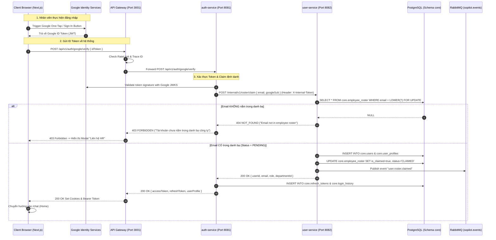

> **Đóng 2026-11-08:** `superseded` vì PRD-M1 và ADR-001/002 đã `superseded`; thay bằng [TECH-V2-core-api](../../../architecture/components/core-api.md) và ADR-005. Giữ file làm lịch sử V1; không dùng làm đặc tả.

# THIẾT KẾ KỸ THUẬT (TECHNICAL DESIGN DOCUMENT)

> **Mã tài liệu:** `TECH-M1-JIT-ONBOARDING` | **Tham chiếu:** [PRD](../../01-requirements/PRD-M1-jit-onboarding.md) | **Trạng thái:** Approved

---

## 1. System Topology Impact

| Thành phần | Công nghệ | Ranh giới Schema / Trách nhiệm |
|---|---|---|
| `infrastructure` | PostgreSQL 16 | Thêm DDL `010_employee_roster.sql` vào schema `core`. |
| `user-service` | Spring Boot 3.4 (:8082) | Quản lý aggregate `core.employee_roster`, API upload Excel/CSV, API internal `/internal/v1/roster/claim`, phát RabbitMQ event khi claim thành công. |
| `auth-service` | Spring Boot 3.4 (:8081) | Xác thực Google ID Token qua Google JWKS, gọi internal API sang `user-service` để claim, sinh Access/Refresh JWT, ghi `core.login_history`. |
| `api-gateway` | NestJS 11 (:3001) | Reverse proxy `POST /api/v1/auth/google/verify` (`@Public()`) và các route Admin `/api/v1/users/roster/*` (`@Roles('ADMIN')`). |
| `feedback-service` | Spring Boot 3.4 (:8085) | Lắng nghe event `user.roster.claimed` để ghi Audit Log tuân thủ. |
| `frontend/web` | Next.js 16 (:3000) | Nút "Sign in with Google", màn hình 403 Forbidden, trang quản lý danh bạ chờ kích hoạt `/admin/users/roster`. |

---

## 2. Sơ đồ tương tác tuần tự (Sequence Diagram)



---

## 3. Data Schema & DDL Specification

- **File Migration:** `infrastructure/init-db/010_employee_roster.sql`
- **Target Schema:** `core`

```sql
CREATE TYPE core.roster_status AS ENUM ('PENDING_ACTIVATION', 'CLAIMED', 'REVOKED');

CREATE TABLE IF NOT EXISTS core.employee_roster (
    id UUID PRIMARY KEY DEFAULT uuid_generate_v4(),
    employee_code VARCHAR(50) NOT NULL,
    email VARCHAR(255) NOT NULL,
    full_name VARCHAR(255) NOT NULL,
    phone VARCHAR(20),
    position VARCHAR(100),
    department_id UUID NOT NULL REFERENCES core.departments(id) ON DELETE RESTRICT,
    role core.user_role NOT NULL DEFAULT 'USER',
    status core.roster_status NOT NULL DEFAULT 'PENDING_ACTIVATION',
    is_claimed BOOLEAN NOT NULL DEFAULT FALSE,
    claimed_at TIMESTAMPTZ,
    claimed_user_id UUID,
    import_batch_id UUID,
    created_at TIMESTAMPTZ NOT NULL DEFAULT CURRENT_TIMESTAMP,
    updated_at TIMESTAMPTZ NOT NULL DEFAULT CURRENT_TIMESTAMP,

    CONSTRAINT uq_employee_roster_code UNIQUE (employee_code),
    CONSTRAINT uq_employee_roster_email UNIQUE (email),
    CONSTRAINT ck_employee_roster_claimed CHECK (
        (is_claimed = FALSE AND claimed_at IS NULL AND claimed_user_id IS NULL) OR
        (is_claimed = TRUE AND claimed_at IS NOT NULL AND claimed_user_id IS NOT NULL)
    )
);

CREATE UNIQUE INDEX idx_employee_roster_email_lower ON core.employee_roster (LOWER(email));
```

---

## 4. API Contracts

### A. Endpoint Xác thực Google JIT
- `POST /api/v1/auth/google/verify` (Public)
- **Request Body:**
  ```json
  { "idToken": "eyJhbGciOiJSUzI1NiIs..." }
  ```
- **Response Success (200 OK):**
  ```json
  {
    "accessToken": "eyJhbGciOiJIUzI1Ni...",
    "refreshToken": "d8f3e2...",
    "tokenType": "Bearer",
    "expiresIn": 900,
    "user": {
      "id": "11111111-1111-1111-1111-111111111111",
      "email": "employee@sopilot.com",
      "fullName": "Nguyen Van A",
      "role": "USER",
      "department": { "id": "uuid", "code": "ENG", "name": "Engineering" }
    }
  }
  ```

### B. Endpoint Internal Claim Roster
- `POST /internal/v1/roster/claim` (Header: `X-Internal-Token`)
- **Request Body:**
  ```json
  {
    "email": "employee@sopilot.com",
    "googleSub": "google-user-id-12345"
  }
  ```

### C. Endpoint Admin Import Danh bạ
- `POST /api/v1/users/roster/import` (Role: `ADMIN`, Multipart File `.xlsx` / `.csv`)
- **Response (200 OK):**
  ```json
  {
    "batchId": "uuid",
    "totalRows": 150,
    "importedCount": 148,
    "failedCount": 2,
    "errors": [
      { "row": 12, "employeeCode": "NV012", "reason": "Department code 'MKT_OLD' not found" }
    ]
  }
  ```
