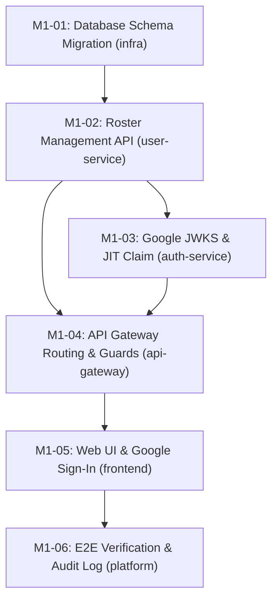

> **Đóng 2026-10-20 (V2-04):** `superseded` bởi [PLAN-V2](../../execution/initiatives/v2-sopilot-mvp/PLAN.md). M1-01/02 giữ `done`, M1-03/04/05 chuyển `superseded` ngày 2026-11-08 (trước đó `review`/`review`/`in-progress`; port sang V2-11/V2-15), M1-06 `superseded`. Không cập nhật tiến độ ở đây nữa.

# KẾ HOẠCH TRIỂN KHAI THỰC THI (EXECUTION PLAN)

> **Mã kế hoạch:** `PLAN-M1-JIT-ONBOARDING` | **Milestone:** Milestone 1: JIT Onboarding v1.0 | **Trạng thái:** Superseded (2026-10-20)  
> **Tham chiếu nghiệp vụ:** [PRD-M1](../01-requirements/PRD-M1-jit-onboarding.md)  
> **Tham chiếu kỹ thuật:** [TECH-M1](../02-architecture/designs/TECH-M1-jit-onboarding.md) | [ADR-001](../../architecture/decisions/adr-001-employee-roster-ownership.md) | [ADR-002](../../architecture/decisions/adr-002-google-jit-auth-boundary.md)

---

## 1. Mục tiêu Kế hoạch & Ranh giới (Objectives)
Hiện thực hóa cơ chế Google 1-Click JIT Sign-in và quản lý danh bạ định danh nhân sự, loại bỏ hoàn toàn quy trình tạo tài khoản thủ công.

---

## 2. Lộ trình Thực thi & Đồ thị Phụ thuộc (Execution DAG)

---

## 3. Danh sách Phân rã Tickets

### Phase 1: Nền tảng Cơ sở dữ liệu (Database Foundation)
| Ticket ID | Tiêu đề | Scope | Size | Phụ thuộc | Trạng thái |
|---|---|---|:---:|---|:---:|
| [`M1-01`](tickets/M1-01-database-migration-employee-roster.md) | Database Schema Migration cho Employee Roster | `infra` | S | None | done |

### Phase 2: Dịch vụ Nghiệp vụ Backend (Backend Domain Logic)
| Ticket ID | Tiêu đề | Scope | Size | Phụ thuộc | Trạng thái |
|---|---|---|:---:|---|:---:|
| [`M1-02`](tickets/M1-02-user-service-roster-management.md) | Quản lý Danh bạ Nhân sự & Internal Claim API | `user` | M | `M1-01` | done |
| [`M1-03`](tickets/M1-03-auth-service-google-jit-integration.md) | Xác thực Google Token & Cấp phát JWT Session | `auth` | M | `M1-02` | superseded |

### Phase 3: Gateway & Giao diện Frontend (Client Integration)
| Ticket ID | Tiêu đề | Scope | Size | Phụ thuộc | Trạng thái |
|---|---|---|:---:|---|:---:|
| [`M1-04`](tickets/M1-04-api-gateway-routing.md) | Cấu hình API Gateway Routing & Proxy Guards | `gateway` | S | `M1-02`, `M1-03` | superseded |
| [`M1-05`](tickets/M1-05-frontend-web-roster-and-google-login.md) | Màn hình Đăng nhập Google & Quản lý Danh bạ Admin | `web` | L | `M1-04` | superseded |

### Phase 4: Kiểm thử Tích hợp & Nghiệm thu (Testing & Sign-off)
| Ticket ID | Tiêu đề | Scope | Size | Phụ thuộc | Trạng thái |
|---|---|---|:---:|---|:---:|
| [`M1-06`](tickets/M1-06-e2e-testing-and-audit-verification.md) | Kiểm thử Toàn diện E2E & Xác minh Audit Log | `platform` | M | `M1-05` | superseded |

---

## 4. Tiêu chuẩn Nghiệm thu Toàn diện (Definition of Done)
Checkpoint 2026-10-15: 2 ticket done, 2 review, 1 in-progress, 1 todo. `implemented_tickets` chỉ đếm M1-01..04 đã commit trước checkpoint, không thay thế nghiệm thu. Xem [bàn giao](../04-reports/HANDOFF-implementation-2026-10-15.md) và [backlog tiếp theo](PLAN-NEXT-implementation-readiness.md).

- [ ] 6/6 tickets đạt trạng thái `done`.
- [ ] Chạy `./scripts/pre-commit-check.ps1` đạt PASS 100%.
- [ ] Xuất báo cáo nghiệm thu `docs/04-reports/AUDIT-M1-jit-onboarding.md` (chưa tạo; lập khi M1-06 xong).
