> Translated from Vietnamese on 2026-11-13 without changing decisions, statuses or counters. The status tables in §3 and the Mermaid edges in §2 keep the exact format `eval/sopilot_eval/plan_check.py` parses. Owner decisions are quoted as recorded ("Owner decision" = *Owner chốt*).

> **Owner decision 2026-10-20:** DOCX is deferred until after the V2 MVP to reduce extraction and testing complexity. The current scope is PDFs with a text layer, MD, TXT (PRD-V2 FR-06); DOCX returns `415` on upload, creates no job and tells the user to export a PDF with a text layer. DOCX remarks in the audits are history, not MVP acceptance requirements. No ticket status or counter changes. *Changed 2026-10-21: TXT is dropped too; the scope is PDFs with a text layer and MD.*

> **Owner decision 2026-11-01 (V2-02 done):** Gemini and Groq `gpt-oss-120b` are dropped from answer generation and the faithfulness judge; small open-source models are self-hosted on Modal (two Starter accounts, $30/month each). The guard stays rule-based; metadata/embedding/rerank are unchanged. ADR-006 §4.4 was rewritten the same day. The bake-off choosing the model and the matching edits of PRD-V2 FR-13 and TECH-V2-ai-service are done in `V2-10`; no ticket added, only `V2-02` moves to `done` (`completed_tickets` 5 → 6, `review_tickets` 4 → 3).

> **Owner decision 2026-10-20 (V2-03 done):** research first; commercial quotas (FR-09: documents, storage, questions/day) are off by default; technical limits (20 MB/file, provider RPM/TPM) stay. TECH-V2 approved as proposed; FR-16/FR-17 move to ai-service (V2-13 scope `ai-qa`). PRD-V2-ingestion-mvp-scope approved: ≤ 10 files per batch (FR-30, V2-15) and a replacement with the same SHA-256 is a no-op (V2-12). *Changed 2026-10-21: the document/storage quota defaults back on at 50/200 MB; the question quota stays off.*

> **Owner decision 2026-10-21 (Markdown normalization and the extraction view, [AUDIT-markdown-normalization](../../../research/audit-markdown-normalization-and-preview-2026-10-21.md)):** the MVP accepts only PDFs with a text layer and Markdown (TXT dropped). One PDF library converts directly into a structured representation, and one canonical Markdown rendered after cleaning is the shared source for chunks/index/citations/metadata suggestions; the library is chosen in `V2-20` (2-day timebox, candidates Docling and PyMuPDF, recorded in ADR-008). *Changed 2026-10-21 (owner): **Docling** is chosen, [ADR-008](../../../architecture/decisions/adr-008-pdf-extraction-docling.md) `approved` but without measurements; `V2-20` confirms it against hard constraints instead of comparing two libraries.* The "Nội dung hệ thống nhận diện" (recognized content) view (PRD-V2 FR-31) opens only at `READY`. The document quota defaults on at 50 documents/200 MB; the question quota stays off. The replacement rule while processing (`409 VERSION_IN_PROGRESS`) and the retry fix (a `FAILED` job goes back to the queue by `attempt`). PRD-V2-ingestion-mvp-scope is merged into PRD-V2 and becomes `superseded`. Criteria of `V2-09`, `V2-12`, `V2-15`, `V2-16`, `V2-19` to `V2-22`, `V2-25` updated; no ticket added, no status or counter change.

> **Owner decision 2026-10-20 (profanity and questions needing no knowledge):** `V2-10` extends the FR-13 rules with a VI/EN profanity dictionary (word boundaries, diacritics kept for words that collide without them), a "strip then judge" router (insult-only messages get a template, insults with a question are still answered) and a block level for truly harmful content. **Rules + semantic router** chosen (comparing the question embedding with example sentences, no LLM call), rejecting an LLM classifier for the grey zone; PRD-V2 FR-13 and ADR-006 §4.4 updated accordingly. `V2-27` (P1) added: the router in ai-service, a labelled routing dataset, measured against rules only to tune thresholds and decide whether to enable it by default.

> **Pre-implementation review 2026-10-21:** `V2-07` also depends on `V2-22` (official RQ numbers run on the `docproc` chunker; smoke/exploratory runs can still go first); `V2-09` also depends on `V2-06` (harness match). `V2-20` scaffolds `services/ai-service` and the build/test scopes; `V2-08` creates the three DB roles; tokenizer, table-row offsets and retry error classification are recorded in TECH-V2-ai-service §1.1, §5.1, §5.2, §6.5. No ticket added, no status or counter change.

> **Owner decision 2026-10-21 (RAG architecture review for the SOP problem):** keep hybrid + RRF + optional rerank + threshold gate, adding three changes without LLM calls (TECH-V2-ai-service §5.4, §6.4, §6.4a, §12a): (A) the document code `docCode` in `index_text` (`V2-22`, passed by the worker in `V2-09`); (B) small-to-big context assembly by same-section group after the gate, with an on/off ablation (`V2-10`); (C) a BM25 weight when the question's language differs from the chunk's, default `1.0`, changed only per RQ1b (`V2-07`, implemented in `V2-09`). GraphRAG, RAPTOR, iterative/agentic, HyDE/multi-query are not in V2. No ticket added, no dependency, status or counter change.

> **Owner decision 2026-10-21 (end-to-end audit of ai-service by query type, decisions D1–D11, details in [TECH-V2-ai-service](../../../architecture/components/ai-service.md) §11a):** criteria updated for `V2-06` (span gold, `query_types` labels), `V2-07` (tokenizer with diacritic-free terms and the `dense_score` gate in the harness before the official numbers), `V2-09` (`refusal_reason`/`route`/`rewrite_status`/`checks` columns in the migration, `doc_code_boost`, `reindex`, embedding-model check), `V2-10` (input, follow-ups, PII, `refusal_reason`, `<source code rev effective>`, number/date check, no fallback after `delta`), `V2-13` (the gap list holds only kinds needing documents, PII-masked questions), `V2-15` (the "Old version" label), `V2-16` (end-to-end TTFT), `V2-19` (merged-cell labels, 1–2-page PDFs, cross-reference count), `V2-20` (merged-cell spans), `V2-21` (minimum page count for headers/footers), `V2-22` (merged cells repeated down rows), `V2-27` (the extended router runs after the gate, `followup` measured through the pipeline). **`V2-28` added** (Vietnamese SOP system check set, P1, size M): `total_tickets` 27 → 28, no other status or counter change. Deferred after the MVP (reconsider when): splitting multi-part questions, asking back on ambiguity, expanding references within a document (D6), the `DOC_INFO` chunk, per-chunk `lang`, an abbreviation dictionary (TECH-V2-ai-service §12a).

> **Implementation preparation 2026-10-24:** the XL V2-11 is split into V2-11 (identity/JIT), V2-29 (workspace/session), V2-30 (invitations/OWNER); the XL V2-15 into V2-15 (shell/chat), V2-31 (upload), V2-32 (viewer), V2-33 (admin). The approved scope is unchanged, 33 tickets in total. DAG and `blocks` in sync; handover also waits for V2-04/V2-27/V2-28 and each frontend part. V2-04 has had its document review and is `done`; V2-05/V2-08 stay `review` for the new delta; V2-06/V2-19 are `in-progress` on tooling, with no approved gold yet. See [AUDIT readiness](../../../archive/reports/AUDIT-v2-readiness-preparation-2026-10-24.md).

# EXECUTION PLAN

> **Plan id:** `PLAN-V2-SOPILOT-MVP` | **Status:** `approved` (owner approval 2026-10-20)
>
> **Process constraint:** PRD-V2 and ADR-004/005/006/007 were approved by the owner on 2026-10-20 (`V2-01`). On 2026-10-19 the scope was reopened to keep staff management, flat departments, category/metadata and department-based document permissions (ADR-007). Per the agent instructions at the time, the PLAN passed its approval gate when `V2-01` completed on 2026-10-20. The research tickets (`V2-05` to `V2-07`, `V2-19`) do not depend on architecture decisions, so they run first. Ingestion is split into `V2-19` to `V2-22` per [AUDIT-ingestion-sop-data](../../../research/audit-ingestion-sop-data-2026-10-19.md).

---

## 1. Goal & scope

**Target:** a research handover with a system that **runs with `docker compose up` on the local machine**. No deployment (B1/B2 out of scope; B3 Cloudflare Tunnel only as a last-resort option).

**Order (direction A, owner decision 2026-10-17):** do the research-value part first (measuring retrieval quality), then rewrite into 2 services, trim and add features. Reason: the multilingual (VI, EN) RAG core had never been measured; if the numbers are poor, change direction before investing in the rest.

**Feasibility principle (owner decision 2026-10-17):** the goal is a system that runs and can be benchmarked for the report, not the absolute best configuration. Applied to every choice in the plan:
1. It must run on the owner's machine (CPU, no GPU) for free; when unsure, measure before committing.
2. Every heavy choice (rerank, an LLM judge, a large embedding model) has a reduced fallback: a fixed subset or a smaller model; the report states the measured cost.
3. When two options differ little and one is much harder to run, choose the one that runs and record the trade-off.
4. Cut P1 and features that do not serve benchmarking/running before cutting time from the measurement work.

| Workstream | Content | Tickets |
|---|---|---|
| **Decisions** | Approve documents, TECH, confirm providers, close the old backlog | V2-01 to V2-04 |
| **Research** | Eval harness, datasets, RQ1–RQ3/RQ5 runs; semantic router measured against rules only | V2-05 to V2-07, V2-27 |
| **Updating existing features** | Fix LLMs, reranker, score scales, embedding provenance, auth hardening (when porting to V2) | V2-09, V2-10, V2-11 |
| **Trim** | Down to 2 services; drop the pre-created roster, general ACLs, department/category trees, OTP/passwords, OnlyOffice, analytics, gateway, RabbitMQ, Redis | V2-08, V2-17 (remove old code) |
| **Key new features** | Workspaces + tenancy + RLS, invitations, verified citations, grounded refusal, quotas (documents 50/200 MB by default, questions off), ≤ 10 files per batch, the "Nội dung hệ thống nhận diện" view, audit, knowledge gaps, demo data | V2-09 to V2-16 |
| **SOP ingestion** | A real extraction corpus, Docling (ADR-008) + canonical Markdown with offsets, boilerplate + metadata + warnings, structure-aware chunking; a Vietnamese SOP system check set | V2-19 to V2-22, V2-28 |
| **Staff, departments, metadata (ADR-007)** | Member profiles, suspension, flat departments, categories/tags, department-based visibility, background metadata suggestions, department authorization tests; department publishers (ADR-009) | V2-23 to V2-26, V2-36 |
| **Acceptance** | FR-19 in CI, RQ4, parity, handover report | V2-14, V2-17, V2-18 |

---

## 2. Dependency graph

```mermaid
flowchart TD
    V01["V2-01: Approve PRD-V2, ADR-004/005/006/007 and settle open questions"]
    V02["V2-02: Confirm live LLM models with real keys"]
    V03["V2-03: Write TECH-V2-core-api and TECH-V2-ai-service"]
    V04["V2-04: Close the M1/NEXT backlog and clean up duplicate documents"]
    V05["V2-05: Retrieval eval harness (FR-18)"]
    V06["V2-06: Multilingual (VI, EN) corpus and reviewed question set"]
    V07["V2-07: Run RQ1–RQ3 and RQ5, write the report"]
    V08["V2-08: Flyway and docker compose skeleton (Postgres/pgvector, object storage)"]
    V09["V2-09: ai-service: ingest worker, embedding, hybrid retrieval, RLS, 4 score types, provider interface"]
    V10["V2-10: ai-service: 2-LLM-call Q&A pipeline, SSE, citations, refusal"]
    V11["V2-11: core-api: service skeleton, Google identity, JIT and personal workspace"]
    V12["V2-12: core-api: documents, upload, outbox, document quota, safe replacement, audit log"]
    V13["V2-13: Answer feedback and the knowledge-gap list"]
    V14["V2-14: FR-19 tenant isolation tests in CI and RQ4"]
    V15["V2-15: Frontend: V2 shell, sign-in/workspace, chat and gaps"]
    V16["V2-16: Demo data and a one-command docker compose"]
    V17["V2-17: Parity check, remove the 8 old services, update guidance docs"]
    V18["V2-18: Research report and handover package"]
    V19["V2-19: Real SOP corpus (VI, EN; PDF/MD) and extraction-quality measurement"]
    V20["V2-20: ai-service: Docling (ADR-008), structured representation and canonical Markdown with offsets (PDF/MD)"]
    V21["V2-21: ai-service: boilerplate separation, SOP metadata extraction and extraction warnings"]
    V22["V2-22: ai-service: document-type recognition, procedure tables and structure-aware chunking"]
    V23["V2-23: core-api: member profiles, suspension lifecycle and flat departments"]
    V24["V2-24: core-api: document metadata, flat categories/tags, department-based visibility"]
    V25["V2-25: ai-service: background metadata suggestions and latency measurement"]
    V26["V2-26: Department-based document authorization tests (FR-29) in CI"]
    V27["V2-27: ai-service: semantic router (rules + embedding) measured against rules only"]
    V28["V2-28: Vietnamese SOP system check set (30–40 questions): merged cells, context assembly, document codes, validity, no diacritics"]
    V29["V2-29: core-api: workspace CRUD, workspace switching and refresh sessions"]
    V30["V2-30: core-api: invitations, members and OWNER rules"]
    V31["V2-31: Frontend: multi-document upload and processing tracking"]
    V32["V2-32: Frontend: recognized content and the citation viewer"]
    V33["V2-33: Frontend: members, departments and document metadata"]
    V34["V2-34: Infra: self-hosted LLM endpoint (Qwen3.5-9B FP8, vLLM) on Modal and a quick check"]
    V35["V2-35: Infra + ai-service: bge-reranker-v2-m3 rerank on GPU, sharing the A10 container with vLLM"]
    V36["V2-36: core-api: document write rights by department publisher and workspace publisher"]
    V37["V2-37: Retrieval configuration matrix and answer-level eval with an independent judge"]
    V01 --> V03
    V01 --> V04
    V05 --> V07
    V06 --> V07
    V22 --> V07
    V01 --> V08
    V03 --> V09
    V06 --> V09
    V08 --> V09
    V20 --> V09
    V21 --> V09
    V22 --> V09
    V02 --> V34
    V02 --> V10
    V34 --> V10
    V09 --> V10
    V03 --> V11
    V08 --> V11
    V09 --> V12
    V11 --> V12
    V10 --> V13
    V12 --> V13
    V09 --> V14
    V12 --> V14
    V10 --> V15
    V11 --> V15
    V13 --> V15
    V29 --> V15
    V30 --> V15
    V10 --> V16
    V12 --> V16
    V21 --> V16
    V24 --> V16
    V14 --> V17
    V15 --> V17
    V16 --> V17
    V26 --> V17
    V31 --> V17
    V32 --> V17
    V33 --> V17
    V04 --> V18
    V07 --> V18
    V14 --> V18
    V17 --> V18
    V27 --> V18
    V28 --> V18
    V35 --> V18
    V09 --> V35
    V34 --> V35
    V03 --> V20
    V19 --> V20
    V20 --> V21
    V20 --> V22
    V11 --> V23
    V12 --> V24
    V23 --> V24
    V09 --> V25
    V21 --> V25
    V24 --> V25
    V10 --> V26
    V23 --> V26
    V24 --> V26
    V05 --> V27
    V10 --> V27
    V10 --> V28
    V19 --> V28
    V21 --> V28
    V22 --> V28
    V11 --> V29
    V29 --> V30
    V12 --> V31
    V15 --> V31
    V10 --> V32
    V12 --> V32
    V15 --> V32
    V15 --> V33
    V23 --> V33
    V24 --> V33
    V25 --> V33
    V30 --> V33
    V23 --> V36
    V24 --> V36
    V36 --> V16
    V36 --> V31
    V36 --> V33
    V07 --> V37
    V10 --> V37
    V13 --> V37
    V27 --> V37
    V35 --> V37
    V37 --> V18
```

---

## 3. Ticket breakdown

### Phase 0: Decisions (no code)
| Ticket | Title | Scope | Size | Depends on | Status |
|---|---|---|:---:|---|:---:|
| `V2-01` | Approve PRD-V2, ADR-004/005/006/007 and settle open questions | docs | S | None | done |
| `V2-02` | Confirm live LLM models with real keys | ai-qa | S | None | done |
| `V2-03` | Write TECH-V2-core-api and TECH-V2-ai-service | docs | L | `V2-01` | done |
| `V2-04` | Close the M1/NEXT backlog and clean up duplicate documents | docs | S | `V2-01` | done |

### Phase 1: Research (runs early; `V2-07`'s official numbers wait for the `V2-22` chunker)
| Ticket | Title | Scope | Size | Depends on | Status |
|---|---|---|:---:|---|:---:|
| `V2-05` | Retrieval eval harness (FR-18) | tests | M | None | done |
| `V2-06` | Multilingual (VI, EN) corpus and reviewed question set | tests | L | None | done |
| `V2-07` | Run RQ1–RQ3 and RQ5, write the report | tests | M | `V2-05`, `V2-06`, `V2-22` | done |
| `V2-37` | Retrieval configuration matrix and answer-level eval with an independent judge | tests | L | `V2-07`, `V2-10`, `V2-13`, `V2-27`, `V2-35` | todo |

### Phase 2: Foundation and ai-service
| Ticket | Title | Scope | Size | Depends on | Status |
|---|---|---|:---:|---|:---:|
| `V2-08` | Flyway and docker compose skeleton (Postgres/pgvector, object storage) | infra | M | `V2-01` | done |
| `V2-09` | ai-service: ingest worker, embedding, hybrid retrieval, RLS, 4 score types, provider interface | ai-qa | L | `V2-03`, `V2-06`, `V2-08`, `V2-20`, `V2-21`, `V2-22` | done |
| `V2-34` | Infra: self-hosted LLM endpoint (Qwen3.5-9B FP8, vLLM) on Modal and a quick check | infra | M | `V2-02` | done |
| `V2-10` | ai-service: 2-LLM-call Q&A pipeline, SSE, citations, refusal | ai-qa | L | `V2-02`, `V2-09`, `V2-34` | done |
| `V2-27` | ai-service: semantic router (rules + embedding) measured against rules only | ai-qa | L | `V2-05`, `V2-10` | done |
| `V2-35` | Infra + ai-service: bge-reranker-v2-m3 rerank on GPU, sharing the A10 container with vLLM | infra | L | `V2-09`, `V2-34` | done |

### Phase 2b: SOP ingestion (AUDIT-ingestion-sop-data)
| Ticket | Title | Scope | Size | Depends on | Status |
|---|---|---|:---:|---|:---:|
| `V2-19` | Real SOP corpus (VI, EN; PDF/MD) and extraction-quality measurement | tests | M | None | done |
| `V2-20` | ai-service: Docling (ADR-008), structured representation and canonical Markdown with offsets (PDF/MD) | ai-qa | L | `V2-03`, `V2-19` | done |
| `V2-21` | ai-service: boilerplate separation, SOP metadata extraction and extraction warnings | ai-qa | M | `V2-20` | done |
| `V2-22` | ai-service: document-type recognition, procedure tables and structure-aware chunking | ai-qa | L | `V2-20` | done |
| `V2-28` | Vietnamese SOP system check set (30–40 questions): merged cells, context assembly, document codes, validity, no diacritics | tests | M | `V2-10`, `V2-19`, `V2-21`, `V2-22` | done |

Contextual retrieval (step 10 of the audit) has no ticket; it is considered only after `V2-07`'s results.

### Phase 3: core-api
| Ticket | Title | Scope | Size | Depends on | Status |
|---|---|---|:---:|---|:---:|
| `V2-11` | core-api: service skeleton, Google identity, JIT and personal workspace | user | L | `V2-03`, `V2-08` | done |
| `V2-29` | core-api: workspace CRUD, workspace switching and refresh sessions | user | L | `V2-11` | done |
| `V2-30` | core-api: invitations, members and OWNER rules | user | M | `V2-29` | done |
| `V2-12` | core-api: documents, upload, outbox, document quota, safe replacement, audit log | knowledge | L | `V2-09`, `V2-11` | done |
| `V2-13` | Answer feedback and the knowledge-gap list | ai-qa | M | `V2-10`, `V2-12` | done |
| `V2-14` | FR-19 tenant isolation tests in CI and RQ4 | tests | M | `V2-09`, `V2-12` | done |
| `V2-23` | core-api: member profiles, suspension lifecycle and flat departments | user | M | `V2-11` | done |
| `V2-24` | core-api: document metadata, flat categories/tags, department-based visibility | knowledge | L | `V2-12`, `V2-23` | done |
| `V2-25` | ai-service: background metadata suggestions and latency measurement | ai-qa | M | `V2-09`, `V2-21`, `V2-24` | done |
| `V2-26` | Department-based document authorization tests (FR-29) in CI | tests | M | `V2-10`, `V2-23`, `V2-24` | done |
| `V2-36` | core-api: document write rights by department publisher and workspace publisher | knowledge | L | `V2-23`, `V2-24` | done |

### Phase 4: Frontend, integration, handover
| Ticket | Title | Scope | Size | Depends on | Status |
|---|---|---|:---:|---|:---:|
| `V2-15` | Frontend: V2 shell, sign-in/workspace, chat and gaps | web | L | `V2-10`, `V2-11`, `V2-13`, `V2-29`, `V2-30` | todo |
| `V2-31` | Frontend: multi-document upload and processing tracking | web | L | `V2-12`, `V2-15`, `V2-36` | todo |
| `V2-32` | Frontend: recognized content and the citation viewer | web | L | `V2-10`, `V2-12`, `V2-15` | todo |
| `V2-33` | Frontend: members, departments and document metadata | web | L | `V2-15`, `V2-23`, `V2-24`, `V2-25`, `V2-30`, `V2-36` | todo |
| `V2-16` | Demo data and a one-command docker compose | platform | M | `V2-10`, `V2-12`, `V2-21`, `V2-24`, `V2-36` | done |
| `V2-17` | Parity check, remove the 8 old services, update guidance docs | platform | L | `V2-14`, `V2-15`, `V2-16`, `V2-26`, `V2-31`, `V2-32`, `V2-33` | todo |
| `V2-18` | Research report and handover package | docs | M | `V2-04`, `V2-07`, `V2-14`, `V2-17`, `V2-27`, `V2-28`, `V2-35`, `V2-37` | todo |

---

## 4. Risks

| Risk | Level | Mitigation |
|---|:---:|---|
| No real SOPs yet to measure extraction; `V2-19` blocks the ingestion chain and `V2-09` | High | The owner gathers documents early; `V2-19` runs in parallel with Phases 0–1 |
| Poor multilingual RAG quality (especially cross-lingual) forcing a change of direction | High | Measure in Phase 1 before rewriting; `V2-07` is the decision gate |
| No GPU: `bge-m3` embedding and rerank are slow | High | Cache embeddings, run once; record times in the report; the corpus can be shrunk |
| The question set lacks quality or has no reviewer | High | `V2-06` requires owner review; the process is recorded in the report |
| The rewrite is too big to finish in time | High | Old code runs in parallel; cut P1 (domain join) and FR-05 first if time runs short |
| LLM quotas block questions | Medium | Measure answers only on a subset; retrieval is measured without an LLM. The FR-09 question quota is off, so only the RPM/TPM limiters and backup models protect provider quotas |
| The PDF library does not preserve Vietnamese procedure tables, or is too slow/heavy on CPU | High | Docling is chosen (ADR-008) without measurements: `V2-20` confirms it against hard constraints (offline CPU, OCR off, page numbers, NFC, `cell_spans`, time/RAM) on a V2-19 subset, capped at 2 days; if a hard constraint fails it stops and asks the owner, and ADR-008 returns to `draft`; `V2-21`/`V2-22` work on `StructuredDocument`, so they are not blocked; only one library, no fallback chain |
| An AGPL license (only if PyMuPDF were reopened) | Low | Docling is MIT; AGPL only with owner confirmation recorded in ADR-008 |
| The frontend has many flows and is hard to accept in one go | Medium | Split into V2-15/V2-31/V2-32/V2-33; each part has its own browser check; V2-17 waits for all |
| The default 50-document quota blocks loading the demo/eval corpus | Low | Eval runs in `eval/` without core-api; the demo sets the quota variables or keeps ≤ 50 documents (`V2-16`) |
| Misconfigured RLS | High | FR-19 runs in CI from `V2-14`, prioritized early |
| Leaking department-restricted documents within a workspace (filtering after top-k, caches, history, drifting access copies) | High | Filter before `LIMIT` in SQL, fail closed without an access row, FR-29 (`V2-26`) in CI |
| Vietnamese profanity rules wrongly blocking business questions (collisions without diacritics, substrings) | Medium | Match on word boundaries and with diacritics; easily misblocked cases in the `V2-10` guard set (false blocks ≤ 2%) and the `V2-27` routing set |
| The semantic router wrongly routing business questions to templates | Medium | Route only above the threshold and `margin` over SOP example questions; acceptance requires ≤ 2% wrong routing in `V2-27`, otherwise it stays off by default |
| The RQ corpus has only English documents, so Vietnamese SOP ingestion, context assembly and document codes are not measured on real SOPs | Medium | `V2-28` (30–40 questions, owner-reviewed) runs after `V2-10`; it is not an RQ, so it does not block `V2-07`; the report states the small sample size |
| Scope grows by 4 tickets (about 1 XL equivalent) | Medium | `V2-24`/`V2-25` are not on the path to RQ1–RQ3; if time is short, defer CSV import (P1) and the metadata-suggestion upgrade first |

## 5. Definition of Done
- [ ] 37/37 tickets `done` with evidence; every scope split out of an XL is accepted.
- [ ] `docker compose up` brings up the whole system on the local machine; UC-01 to UC-06 and UC-12 work.
- [ ] FR-19 and FR-29: zero leaks. The RQ1–RQ3 report in `docs/research/`.
- [ ] `CLAUDE.md` (architecture, drift section), `.claude/` and the architecture docs (`docs/architecture/`) reflect the new architecture.

> **Acceptance 2026-10-25:** V2-05/V2-08 `done` within the scope the owner settled; see the [record](../../../quality/test-reports/audit-v2-05-v2-08-acceptance-2026-10-25.md). RQ benchmarks and the deployment of the existing DB are separate work.

> **Data pilot 2026-10-25:** V2-06 has 4 real VI/EN documents, 12 intents / 24 dev/draft questions, 16 spans; no test set or owner review yet. V2-19 has downloaded/hash-locked 11 real PDFs / 224 pages, enough candidate files (6 VI + 2 EN + 1 scan), but labels cover only the selected pages and are not owner-approved. Both stay `in-progress`, no counter/DAG change; the V2-20 gate is not accepted and no RQ has run. The review sheet and evidence are in the [pilot HANDOFF](../../../research/research-v2-06-v2-19-pilot-review-2026-10-25.md).

> **Owner data review 2026-11-01:** V2-06 pilot 24/24 questions `reviewed` (0 rejected/edited), V2-19 23/23 files `owner_confirmed=full_document` (0 labels dropped/edited); both `--require-reviewed` gates are green. Reviewed with `eval/review_ui/server.py`. Both stay `in-progress` (V2-06 lacks the scale decision and the test-set freeze; V2-19 lacks GMP SOPs, licenses for 8 Vietnamese ISO PDFs, and a cross-reference counting script); no counter/DAG change.

> **Data 2026-11-01 (round 2):** V2-06 has the main set `eval/datasets/sop-main` (23 canonical docproc documents, 105 questions = dev 24 + test 81; 10 dev questions still under owner review, 95 draft); V2-19 adds 2 NCI GMP SOPs (draft labels), secondary verification of the licenses of 8 Vietnamese ISO PDFs, and a cross-reference counting script (`eval/sopilot_eval/crossref.py`). The `--require-reviewed` gates of both are red until the owner reviews the new parts. Both stay `in-progress`, no counter/DAG change.

> **Update 2026-11-03:** `V2-06` and `V2-19` move `in-progress` → `review` (data reviewed with Opus at the owner's direction, `--require-reviewed` gates green); `review_tickets` 3 → 5. Not `done`: owner acceptance and a test-set freeze are needed.

> **Owner decision 2026-11-03:** `V2-06` and `V2-19` → `done` (review with Opus accepted); `completed_tickets` 6 → 8, `review_tickets` 5 → 3. The test set must still be frozen before `V2-07`.

> **Owner decision 2026-11-04:** `V2-20`, `V2-21`, `V2-22` → `done` (docproc fixed 6 bugs; thresholds: boilerplate leakage ≤ 10% and wrongful removal ≤ 2%; `header_footer_ratio` 0.6 → 0.4 per TECH §5.3); `completed_tickets` 9 → 11, `review_tickets` 2 → 0.

> **Owner decision 2026-11-04 (model choice for V2-10):** the full bake-off is dropped; the generation model is Qwen3.5-9B FP8 on L4, with replacement candidates in ADR-006 §4.4. No status or counter change.

> **Owner decision 2026-11-09 (V2-34 added):** a new ticket `V2-34` builds and checks the Modal LLM endpoint (ADR-006 §4.4); `V2-10` also depends on `V2-34` because the 20-question quick check and manual tests need the real endpoint. `total_tickets` 33 → 34; `completed_tickets`, `review_tickets`, `implemented_tickets` unchanged (`todo` is not counted).

> **Owner decision 2026-11-05:** `V2-11` → `done` (41 unit + 14 integration tests green, 3 TECH deviations approved and recorded in TECH-V2-core-api; the previous JWKS key moved to `V2-29`); `completed_tickets` 11 → 12, `implemented_tickets` 11 → 12.

> **Owner decision 2026-11-05:** `V2-09` → `done` (step 2/2: hybrid retrieval access-filtered before `LIMIT`, 4 separate scores, the content endpoint, `reindex`; 178 tests; top-10 Jaccard against the harness ≥ 0.993 in every mode); `completed_tickets` 12 → 13, `implemented_tickets` 12 → 13. Unblocks `V2-10`, `V2-12`.

> **Owner decision 2026-11-07:** `V2-07` → `done` (report [AUDIT-eval-rq1-rq3-2026-11-04](../../../research/audit-eval-rq1-rq3-2026-11-04.md) `final`; keep bge-m3 and `cross_lingual_bm25_factor` 1.0, `retrieval.thresholds` not written, the default mode and threshold move to `V2-10`); `completed_tickets` 13 → 14, `implemented_tickets` 13 → 14.

> **Update 2026-11-06:** `V2-12`, `V2-14`, `V2-23` → `review` (core-api round 1 and tenant isolation; items depending on `V2-29`, `V2-30`, `V2-10`, `V2-13`, the GitHub Actions run and a real two-service run stay open); `review_tickets` 0 → 3, `implemented_tickets` 14 → 17. Waiting for owner acceptance.

> **Update 2026-11-08:** `V2-29` → `review` (rotating refresh with reuse detection, logout, switch/create/edit/soft-delete workspaces, JWKS keeping the previous key; migration `V006`; hard workspace deletion and P1 domain join not done, see TECH-V2-core-api §14); `review_tickets` 3 → 4, `implemented_tickets` 17 → 18. Waiting for owner acceptance.

> **Owner decision 2026-11-09:** `V2-12`, `V2-14`, `V2-23` → `done` (rechecked: core-api `mvnw verify` 73 unit + 78 integration green, `tests/tenant-isolation` 31 green and the negative control 23 failing, `tenant-isolation.yml` green on PR #5 and `develop`; 8 TECH deviations approved in TECH-V2-core-api §13; [AUDIT-v2-14](../../../quality/test-reports/audit-v2-14-tenant-isolation-rq4-2026-11-06.md) `final`). The open items become criteria: isolation through the Q&A/conversation API → `V2-10`, feedback → `V2-13`; refresh and token revocation on suspension already exist in `V2-29`; invitations with profiles and CSV import (P1) → `V2-30`; repeating `workspace_id` in `DocumentRepository` writes → `V2-24`. `completed_tickets` 14 → 17, `review_tickets` 4 → 1 (including `V2-29` in `review`), `implemented_tickets` stays 18.

> **Owner decision 2026-11-09:** `V2-29` → `done` (`mvnw verify` on `develop` 78 unit + 101 integration green, CI `develop` green; the TECH-V2-core-api §14 deviations approved). Hard deletion of the workspace row is **outside the MVP**, no ticket added. The criterion "V2-30 reuses the session service" moves to `V2-30`; `V2-30` unblocked. `completed_tickets` 17 → 18, `review_tickets` 1 → 0, `implemented_tickets` stays 18 (counted after merging the branch that closed `V2-12`/`V2-14`/`V2-23`).

> **Owner decision 2026-11-09 (hiding history after losing access):** answers are hidden by every source in the LLM context, not only by citations ([TECH-V2-ai-service §7.5](../../../architecture/components/ai-service.md)); PRD-V2 §8 item 8 and ADR-007 §4.5 updated to match. `V2-10` changed (done in milestone 3); `V2-15` shows `hidden` without a contract change. No status or counter change.

> **Owner decision 2026-11-09:** `V2-34` → `done` (Modal endpoint Qwen3.5-9B FP8 on L4, vLLM 0.33.0: `/v1/models` and streaming chat work; `enable_thinking=false` stops reasoning output, 214 versus 1449 tokens; cold start 494 s, warm TTFT 1145 ms measured client-side, 24.3 tokens/s). Real cost, budget alerts and the Modal multi-account terms (with an ADR-006 §4.4 edit) become `V2-10` criteria. `completed_tickets` 17 → 18, `implemented_tickets` 17 → 18.

> **Owner decision 2026-11-09 (V2-35 added, A10 GPU):** the `V2-34` endpoint moves from L4 to A10 (ADR-006 §4.4 allows it when L4 is slow; L4 measured 24.3 tokens/s) with `max_containers=1`; `scaledown_window=60` kept during development. A new ticket `V2-35` (P1) moves the `bge-reranker-v2-m3` rerank onto the GPU in the same A10 container as vLLM, measures latency and reruns RQ2/RQ2b; rerank is not enabled by default. `V2-35` depends on `V2-09`, `V2-34` and blocks `V2-18` (the default retrieval mode is decided on these measurements). `total_tickets` 34 → 35; other counters unchanged.

> **Owner decision 2026-11-09:** `V2-10` → `done` (milestone 5 run against the real endpoint on A10: cold start 264 s, warm TTFT 943 ms, 47.9 tokens/s; the `answers` harness on the `sop-main` test set with `expand` on: 94.3% of answerable questions answered, 11/11 unanswerable questions refused, citation precision 84.2% versus 64.4% with it off, faithfulness 0.981 judged by the same model; 0/8 `probe` questions leaked rules; cost for the day $1.56). The Modal multi-account terms criterion is dropped (the owner uses two accounts), and ADR-006 §4.4 is not changed to a single-account plan. Moved: the unanswered list → `V2-13`; `OUT_OF_SCOPE`, attacks passing the gate, encoded answers → `V2-27`; FlashInfer cache → `V2-35`; asking through the API and end-to-end TTFT → `V2-16`. Details in [V2-10](tickets/V2-10-ai-service-qa-pipeline.md) milestone 5. `completed_tickets` 18 → 19, `implemented_tickets` 18 → 19.

> **Owner decision 2026-11-09:** `V2-35` → `done` (`bge-reranker-v2-m3` rerank in the A10 container with vLLM: CPU–GPU score difference at most 2.7e-6 and top 5 identical 24/24; RQ2/RQ2b on `sop-main-v2` match the earlier numbers; warm rerank p50 about 1.0–1.4 s versus 15.7–18.1 s on CPU; cold start 264 s → 159 s thanks to the FlashInfer cache; policy (a) on rerank errors); `completed_tickets` 20 → 21, `review_tickets` 1 → 0, `implemented_tickets` unchanged.

> **Update 2026-11-10:** `V2-24` → `review` (document metadata, flat categories/tags, DEPARTMENTS scope, PUT /visibility with the ACCESS_UPDATED outbox and the §7.1 race handled, `mvnw verify` 102 unit + 113 integration tests green); `review_tickets` 0 → 1, `implemented_tickets` 21 → 22. Waiting for owner acceptance.

> **Owner decision 2026-11-10:** `V2-24` → `done` (after review fixes: `ACCESS_UPDATED` sent directly on the request thread with a 60 s lease and 2 s timeout, no duplicate sends; duplicate departments removed; upload accepts `title`; unit tests added for the ADR-007 §4.4 permission matrix, metadata field sources, archived/deleted categories; `mvnw verify` 102 unit + 113 integration green). `completed_tickets` 21 → 22, `review_tickets` 1 → 0, `implemented_tickets` stays 22.

> **Proposal 2026-11-10 (department publishers, pending owner approval of [ADR-009](../../../architecture/decisions/adr-009-department-publishers.md)):** add `V2-36` (P0, core-api) moving document write rights from OWNER/ADMIN to the owning department's publisher and the workspace publisher (TECH-V2-core-api §15). `V2-36` depends on `V2-23`, `V2-24` and blocks `V2-16` (the demo needs publishers), `V2-31` (upload buttons by publisher rights), `V2-33` (the OWNER's publisher assignment screen). `total_tickets` 35 → 36; other counters unchanged (`todo` is not counted). If the owner does not approve ADR-009, remove `V2-36` and these edges.

> **Update 2026-11-10:** `V2-26` → `review` (the two-part FR-29 suite: `DepartmentAuthorizationIT` 81 runs and `test_department_authorization.py` 60 runs, the ADR-007 §4.4 read matrix × every channel, department moves, suspension, archive, blocked deletion, narrowing, fail-closed, filtering before `LIMIT`; negative checks red 8–18/81 and 23–27/60; the `department-authorization` job in `tenant-isolation.yml` has not run on GitHub yet). `review_tickets` 0 → 1, `implemented_tickets` 22 → 23. Waiting for owner acceptance.

> **Owner decision 2026-11-10:** [ADR-009](../../../architecture/decisions/adr-009-department-publishers.md) approved (`approved`), §6 Q0–Q7 settled; PRD-V2 FR-06, FR-25, FR-26, §8 item 9 updated accordingly. `V2-36` stays `todo`, ready to start; `V2-16`, `V2-31`, `V2-33` keep their dependency on `V2-36`. Counters unchanged.

> **Owner decision 2026-11-10:** `V2-26` → `done` (the `department-authorization` job green on PR #12: `DepartmentAuthorizationIT` 81/81, `test_department_authorization.py` 60 passed, the FR-19 jobs green). Open notes carried over: the `401` code on suspension through the API versus `403 MEMBERSHIP_SUSPENDED` in ADR-007/V2-23; `rag.suggestion_cache` has no department key yet → decide during `V2-25`. `completed_tickets` 22 → 23, `review_tickets` 1 → 0, `implemented_tickets` stays 23.

> **Owner decision 2026-11-10:** two codes are accepted on suspension: through the API the refresh chain is revoked immediately, so refresh returns `401 UNAUTHENTICATED`; `403 MEMBERSHIP_SUSPENDED` on sign-in, workspace switch, token reissue and refresh of a chain not yet revoked. TECH-V2-core-api §5.1, the core-api README and the context docs updated to match the source. No code change. Counters unchanged.

> **Update 2026-11-11:** `V2-30` and `V2-36` move `todo` → `review` (code, migrations `V008`/`V009`, tests and docs done; waiting for owner acceptance). `review_tickets` 0 → 2, `implemented_tickets` 23 → 25. V2-36's migration is `V009` because V2-30 used `V008`. Deferred with a record: domain join (FR-05) and CSV invitation import (FR-24), see TECH-V2-core-api §16.

> **Owner decision 2026-11-11:** `V2-30` and `V2-36` → `done` (evidence in the final notes of each ticket: 126 unit + 238 integration tests, tenant isolation 31, migration and docs checks green; 3 deviations recorded in TECH-V2-core-api §16, §17; FR-05 and FR-24 deferred). `completed_tickets` 23 → 25, `review_tickets` 2 → 0, `implemented_tickets` 25.

> **Owner decision 2026-11-11 (V2-37 added, the recommended configuration and completion order):** a new ticket [`V2-37`](tickets/V2-37-eval-config-matrix-answer-level.md) builds the retrieval configuration matrix, RRF/pool sensitivity, answer-level eval on `sop-main-v2` with an independent judge (Gemma 4 26B A4B or 31B on L40S, the second Modal account, chosen by κ against the owner on 30 questions) and a comparison with the real API. The recommended configuration for the report is hybrid RRF 1/1 `k = 60` + `bge-reranker-v2-m3` rerank, pool 25. The hypotheses (non-inferiority δ = 0.02 and the role of BM25) and the decision rule are recorded in `V2-37` §1 before running. The `sop-main-v2` labels keep `review.jsonl` unchanged. `V2-37` depends on `V2-07`, `V2-10`, `V2-13`, `V2-27`, `V2-35`: the retrieval matrix can run now; the answer-level part runs on a pinned QA commit after `V2-13`, `V2-27`. `V2-18` also depends on `V2-37`. The owner completes the remaining tickets in this order: `V2-37` retrieval in parallel with `V2-27`, `V2-13` → `V2-37` answers in parallel with `V2-25` and the data part of `V2-28` → `V2-15` → `V2-31`, `V2-32`, `V2-33` → `V2-16` → `V2-17` → the rest of `V2-28` → `V2-18`. `total_tickets` 36 → 37; other counters unchanged.

> **Owner decision 2026-11-12 (V2-25):** Groq is used only for metadata suggestions, not for answers or the judge (recorded in [ADR-006 §4.4](../../../architecture/decisions/adr-006-free-tier-providers-and-environments.md)); suggestions run in the same worker loop after ingest; a suggested title is only stored, never applied automatically (recorded in [TECH-V2-core-api](../../../architecture/components/core-api.md)). Ticket changed: [`V2-25`](tickets/V2-25-async-metadata-suggestion.md), still `todo` until measured.

> **Update 2026-11-13 (closing Wave 1):** `V2-13`, `V2-16`, `V2-25`, `V2-27`, `V2-28` move `todo` → `review` (code and tests committed on branch `feat/wave1-closeout`; not yet owner-accepted). `review_tickets` 0 → 5, `implemented_tickets` 25 → 30. Each ticket's open items are in its section 2a: `V2-13` waits for owner review; `V2-16` a clean-machine test, end-to-end TTFT with the real provider, the V2 frontend (`V2-15`); `V2-25` p50/p95 with an empty cache on the V2-19 corpus; `V2-27` owner review of the routing set and example sentences, threshold tuning, `feedback_in_chat`, `followup` measured through the pipeline, flag kept `false` ([AUDIT-routing](../../../research/audit-routing-guard-eval-2026-11-13.md)); `V2-28` owner review of the 37-question set and licenses, a real run ([AUDIT-vi-sop](../../../quality/test-reports/audit-vi-sop-system-check-2026-11-13.md)).

> **Owner decision 2026-11-14:** `V2-13`, `V2-16`, `V2-25`, `V2-27`, `V2-28` → `done` (owner review of the Wave 1 closeout; CI on PR #14 green). The open items listed in the 2026-11-13 update stay recorded in each ticket's section 2a and are not closed by this decision. `completed_tickets` 25 → 30, `review_tickets` 5 → 0, `implemented_tickets` stays 30.

---

## 6. Change log

Moved from the top of `docs/README.md` on 2026-11-08 so the README keeps only structure and conventions. Content unchanged, in posting order; new entries go at the end.

**V2 plan (`approved` 2026-10-20):** [PLAN-V2](PLAN.md), 33 tickets `V2-01` to `V2-33` (SOP ingestion: `V2-19` to `V2-22`, see [AUDIT-ingestion-sop-data](../../../research/audit-ingestion-sop-data-2026-10-19.md); staff, departments, metadata: `V2-23` to `V2-26`; semantic router and routing measurement: `V2-27`; Vietnamese SOP system check set: `V2-28`).

**Preparation 2026-10-24:** two XL tickets split into V2-11/V2-29/V2-30 and V2-15/V2-31/V2-32/V2-33, no added scope. Dataset/extraction tooling and review evidence in [AUDIT readiness](../../../archive/reports/AUDIT-v2-readiness-preparation-2026-10-24.md).

**Update 2026-10-21 (end-to-end audit of ai-service by query type):** the owner settled D1–D11 ([TECH-V2-ai-service](../../../architecture/components/ai-service.md) §11a, [PLAN-V2](PLAN.md)): the `hybrid` gate always has a `dense_score`; `refusal_reason` separates "missing documents" from "out of scope" and "invalid input"; merged cells repeated down procedure rows; `code/rev/effective` metadata in `<source>`; empty or over-1000-character questions refused; PII masking; the extended router runs after the threshold gate; diacritic-free BM25 terms. `V2-06`, `V2-07`, `V2-09`, `V2-10`, `V2-13`, `V2-15` to `V2-16`, `V2-19` to `V2-22`, `V2-27` updated; `V2-28` added.

**Update 2026-10-21 (Markdown normalization and the extraction view):** [AUDIT-markdown-normalization-and-preview](../../../research/audit-markdown-normalization-and-preview-2026-10-21.md). The MVP accepts only PDFs with a text layer and MD (TXT dropped); one canonical Markdown after cleaning is the shared source for chunks/index/citations; the "Nội dung hệ thống nhận diện" view (PRD-V2 FR-31) opens at `READY`; the document quota defaults to 50 documents/200 MB. [PRD-V2-ingestion-mvp-scope](../../../archive/01-requirements/PRD-V2-ingestion-mvp-scope.md) has been merged into PRD-V2 and became `superseded`. PDF library: Docling ([ADR-008](../../../architecture/decisions/adr-008-pdf-extraction-docling.md), owner decision 2026-10-21, no measurements yet); `V2-20` confirms it against the hard constraints.

**V2 (owner approval 2026-10-20, `approved`):** [PRD-V2](../../../product/prd-v2-sopilot-mvp.md), [ADR-004 two-service architecture](../../../architecture/decisions/adr-004-two-service-architecture.md), [ADR-005 workspaces and Google JIT](../../../architecture/decisions/adr-005-workspace-tenancy-and-google-jit.md), [ADR-006 free providers, local eval and deployment](../../../architecture/decisions/adr-006-free-tier-providers-and-environments.md), [baseline analysis 2026-10-17](../../../research/audit-v2-baseline-analysis-2026-10-17.md). [ADR-007 departments, member profiles and document access](../../../architecture/decisions/adr-007-departments-member-profiles-document-access.md). This set replaces PRD-M1, ADR-001, ADR-002, ADR-003 (now `superseded`); the NEXT/M1 backlog was closed in `V2-04`.

Auth update 2026-10-15: [Google identity/admission and tests](../../../archive/04-reports/AUDIT-google-admission-2026-10-15.md), [policy ADR-003](../../../architecture/decisions/adr-003-google-identity-and-roster-admission.md). This adds the checkpoint below; it does not turn the whole-project audit's conclusion into release-ready.

**Docs restructure 2026-11-13:** this plan moved from `03-plans/PLAN-V2-sopilot-mvp.md` to `docs/execution/initiatives/v2-sopilot-mvp/PLAN.md` and was translated to English; ticket ids, statuses and counters are unchanged.
