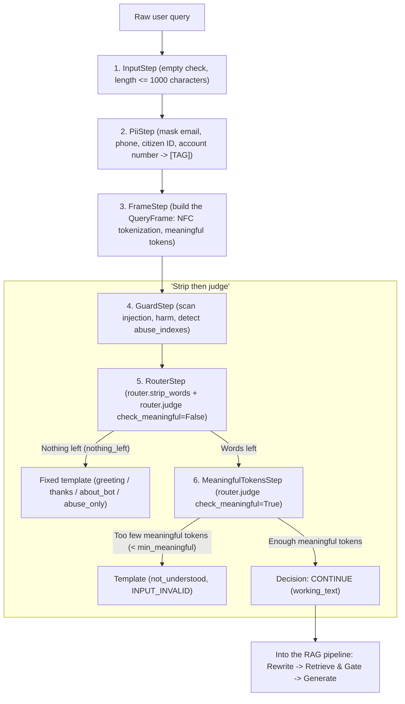

# TECHNICAL DESIGN: "STRIP THEN JUDGE"

> **Document id:** `TECH-V2-qa-strip-and-judge` | **References:** `TECH-V2-ai-service §7.1`, `PRD-V2 FR-13`, `V2-10`
>
> **Status (2026-11-13):** an explanatory companion to [TECH-V2-ai-service §7.1](../../../../architecture/components/ai-service.md) step 3, written during V2-10 (`done`). The names it cites (`Token`, `Stripped`, `RouteResult`, `strip_words`, `judge`, `_STRIPPABLE`, `_template_for`, `_inside_code`) and the five tests in §7 were checked against the code on 2026-11-13. **On any conflict, TECH-V2-ai-service §7.1 and the code win.** Translated from Vietnamese on 2026-11-13.

---

## 1. Context and technical goal

In internal RAG systems for looking up standard procedures (SOPs), user questions often contain:
- Greetings (*"xin chào"*, *"hello"*).
- Thanks (*"cảm ơn"*, *"thanks"*).
- Questions about the assistant's identity (*"bạn là ai?"* (who are you?), *"bạn làm được gì?"* (what can you do?)).
- Exclamations or insulting/profane words (*"ngu quá"*, *"đm"*).

### The problem with the traditional approach
Sending the raw question straight to the generator, or using an LLM classifier for intent:
1. **Wasted cost and high latency:** one LLM intent classification takes 300–800 ms and spends quota needlessly on obvious greetings.
2. **Vulnerable to prompt injection:** a malicious question can fool the intent classification step.
3. **False positives on abbreviations:** SOP documents contain many abbreviations that a profanity filter mislabels (for example *"định mức"* (norm) abbreviated *"đm"*, *"vật liệu"* (material) as *"vl"*, *"chứng chỉ"* (certificate) as *"cc"*, or document codes like `QT-VL-02`).

### SOPilot's solution: the "strip then judge" rule
- Replace the LLM intent classifier entirely with deterministic, rule-based matching.
- **Strip:** remove greeting, thanks, about-the-bot and profane words from the original string without losing the positions of the remaining tokens.
- **Judge:** evaluate what remains of the question:
  - Nothing left, or below the meaningful-token threshold (`min_meaningful_tokens`): return a fixed template (`TEMPLATE`) immediately and end the processing chain.
  - Meaningful content left: continue into the RAG pipeline on the stripped text (`working_text`).

---

## 2. Architecture and position in the QA pipeline

"Strip then judge" sits in the first steps of the QA pipeline in `services/ai-service`, executed in order in the `Step` chain of `qa/pipeline.py`:



---

## 3. Data contracts

The system uses immutable dataclasses in `sopilot_ai.qa`:

### 3.1 `Token` ([`qa/textnorm.py`](../../../../../services/ai-service/src/sopilot_ai/qa/textnorm.py))
```python
@dataclass(frozen=True)
class Token:
    index: int          # Token position in the question (0, 1, 2...)
    raw: str            # Lowercase NFC text, diacritics kept
    folded: str         # Vietnamese diacritics removed, leetspeak decoded (0->o, 1->i, 3->e, 4->a, 5->s, 7->t)
    start: int          # Start character position in the original NFC text
    end: int            # End character position in the original NFC text
```

### 3.2 `Stripped` ([`qa/router.py`](../../../../../services/ai-service/src/sopilot_ai/qa/router.py))
```python
@dataclass(frozen=True)
class Stripped:
    working_text: str          # Text after cutting tokens, with whitespace and punctuation normalized
    kinds: tuple[str, ...]     # Kinds stripped: ("about_bot", "thanks", "greeting", "abuse")
    removed: frozenset[int]    # Set of token indexes cut
    nothing_left: bool         # True if every token in the question was stripped
```

### 3.3 `RouteResult` ([`qa/router.py`](../../../../../services/ai-service/src/sopilot_ai/qa/router.py))
```python
@dataclass(frozen=True)
class RouteResult:
    working_text: str          # The text sent into RAG
    stripped: tuple[str, ...]  # Kinds stripped
    removed: frozenset[int]    # Indexes of removed tokens
    template_key: str | None   # Key in templates.yaml when a template is returned, None to continue
    refusal_reason: str | None # "INPUT_INVALID" for not_understood, otherwise None
```

---

## 4. Algorithm details: strip and judge

### 4.1 Stripping (`router.strip_words`)

The function [`strip_words(frame, abuse_indexes)`](../../../../../services/ai-service/src/sopilot_ai/qa/router.py) does the stripping:
1. **Take the profanity indexes:** `removed` starts with all `abuse_indexes` found by the guard step.
2. **Phrase matching by priority:** iterate over the strippable kinds `_STRIPPABLE = ("about_bot", "thanks", "greeting")`:
   - Take the trigger list from `qa/templates.yaml`.
   - Use `match_phrases(frame.tokens, triggers, use_folded=True)`: whole-word matching on the `folded` form. Longer phrases are matched first (`-len(phrase)`).
   - Exclude tokens already in the `abuse` group (profanity is not mistaken for a greeting).
   - Add the token indexes to `removed`.
3. **Cut tokens and rebuild the text:**
   - Call `remove_tokens(frame.text, frame.tokens, removed)`: cut the `[start:end]` slices of the removed tokens directly from the original text.
   - Collapse double spaces, remove spaces before punctuation (`re.sub(r"\s+([,.;:!?])", r"\1", cleaned)`), strip extra punctuation at both ends.
4. **Emptiness:** `nothing_left = all(t.index in removed for t in frame.tokens)`.

### 4.2 Judging (`router.judge`)

The function [`judge(frame, stripped, min_meaningful=None, check_meaningful=True)`](../../../../../services/ai-service/src/sopilot_ai/qa/router.py) decides:
- **Case 1: `stripped.nothing_left == True`** (checked in `RouterStep`):
  - The whole question consists only of greetings, thanks or profanity.
  - The template is chosen by `_template_for(stripped.kinds)`:
    - If it contains `"abuse"`: the `abuse_only` template (a neutral sentence with a hint on how to ask).
    - Otherwise the kind with the highest `priority`: `about_bot` (priority 3) > `thanks` (priority 2) > `greeting` (priority 1).
    - If no kind was stripped but the question is still empty (only odd characters): `not_understood` (`refusal_reason = "INPUT_INVALID"`).
- **Case 2: `check_meaningful == True`** (checked in `MeaningfulTokensStep`):
  - Count the remaining meaningful tokens: `count = frame.meaningful_count(stripped.removed)`.
  - A token is meaningful if it is:
    - In the vocabulary of the user's documents (`known_terms`, read from `rag.chunk_terms` through the access filter).
    - In the bilingual common-word dictionary [`qa/lexicon.yaml`](../../../../../services/ai-service/src/sopilot_ai/qa/lexicon.yaml).
  - If `count < min_meaningful` (default threshold 1 in `qa/guard_rules.yaml`):
    - The question has words but is meaningless or vague (for example *"chào bạn nhé"* (hi there), *"asdf qwer"*, *"cái này sao"* (what about this)).
    - Return the matching template or `not_understood`.

---

## 5. Edge cases

| Case | Risk | Design answer |
|---|---|---|
| **Words colliding when diacritics are removed**<br/>(*"nguồn"* vs *"ngu"*, *"các"* vs *"cac"*, *"buổi"* vs *"buoi"*) | The profanity filter wrongly deletes valid business keywords | - Profanity is matched on whole-word boundaries (`match_phrases`), not substrings.<br/>- Words that are harmless when written with diacritics appear only in the `abuse.accented` list (matched only when the original question has the diacritics). |
| **Document codes and abbreviations**<br/>(*"QT-VL-02"*, *"cc"*, *"đm"*, *"vl"*) | *"cc"*, *"đm"*, *"vl"* mistaken for swearing instead of *"chứng chỉ"*, *"định mức"*, *"vật liệu"* | - Classified in the `standalone_only` list.<br/>- Counted as profanity only in very short questions (`len(tokens) <= 3`).<br/>- The `_inside_code` check: a token adjacent to `-` or `/` (as in `QT-VL-02` or `cc/dm`) never counts as profanity. |
| **Swearing together with a real question**<br/>(*"ngu quá, quy trình nghỉ phép thế nào?"* (stupid, how does the leave procedure work?)) | The system refuses, frustrating the user | - Strip *"ngu"*, record the flag `guard_events(INPUT_FLAG, "abuse.profanity")`.<br/>- Keep the valid part of the question: *"quá, quy trình nghỉ phép thế nào?"* becomes the `working_text` that continues into RAG. |
| **Protection against system-prompt injection** | Fake greetings used to evade the guard | `GuardStep` always runs before `RouterStep`. Every message matching prompt-injection or fake-system-role patterns is blocked at the guard (`Decision.REFUSE`, `REFUSED_GUARD`). See [TECH-V2-qa-guard-and-defense](qa-guard-and-defense.md). |

---

## 6. Relationship to the overall guard system

"Strip then judge" only cleans the question, routes greetings/thanks/profanity and filters meaningless questions. The advanced defense-in-depth mechanisms (blocking sophisticated prompt injection, preventing prompt leaks with the canary token, the document retrieval gate, and the semantic router for the grey zone) are specified separately in:

[**`TECH-V2-qa-guard-and-defense` (the guard system and defense in depth in the QA pipeline)**](qa-guard-and-defense.md).

---

## 7. Testing and verification

The mechanism is covered by automated tests in [`services/ai-service/tests/unit/test_qa_input_rules.py`](../../../../../services/ai-service/tests/unit/test_qa_input_rules.py):

1. **`test_words_that_collide_when_accents_are_stripped_are_not_profanity`**: questions containing *"nguồn"*, *"các bước"*, *"buổi họp"*, *"cc là gì"*, *"đm trong quy trình"* all pass (`Decision.CONTINUE`).
2. **`test_a_question_that_is_only_profanity_gets_the_neutral_sentence`**: questions containing only insults get the `abuse_only` template.
3. **`test_profanity_with_a_question_is_answered_on_the_stripped_text`**: a swear word plus a question has the swear word stripped and the content sent to RAG.
4. **`test_greetings_thanks_and_about_bot_get_a_template`**: purely social messages return the right template without calling the LLM.
5. **`test_a_greeting_before_a_question_is_stripped_and_the_question_goes_to_rag`**: a greeting before a question is stripped correctly and the question is kept intact.

(Test names checked to exist on 2026-11-13; they were not run as part of this documentation migration.)
