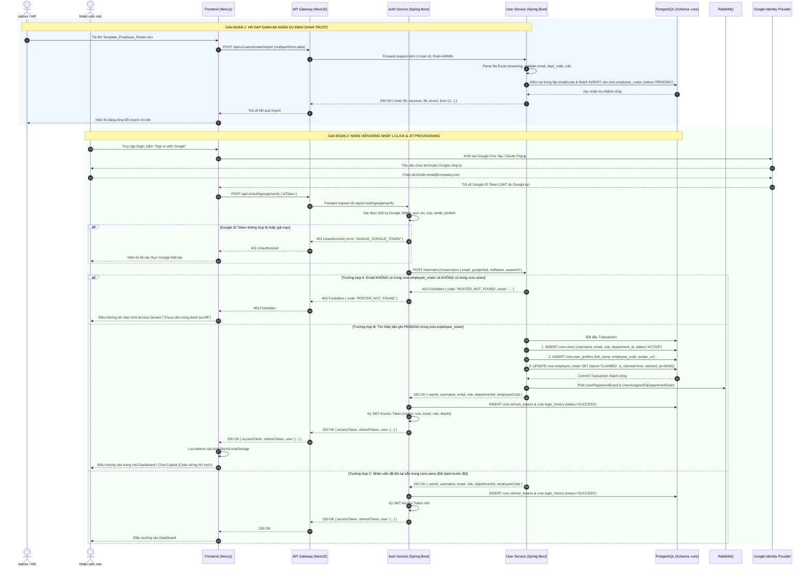

# TÀI LIỆU THIẾT KẾ KIẾN TRÚC & KẾ HOẠCH THỰC THI (TECHNICAL DESIGN DOCUMENT)

**Dự án:** SOPilot – Autonomous SOP & Policy Copilot  
**Mốc 1 (Milestone 1):** JIT (Just-In-Time) Onboarding & Quản lý Danh bạ Định danh Nhân sự (Pre-provisioned Employee Directory)  
**Vai trò:** Principal Software Architect & Tech Lead  
**Trạng thái:** Approved / Ready for Execution  

---

## 1. Context & Motivation

Hiện tại, quy trình cấp quyền và khởi tạo tài khoản nhân viên mới vào hệ thống quản lý tri thức & quy chế nội bộ SOPilot đang dựa vào đăng ký thủ công hoặc gửi thư mời phức tạp. Điều này phát sinh các điểm nghẽn:
1. **Quản trị viên (HR/IT Helpdesk) tốn nhiều thời gian**: Phải tạo thủ công từng tài khoản, cấp mật khẩu tạm thời hoặc gửi email kích hoạt dễ bị lạc vào hòm thư rác.
2. **Nhân viên gặp rào cản tiếp cận (Friction)**: Phải tạo mật khẩu mới, xác minh nhiều bước, dễ quên thông tin đăng nhập.
3. **Rủi ro an ninh & Kiểm soát quyền hạn (Security & Compliance)**: Nhân sự ngoài tổ chức có thể tự do đăng ký nếu không có tường lửa danh bạ; nhân viên mới vào có thể bị gán sai phòng ban/vai trò dẫn tới xem được các tài liệu mật không được phép.

**Mục tiêu của Mốc 1:** Thay thế hoàn toàn luồng truyền thống bằng cơ chế **"Pre-provisioned Directory + Google 1-Click JIT Sign-in"**:
1. HR/Admin upload danh sách nhân viên công ty (file Excel/CSV chuẩn gồm: Họ tên, Email, Mã NV, Mã Phòng ban, Role).
2. Nhân viên chỉ cần truy cập trang web, bấm **"Sign in with Google"** bằng email công ty.
3. Hệ thống đối soát email đã được Google xác thực với danh bạ định danh trước:
   - **Nếu khớp**: Tự động khởi tạo hồ sơ nhân viên (JIT Provisioning), gắn đúng Phòng ban (Department) và Quyền hạn (Role: USER/MANAGER), đánh dấu trạng thái đã kích hoạt (`status = CLAIMED`), cấp phát JWT token đưa vào trang hỏi đáp.
   - **Nếu không khớp**: Chặn ngay lập tức với lỗi `403 Forbidden` kèm giao diện thông báo thân thiện: *"Tài khoản của bạn chưa nằm trong danh bạ nhân sự của tổ chức. Vui lòng liên hệ HR."*

---

## 2. Scope Analysis

### Services Affected
| Service | Impact Description |
|---|---|
| `infrastructure` | Thêm database migration `010_employee_roster.sql` vào schema `core` của PostgreSQL 16. |
| `user-service` | Quản lý aggregate `core.employee_roster`, parser Excel/CSV streaming, API import danh bạ, API danh sách pending, API update roster, và internal API `/internal/v1/roster/claim`. Phát sự kiện RabbitMQ khi claim tài khoản. |
| `auth-service` | Tiếp nhận Google ID Token, xác thực chữ ký số bằng Google Public JWKS, gọi internal API sang `user-service` để claim JIT, sinh Access Token (JWT) & Refresh Token, ghi nhận lịch sử vào `core.login_history`. |
| `api-gateway` | Cấu hình reverse proxy cho endpoint công khai `POST /api/v1/auth/google/verify` và các endpoint admin `/api/v1/users/roster/*`. Hỗ trợ multipart file streaming upload. |
| `feedback-service` | Lắng nghe sự kiện `UserRegisteredEvent` và `UserAssignedToDepartmentEvent` từ RabbitMQ để ghi nhận Audit Log tuân thủ. |
| `frontend/web` | Thêm nút "Sign in with Google" trên `/login`, màn hình Access Denied (403), Tab quản lý "Danh bạ chờ kích hoạt" trên `/admin/users`, Modal upload Excel và download file mẫu. |

---

## 3. Phân tích & Phản biện Kiến trúc (Architecture Decisions & ADR-Lite)

### ADR-01: Quyền sở hữu bảng `core.employee_roster`
* **Quyết định:** Giao toàn quyền cho **`user-service`** quản lý.
* **Lý do (DDD - Domain Driven Design):**
  * Danh bạ tiền định danh là thực thể nghiệp vụ thuộc miền **Quản trị Tổ chức & Nhân sự (HR & Organization Management)**. Các tác vụ như import file mẫu Excel/CSV, validate mã nhân viên, map mã phòng ban (`dept_code`), filter theo phòng ban, cập nhật chức vụ/phòng ban trước khi nhân viên vào làm đều gắn chặt với aggregate `Department` và `UserProfile`.
  * Nếu đưa vào `auth-service`, service xác thực sẽ bị phình to (bloated) với các thư viện đọc bảng tính (Apache POI), logic duyệt cây phòng ban và phân trang danh bạ, vi phạm nghiêm trọng **Nguyên tắc Đơn trách nhiệm (Single Responsibility Principle - SRP)**.
  * Do đó: `user-service` là **Owner (System of Record)** của `core.employee_roster`.

### ADR-02: Ranh giới xác thực Google OAuth & JIT Token Issuance
* **Quyết định:** **`auth-service` trực tiếp giải mã và xác thực Google ID Token; Gateway chỉ làm Reverse Proxy thuần túy.**
* **Lý do:**
  * Giữ API Gateway tuân thủ nguyên tắc **"Smart endpoints, dumb pipes"**. Tránh biến Gateway thành monolithic proxy gánh business logic xác thực, caching JWKS, và phát hành JWT claims.
  * Đảm bảo tính nhất quán của hệ sinh thái xác thực: `auth-service` chịu trách nhiệm toàn diện việc ký JWT, cấp Refresh Token, lưu trữ phiên đăng nhập (`core.refresh_tokens`), và ghi vết `core.login_history`.

### ADR-03: Giao tiếp liên dịch vụ khi Claim tài khoản
* **Quyết định:** Giao tiếp đồng bộ (Synchronous HTTP/REST) qua Spring Cloud OpenFeign giữa `auth-service` và `user-service` với endpoint `POST /internal/v1/roster/claim`, được bảo vệ bằng header `X-Internal-Service-Token`.
* **Lý do:**
  * Quá trình đăng nhập của người dùng yêu cầu phản hồi tức thời (blocking read-after-write). Sau khi `user-service` hoàn thành transaction tạo User/Profile và claim Roster, `auth-service` cần ngay `userId, role, departmentId` để nạp vào JWT Claims.
  * Các tác vụ ghi nhật ký kiểm toán (Audit Trail) được đẩy bất đồng bộ (Asynchronous) qua RabbitMQ sang `feedback-service` để giữ thời gian phản hồi đăng nhập < 250ms.

---

## 4. Sơ đồ trình tự luồng dữ liệu (Mermaid Sequence Diagram)



---

## 5. Kịch bản Database Migration (DDL Script)

File migration: `infrastructure/init-db/010_employee_roster.sql`:

```sql
-- ============================================================
-- FILE: 010_employee_roster.sql
-- SCHEMA: core
-- PURPOSE: Pre-provisioned Employee Directory for JIT Onboarding
-- ============================================================

CREATE EXTENSION IF NOT EXISTS "uuid-ossp";

-- 1. ENUM STATUS CHO ROSTER
DO $$
BEGIN
    IF NOT EXISTS (SELECT 1 FROM pg_type WHERE typname = 'roster_status' AND typnamespace = 'core'::regnamespace) THEN
        CREATE TYPE core.roster_status AS ENUM ('PENDING', 'CLAIMED', 'DEACTIVATED');
    END IF;
END$$;

-- 2. TABLE: core.employee_roster
CREATE TABLE IF NOT EXISTS core.employee_roster (
    id UUID PRIMARY KEY DEFAULT uuid_generate_v4(),
    employee_code VARCHAR(50) NOT NULL,
    email VARCHAR(255) NOT NULL,
    full_name VARCHAR(150) NOT NULL,
    phone VARCHAR(20),
    position VARCHAR(100),
    department_id UUID NOT NULL REFERENCES core.departments(id) ON DELETE RESTRICT,
    role core.user_role NOT NULL DEFAULT 'USER',
    status core.roster_status NOT NULL DEFAULT 'PENDING',
    is_claimed BOOLEAN NOT NULL DEFAULT FALSE,
    claimed_at TIMESTAMPTZ,
    claimed_user_id UUID REFERENCES core.users(id) ON DELETE SET NULL,
    import_batch_id UUID NOT NULL DEFAULT uuid_generate_v4(),
    created_by UUID REFERENCES core.users(id) ON DELETE SET NULL,
    updated_by UUID REFERENCES core.users(id) ON DELETE SET NULL,
    created_at TIMESTAMPTZ NOT NULL DEFAULT CURRENT_TIMESTAMP,
    updated_at TIMESTAMPTZ NOT NULL DEFAULT CURRENT_TIMESTAMP,
    deleted_at TIMESTAMPTZ,

    CONSTRAINT chk_roster_email_format CHECK (email ~* '^[A-Za-z0-9._%+-]+@[A-Za-z0-9.-]+\.[A-Za-z]{2,}$'),
    CONSTRAINT chk_roster_claimed_consistency CHECK (
        (is_claimed = FALSE AND claimed_at IS NULL AND claimed_user_id IS NULL) OR
        (is_claimed = TRUE AND claimed_at IS NOT NULL AND claimed_user_id IS NOT NULL)
    )
);

-- 3. INDEXES
CREATE UNIQUE INDEX IF NOT EXISTS idx_roster_email_lower_unique 
    ON core.employee_roster (LOWER(email)) 
    WHERE deleted_at IS NULL;

CREATE UNIQUE INDEX IF NOT EXISTS idx_roster_employee_code_unique 
    ON core.employee_roster (employee_code) 
    WHERE deleted_at IS NULL;

CREATE INDEX IF NOT EXISTS idx_roster_dept_status 
    ON core.employee_roster (department_id, status) 
    WHERE deleted_at IS NULL;

CREATE INDEX IF NOT EXISTS idx_roster_status 
    ON core.employee_roster (status) 
    WHERE deleted_at IS NULL;

CREATE INDEX IF NOT EXISTS idx_roster_batch_id 
    ON core.employee_roster (import_batch_id);

-- 4. TRIGGER AUTO UPDATE TIMESTAMP
CREATE OR REPLACE FUNCTION core.trg_update_employee_roster_timestamp()
RETURNS TRIGGER AS $$
BEGIN
    NEW.updated_at = CURRENT_TIMESTAMP;
    RETURN NEW;
END;
$$ LANGUAGE plpgsql;

DROP TRIGGER IF EXISTS trg_employee_roster_updated_at ON core.employee_roster;
CREATE TRIGGER trg_employee_roster_updated_at
    BEFORE UPDATE ON core.employee_roster
    FOR EACH ROW
    EXECUTE FUNCTION core.trg_update_employee_roster_timestamp();
```

---

## 6. Danh sách API Endpoints

### API Quản lý Danh bạ (User-Service & Gateway)
1. `GET /api/v1/users/roster/template` (Admin, Manager): Xuất file Excel mẫu gồm 2 sheet (Form nhập và Danh mục `dept_code`).
2. `POST /api/v1/users/roster/import` (Admin): Upload multipart `.xlsx`/`.csv`, trả về báo cáo số dòng thành công/thất bại và chi tiết lỗi.
3. `GET /api/v1/users/roster` (Admin, Manager): Danh sách chờ kích hoạt, lọc theo phòng ban, keyword, phân trang.
4. `PUT /api/v1/users/roster/{id}` (Admin): Cập nhật thông tin bản ghi `PENDING` (sửa phòng ban, role trước khi claim).
5. `DELETE /api/v1/users/roster/{id}` (Admin): Vô hiệu hóa bản ghi danh bạ (`status = DEACTIVATED`).

### API Xác thực Google JIT (Auth-Service & Gateway)
6. `POST /api/v1/auth/google/verify` (Public): Nhận Google `idToken`, xác thực chữ ký RS256 qua JWKS, claim JIT và cấp bộ Access Token + Refresh Token.

### Internal API (Microservice-to-Microservice)
7. `POST /internal/v1/roster/claim` (`user-service:8082`): Bảo vệ bởi `X-Internal-Service-Token`. Thực hiện transaction kiểm tra roster, tạo User & UserProfile, đổi status sang `CLAIMED`, phát sự kiện RabbitMQ.

---

## 7. Kế hoạch phân rã Ticket (Ticket Breakdown)

### Phase 1: Backend Foundation
| Ticket ID | Title | Size | Depends On | Scope |
|---|---|---|---|---|
| `M1-01` | Database Schema Migration cho Employee Roster | S | - | infra |
| `M1-02` | User-Service: Roster Management & Internal Claim Engine | L | M1-01 | user |

### Phase 2: Integration & Security
| Ticket ID | Title | Size | Depends On | Scope |
|---|---|---|---|---|
| `M1-03` | Auth-Service: Google Token Verification & JIT Integration | M | M1-02 | auth |
| `M1-04` | API Gateway: Định tuyến Roster & Google Auth Endpoints | S | M1-02, M1-03 | gateway |

### Phase 3: Frontend & UI/UX
| Ticket ID | Title | Size | Depends On | Scope |
|---|---|---|---|---|
| `M1-05` | Frontend Web: Giao diện Quản lý Roster & Google 1-Click Login | L | M1-04 | web |

### Phase 4: Testing & Polish
| Ticket ID | Title | Size | Depends On | Scope |
|---|---|---|---|---|
| `M1-06` | Kiểm thử Tích hợp E2E & Xác thực Audit Trail | M | M1-01 -> M1-05 | tests |

---

## 8. Kịch bản Kiểm thử Nghiệm thu (Acceptance Test Suite)

| ID | Nhóm kiểm thử | Kịch bản kiểm thử (Test Scenario) | Kết quả mong đợi |
|---|---|---|---|
| **TC-01** | Import Roster | Admin tải file mẫu Excel từ hệ thống | Tải về file `.xlsx` gồm 2 sheet: Form mẫu & Danh mục phòng ban. |
| **TC-02** | Import Roster | Nạp file Excel hợp lệ 100% (50 dòng) | HTTP 200: `successCount: 50, failureCount: 0`. Bảng Roster hiển thị 50 nhân viên `PENDING`. |
| **TC-03** | Import Roster | Nạp file chứa mã phòng ban không tồn tại | HTTP 200: Báo lỗi dòng vi phạm: *"Mã phòng ban không tồn tại"*. Các dòng hợp lệ vẫn lưu bình thường. |
| **TC-04** | Import Roster | Nạp file chứa email sai cú pháp RFC 5322 | Báo lỗi dòng: *"Email không đúng định dạng"*. |
| **TC-05** | Import Roster | Nạp file chứa email đã hoạt động trong `core.users` | Bỏ qua dòng, cảnh báo: *"Nhân viên đã tồn tại và đang hoạt động"*. |
| **TC-06** | Import Roster | Nạp file chứa trùng mã nhân viên trong cùng file | Dòng đầu tiên được lưu, dòng sau báo lỗi vi phạm trùng mã NV. |
| **TC-07** | Google JIT | Nhân viên trong danh bạ đăng nhập lần đầu | Đăng nhập thành công, nhận JWT. Roster đổi `CLAIMED`. Tạo user trong `core.users` và `user_profiles`. |
| **TC-08** | Google JIT | Nhân viên đã claim đăng nhập lần thứ hai | Cấp phát JWT mới thành công. Không tạo trùng user, ghi nhận `login_history`. |
| **TC-09** | Google JIT | Tài khoản ngoài công ty cố tình đăng nhập | HTTP 403 Forbidden (`ROSTER_NOT_FOUND`). Hiển thị màn hình Access Denied thân thiện. |
| **TC-10** | Bảo mật | Gửi Google ID Token đã hết hạn | HTTP 401 Unauthorized (`ID token has expired`). |
| **TC-11** | Bảo mật | Giả mạo Google ID Token (chữ ký sai) | HTTP 401 Unauthorized (`Invalid ID token signature`). |
| **TC-12** | Bảo mật | Token cấp cho ứng dụng khác mạo danh | HTTP 401 Unauthorized (`Invalid audience`). |
| **TC-13** | Bảo mật | Tài khoản Google chưa verify email (`email_verified = false`) | HTTP 401 Unauthorized (`Google email not verified`). |
| **TC-14** | Edge Case | Email chữ hoa / thường (`User@Company.com` vs `user@company.com`) | Chuẩn hóa lowercase tự động, đối soát thành công. |
| **TC-15** | Audit Trail | Kiểm tra ghi nhận kiểm toán sau khi JIT claim | Bảng `analytics.audit_logs` có bản ghi action `USER_CREATE`, metadata: `loginMethod: GOOGLE_JIT`. |

---

## 9. Risk Assessment & Mitigation
1. **Lệ thuộc vào Google JWKS Network Call:** Nếu Google JWKS endpoint bị chậm hoặc mạng chập chờn, API xác thực có thể bị timeout.  
   *Giải pháp:* Caching JWKS Public Keys trong bộ nhớ local (RAM) với TTL 60 phút và cơ chế cache-aside tự refresh.
2. **Tràn bộ nhớ khi Upload file Excel dung lượng lớn:** File Excel hàng ngàn dòng nếu load toàn bộ vào DOM của Apache POI (`XSSFWorkbook`) sẽ gây lỗi Heap Out-of-Memory.  
   *Giải pháp:* Sử dụng cơ chế Streaming (`StreamingReader` / SXSSF) và giới hạn dung lượng file tối đa 10MB.
3. **Race Condition khi nhiều request login cùng lúc:** Một nhân viên bấm đăng nhập nhiều lần liên tiếp khi mạng lag.  
   *Giải pháp:* Ràng buộc Unique Constraint `idx_roster_email_lower_unique` và transaction isolation trong `user-service`.
