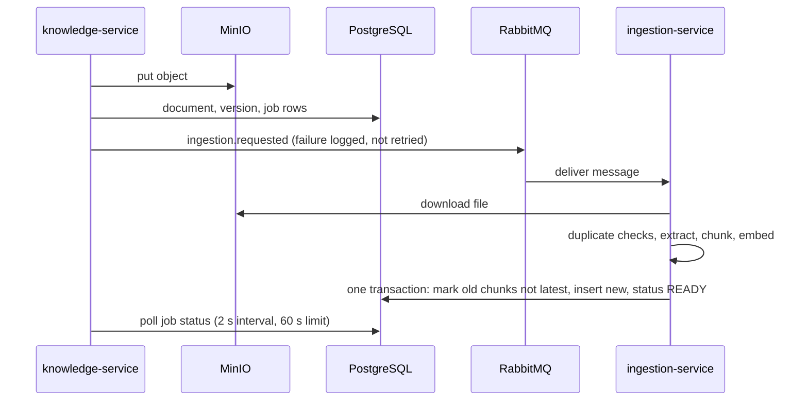
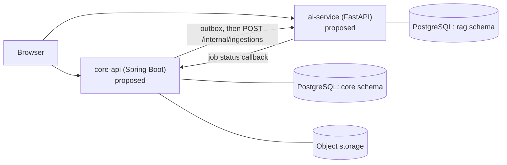

# SOPilot: engineering case study

Part of the portfolio set: [README](../../README.md) → this case study → [implementation evidence](implementation-evidence.md) → source, tests and ADRs. Every status word below ("implemented", "partial", "planned") is defined in the evidence document, which also lists the file paths. The source is private; links work only with repository access. Nothing here was run while writing it.

## Framing: auditing my own V1 to design V2

V1 began as a course project built with a classmate. I wrote its AI module (the full RAG path in `ai-qa-service`), document ingestion and preprocessing, the database design, the unanswered-question feature and the related frontend. The weaknesses discussed below are therefore largely in code I wrote, and they are the reason I am rebuilding the system as V2, which I own and am building alone. Each section below states what V1 does, what is wrong with it, and what V2 proposes. V2 statements are design intent unless the [evidence table](implementation-evidence.md) says otherwise.

## Problem and scope

Organizations keep procedures and policies in long documents that people rarely read. SOPilot is a question-answering system over those documents. An employee asks in Vietnamese or English and should get a cited answer, but only from documents their role and department may see. An administrator uploads and versions documents and reviews questions the system could not answer.

The repository holds two things that must not be confused:

- **V1 (frozen):** eight services (NestJS gateway, five Spring Boot services, two FastAPI services) plus PostgreSQL/pgvector, RabbitMQ, Redis and MinIO, and a Next.js frontend. Most of the code is here.
- **V2 (in progress):** a redesign into two services. Only the evaluation harness and local database/storage infrastructure exist. The two services themselves do not.

No evidence of real users, deployment, or measured latency or answer quality was found.

## 1. Upload to searchable chunks: consistency at the boundaries

**Constraint.** One upload touches four places: the object store (MinIO), the Knowledge database rows, the message broker, and the chunk index. None share a transaction.

**What V1 does.** `knowledge-service` writes the file to MinIO, then creates the document, version and audit rows and publishes an event. In the synchronous "confirm" path it saves a job row first, publishes `ingestion.requested`, then polls the job for up to 60 seconds. `ingestion-service` consumes the event, downloads the file, runs three duplicate checks (file hash, extracted-text hash, semantic fingerprint), chunks, embeds, and writes chunks.

**Why it is built this way.** Not recorded for V1. My interpretation: swapping the chunk set in a single database transaction means readers see either the old or the new version, which is a deliberate-looking boundary in `pipeline.py`.

**Failure modes found in source.**
- MinIO is written before the database commit; a rollback leaves an orphan object. No cleanup was found.
- The event publisher catches and logs every exception. A lost message leaves the job `UPLOADED` and the poll times out.
- In `upload()` the publish call runs inside the transactional method, so a consumer could in principle see the event before the commit.
- `pipeline.process` swallows all exceptions and returns `FAILED`; the consumer then acknowledges the message, so the broker's dead-letter configuration is not exercised for pipeline errors.

**Unverified.** None of this was exercised. Tests exist for deduplication and for `checkDuplicate`; I found none for the ordering above.

**V2 (proposed).** [TECH-V2-core-api §2](../02-architecture/designs/TECH-V2-core-api.md) writes the document, version, job request (an `outbox` row) and audit log in one database transaction, then delivers the request to `ai-service` with retries and idempotency on document and checksum. The file is still uploaded to storage before the commit, so the design adds a periodic cleanup job for orphaned objects instead of pretending the two are atomic. The AI side claims jobs with `SELECT ... FOR UPDATE SKIP LOCKED`. The trade-off is replacing a broker with a database-backed queue: fewer moving parts and a transactional hand-off, at the cost of polling and a throughput ceiling I have not measured. Implementation status: none of this exists yet.

## 2. Retrieval and permission-aware access

**Constraint.** A user must never receive text from a document they may not read, and answers need passages that match both meaning and exact terms such as policy codes.

**What V1 does.** The gateway checks the JWT and a coarse role. `ai-qa-service` verifies the JWT again, and the retrieval SQL filters chunks by `status = 'PUBLISHED'`, expiry date, and an access predicate: public, or the user's role, department or user id appears in arrays stored on the chunk. This runs for both retrievers, before ranking. Dense search uses pgvector cosine distance; lexical search uses PostgreSQL `ts_rank` on a `simple` text-search vector. Results are merged with weighted Reciprocal Rank Fusion (0.7 dense, 0.3 lexical, k = 60).

**What it is not.** The lexical side is `ts_rank`, which has no inverse-document-frequency or length normalisation, so it should not be called BM25. A reranker exists in code but `chat.py` constructs the orchestrator without it, so it never runs. The 0.15 relevance cutoff compares each chunk's original score (cosine or normalised `ts_rank`), not the fused score, so it mixes scales. The query path imports a `build_sources` function that I could not find defined; if reached, it would fail.

**Trade-off.** Copying access rules onto each chunk makes the filter a single indexed query, with no cross-service call. The cost is staleness: the arrays are written at ingestion, and I found no code that updates them when visibility changes. This is my reading, not a recorded decision, and I did not trace metadata-service.

**Unverified.** No authorization test for the SQL predicate was found. No retrieval quality has been measured on V1.

**V2 (proposed).** [TECH-V2-ai-service §6](../02-architecture/designs/TECH-V2-ai-service.md) replaces `ts_rank` with BM25 computed in SQL, using the same tokenizer as the evaluation harness (Vietnamese unigrams and bigrams, plus accent-stripped terms), so harness results can be compared with the service. The relevance cutoff is applied to a stated score per mode (cosine for hybrid, because rank-fusion scores are not comparable across queries) and reranking runs before the cutoff. Visibility changes carry an `access_revision` so a stale update cannot overwrite a newer one, and tenant isolation moves into row-level security with separate database roles. The access-revision and role pieces are specified; the role and schema bootstrap migrations exist, the tables and policies do not.

## 3. Evaluation: what the metrics measure

**Constraint.** Before rewriting the system, the project needs to know whether Vietnamese and cross-lingual retrieval is good enough ([PLAN-V2](../03-plans/PLAN-V2-sopilot-mvp.md) states this ordering).

**What exists.** `eval/` is a retrieval-only harness: an in-memory index with dense, BM25 (own implementation, Vietnamese unigram and bigram tokens) and hybrid RRF retrievers, optional cross-encoder rerank, and recall@k, MRR, nDCG@10 plus a refusal-threshold sweep. It needs no LLM or running stack.

**Scope limits that matter.**
- Relevance is judged at document or page level and each run is labelled `document_page_proxy`; chunking is labelled `character_exploratory_only`. Span-level gold labels and the shared structure-aware chunker are not implemented.
- It scores retrieval, not generated answers, citations, or the PostgreSQL query path. The refusal sweep is a retrieval-level proxy.
- Existing result files come from a 3-chunk smoke fixture and are documented as not reportable. The real pilot datasets are described as drafts.
- The 2026-10-25 acceptance audit reports passing harness tests; that is a historical, unreproduced result and approves the tooling only.

The design choice worth noting is the guard rails: configs that request unimplemented chunking fail instead of silently falling back, and cache keys include model revision, so a number cannot quietly come from the wrong setup. Source: `eval/README.md` and the audit.

## V2 direction (proposed / in progress)

V2 is the focus of current work. What exists today: the specifications ([PRD-V2](../01-requirements/PRD-V2-sopilot-mvp.md), ADR-004 to ADR-008, two technical designs, 33 tickets), the evaluation harness, and local PostgreSQL/MinIO infrastructure with role isolation. What does not exist: `core-api`, `ai-service`, the application tables and any end-to-end V2 workflow.

[ADR-004](../02-architecture/adr/ADR-004-two-service-architecture.md) records the decision (owner-approved 2026-10-20) to replace the eight services with `core-api` (Spring Boot) and `ai-service` (FastAPI). Documented reasons: a target of zero monthly hosting cost, one maintainer unable to operate eight services, and each remaining service having a real boundary (language, load, lifecycle). It rejects keeping eight services and rejects a Supabase-based design.

Design points relevant to section 1: an outbox row is written in the same database transaction as the document, then delivered with retries; the AI side claims jobs with `SELECT ... FOR UPDATE SKIP LOCKED`; each service writes only its own schema, with row-level security by workspace and separate database roles. The bootstrap migrations for roles and schemas exist; the tables, outbox and services do not.

These are design intentions. No cost, latency or reliability benefit has been measured. The main risk is a rewrite that costs more than it saves; the plan manages it by running evaluation first and keeping V1 frozen rather than extended.

### What V2 is meant to demonstrate

| Backend (SWE) | Applied AI (AIE) |
|---|---|
| Transactional outbox and idempotent hand-off between services | Evaluation before implementation: retrieval metrics and their scope |
| Honest consistency boundaries between database and object storage | Hybrid retrieval with BM25 matched to the evaluation harness |
| Multi-tenant isolation with row-level security and least-privilege roles | Refusal-threshold calibration as a measured trade-off, not a constant |
| Versioned migrations, ADRs that compare rejected options | Vietnamese and cross-lingual handling, structure-aware chunking |

Each row is a design goal, not a delivered result. The evidence table shows which parts exist.

## Limits of this review

Source was read, not executed. Test files exist but were not run. Frontend behavior, the Google sign-in flow and the feedback loop were not examined in depth. Items marked drift in [CLAUDE.md](../../CLAUDE.md) (bucket names, exchange names, retired model IDs) were taken as reported and only partly re-checked. See the [evidence table](implementation-evidence.md) for per-capability status.
