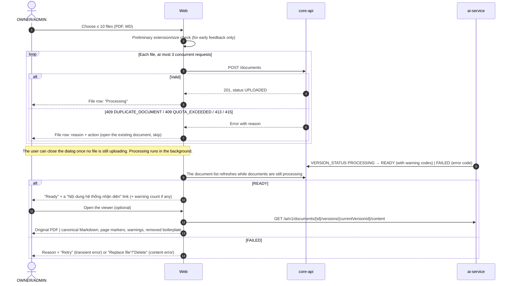

> Translated from Vietnamese on 2026-11-13; content unchanged. The screen name "Nội dung hệ thống nhận diện" (content recognized by the system) and other UI strings keep their Vietnamese text where the UI wording is specified. ADR-008 later chose Docling.

# Structured Markdown normalization and "Nội dung hệ thống nhận diện" (content recognized by the system)

On 2026-10-21 the owner asked to settle the approach for normalizing documents into structured Markdown, with a UX to view the extraction result, and to sync it into the V2 plan. This report records the analysis and reasons. The decisions have been carried into PRD-V2 (FR-06..FR-09, FR-30, FR-31), the two TECH-V2 documents, PLAN-V2 and the tickets listed in §9.

**Limits:** there is no V2-19 corpus yet, and neither Docling nor PyMuPDF 2.x has been tried (nothing installed outside the repo, per instructions). The only measurement in §5 is a test of PyMuPDF 1.27, already in the repo's venv, on 5 non-SOP PDFs. The user scenarios in §2 are hypothetical, not statistics or benchmarks.

---

## 1. Conclusions

1. **One shared representation, one canonical Markdown.** Every file (PDF with a text layer, Markdown) is read into a `StructuredDocument` (heading, paragraph, list item, table, each element with its PDF page and offsets). After cleaning, ai-service **renders** the canonical Markdown itself from the element tree and records offsets while rendering. This is the only version used for chunks, the index, citations, metadata suggestions and the viewer. The Markdown string produced by a library is never used as the offset source.
2. **PDFs go straight from the library's structure to the element tree.** No plain-text extraction followed by rebuilding Markdown. Input Markdown is parsed with a CommonMark/GFM parser and re-rendered through the same renderer.
3. **One PDF conversion library, chosen by a timeboxed spike.** Main candidate: Docling (MIT); control candidate: PyMuPDF (AGPL-3.0 or a commercial license). No chain of fallback tools, no OCR, no LLM rewriting content. Criteria and timebox in §6.
4. **The MVP accepts PDFs with a text layer and Markdown.** TXT is dropped (upload returns `415`); DOCX and OCR remain deferred.
5. **The "Nội dung hệ thống nhận diện" view opens only when `READY`.** Read-only, showing exactly the cleaned Markdown used for chunks/the index, next to the original PDF with page markers. It does not block the pipeline, has no editor and no "checked" status. The reason for this timing is in §4.3.
6. **Repository loading in batches of ≤ 10 files**, one request per file; independent results; per-file retry. No batch, ZIP or connector.
7. **Dedup and replacement by bytes:** SHA-256 blocks duplicates across documents, a replacement identical to the `READY` version is a no-op, and a replacement still processing blocks other replacements (`409 VERSION_IN_PROGRESS`) to avoid out-of-order activation.
8. **The default document quota is back on at 50 documents / 200 MB per workspace**, per the owner's instruction of 2026-10-21, configurable, `0` = off. The question quota stays off by default. This partially reverses the 2026-10-20 decision (PRD-V2 §8.10), see §8.

---

## 2. User groups and situations (hypothetical)

| Group | Typical formats | Initial load | Operation | Needs from the viewer |
|---|---|---|---|---|
| Individual | Downloaded PDFs, MD notes | A few dozen files, 2–3 batches | Occasional adds/replacements | Knowing scanned files are refused; seeing quickly whether the content is readable |
| Wiki/Markdown team | MD (with frontmatter, shortcodes) | Export a wiki folder, choose files | Replace many files after an editing round | Checking headings/lists are kept; re-rendered MD may differ in formatting from the original |
| Word/PDF enterprise | PDFs exported from Word, with tables | Hundreds of files in many batches; with the default 50 documents the quota must be raised | Replace on reissue; sometimes replace a template across many files | Whether procedure tables keep rows/columns; whether headers/footers leak |
| Organization with SOP control | ISO/GMP PDFs with approval tables, revision history | Choose the effective versions before loading | Replace exactly the right version by SOP code | Whether the removed boilerplate is right; whether code/issue number are recognized |

Observations used for the decision:
- Controlling "which version may be used" is the manager's job before upload; SOPilot has no approval workflow (formerly PRD-V2 ING-04, now in FR-07).
- The viewer helps managers spot extraction errors per file, but does not replace measuring extractor quality on a corpus (V2-19/V2-20).
- Repositories of thousands of documents (group D in AUDIT-ingestion-business-cases §8) are not supported just by raising the quota: processing time on the target machine needs measuring, which is not in V2.

---

## 3. Comparison with the current design

| Item | Already there (TECH-V2, 2026-10-20) | Change | Benefit | Limit |
|---|---|---|---|---|
| Intermediate representation | `StructuredDocument`, `DocElement`, `extracted_documents.structure/markdown` | Keep; drop `TXT`; add a definition of canonical Markdown and a renderer with offsets | One source for chunks, citations, preview | Canonical Markdown may differ in formatting from the original MD (e.g. `*` becomes `-`) |
| Offsets | "offsets in the exported markdown" | Offsets computed on the Markdown **after cleaning**, in code points; the API also returns UTF-16 for browsers | No drift when highlighting; independent of the library's string | Every renderer change requires re-ingest (record `normalizer_version`) |
| PDF extraction | ADR-008 chooses the library after V2-19 | Keep; add criteria, a timebox and an OCR-off setting | A decision with measurements | Blocked by the minimal corpus |
| Coordinates (bbox) | None | Not in the MVP contract | Less data, fewer tests | No highlighting on the original PDF; only page jumps |
| Quality warnings | None | `warnings` with specific codes (§4.4) | Managers know which files to check | No overall confidence score |
| Viewer | `/content` for the citation viewer | Extended into the "Nội dung hệ thống nhận diện" screen (FR-31) | Reuses the existing endpoint and viewer | Only when `READY` |
| Retry | `POST /retry` + `INSERT ... ON CONFLICT (version_id) DO NOTHING` | The payload carries `attempt`; ai-service moves a `FAILED` job back to `QUEUED` when the `attempt` is newer | Fixes a design bug: the old retry would be ignored because of the duplicate `version_id` | — |
| Replacement | No-op when identical to the current version | Add: a duplicate of another document → `DUPLICATE_DOCUMENT`; while a version is processing → same bytes return that version, different bytes `409 VERSION_IN_PROGRESS` | Avoids two versions activating out of order | Users have to wait for the processing version to finish |
| Quotas | Off by default | Documents/size default 50 / 200 MB | Per the owner's instruction of 2026-10-21 | Larger demos/evals must set variables (V2-16) |

---

## 4. Settled pipeline and UX

### 4.1 Pipeline

```mermaid
flowchart LR
    U["Upload per file\n(core-api: type, 20 MB, SHA-256, quota)"] --> Q["Outbox → job\n(ai-service)"]
    Q --> R{"File type"}
    R -->|PDF with text layer| P["PDF library (ADR-008)\nOCR off"]
    R -->|Markdown| M["CommonMark/GFM parser\n+ frontmatter"]
    P --> S["StructuredDocument\n(headings, paragraphs, lists, tables, pages)"]
    M --> S
    S --> N["Normalize\n(NFC, whitespace, numbering kept)"]
    N --> C["Clean\n(headers/footers, boilerplate, metadata)"]
    C --> MD["Render canonical Markdown\n+ offsets + page markers + warnings"]
    MD --> K["Structure-aware chunking\n(offsets on the canonical Markdown)"]
    K --> E["Embed\n(cache by model, revision, sha256(index_text))"]
    E --> A["One transaction: chunks + extracted_documents\n+ activate the version → READY"]
    A --> G["Metadata suggestions\n(read extracted_documents)"]
    A --> V["The 'Nội dung hệ thống nhận diện' view"]
```

Conventions:
- **Canonical Markdown** = the render of the `role = content` elements after cleaning. Removed boilerplate is stored separately (`boilerplate`) with its pages, not in the canonical Markdown and not indexed.
- Element and chunk offsets are `[char_start, char_end)` on the canonical Markdown, in Unicode code points (Python string indices). The public API also returns UTF-16 offsets so browsers slice strings correctly.
- A `PROCEDURE_STEP` chunk has `content` of the form `Bước: … | Trách nhiệm: …` (Step: … | Responsibility: …), which is not a substring of the Markdown; its offsets point to the source passage (the table row).
- No commitment that the same content in different formats (PDF and MD) yields identical Markdown; no LLM is used to force them to match.
- The Markdown hash is not used to skip versions automatically. Skipping relies only on the file's SHA-256.
- Metadata suggestions read `extracted_documents` and never download or re-parse the file. Retrying a `FAILED` version reruns the whole pipeline (no intermediate results kept between attempts).

### 4.2 UX flow upload → processing → `READY` → view

- A successful upload only means the file was received; the label is "Processing", with no content link.
- `READY` means technical processing succeeded and the document can be queried; it does not mean the user has checked the content or that it is certainly correct. The viewer states this.
- If something is wrong, use the existing "Replace file" or "Delete". There is no Markdown editor.

### 4.3 When the viewer opens: only when `READY`

| Option | Additional work | Estimated effort | Benefit |
|---|---|---|---|
| A. Open right after convert/clean | Write `extracted_documents` in a separate transaction before embedding; an endpoint allowing reads of non-activated versions (OWNER/ADMIN only); clean up data when a version goes `FAILED` or is deleted midway; a new UI state "content available, not yet answerable"; permission tests for inactive versions | +1 to +2 days, plus an extra permission branch needing FR-19/FR-29 tests | Viewing earlier by the embedding time |
| **B. Only when `READY` (chosen)** | No extra table or state; use `extracted_documents` written in the activation transaction (TECH-V2-ai-service §5.6) and the `/content` endpoint that already reads only the active version | The viewer UI | One state, one permission branch |

B was chosen because: (1) embedding is the only step left after cleaning, and the NFR sets 20-page PDF ingest < 60 s, so the extra wait is small (not measured on the owner's machine); (2) users do not have to sit and wait, since the document list reports `READY` later; (3) option A adds a read path for non-activated content, a path needing isolation and permission tests. It can move to A after the MVP if `t_ready` measurements show the wait is too long.

Replacement case: while version N+1 is processing or `FAILED`, the viewer still shows version N with the label "Phiên bản N, đang dùng để hỏi đáp; phiên bản N+1 đang xử lý / xử lý lỗi" (Version N, used for Q&A; version N+1 processing / failed). Version N's content is never shown under N+1's label. Once N+1 is `READY`, only N+1's content remains (N's file and chunks are deleted per TECH-V2-core-api §11 Q4).

### 4.4 Quality warnings

Emitted only when the processor has a specific signal. No confidence score.

| Code | Signal | Display |
|---|---|---|
| `PAGES_WITHOUT_TEXT` | Pages with fewer than `SOPILOT_PAGE_MIN_CHARS` characters in a PDF that has a text layer on other pages | "Pages 3, 7 have almost no text; image content is not recognized (no OCR)." |
| `UNMAPPED_GLYPHS` | The text contains U+FFFD, `(cid:n)` or Private Use Area characters | "Some characters could not be read (the PDF font lacks a character map); content may be wrong on page …" |
| `NO_HEADINGS_DETECTED` | No headings recognized in a document longer than one page | "No section headings recognized; citations will lack section paths." |
| `BOILERPLATE_REMOVED` | Boilerplate blocks were removed (information, not an error) | A list of removed blocks by page, collapsed by default |
| `CONVERTER_WARNING` | The chosen library returns its own warnings for pages/elements (if it has such an API) | The message mapped to a fixed sentence by type |

### 4.5 Viewer layout

- PDF, wide screen: the original PDF on the left (the existing viewer, a signed URL, page jumps with `#page=N`); the rendered canonical Markdown on the right, with a "Trang N" (Page N) marker at the start of each page's passages. Clicking a page marker jumps the PDF to that page. No synchronized scrolling, no two-way highlighting.
- PDF, narrow screen: two tabs, "Nội dung nhận diện" (recognized content) and "File gốc" (original file).
- Markdown: only the canonical Markdown pane and a download-original button.
- Rendering never executes raw HTML (no `rehype-raw`, unlike the old `DocumentViewerModal`); external images are not loaded automatically and appear as links.
- Every member with read access to the document can open it (FR-25 "preview"); without access → `404`.

---

## 5. Experiment run (2026-10-21)

**Command:** a temporary script in the scratchpad, run with `services/ingestion-service/.venv` (PyMuPDF 1.27.2.3 already in the repo, nothing extra installed). Measured: pages with text, character count, Vietnamese accented characters, the number of `U+FFFD`/`(cid:`, pages not in NFC, tables from `page.find_tables()`, TOC entries, time (including `find_tables` and `get_text("dict")`).

| File | Type | Pages | Pages with text | VI accented chars | U+FFFD / cid | Not NFC | Tables detected | TOC | Time |
|---|---|---:|---:|---:|---:|---:|---:|---:|---:|
| `temp/De_cuong_NCKH_sinh_vien_2026.pdf` | PDF exported from Word, Vietnamese | 8 | 8 | 2,661 | 0 | 0 | 7 | 0 | 0.40 s |
| `temp/De_cuong_NCKH_SOPilot_17-10-2026.pdf` | PDF exported from Word, Vietnamese | 7 | 7 | 2,765 | 0 | 0 | 9 | 0 | 0.72 s |
| `mock_docs/original_safety_policy.pdf` | Synthetic PDF, English | 2 | 2 | 0 | 0 | 0 | 0 | 0 | 0.13 s |
| `mock_docs/large_document.pdf` | Synthetic PDF, English | 21 | 21 | 0 | 0 | 0 | 0 | 0 | 1.96 s |
| `mock_docs/empty_document.pdf` | PDF without text | 1 | 0 | 0 | 0 | 0 | 0 | 0 | 0.00 s |

Measured observations:
- The two Vietnamese PDFs exported from Word give NFC text with no broken characters; tables are detected. The tables **have not been compared** with gold labels, so whether rows/columns are right is unknown.
- No PDF has a TOC; the two synthetic PDFs use a single font size (10 pt), so heading detection by font size does not work and must rely on numbering patterns (V2-22). One Vietnamese PDF has headings differing from the body only in bold at the same 12 pt size.
- `empty_document.pdf` gives 0 characters: enough of a signal for `NO_TEXT_LAYER`.

Not inferred from this experiment: quality on ISO SOPs, a comparison with Docling, the speed of PyMuPDF 2.x with its layout model, or any threshold. These five files are not the V2-19 corpus.

---

## 6. Tool choice: criteria and timebox

### 6.1 Information from official docs (looked up on 2026-10-21)

| Criterion | Docling | PyMuPDF / PyMuPDF4LLM |
|---|---|---|
| License | MIT ([GitHub](https://github.com/docling-project/docling), PyPI `docling` 2.140.0, 2026-10-16) | "Dual Licensed - GNU AFFERO GPL 3.0 or Artifex Commercial License" (PyPI `PyMuPDF` 2.0) |
| Version | 2.140.0, Python ≥ 3.10 | PyMuPDF 2.0 released 2026-10-19, Python ≥ 3.11; the 4llm and layout code merged into `pymupdf` 2.x (the `pymupdf4llm` 2.0 package is empty) |
| Dependencies | `docling-slim[standard]`; OCR is an extra (`rapidocr`, `easyocr`, `tesserocr`…). Models downloaded on first use; `docling-tools models download` and `artifacts_path` for offline runs | `numpy`, `onnxruntime`, `networkx`, `pymupdf-layout==2.0`, `tabulate`… (PyPI `requires_dist` of PyMuPDF 2.0) |
| Layout, tables | Layout model, reading order, TableFormer (`FAST`/`ACCURATE`, default `ACCURATE`) | Layout analysis "without a GPU", on by default at import, off with `use_layout`; Artifex reports overall layout F1 0.8343 → 0.8640 on their set |
| Provenance | `DoclingDocument` has a `body` tree and `furniture` (headers/footers separated from the body), "provenance information", bbox where available | `page_chunks` returns `page_boxes` with classes `section-header`, `table`, `page-header`, `page-footer`, `list-item`… |
| OCR | Several engines; must be turned off by configuration | The docs say OCR runs automatically on pages needing it if an engine is present; must be turned off |
| CPU | Thread count options, a page queue limit to reduce RAM | Claims layout needs no GPU |

**Not verified:** speed and RAM on the owner's machine (CPU, 32 GB RAM); Docling's exact provenance field names (`page_no`, `bbox`, `charspan`); the default value of `do_ocr`; Docker image size after adding each library; quality on Vietnamese.

Assessment (not measured): ai-service already needs `torch` for `bge-m3` through sentence-transformers, so Docling's extra dependency cost is smaller than for a service without torch. PyMuPDF 2.0 was released two days before this report; pinning the version is mandatory if chosen.

Not considered as main candidates: Marker and MinerU (GPL/AGPL licenses or separate model terms, heavier for this goal), `unstructured` (many dependencies, no better table structure according to the docs read). This is a scope exclusion, not a measured result.

### 6.2 Selection criteria (to be recorded in ADR-008 in V2-20)

Hard constraints (fail = eliminated):
1. Runs offline on CPU, models pre-downloaded to a volume; no network calls during processing.
2. OCR can be turned off completely and verifiably (image pages give 0 characters).
3. Each element has its real page number; headers/footers can be separated, or there is enough page information for V2-21 to separate them.
4. Vietnamese text in NFC, no lost diacritics on sample PDFs with a standard Unicode text layer.
5. License: MIT/Apache/BSD preferred. AGPL is accepted only if the owner confirms (the project runs locally and is not distributed as a service; if offered over a network later, the source must be published or a license bought).

Comparison (no absolute thresholds before the baseline):
6. Heading precision/recall by order and level, tables at the right position with the right row/column counts, per V2-19 document family.
7. Time and peak RAM per page on the owner's machine. Initial target (no measured basis, to be settled after the spike): extracting a 20-page PDF uses no more than half of the NFR's 60 s budget, leaving room for embedding.
8. Integration and maintenance effort: adapter line count, API stability, release frequency.

Rule: if both meet the hard constraints, choose the one better on criterion 6; with a small difference, choose the lighter and easier to maintain (PLAN-V2 feasibility principle 3). Only **one** library at runtime.

### 6.3 Timebox

- **2 working days** in V2-20, on the minimal V2-19 subset: at least 6 Vietnamese PDFs (preferring the 4 ISO PDFs in RESEARCH-V2-19 list A that have procedure tables), 2 English PDFs (EPA), 1 scanned PDF. The heading/table labels of this subset are owner-reviewed first.
- If the corpus is not ready when V2-20 starts: use PDFs created from Word (Vietnamese, with numbered headings and tables with merged cells) labelled synthetic, choose provisionally by the hard constraints and criteria 7–8, record ADR-008 as `draft` and rerun the comparison when the corpus is ready. This does not block V2-21/V2-22, since they work on the `StructuredDocument`, not the library.

---

## 7. Effort, assumptions and what is not measured

Assumptions: one person, a focused working day of about 6 hours; the corpus subset exists; owner label-review waiting time not counted. Unit: days.

| Work item | Ticket | Estimate | Main uncertainty |
|---|---|---:|---|
| Library selection spike, ADR-008 | V2-20 | 2 (timebox) | Installing models, running on Windows and Docker |
| PDF → `StructuredDocument` adapter (pages, tables, OCR off, `NO_TEXT_LAYER`, encrypted/broken PDFs) | V2-20 | 2–4 | Multi-page tables, merged cells, headers inside tables (VI ISO) |
| Markdown reader (parser, frontmatter, shortcodes) | V2-20 | 1 | GFM variants |
| Normalization + canonical Markdown renderer with offsets, page markers, UTF-16, warnings | V2-20 | 1.5–2.5 | Whitespace rules and GFM tables when cells contain line breaks |
| Source mapping through clean/chunk (offsets, pages, table chunks) | V2-21, V2-22 | +1 over the old estimate | Chunks cutting through multi-page tables |
| Worker integration: storing `warnings`, `normalizer_version`, fixing retry, extending the `/content` endpoint | V2-09 | +1 | — |
| core-api: the processing-version replacement rule, the default-on quota and concurrency tests, warning codes | V2-12 | +1–1.5 | — |
| UX for loading ≤ 10 files with per-file status and actions | V2-15 | 2–3 | Auto-refreshing the list, handling network loss |
| UX "Nội dung hệ thống nhận diện" + browser checks | V2-15 | 2–3 | `#page=N` behaves differently across browser PDF viewers |
| **Total increase over the 2026-10-20 plan** | | **about 8–14** | Most of the uncertainty is in Vietnamese PDF table quality |

Not measured: speed/RAM of both libraries; heading/table quality on SOPs; the real `t_ready` of a 20-page PDF on the owner's machine; the embedding cache rate on replacement; Docker image size.

---

## 8. Adjustments to approved documents

| Before | After (2026-10-21) | Where changed |
|---|---|---|
| FR-06: PDF with a text layer, MD, TXT | PDF with a text layer and MD; TXT returns `415` with guidance to switch to `.md` | PRD-V2, TECH-V2 ×2, V2-12, V2-15, V2-19, V2-20 |
| FR-09: document/size quotas off by default | Default 50 documents / 200 MB per workspace, `0` = off; the question quota stays off | PRD-V2 FR-09 and §8.10, TECH-V2-core-api, V2-12, V2-16 |
| §5: "ZIP/folder import out of scope (choosing ≤ 10 files stays in scope)" | Kept; clarified there is no batch, no whole-batch transaction, per-file results, per-file retry | PRD-V2 §5, FR-30 |
| FR-07 no-op when identical to the current version | Added: a duplicate of another document on replacement → reported as a duplicate; a processing version blocks a version with different bytes | PRD-V2 FR-07, TECH-V2-core-api §3.3/§5.5 |
| No extraction viewer | FR-31 "Nội dung hệ thống nhận diện", only when `READY` | PRD-V2, TECH-V2-ai-service §7.3, V2-09, V2-15 |
| PRD-V2-ingestion-mvp-scope as a supplementary source | Content merged into PRD-V2; the document moves to `superseded` | PRD-V2-ingestion-mvp-scope |

The quota decision partially reverses the owner's 2026-10-20 decision ("commercial quotas off by default"). The owner confirmed on 2026-10-21: the document quota is on by default at 50 documents/200 MB.

---

## 9. Documents updated

PRD-V2 (FR-06, FR-07, FR-08, FR-09, FR-14, FR-30, new FR-31, UC-04, new UC-12, §5, §8), PRD-V2-ingestion-mvp-scope (`superseded`), TECH-V2-ai-service, TECH-V2-core-api, PLAN-V2, tickets V2-09, V2-12, V2-15, V2-16, V2-19, V2-20, V2-21, V2-22, V2-25, `.agent/context/README.md`, `docs/README.md`. No ticket status or PLAN counter changed; no acceptance scenario is recorded as met.
