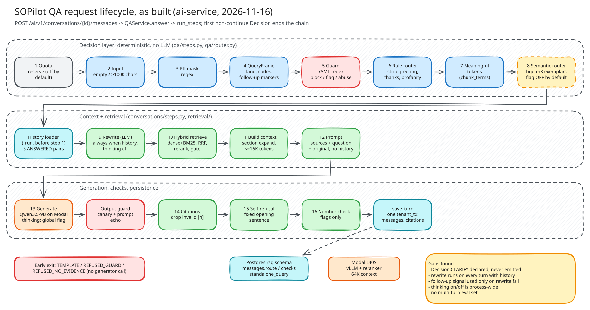
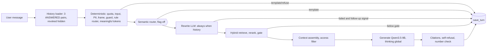
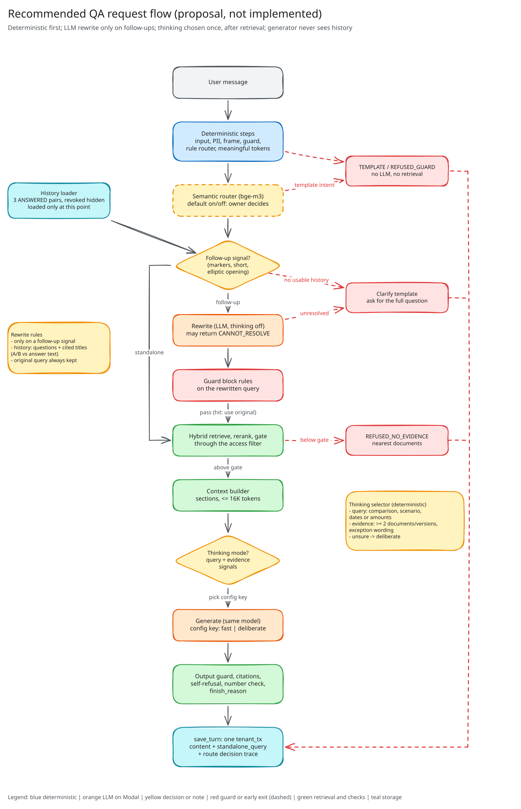

# RESEARCH-decision-layer-context-2026-11-16: Decision layer and conversation context

Date 2026-11-16. Branch `chore/infra-remove-legacy` at `680645f`. Scope: ai-service QA path only. Architecture evaluation only: no code, schema or configuration was changed for it. Diagram of the as-built path: §3.

Evidence levels used: **[code]** read in executable code; **[test-report]** a committed measurement; **[doc]** design text only; **[card]** model-card or vendor claim; **[secondary]** third-party page; **[estimate]** my engineering estimate; **[hypothesis]** untested. I read code; I did not run the unit suites or the stack.

---

## 1. Executive summary

SOPilot already has the right *shape*: a deterministic, auditable decision chain (`qa/pipeline.py` `run_steps`, first non-`continue` decision wins), one optional LLM rewrite, hybrid retrieval with a loose gate, a generator that never sees conversation history (D5), and history that is filtered for revoked access before reuse. That shape is a better fit for a 9B self-hosted model and a research claim about tenant isolation than any memory-heavy or classifier-heavy design.

The real weaknesses are narrow and measurable:

1. **Multi-turn handling is unmeasured and unconditional.** Every turn with history pays an LLM rewrite call (`RewriteStep`), standalone questions included, with no topic-switch control and no multi-turn eval set. The follow-up detector (`QueryFrame.followup_signal`) is only used *after* a failed rewrite.
2. **Clarification exists in the type, not in behaviour.** `DecisionKind.CLARIFY` is never emitted; the only ask-back is `followup_clarify` on rewrite failure.
3. **Recall of non-SOP intents is low, but misses are cheap.** On the routing test split (rules + semantic router): SOP misroute 0/53, costly errors 0, but greeting recall 0.61, about_bot 0.19, off_topic 0.21, harmful 0.22 [test-report `eval/results/routing/routing-rules-router-test/metrics.json`]. Misses fall through to RAG and end in a `NO_EVIDENCE` card, which the design accepts.
4. **Thinking is a process-wide switch.** `SOPILOT_LLM_THINKING` sets `enable_thinking` once per chain at startup; there is no per-request control, and no recorded quality measurement of thinking on vs off.
5. **The rewritten query bypasses the guard.** The guard runs on the masked user text; the rewrite output (built partly from earlier assistant answers, which contain document text) goes to retrieval and into the generator's user message unchecked.
6. **Truncation is invisible.** Reasoning and answer share 3,000 output tokens, and `finish_reason` is never read, so a cut-off answer is stored as `ANSWERED`.

**Recommendation (smallest architecture that fixes these):** keep the deterministic chain and the single generator model; do **not** add a shared multi-head encoder, summarization, semantic history retrieval or structured memory now. Change four things inside ai-service, with no schema migration:

- gate the rewrite on deterministic follow-up signals and let the same rewrite call return "cannot resolve" → a real clarify branch;
- run the guard's block rules on the rewritten query;
- decide thinking on/off **once, after retrieval**, from deterministic query and evidence signals, mapped to two pre-declared generator configs. Do this only if a benchmark shows thinking helps specific question classes;
- build a multi-turn eval set first, so each change is measured.

ML classifiers (prompt-injection guard, linear heads on the bge-m3 vectors the router already computes) are future work in shadow mode, adopted only on measured gains.

---

## 2. Current-state assessment (repository evidence)

| # | Finding | Evidence | Status |
|---|---|---|---|
| 1 | QA runs entirely in ai-service: `POST /ai/v1/conversations/{id}/messages` → `QAService.answer` (SSE). core-api is not on the QA path. | `api/conversations.py`; `conversations/service.py` `QAService.answer`; frontend calls ai-service (`frontend/web/lib/api/endpoints.ts`); no conversation code in `services/core-api/src/main` | Implemented, verified [code] |
| 2 | Step chain order: quota → input → pii → frame → guard → router → meaningful_tokens → semantic_router (flag) → rewrite → retrieve_and_gate → build_context → build_prompt → generate_and_stream → citations → self_refusal → number_check. | `qa/pipeline.py` `STEP_ORDER`; `QAService.steps` | Implemented, verified [code] |
| 3 | Conversations are created lazily: a new id is minted and the conversation, USER and ASSISTANT rows, citations, retrieval results and guard events are written in **one** `tenant_tx` after the chain ends; `citations`/`done` are sent only after the write. Client abort → `ERROR` row with `route.aborted`. | `QAService.answer`, `_record`, `_store_aborted`; `repository.save_turn` | Implemented, verified [code] |
| 4 | History = last 3 `ANSWERED` (question, answer) pairs, oldest first, PII-masked; pairs whose answer used a now-unreadable document are dropped (`hidden_answers`, context_sources ∪ citations). Loaded in `_run` **before step 1**, even for questions a template will answer. | `service.py` `HISTORY_TURNS=3`, `_run`; `repository.recent_turns`, `hidden_answers` | Implemented, verified [code] |
| 5 | History selection is by count, not tokens. The rewrite prompt cuts each answer to 600 chars and strips `[n]`. Upper bound ≈ 3×(1000+600) chars + question. | `qa/prompt.py` `MAX_HISTORY_ANSWER_CHARS`, `build_rewrite_prompt` | Implemented; bounded but not token-aware |
| 6 | Rewrite runs on **every** turn that has history (no conditional gate), `temperature=0`, thinking off, max 200 output tokens. Output is cleaned (first line, prefix/quotes stripped, rejected if > 1000 chars). | `steps.py` `RewriteStep`; `models.yaml` `llm.rewrite` | Implemented, verified [code] |
| 7 | Follow-up detection: `followup_marker` (VI/EN demonstratives, `followup_rules.yaml`, owner draft) or `short` (< 4 tokens). Used **only** when the rewrite fails → `followup_clarify` template. Also recorded in `route.signals`. | `qa/query_frame.py`; `RewriteStep` | Partially implemented |
| 8 | `DecisionKind.CLARIFY` is declared; no step emits it. | `qa/pipeline.py` docstring + enum; design §7.1 | Documented/planned, not implemented |
| 9 | Input guard: YAML regex on two views (lowercase NFC; and folded + leetspeak-undone), block (prompt reveal, override, fake role, threat/self-harm/harassment), flag (role-play, skip steps, other workspace), whole-token profanity lists incl. `standalone_only`. Profanity never blocks: "strip then judge". | `qa/guard.py` `inspect`; `qa/guard_rules.yaml` | Implemented, verified [code] |
| 10 | Guard input = PII-masked current question only. Not applied to the rewritten query, history, or document text. | `GuardStep` reads `frame.text`; `RewriteStep` output unchecked | Implemented (gap) |
| 11 | Rule router strips greeting/thanks/about-bot/profanity tokens and decides on the remainder; meaningful tokens via `rag.chunk_terms` through the access filter + lexicon. | `qa/router.py` `strip_words`, `judge`; `FrameStep` `known_terms` | Implemented, verified [code] |
| 12 | Semantic router: bge-m3 cosine vs exemplars (`router_exemplars.yaml`), threshold 0.75 / margin 0.05; template, disclaimer, `about_source`, `off_topic` (only acts after the gate refuses). **Off by default** (`SOPILOT_SEMANTIC_ROUTER_ENABLED=false`). Vector reused for dense retrieval only without history and unchanged text. | `qa/router.py` `SemanticLayer`; `steps.py` `SemanticRouterStep`, `RetrieveStep`; `config.py` | Implemented, behind flag |
| 13 | Routing test split: SOP misroute 0.0, acceptance passed, router p50 102 ms / p95 121 ms (local CPU embedding). Follow-up rows: "not measured here". | `eval/results/routing/routing-rules-router-test/metrics.json` | Measured [test-report] |
| 14 | Guard E2E (real stack, 2026-11-15): Chromium chat 23 pass, 6 gap, 2 fail. Gaps include typo greetings, "ngu quá", off-topic weather/poem; fails are derived-number and safety-number answers (generation, not guard). | `docs/quality/evidence/guard-tests/results.md` | Measured [test-report] |
| 15 | Retrieval: dense + BM25 → RRF → optional rerank (bge-reranker-v2-m3, Modal) → gate on best candidate (loose placeholder thresholds). Below gate → `NO_EVIDENCE`, or `OUT_OF_SCOPE` if the router said `off_topic`. | `retrieval/retriever.py`; `RetrieveStep` | Implemented, verified [code] |
| 16 | Context: hit chunks widened to same-section groups through the access filter, ≤ 16K tokens, capped by the chain's context budget. | `BuildContextStep`; `retrieval/context.py`; `models.yaml` `retrieval.context` | Implemented, verified [code] |
| 17 | Prompt: system rules + canary + `<source>` tags; user message = rewritten question + `Câu gốc:` original when different. **No history to the generator** (D5). | `qa/prompt.py` `build_prompt`; `BuildPromptStep` | Implemented, verified [code] |
| 18 | Generator: Qwen3.5-9B FP8 on vLLM (Modal L40S, 64K), thinking on by default; `<think>` split client-side (no server reasoning parser); reasoning streamed with its own output guard; answer guard = canary + prompt echo. | `infrastructure/modal/serve_vllm.py`; `providers/llm.py` `ThinkSplitter`, `LLMSpec.thinking`; `GenerateStep`, `_ThoughtStream` | Implemented, verified [code] |
| 19 | Thinking control is fixed per chain at startup (`extra_body` in a frozen `LLMSpec`); no per-request override path. Reasoning shares `max_output_tokens=3000` with the answer. | `providers/llm.py` `LLMSpec`, `_body`, `build_chain`; `models.yaml` | Implemented (limitation) |
| 20 | Thinking quality/latency trade-off: a bench script exists; no recorded result found in docs. ADR-011 §5 TTFT figures are thinking **off**. | `infrastructure/modal/bench_thinking.py`; ADR-011 §5 caveats | Unknown / not verifiable |
| 21 | Post-generation: invalid `[n]` dropped, self-refusal detection, number/date check (flags only), disclaimers appended for disclaimer intents. | `CitationStep`, `SelfRefusalStep`, `NumberCheckStep`; `QAService._outcome` | Implemented, verified [code] |
| 22 | Persisted per assistant message: `standalone_query`, `rewrite_status` (CHECK `NONE|OK|FAILED`), `route` jsonb (signals, layer, semantic, gate, steps, llmCalls), `checks`, `context_sources`, timings. `tokens_in/out` stay NULL (no usage from stream). | `V003__rag_tables.sql` `rag.messages`; `_record` | Implemented, verified [code] |
| 23 | `router.SemanticRouter` Protocol (V2-10 hook) is superseded by `SemanticLayer` and has no caller in the QA path. | `qa/router.py` | Likely dead code (did not grep eval for callers) |
| 24 | No summarization, semantic history retrieval, structured memory, or answer cache. RAPTOR/summary trees explicitly rejected. | design §12a; absence in code | Not implemented (by design) |
| 25 | No multi-turn evaluation dataset (routing set marks follow-ups as unmeasured). | `eval/datasets/routing`; `metrics.json` note | Missing evidence |

Doc/code consistency: §7.1 of TECH-V2-ai-service matches the code on the points above (clarify unused, 3 ANSWERED pairs, no history to generator, reasoning not persisted). The doc numbers steps 1–12; the code names 16 steps. This is a labelling difference, not drift.

---

## 3. Actual end-to-end lifecycle

1. `QAService.open` — new conversation id (not yet stored) or ownership check (`404`-equivalent if not the caller's).
2. `answer` emits `meta`; `_run` loads history (3 ANSWERED, non-hidden, PII-masked pairs) if the conversation exists.
3. Deterministic steps 1–7 (quota, input, PII, frame, guard, rule router, meaningful tokens). Any can end the turn with a template or refusal; no LLM.
4. Semantic router (if enabled): template/about_source exit, disclaimer marking, or `off_topic` candidate.
5. Rewrite (LLM) if history exists; failure + follow-up signal → `followup_clarify`.
6. Retrieval on `ctx.query` = rewritten ‖ stripped ‖ masked; gate → `NO_EVIDENCE` / `OUT_OF_SCOPE`.
7. Context assembly through the access filter; empty → `NO_EVIDENCE`.
8. Prompt (no history), generation streamed through the output guard (thinking per global flag).
9. Citations, self-refusal, number check.
10. One transaction writes the turn; then `citations`, `done` (or `error`).



Source: [qa-lifecycle-current.excalidraw](../architecture/diagrams/qa-lifecycle-current.excalidraw) (generator `scripts/diagrams/generators/qa_lifecycle_current.py`)

<details><summary>Diagram source (text)</summary>



</details>

---

## 4. Query decision layer evaluation

### 4.1 Input guard

- **Current approach fits the main risk.** Direct injection in SOP Q&A is mostly "reveal/ignore your instructions" phrasing, which narrow regexes catch with very low false positives on SOP vocabulary (the rules were deliberately narrowed: "quy tắc nội bộ", "tắt bộ lọc spam"). The two-view matching handles unaccented Vietnamese and leetspeak; raw-view rules handle the diacritic collisions ("ẩn"/"an", "từ từ"/"tự tử").
- **Weak points:** paraphrased or translated injections and Unicode tricks beyond NFC (zero-width characters, homoglyphs: NFC does not fold Cyrillic "о"). Harm recall on the routing test is 0.22 (2/9) [test-report], which is small-sample but consistent with regex limits.
- **Frustrated users:** "strip then judge" is the right policy and should stay deterministic. Profanity never blocks, the question is answered on what remains, and the prompt asks for a neutral tone. A toxicity classifier would add false blocks without benefit, because blocking abusive-but-answerable questions is not a product goal.
- **Indirect injection** (instructions inside SOP documents) is the more realistic enterprise threat. Today the defences are structural: sources in escaped `<source>` tags, rules say use only source content, canary + echo output guard. That is reasonable; an input classifier on the user text does not address it.
- **Categories need different handling, not necessarily different models:** injection → block; real harm → block with support contact; profanity → strip; off-topic → only after gate. A single generative guard (e.g. Qwen3Guard) covers harm categories but not "strip then judge" semantics.

**Recommendation:** keep regex as the blocking layer (Already implemented). Add a Unicode hardening pass in normalization (zero-width removal, NFKC for compatibility forms, a small confusables map) (Requires modification, small). Run the block rules on the rewritten query too (Requires modification; §7). Evaluate one ML injection classifier offline in shadow mode (Future enhancement).

### 4.2 Intent clarification

- Follow-up ≠ ambiguous. Today the system conflates them only in the failure branch. Real cases:
  - standalone question (no history needed) → proceed;
  - follow-up that history resolves → rewrite → proceed;
  - follow-up that history cannot resolve ("còn cái kia?" after an unrelated turn, or no ANSWERED turn) → clarify;
  - standalone but under-specified ("quy trình phê duyệt là gì?" with 6 approval SOPs) → this is an **evidence** ambiguity, visible only after retrieval (top hits spread across many documents with similar scores).
- **Recommendation:** (a) let the existing rewrite call emit a sentinel (`CANNOT_RESOLVE`) when the reference has no antecedent, mapped to the existing `followup_clarify` template. No extra call (Requires modification). (b) A follow-up signal with **no** usable history (new conversation, or all history hidden/refused) → clarify directly, no retrieval on a fragment (Requires modification; today it goes to retrieval). (c) Retrieval-side ambiguity ("which of these documents?") is a later feature: use deterministic evidence spread (top-k from ≥3 distinct documents, scores within a small margin, no doc code in query) to *append* a "did you mean document X or Y" line rather than refuse (Future enhancement; needs UX decision).

### 4.3 Query routing

| Route | Mechanism now | Should be |
|---|---|---|
| Greeting / thanks / about-bot / abuse-only | rules (+ semantic) | keep deterministic; semantic router optional |
| SOP RAG | default fall-through | keep as default (fail-open to RAG is correct: the gate + self-refusal backstop it) |
| Out-of-scope | semantic `off_topic` **and** gate refused | keep (D1 is sound: router cannot know the corpus) |
| About previous source | semantic `about_source` | keep; deterministic phrasing rules could also catch "nguồn nào?" |
| Disclaimer intents | semantic | keep behind flag; recall 0.08–0.14 on test means it rarely fires |
| Document management ("upload", "delete my doc") | not routed | product has no chat actions; `action_request` disclaimer suffices |

Enabling the semantic router is a cheap recall win with measured zero SOP misroute on the test split, costing about 100 ms CPU per question [test-report]. It does not justify a new model. Owner decision (§17).

### 4.4 Conditional rewriting

Problems with unconditional rewriting: an extra LLM round trip on every multi-turn question (latency, Modal load); **topic contamination**, where the model can merge a fresh standalone question with the previous topic; previous **assistant answers** (document-derived text) leak into the retrieval query.

Recommended gate (deterministic, from `QueryFrame` + history):

```
rewrite if history and (
    followup_marker                       # explicit reference
    or short                              # < N tokens fragment
    or (no doc_code and meaningful_count <= K and has_elliptic_opening)   # "còn ... thì sao", "and for ..."
)
else: skip rewrite, retrieve on the original (route.rewrite = {skipped: true, why})
```

- Keep the original query: already done (`messages.content` + `Câu gốc:` in prompt) (Already implemented).
- Return to an older topic: only within the 3-pair window; beyond it the user is asked (via `CANNOT_RESOLVE`). Acceptable for SOP lookup sessions [hypothesis; measure turn-length distribution].
- Corrections ("không, ý tôi là nghỉ ốm"): the rewrite sees the last pairs, so it handles them if the marker gate fires ("không", "ý tôi là" should be added to `followup_rules.yaml`).
- **Reduce assistant-answer influence:** A/B a history format of *user questions + cited document titles/sections of the answer* (from `message_citations`, already access-filtered by `previous_sources`-style queries) instead of 600 chars of answer text. Fewer tokens, no document text in the rewrite, revocation-safe. Measure on the multi-turn set (New capability, small).
- Risk of the gate: implicit follow-ups without markers ("thời hạn bao lâu?" after a leave question) skip the rewrite and retrieve generically. Mitigation: the "short" rule plus an evidence fallback, where a rewrite-skipped query that falls below the gate retries once with the rewrite. That fallback costs one LLM call only on failures (Requires modification; measure before adding).

---

## 5. Reasoning effort / thinking configuration

**Facts.** Qwen3.5-9B on vLLM; thinking is toggled by `chat_template_kwargs.enable_thinking`. vLLM documents request-level `chat_template_kwargs` overriding the server default, and a `thinking_token_budget` sampling parameter that needs reasoning boundary tokens, normally from `--reasoning-parser` [vLLM docs, secondary to this repo]. The deployed server runs **without** a reasoning parser (design §10 note; `ThinkSplitter`), so a token budget is **not available** without a serving change, and the combination with Qwen3.5 on vLLM 0.33 is unverified. Today's code cannot vary thinking per request (`LLMSpec` fixed per chain).

**Key structural point.** The generator is the only LLM call after retrieval, and the rewrite already runs with thinking off. A pre-retrieval "Stage 1" prediction therefore has nothing to configure: the one configuration choice that matters is made right before `GenerateStep`, when the query signals **and** the evidence are both known. Two-stage routing collapses to **one deterministic decision after context assembly**, with no switching.

**Taxonomy.** "Minimal" is already served by templates (no generator call). The useful taxonomy is binary: **`fast` (thinking off)** vs **`deliberate` (thinking on)**. Four levels need a budget control the server does not have, and an evidence base nobody has measured.

**Signals (deterministic):**
- query: `frame.comparison`, scenario markers ("nếu", "trường hợp", "if", "in case"), dates/amounts present (`frame.dates/amounts`), multi-part (≥2 question marks or conjunction lists);
- evidence: sources from ≥2 distinct documents or versions, section text containing exception markers ("trừ trường hợp", "ngoại lệ", "except", "unless"), context tokens above a threshold.

Rule: `deliberate` if any query signal, or ≥2 evidence signals; else `fast`. Independent of rewrite status, answer length and chunk count alone (as the brief requires).

**Configuration mapping.** Declare two generator configs in `models.yaml` (e.g. `generate` and `generate_fast`, same endpoint, different `extra_body` and `max_output_tokens`). The decision picks a **key**, never a model name or free parameters. Fallbacks: unsupported/failed config → the default `generate` (thinking on, today's behaviour); low confidence → `deliberate` (quality over cost); model unavailable → existing `LLM_UNAVAILABLE` path. Retrieval, gate, citation checks and number checks run identically in both modes.

**Gate on evidence first.** Run `bench_thinking.py` (exists) on the dev split, grouped by the signals above, measuring answer correctness and first-answer latency. If thinking does not help simple lookups measurably, or hurts latency badly, ship the switch; if thinking helps everywhere, keep it always on and skip the feature. Guard test 10b (derived arithmetic) failed *with* thinking on, so thinking is not a fix for arithmetic either.

Classification: Requires modification (provider: per-call `extra_body` or a second chain; one step), conditional on the benchmark.

---

## 6. Conversation context management

| Strategy | Verdict for SOPilot now | Reason |
|---|---|---|
| A. Token-aware recent window | **Modify lightly**: keep 3 pairs, add a token cap on the rewrite prompt (already bounded ≈ ≤ 3K tokens by the 2-chars/token estimate) | Count window is adequate because only the rewrite consumes history |
| B. Summarization / compaction | **Reject for MVP** | Generator does not use history (D5); a summary is a new derived artifact that must be re-hidden on revocation (aggregates several answers' sources), adds an LLM call and drift; no evidence of long sessions |
| C. Semantic retrieval of past turns | **Reject** | Would need history embeddings (new index or reuse of `rag` vectors with a new kind), per-user scope, revocation handling; benefit only for "return to topic from 10 turns ago" |
| D. Structured memory (facts, preferences) | **Reject** | SOP answers must come from current documents; user "facts" (role, department) already come from the token/ACL; model-derived assumptions would contradict "history is not evidence" |
| E. Contextual query understanding | **Keep, make conditional** (§4.4) | Core of follow-up support |
| F. Context builder | **Already implemented** as `BuildContextStep` + `build_prompt`; keep as a logical component, no service | Owns sources, budget, ordering, escaping |
| G. Hierarchical memory | **Reject** | Complexity without a use case |

Revisit B only if logs show a meaningful share of conversations > 6 ANSWERED turns where users refer back beyond the window (measure from `rag.messages`).

---

## 7. Interaction and integration: answers to the 12 questions

1. **Raw input only:** input validity, PII masking, guard block rules, rule router, meaningful tokens, semantic router (masked original).
2. **Need conversation context:** follow-up resolvability, rewrite, `about_source`.
3. **Use retrieval results:** gate/no-evidence, out-of-scope confirmation, thinking mode, evidence ambiguity (future).
4. **Guard views:** the user's raw (masked) text for all rules, **plus** block rules on the rewritten query (it is system-produced text containing fragments of earlier answers). History is not re-guarded: its questions were guarded when asked, and its answers passed the output guard. Hit on the rewrite → discard it and use the original.
5. **Routing before rewriting:** yes, as now. Template intents must not cost an LLM call, and the router uses the original wording. Exception: `about_source` already uses history directly.
6. **Keep both queries:** yes, as now (`content`, `standalone_query`, `Câu gốc:`).
7. **Past assistant answers:** they may shape the *retrieval query* (entity resolution) only. Never generator evidence (keep D5). Prefer cited titles over answer text (§4.4 A/B). Revocation filter must apply (already does).
8. **Share one inference:** follow-up resolvability + rewrite + clarify sentinel share the rewrite call. Route intents share the one bge-m3 vector (already reused for dense retrieval when possible).
9. **Separate inference:** guard (raw text, must be fast and deterministic) vs rewrite (needs history) vs generation (needs sources). Different inputs, so no merging.
10. **Reasoning effort:** after retrieval only (§5).
11. **Uncertainty:** unresolved reference → clarify; low gate → `NO_EVIDENCE` with nearest documents; ambiguous evidence → answer with explicit alternatives (future); thinking classifier unsure → `deliberate`.
12. **Stay deterministic:** authorization and the access filter, PII, guard blocking, quota, the gate threshold, citation validation, template exits, the config mapping, and the clarify decision on rewrite sentinel/failure.

### Recommended request flow



Source: [qa-lifecycle-recommended.excalidraw](../architecture/diagrams/qa-lifecycle-recommended.excalidraw) (generator `scripts/diagrams/generators/qa_lifecycle_recommended.py`)

History loading should also move after the deterministic steps (load only when a turn reaches the follow-up check): saves two queries on template turns. Small and optional.

---

## 8. Comparison matrices

Scores: ++ strong, + adequate, 0 neutral, − weak, −− poor. Evidence column marks what backs the rating.

### 8.1 Query decision layer

| Criterion | A. Rules only (now, router off) | B. Rules + bge-m3 exemplar router (flag on) | C. Rules + linear heads on bge-m3 vectors | D. Shared new encoder (mmBERT/GLiNER2) multi-head | E. LLM classifier call |
|---|---|---|---|---|---|
| SOP misroute safety | ++ [test-report] | ++ 0/53 [test-report] | + [hypothesis] | ? | − (LLM variance) |
| Non-SOP recall | −− | − (0.08–0.61) | + [hypothesis] | + [hypothesis] | ++ [hypothesis] |
| VI/EN, unaccented | + rules both views | + bge-m3 multilingual | + | ? per model | + |
| Latency / cost | ++ ~0 | + ~100 ms CPU | + same vector | − second encoder | −− extra Modal call |
| Infra | ++ | ++ (already loaded) | ++ | − new model, runtime | − |
| Training data need | none | exemplars | ~390 labelled rows now; more needed | larger per head | prompt only |
| Testability / audit | ++ | + | + | 0 | − |
| **Verdict** | baseline | **enable (owner)** | future | reject now | reject |

### 8.2 Reasoning effort routing

| Criterion | Always on (now) | Always off | Deterministic post-retrieval switch | Two-stage ML classifier |
|---|---|---|---|---|
| Quality on complex questions | + [hypothesis] | − [hypothesis] | + | + |
| Latency on simple questions | − (reasoning before answer) | ++ | + | + |
| Complexity | ++ | ++ | + (one step, one config key) | −− (labels, model, calibration) |
| Server support | ✓ | ✓ | ✓ per-request kwargs [vLLM docs] | ✓ |
| Evidence | none recorded | none | needs bench | needs labels |
| **Verdict** | keep until bench | — | **adopt if bench shows a gap** | reject |

### 8.3 Context management

| Criterion | 3-pair window + rewrite (now) | + conditional gate + clarify sentinel + titles-only history | + rolling summary | + semantic history retrieval | + structured memory |
|---|---|---|---|---|---|
| Follow-up support | + | + | + | + | 0 |
| Topic switch | − | + | − | + | 0 |
| Long conversations | − | − | + | ++ | + |
| Correction handling | + | + | − (stale summary) | 0 | − |
| Grounding safety | ++ (no history to generator) | ++ | + | + | − |
| Revocation safety | ++ (hidden filter) | ++ | − new artifact | − | −− |
| Tokens / latency | − one call per turn | + calls only on follow-ups | − | − | − |
| Complexity | ++ | + | − | −− | −− |
| **Verdict** | baseline | **adopt** | reject | reject | reject |

### 8.4 Integrated alternatives

| Alternative | Description | Verdict |
|---|---|---|
| I1 Status quo | as built | works; misses multi-turn efficiency and measurement |
| **I2 Deterministic-first, minimal changes** | §7 flow: conditional rewrite + clarify sentinel, guard on rewrite, post-retrieval thinking switch, multi-turn eval | **recommended** |
| I3 Decision-model stack | shared encoder for guard/intent/follow-up/effort + rules | premature: no labelled data, new runtime, unclear gain |
| I4 Agentic LLM router | one LLM call decides route, rewrite, effort | adds a sequential Modal call to every question; weak auditability; conflicts with "no LLM where rules suffice" |
| I5 Memory-rich assistant | summaries + memory + history retrieval | contradicts D5 and the revocation model; no use case |

---

## 9. Recommended architecture

I2. Classification of each element:

| Element | Class |
|---|---|
| Deterministic chain, `Decision` model, single write per turn | Already implemented |
| Regex guard with two views, strip-then-judge | Already implemented |
| Unicode hardening (zero-width, NFKC, confusables) | Requires modification |
| Guard block rules on rewritten query | Requires modification |
| Semantic router on by default | Already implemented (config/owner) |
| Conditional rewrite gate | Requires modification |
| `CANNOT_RESOLVE` sentinel → clarify; follow-up without history → clarify | Requires modification |
| History as questions + cited titles (A/B) | New capability (small) |
| Post-retrieval thinking switch, two config keys | Requires modification (conditional on bench) |
| Multi-turn eval set, thinking bench by class | New capability (eval) |
| Evidence-ambiguity hint ("document X or Y?") | Future enhancement |
| Linear heads on bge-m3 vectors; ML injection guard in shadow mode | Future enhancement |
| Summaries, history retrieval, structured memory, new encoder | Rejected for now |

## 10. Component responsibilities

| Component | Owns | Does not |
|---|---|---|
| `GuardStep` (+ check on rewrite) | block/flag/abuse on user text and on the rewrite | judge relevance |
| Rule/semantic router | template intents, disclaimers, off-topic candidate | refuse SOP questions; read history (except `about_source`) |
| Follow-up gate (new, in `RewriteStep`) | decide skip / rewrite / clarify from frame + history presence | call retrieval |
| `RewriteStep` | standalone query or `CANNOT_RESOLVE` | answer; add facts |
| `RetrieveStep` | candidates, gate, nearest documents | use history |
| `BuildContextStep` | source selection under budget, access re-check | use history |
| Thinking selector (new, after context) | choose `fast`/`deliberate` key | choose models or parameters |
| `GenerateStep` | stream answer with guard | see history |
| Post-checks | citation validity, self-refusal, numbers | edit answer text (except invalid markers) |
| `save_turn` | one transaction, decision trace in `route` | — |

## 11. Service ownership

Everything here stays in **ai-service** (schema `rag`, ADR-004): history, decisions, rewrite, retrieval, generation, persistence. core-api is unaffected: no new endpoint, no outbox event. Frontend: only if the clarify template needs distinct rendering. It is already a `TEMPLATE` with `refusal_reason = INPUT_INVALID`, so probably no change.

## 12. Data model and API implications

- **No migration for MVP.** Record decisions in existing jsonb: `route.rewrite = {skipped, reason}`, `route.thinking = {mode, signals}`, `route.clarify = {reason}`. Keep `rewrite_status` as `NONE` for skipped rewrites: adding `SKIPPED` would need a new Flyway file changing the CHECK. Owner may prefer that for analytics.
- `models.yaml`: a second generator config key (`generate_fast`).
- SSE: unchanged. Optional `meta.thinking` flag so the UI can hide the reasoning dropdown.
- `followup_rules.yaml`: add correction markers ("không,", "ý tôi là", "I mean").

## 13. Security, authorization and grounding safeguards

- Keep D5: generator receives sources + current question (+ original) only. Historical answers never become evidence; newer SOP versions win automatically because evidence is always re-retrieved.
- Keep `hidden_answers` filtering at history load. Any future derived artifact (summary, memory) must carry source document ids and pass the same check at read time. That cost is the main reason to avoid such artifacts.
- No answer cache. A cache keyed by question would bypass per-user ACLs and versioning.
- Guard on the rewritten query closes the path "document text in earlier answer → rewrite → generator user message".
- Thinking mode never changes retrieval, gate, access filter, citation validation or number checks.
- Indirect injection: keep escaped `<source>` tags + canary/echo guard. Consider adding an `inject.*` scan of **chunks at ingest** as a flag (not block) for the owner, as a future item.

## 14. Token budget and performance

- Rewrite prompt ≤ ~3K tokens [estimate from 2 chars/token bound]; 200 output tokens. Skipping it on standalone turns removes one sequential Modal round trip per such turn. The magnitude is unmeasured: ADR-011 gives TTFT 1.64 s at 8K prompts, thinking off, so a ~3K-token rewrite is plausibly ≤ ~1.5 s warm [estimate].
- Generator: ≤ 16K source tokens (budget choice, not evaluated, ADR-011). Thinking shares `max_output_tokens=3000` with the answer. Long reasoning can truncate answers, and **`finish_reason` is not read anywhere in `services/ai-service/src`** [code, grep], so a truncated answer is stored as `ANSWERED` silently. Recommend recording `finish_reason` in `checks` and warning on `length` (Requires modification, small). This matters more with thinking on.
- Semantic router ~100 ms p50 CPU [test-report]; dense retrieval reuses the vector when there is no history.
- No hardware latency target is guaranteed beyond ADR-011's measured TTFT (thinking off).

## 15. Phased adoption

| Phase | Content | Exit criterion |
|---|---|---|
| 0 Measure | multi-turn eval set (≈60–100 conversations: standalone-after-history, explicit ref, implicit ref, topic switch, return to older topic, correction, unresolvable, revoked-source history); thinking bench by question class on dev split; extend guard set with obfuscation/unaccented/paraphrase cases | baselines recorded |
| 1 MVP fixes | conditional rewrite gate; `CANNOT_RESOLVE` + no-history clarify; guard on rewrite; Unicode hardening; decision trace in `route`; owner decision on semantic router default | multi-turn resolution ≥ baseline, rewrite calls ↓, no SOP misroute increase |
| 2 Thinking switch | two config keys + post-retrieval selector, only if Phase 0 shows a class-dependent gain | simple-class latency ↓ with no correctness loss on complex class |
| 3 Future | titles-only history if A/B wins; evidence-ambiguity hint; linear heads on bge-m3; ML injection guard shadow scoring | each beats the rules on held-out test with FP on SOP questions ≤ 2% |

## 16. Testing and evaluation plan

- **Unit:** follow-up gate truth table; sentinel parsing in `clean_rewrite`; guard-on-rewrite fallback; thinking selector signals → key; config key resolution and fallback.
- **Integration (pytest, stack):** history with revoked document is excluded from rewrite (exists in spirit, extend for the titles-only format); clarify path stores `TEMPLATE/INPUT_INVALID`.
- **Eval:** multi-turn set metrics: resolution accuracy (standalone query judged correct), contamination rate (standalone question rewritten into another topic), clarify precision/recall, retrieval hit@k on rewritten vs original, rewrite-call rate. Routing set unchanged (SOP misroute ≤ 0.02). Thinking: answer correctness and `first_answer` latency per class.
- **Guard:** separate tuning and held-out sets (already the policy); report FP on SOP corpus questions.
- Isolation suite unchanged (no new tenant-table access patterns, except reading `message_citations` titles through the existing access CTE).

## 17. Candidate model notes (none recommended for the blocking path now)

| Candidate | Facts found | Fit |
|---|---|---|
| Llama Prompt Guard 2 86M | mDeBERTa-base, multilingual; gated under the Llama 4 Community License [secondary: Mozilla any-guardrail, Groq docs]; Vietnamese not in any language list found | shadow-test candidate for injection; license acceptance needed; VI unverified |
| Horizon-Labs prompt-injection-guard-small | mmBERT-small base, Apache-2.0; scores only on Horizon's own suite [secondary: derivative model card] | shadow-test candidate; no independent benchmark |
| Horizon-Labs multilingual-zeroshot-* | zero-shot NLI-style, Apache-2.0, large on bge-m3 [secondary aggregator] | not a guard; overlaps with exemplar router |
| Qwen3Guard-Gen-0.6B | Apache-2.0, 119 languages claimed, Safe/Controversial/Unsafe [card, arXiv 2510.14276]; generative, ~0.6–0.75B | harm categories; slow-ish on CPU [estimate]; VI unmeasured |
| GLiNER2.5-multi-Decide | 287M, mDeBERTa-v3-base, classification API [GitHub wiki]; Apache-2.0 only from a secondary listing | zero-shot intent; second encoder; untested on VI |
| mmBERT-small | 140M (42M non-embedding), MIT, 1800+ languages [card, paper 2509.06888] | backbone if fine-tuning ever needed; no VI task head |
| laya-vi | Apache-2.0, trained on Vietnamese *business decisions*, self-reported 0.89 [card] | task mismatch (not intent/guard) |
| PhoBERT ViHSD classifiers | CLEAN/OFFENSIVE/HATE; macro-F1 ~0.80 self-reported [card]; social-media domain; UIT datasets often research-only | wrong goal (we strip, not block); license risk |
| mDeBERTa NLI zero-shot | one forward pass per label | slower and likely weaker than exemplar cosine [hypothesis] |
| ONNX Runtime / OpenVINO | only relevant once a new CPU encoder is added | not needed now |

Shared multi-head encoder: rejected for now. ~390 labelled routing rows, no labelled follow-up or effort data; heads would interfere and need calibration; it would add a second encoder beside bge-m3. The proportionate future path is **linear heads on the bge-m3 vector already computed by the router**: zero new runtime.

## 18. Decisions for the product owner

1. Enable `SOPILOT_SEMANTIC_ROUTER_ENABLED` by default (measured: 0 SOP misroute on test, ~100 ms CPU)?
2. Approve the conditional rewrite gate (skip rewrite on standalone questions), accepting some risk on implicit follow-ups until the multi-turn set measures it?
3. Approve a real clarify branch (`CANNOT_RESOLVE` sentinel; follow-up signal with no usable history → ask)?
4. A/B "questions + cited titles" instead of answer text as rewrite history?
5. Thinking: run the bench first, and keep "always on" unless it shows a class-dependent gain? Binary `fast`/`deliberate` only?
6. Record skipped rewrites as `rewrite_status = NONE` + `route.rewrite.skipped` (no migration) or add `SKIPPED` via a new migration?
7. Approve building the multi-turn eval set (Phase 0) before any implementation ticket?
8. Keep summaries, structured memory and history retrieval out of V2 scope (revisit only on measured long-session usage)?
9. Allow offline shadow evaluation of one ML injection guard (license review needed for Llama Prompt Guard 2)?
