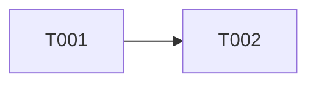

# <Title>

## 1. Goal and scope

## 2. Dependency graph

## 3. Tickets
| Ticket | Scope | Size | Depends on | Status |
|---|---|---|---|---|
| `TICKET-001` | core | M | - | todo |

## 4. Risks

## 5. Definition of done

## 6. Change log
> **Owner decision YYYY-MM-DD (affects TICKET-00N):** one line. The decision itself lives in its ADR or design.
